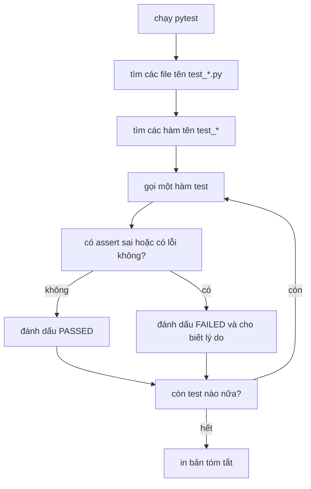
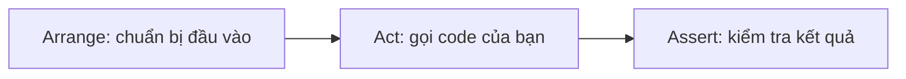

Code làm việc với AI model hiếm khi crash khi nó sai. Một prompt builder hỏng vẫn gửi đi một prompt, một hàm làm sạch văn bản hỏng vẫn trả về văn bản, và model vẫn trả lời, chỉ là tệ hơn. **Test** (kiểm thử) là những chương trình nhỏ tự kiểm tra code giúp bạn, để một lỗi âm thầm biến thành một thất bại màu đỏ rõ ràng. Công cụ chuẩn cho việc này trong Python là **pytest**.

## 1. Sao không chạy rồi nhìn kết quả?

Bạn có thể kiểm tra một hàm bằng cách in vài kết quả rồi đọc:

```python
def count_tokens(text):
    return len(text.split())


print(count_tokens("hello brave new world"))   # 4
print(count_tokens(""))                         # 0
print(count_tokens("a  b"))                     # 2
```

Cách này dùng được một lần. Nhưng tuần sau bạn sửa hàm, và phải chạy lại, đọc lại từng dòng, rồi nhớ mỗi con số lẽ ra là bao nhiêu. Một test ghi sẵn đáp án mong đợi xuống, để máy tính làm việc kiểm tra mỗi lần.

## 2. Test đầu tiên của bạn

Một test là một hàm có tên bắt đầu bằng `test_`. Bên trong, bạn gọi code của mình và dùng `assert`, một từ khóa mới: `assert condition` không làm gì khi điều kiện là `True`, và raise `AssertionError` (một exception, giống những cái trong bài về exception) khi điều kiện là `False`.

```python
def clean_text(text):
    return " ".join(text.split()).lower()


def test_clean_text_lowercases():
    assert clean_text("Hello") == "hello"


test_clean_text_lowercases()
print("no error means the test passed")   # no error means the test passed
```

Ở đây ta gọi test bằng tay. Với pytest thì không cần: bạn đặt test vào một file tên `test_something.py` (tên bắt đầu bằng `test_`) và pytest tự tìm, tự chạy mọi hàm `test_`.



Một test thất bại không làm dừng các test khác. Bạn nhận một dấu xanh hoặc đỏ cho mỗi test.

> [!NOTE]
> Các bài tập trong app này cũng được chấm bằng test kiểu pytest. Danh sách đỏ và xanh bên dưới code của bạn chính là bản báo cáo này.

## 3. Chạy pytest và đọc một thất bại

pytest là chương trình bạn chạy trong terminal (các lệnh này không chạy được trong app):

```bash
pytest
pytest -q
pytest -x
pytest -k clean
pytest test_clean.py
```

| lệnh | tác dụng |
|---|---|
| `pytest` | tìm và chạy mọi test trong thư mục hiện tại |
| `pytest -q` | quiet: in ngắn gọn hơn |
| `pytest -x` | dừng ở test thất bại đầu tiên |
| `pytest -k clean` | chỉ chạy các test có tên chứa `clean` |
| `pytest test_clean.py` | chạy một file |

Bây giờ là một hàm có lỗi: nó quên gộp các khoảng trắng lặp. Python thuần nói rất ít khi assert sai:

```python
def clean_text(text):
    return text.strip().lower()


assert clean_text("Hello   World") == "hello world"
# AssertionError
```

Khối này kết thúc bằng lỗi có chủ ý. Thông báo trống trơn. pytest thông minh hơn: nó nhìn vào bên trong `assert` và cho bạn thấy cả hai vế của phép so sánh.

```text
>       assert clean_text("Hello   World") == "hello world"
E       AssertionError: assert 'hello   world' == 'hello world'
E         - hello world
E         + hello   world

test_clean.py:5: AssertionError
FAILED test_clean.py::test_clean_text_collapses_spaces
1 failed, 1 passed in 0.02s
```

Hãy đọc từ dòng có `>`: nó đánh dấu dòng bị lỗi. Các dòng `E` cho biết hai vế là gì. Ở đây kết quả có ba dấu cách trong khi bạn mong đợi một. Bạn cũng có thể thêm thông báo của riêng mình sau dấu phẩy: `assert total == 6, "add every number, not just the last one"`.

## 4. Arrange, Act, Assert

Một test dễ đọc có ba bước. **Arrange** (chuẩn bị): tạo đầu vào. **Act** (thực hiện): gọi đoạn code cần test, đúng một lần. **Assert** (kiểm tra): so kết quả.



```python
def clean_text(text):
    return " ".join(text.split()).lower()


def test_clean_text_removes_extra_spaces():
    # Arrange
    raw = "  Hello    AI   World  "
    # Act
    cleaned = clean_text(raw)
    # Assert
    assert cleaned == "hello ai world"


test_clean_text_removes_extra_spaces()
print("passed")   # passed
```

Bấm **Visualize** ở khối code này để xem `raw` biến thành `cleaned` trước khi assert kiểm tra nó.

Hãy đặt tên mỗi test như một **câu** nói điều gì phải đúng. Khi một test thất bại, cái tên là thứ bạn đọc đầu tiên, nên nó phải kể được câu chuyện:

| tên tệ | tên tốt |
|---|---|
| `test_1` | `test_clean_text_removes_extra_spaces` |
| `test_empty` | `test_returns_zero_tokens_for_empty_text` |
| `test_error` | `test_negative_limit_raises_value_error` |

> [!TIP]
> Mỗi test chỉ nên kiểm một ý. Nếu `test_clean_text` có sáu assert và cái thứ ba sai, bạn sẽ không bao giờ biết ba cái sau có đúng hay không.

## 5. Nên test những gì

Một test cho trường hợp thuận lợi là chưa đủ. Lỗi thường nằm ở các rìa, nên lần nào cũng hãy nghĩ tới những đầu vào này:

| loại | câu hỏi | với `clean_text` |
|---|---|---|
| typical (điển hình) | trường hợp bình thường chạy đúng không? | `"Hello World"` |
| empty (rỗng) | nếu chẳng có gì thì sao? | `""` |
| boundary (biên) | trường hợp nhỏ nhất hoặc vừa chạm giới hạn là gì? | `"a"`, chỉ toàn dấu cách |
| odd input (đầu vào lạ) | còn gì khác trông giống đầu vào? | tab và xuống dòng |
| bad input (đầu vào sai) | cái gì phải bị từ chối? | ở phần kế tiếp |

```python
def clean_text(text):
    return " ".join(text.split()).lower()


def test_empty_text_stays_empty():
    assert clean_text("") == ""


def test_only_spaces_becomes_empty():
    assert clean_text("   ") == ""


def test_tabs_and_newlines_count_as_spaces():
    assert clean_text("a\tb\nc") == "a b c"


test_empty_text_stays_empty()
test_only_spaces_becomes_empty()
test_tabs_and_newlines_count_as_spaces()
print("3 passed")   # 3 passed
```

Khi gặp một lỗi ngoài đời thật, hãy viết trước một test thất bại vì lỗi đó, rồi mới sửa code. Test đó từ nay canh giữ để lỗi không quay lại.

## 6. Kiểm tra lỗi: `pytest.raises`

Có những đầu vào phải bị **từ chối**. Một hàm đọc điểm phải raise `ValueError` với `"abc"`. Đây là hàm đó, và một phép kiểm tra viết bằng `try/except` mà bạn đã biết:

```python
def parse_score(text):
    """Turn '8/10' into 0.8. Raise ValueError for anything else."""
    parts = text.split("/")
    if len(parts) != 2:
        raise ValueError(f"expected 'a/b', got {text}")
    return int(parts[0]) / int(parts[1])


try:
    parse_score("abc")
    print("no error: the test would FAIL")
except ValueError:
    print("ValueError: the test would PASS")   # ValueError: the test would PASS
```

pytest có cách ngắn hơn. `pytest.raises(ValueError)` là một khối `with` (như trong bài về file) mà test sẽ pass khi code bên trong raise đúng lỗi đó, và fail khi không raise:

```text
import pytest


def test_text_without_slash_raises_value_error():
    with pytest.raises(ValueError):
        parse_score("abc")
```

Khối ở trên là một file test, không phải để chạy trong app. Nếu `parse_score("abc")` trả về một con số, test sẽ thất bại với thông báo `DID NOT RAISE`.

## 7. Số thập phân: `pytest.approx`

Máy tính lưu số thập phân dưới dạng nhị phân, nên xuất hiện những sai số làm tròn rất nhỏ. Đừng bao giờ so sánh float bằng `==`:

```python
print(0.1 + 0.2)                        # 0.30000000000000004
print(0.1 + 0.2 == 0.3)                 # False
print(abs((0.1 + 0.2) - 0.3) < 1e-9)    # True
```

Dòng cuối là ý chính. Hàm có sẵn `abs(x)` trả về độ lớn của `x` mà bỏ dấu, nên `abs(a - b) < 1e-9` hỏi "khoảng cách giữa `a` và `b` có rất nhỏ không?" (`1e-9` là `0.000000001`). Hai float được xem là "bằng nhau" khi khoảng cách giữa chúng rất nhỏ. `pytest.approx` làm việc đó giúp bạn:

```text
import pytest


def test_one_third_is_about_0_333():
    assert parse_score("1/3") == pytest.approx(0.3333, abs=1e-3)
```

`abs=1e-3` nghĩa là "sai lệch trong vòng 0.001". Nếu không có nó, `approx` dùng một ngưỡng mặc định rất nhỏ, đủ cho hầu hết trường hợp.

| dùng cái này | khi nào |
|---|---|
| `assert a == b` | kết quả chính xác: string, int, list, dict |
| `with pytest.raises(E):` | code phải từ chối bằng lỗi `E` |
| `assert x == pytest.approx(y)` | kết quả là float |
| `@pytest.mark.parametrize` | cùng một phép kiểm tra cho nhiều đầu vào (phần kế tiếp) |

## 8. Nhiều case, một test: `parametrize`

Viết năm test gần giống hệt nhau thì chán. `parametrize` chạy một hàm test một lần cho mỗi dòng của một bảng. Dòng bắt đầu bằng `@` là một **decorator** (bộ trang trí): nó gắn nhãn cho hàm bên dưới. Bạn không cần biết decorator hoạt động ra sao để dùng nó.

```text
import pytest


@pytest.mark.parametrize(
    "text, expected",
    [
        ("8/10", 0.8),
        ("0/5", 0.0),
        ("5/5", 1.0),
    ],
)
def test_parse_score_value(text, expected):
    assert parse_score(text) == pytest.approx(expected)
```

pytest chạy nó thành ba test riêng và báo cáo từng cái, nên bạn thấy chính xác dòng nào thất bại:

```text
test_scores.py::test_parse_score_value[8/10-0.8] PASSED
test_scores.py::test_parse_score_value[0/5-0.0] PASSED
test_scores.py::test_parse_score_value[5/5-1.0] PASSED
```

(Danh sách chi tiết này hiện ra với `pytest -v`.) Thêm một case chỉ là thêm một dòng vào bảng, nên rất rẻ để phủ các trường hợp biên.

## 9. Fixture: phần chuẩn bị dùng chung

Nếu nhiều test cần cùng một dữ liệu đã chuẩn bị, một **fixture** sẽ dựng nó cho từng test. Đánh dấu một hàm bằng `@pytest.fixture`, rồi xin nó bằng cách thêm tên của nó làm tham số:

```text
import pytest


@pytest.fixture
def sample_docs():
    return ["  First doc ", "SECOND   doc", ""]


def test_cleans_every_document(sample_docs):
    assert [clean_text(d) for d in sample_docs] == ["first doc", "second doc", ""]


def test_sample_has_three_documents(sample_docs):
    assert len(sample_docs) == 3
```

Mỗi test nhận một bản **mới**, nên test này không làm hỏng dữ liệu của test kia. pytest cũng có sẵn vài fixture. Bạn chỉ cần ghi tên chúng làm tham số:

| fixture | bạn nhận được gì |
|---|---|
| `tmp_path` | một thư mục tạm mới và trống cho test này, được xóa sau đó |
| `capsys` | cách để đọc những gì code đã in ra |
| `monkeypatch`, `caplog` | đổi một giá trị trong một test, đọc các log message (nói thêm ở bài về logging) |

```text
def show_prompt(text):
    print(f"Prompt: {text}")


def test_saves_cleaned_text_to_a_file(tmp_path):
    path = f"{tmp_path}/out.txt"
    with open(path, "w", encoding="utf-8") as f:
        f.write(clean_text("  Hi "))
    with open(path, encoding="utf-8") as f:
        assert f.read() == "hi"


def test_prints_the_prompt(capsys):
    show_prompt("Hi")
    assert capsys.readouterr().out == "Prompt: Hi\n"
```

Dùng fixture khi phần chuẩn bị dài hơn một hai dòng và nhiều test dùng chung. Với một giá trị đơn lẻ, cứ viết thẳng trong test.

## 10. Test chính là bản đặc tả

Danh sách tên test đọc lên giống một bản mô tả những gì code hứa hẹn: "removes extra spaces", "empty text stays empty", "bad score raises ValueError". Đồng đội mới, và bạn của ba tháng sau, có thể đọc test để biết hàm phải làm gì. Nếu bạn sửa code và một test chuyển đỏ, thì hoặc bạn đã phá lời hứa, hoặc lời hứa đã đổi, và khi đó bạn cập nhật test một cách có chủ ý.

> [!WARNING]
> Test xanh không chứng minh rằng không còn lỗi. Chúng chỉ chứng minh các case bạn đã viết là đúng. Chất lượng bộ test chính là chất lượng các case bạn nghĩ ra.

## 11. Lỗi thường gặp

**Tên test không bắt đầu bằng `test_`.** pytest âm thầm bỏ qua nó:

```text
def check_clean_text():
    assert clean_text("A") == "a"
```

pytest không chạy nó. Trong một file có test khác, nó bị bỏ qua âm thầm; đứng một mình thì pytest báo `no tests ran` và thoát với mã 5, bị CI tính là thất bại. Cách sửa: đổi tên thành `test_clean_text_lowercases`, và đặt tên file là `test_*.py` nữa.

**Chỉ test trường hợp thuận lợi.** Test này xanh, nhưng hàm lại crash với chuỗi rỗng. Khối này kết thúc bằng lỗi có chủ ý:

```python
def first_word(text):
    return text.split()[0]


def test_first_word():
    assert first_word("hello world") == "hello"


test_first_word()
print(first_word(""))
# IndexError: list index out of range
```

Cách sửa: thêm case rỗng, quyết định đáp án nên là gì (có thể là `""`), rồi sửa code cho tới khi test pass.

**Đặt code sau dòng gây lỗi bên trong `pytest.raises`.** Khi lỗi đã được raise, phần còn lại của khối bị bỏ qua:

```text
with pytest.raises(ValueError):
    parse_score("abc")
    assert False   # never runs
```

Cách sửa: chỉ giữ trong `with` đúng một dòng phải raise, còn các assert khác đặt ở ngoài.

**Các test dùng chung dữ liệu.** Ở đây test thứ hai thấy thứ mà test thứ nhất để lại. Khối này kết thúc bằng lỗi có chủ ý:

```python
history = []


def add_message(text):
    history.append(text)
    return len(history)


def test_first_message_is_number_one():
    assert add_message("hi") == 1


def test_another_first_message_is_number_one():
    assert add_message("hello") == 1


test_first_message_is_number_one()
test_another_first_message_is_number_one()
# AssertionError
```

Cách sửa: dựng dữ liệu bên trong từng test, hoặc trả nó từ một fixture để mỗi test có bản mới. Test phải chạy đúng theo bất kỳ thứ tự nào.

## Tóm tắt

- Một test là một hàm tên `test_...` trong file tên `test_*.py`. Nó gọi code của bạn và dùng `assert` thuần. pytest tìm và chạy tất cả, rồi hiện một dấu cho mỗi test.
- Báo cáo thất bại cho thấy cả hai vế của phép so sánh. Dùng `-q`, `-x` và `-k tên` để điều khiển lần chạy.
- Viết test theo Arrange, Act, Assert, và đặt tên như một câu. Phủ các đầu vào điển hình, rỗng, biên và sai.
- Dùng `with pytest.raises(E):` cho lỗi, `pytest.approx` cho float, và `@pytest.mark.parametrize` để chạy một test trên cả bảng case.
- `@pytest.fixture` đưa cho mỗi test một bản dữ liệu chuẩn bị mới; `tmp_path` và `capsys` có sẵn.
- Test là bản đặc tả chạy được, nhưng chúng chỉ kiểm các case bạn đã viết.
