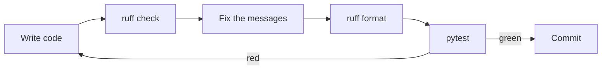

An AI project is mostly small scripts that clean, split and reshape data. They are written in a hurry, and hurried code hides bugs: a variable that was meant to be the total, a list shared between calls, an `except:` that swallows every error. A **linter** (a tool that reads your code without running it and points at suspicious spots) finds many of these in a second. This lesson shows you **ruff**, the fast tool this course uses to lint your code and to keep its layout tidy.

## 1. A linter and a formatter do different jobs

Think of writing an essay. A spell-checker underlines words that are probably wrong. A page-layout tool sets margins and spacing but never changes your words. Ruff has both tools in one program:

| tool | question it answers | what it changes | ruff command |
|---|---|---|---|
| linter | "Is something here probably wrong or risky?" | nothing, unless you ask for a fix | `ruff check` |
| formatter | "Is the layout the usual one?" | spaces, quotes, line breaks, never the meaning | `ruff format` |

Ruff is written in Rust, so it checks a whole project in a blink. It replaces several older tools (flake8, isort, black, pyupgrade) with one. Here is the loop you will repeat all day:



> [!NOTE]
> Ruff is a terminal program, so it **cannot run inside this app**. Blocks marked `bash` and `text` show what you would type and see in your own terminal. The `python` blocks still have Run and Visualize as usual. The exercises here are checked by running your functions, not by running ruff.

## 2. Run ruff: three commands

Add ruff to your project once, then use three commands:

```bash
uv add --dev ruff
uv run ruff check
uv run ruff check --fix
uv run ruff format
```

- `ruff check` lists problems and changes nothing.
- `ruff check --fix` also repairs the problems that have a **safe** automatic fix.
- `ruff format` rewrites the layout of your files.

Add `--check` to the format command (`ruff format --check`) to only list the files that *would* change. That is what automated checks use.

## 3. Reading one ruff message

Every message has the same parts. Here is one for a file `clean.py` whose first line is `import os`:

```text
F401 [*] `os` imported but unused
 --> clean.py:1:8
  |
1 | import os
  |        ^^
help: Remove unused import: `os`
```

```text
F401 [*] `os` imported but unused
(1)  (2) (3)
 --> clean.py:1:8
     (4)
  |
1 | import os
  |        ^^
  |        (5)
help: Remove unused import: `os`
(6)
```

| part | meaning |
|---|---|
| (1) `F401` | the **rule code**: the letters name the family, the digits name the rule |
| (2) `[*]` | ruff can fix this by itself with `--fix` |
| (3) text | what is wrong, in one sentence |
| (4) `clean.py:1:8` | file, line, column |
| (5) `^^` | exactly which characters are the problem |
| (6) `help:` | the fix ruff suggests |

If you only want one line per problem, for example to search or count, use the short form. Each line is `file:line:column: CODE message`:

```bash
uv run ruff check --output-format concise
uv run ruff rule F401
```

```text
clean.py:1:8: F401 [*] `os` imported but unused
```

The second command, `ruff rule F401`, prints a full explanation of a rule. Use it whenever a code looks like a mystery. Wording and layout differ a little between ruff versions, but the parts stay the same.

## 4. Rule families

The letters at the start of a code name a **family** of rules:

| family | what it catches | example |
|---|---|---|
| `F` (Pyflakes) | real mistakes: names that are unused or undefined | `F401` unused import, `F841` unused variable |
| `E` and `W` (pycodestyle) | style problems and some risky habits | `E501` line too long, `E711` comparison to `None`, `E722` bare `except` |
| `B` (bugbear) | patterns that often become bugs | `B006` mutable default argument |
| `UP` (pyupgrade) | old syntax that has a modern replacement | `UP045` old `Optional[str]` spelling |

The next three sections walk through the messages you will see most often. For each one: the smell, the message, the fix.

## 5. Unused things: F401 and F841

**Idea:** a name that is created and never used is either clutter or a typo. Ruff reports an unused `import` as `F401` and an unused local variable as `F841`.

Look at this function. It should count the words of all texts, but it returns `0`:

```python
import os


def count_words(texts):
    total = 0
    for text in texts:
        totl = total + len(text.split())
    return total


print(count_words(["a b", "c"]))   # 0, but the answer should be 3
```

Ruff reports two messages:

```text
F401 [*] `os` imported but unused
F841 Local variable `totl` is assigned to but never used
```

The first one is clutter: delete the import. The second one is the real catch. Ruff cannot know that `totl` is a typo, but it noticed that a value was written and never read. That is exactly what a typo looks like. Fix the name:

```python
def count_words(texts):
    total = 0
    for text in texts:
        total = total + len(text.split())
    return total


print(count_words(["a b", "c"]))   # 3
```

**Notice:** the `F841` message has no `[*]`. Ruff could delete the line, but that would silence the message and keep the bug. When ruff reports an unused name, ask "what did I mean to use here?" before you delete anything.

## 6. Dangerous code: B006 and E722

**B006, mutable default argument.** Python builds a default value **once**, when the `def` line runs. A default of `[]` creates one list, and every call that does not pass its own list shares it.

Press **Visualize** on this block and watch `items` already hold `"a"` at the start of the second call, while `first` grows by itself.

```python
def add_item(item, items=[]):
    items.append(item)
    return items


first = add_item("a")
second = add_item("b")
print(first)             # ['a', 'b']
print(first is second)   # True
```

| call | `items` when the call starts | returns |
|---|---|---|
| `add_item("a")` | `[]` | `['a']` |
| `add_item("b")` | `['a']` (the same list as before) | `['a', 'b']` |

Ruff says `B006 Do not use mutable data structures for argument defaults`. The fix is the pattern you saw with `None` in the typing lesson: default to `None`, and build the list inside the function.

```python
def add_item(item, items=None):
    if items is None:
        items = []
    items.append(item)
    return items


print(add_item("a"))   # ['a']
print(add_item("b"))   # ['b']
```

Ruff offers this change, but it is not marked `[*]`. It is an **unsafe fix**: it can change how your program behaves, so `--fix` leaves it alone until you decide.

**E722, bare except.** A plain `except:` catches *every* error, including mistakes in your own code:

```python
def to_int(text):
    try:
        return int(text)
    except:
        return -1


print(to_int("12"))    # 12
print(to_int("abc"))   # -1, as intended
print(to_int(None))    # -1, but None is a bug in the caller. It should be loud.
```

Ruff says `E722 Do not use bare except`. Name the error you expect:

```python
def to_int(text):
    try:
        return int(text)
    except ValueError:
        return -1


print(to_int("12"))    # 12
print(to_int("abc"))   # -1
# to_int(None) now raises a TypeError, so the bug shows up instead of hiding
```

## 7. Style and old syntax: E711, E501, UP045 and friends

**E711, comparison to None.** `==` asks "are these equal?", and a class may answer that in its own way. `is None` asks "is this the one and only `None` object?" and always answers honestly. Ruff says `E711 Comparison to None should be cond is None`.

```python
def describe(data):
    if data is None:
        return "no data"
    return "got " + str(len(data)) + " rows"


print(describe(None))     # no data
print(describe([1, 2]))   # got 2 rows
```

Here are other messages you will meet often:

| code | what ruff sees | write this instead |
|---|---|---|
| `E501` | a line longer than `line-length` | split the line, or let `ruff format` wrap it |
| `E712` | `if flag == True:` | `if flag:` |
| `E713` | `if not a in b:` | `if a not in b:` |
| `E731` | `strip = lambda s: s.strip()` | `def strip(s):` and a `return` line |
| `E741` | a variable named `l`, `O` or `I` (easy to mix up with digits) | a real name such as `label` |
| `UP045` | `Optional[str]` | the short form from the typing lesson (`str` or `None`, joined with a vertical bar) |

A cleaned-up version of those habits:

```python
KNOWN = {"spam", "ham"}


def strip_text(text):
    return text.strip()


label = strip_text("  eggs ")
if label not in KNOWN:
    print("unknown label:", label)   # unknown label: eggs
```

`UP045` is marked `[*]`, so `ruff check --fix` rewrites it for you. It shows ruff's other job: keeping old code up to date.

**One more smell without a code in our setup.** Naming a variable after a built-in, such as `sum`, `list` or `len`, hides the built-in. Ruff has a family `A` for that, which we do not switch on. Know the symptom. This block crashes on purpose:

```python
sum = 0
for n in [1, 2, 3]:
    sum += n
print(sum)           # 6
print(sum([4, 5]))   # TypeError: 'int' object is not callable
```

`sum` is now the number `6`, so `sum([4, 5])` tries to call a number. Choose another name, such as `total`.

## 8. `ruff format`: layout only

The formatter makes spacing, quotes and blank lines consistent. This code is ugly but works:

```python
def  total(prices) :
    return sum( prices )
x = {'a':1,'b':2}
print(total([1,2,3]) , x)   # 6 {'a': 1, 'b': 2}
```

After `ruff format`, the same program reads like this:

```python
def total(prices):
    return sum(prices)


x = {"a": 1, "b": 2}
print(total([1, 2, 3]), x)   # 6 {'a': 1, 'b': 2}
```

Same output, new layout: no stray spaces, double quotes, two blank lines after a function, a space after each comma. A formatter never renames anything and never touches your logic.

| command | finds bugs? | changes layout? | changes code? |
|---|---|---|---|
| `ruff check` | yes | no | no |
| `ruff check --fix` | yes | no | only the safe fixes |
| `ruff format` | no | yes | no |

Run `check --fix` first and `format` last. Then run your tests: a fix is only good if the tests stay green.

## 9. Configure ruff in `pyproject.toml`

Ruff reads its settings from the `pyproject.toml` file at the root of your project, in a table called `[tool.ruff]`:

```toml
[tool.ruff]
line-length = 100
target-version = "py311"
extend-exclude = ["notebooks"]

[tool.ruff.lint]
select = ["E", "F", "W", "B", "UP"]
ignore = ["E731"]

[tool.ruff.lint.per-file-ignores]
"__init__.py" = ["F401"]
"scripts/*" = ["E501"]
```

- `line-length`: the longest line allowed (the default is 88). `ruff format` wraps to this length.
- `target-version`: the oldest Python you support. It decides which upgrades `UP` may suggest.
- `extend-exclude`: folders ruff should skip.
- `select`: the rule families to turn on. It **replaces** the default list, so name everything you want.
- `ignore`: rules to turn off everywhere. Here `E731` is off because this team likes small `lambda` helpers.
- `per-file-ignores`: rules to turn off only for matching files. Here `__init__.py` files may keep imports they do not use, because their job is to re-export names.

> [!TIP]
> Before you ignore a rule, run `uv run ruff rule CODE` and read why it exists. Most rules are worth keeping.

## 10. Silencing one message with `# noqa`

Sometimes ruff is right in general but wrong for one line. Add `# noqa: CODE` at the end of that line and ruff skips that rule there. A good use is a long link that cannot be split:

```python
DOCS_URL = "https://example.com/docs/a/very/long/path/that/cannot/be/split/without/breaking/the/link"  # noqa: E501
print(DOCS_URL.split("/")[2])   # example.com
```

Three rules keep `noqa` honest:

1. Always write the code. `# noqa: E501` silences one rule. A bare `# noqa` silences **everything** on that line, including bugs you add later.
2. Add a short reason when it is not obvious.
3. Try the fix first. If one rule fires all over a file or folder, use `per-file-ignores` instead.

## 11. Ruff in your editor, pre-commit and CI

You do not have to remember the commands. Install the **Ruff** extension in VS Code, then add this to `.vscode/settings.json`. Problems get underlined as you type, and every save formats the file and applies the safe fixes:

```json
{
  "[python]": {
    "editor.defaultFormatter": "charliermarsh.ruff",
    "editor.formatOnSave": true,
    "editor.codeActionsOnSave": {
      "source.fixAll.ruff": "explicit"
    }
  }
}
```

The same two checks can run automatically before each commit, with the `pre-commit` tool (a `.pre-commit-config.yaml` file):

```yaml
repos:
  - repo: https://github.com/astral-sh/ruff-pre-commit
    rev: v0.17.1
    hooks:
      - id: ruff-check
        args: [--fix]
      - id: ruff-format
```

On a CI server (the machine that checks every push), run `uv run ruff check` and `uv run ruff format --check`. If either one fails, the push is rejected. Use the newest tag for `rev`.

## 12. Common mistakes

**A bare `# noqa` that hides everything.** The comment silences ruff for the whole line, including the typo below:

```python
total = 0
for n in [1, 2, 3]:
    totl = total + n  # noqa
print(total)   # 0, and ruff says nothing
```

Fix: delete the `# noqa` and fix the name, `total = total + n`. If you really need a `noqa`, write the code, as in `# noqa: F841`, and a reason.

**Expecting `ruff format` to find bugs.** This function is perfectly formatted and still wrong:

```python
def add_item(item, items=[]):
    items.append(item)
    return items
```

```text
1 file left unchanged
```

The formatter has nothing to say about it. Only `ruff check` reports `B006`. Run both.

**Turning rules off to get a green run.** A long `ignore` list is a way to hide real bugs:

```toml
[tool.ruff.lint]
select = ["E", "F", "W", "B", "UP"]
ignore = ["F841", "B006"]
```

Now the typo from §5 and the shared list from §6 pass silently. Fix the code, and ignore a rule only with a reason.

**Half-fixing B006.** You change the default to `None` and forget the `if` that builds the list. This block fails on purpose:

```python
def add_item(item, items=None):
    items.append(item)
    return items


add_item("a")   # AttributeError: 'NoneType' object has no attribute 'append'
```

Fix: add `if items is None:` and `items = []` before `items.append(item)`, then run your tests. That is why ruff does not apply this fix by itself.

> [!WARNING]
> `--fix` and "fix all on save" edit your code for you. Read the diff and run the tests after every fix. Unsafe fixes (the ones without `[*]`) need your own judgement.

## Recap

- A **linter** (`ruff check`) finds suspicious code without running it. A **formatter** (`ruff format`) only changes layout.
- A message is `CODE message` at `file:line:column`. The letters of the code name the family (`F`, `E`, `W`, `B`, `UP`). `[*]` means `--fix` can repair it safely.
- Unused names (`F401`, `F841`) are clutter or a typo. `B006` (mutable default) and `E722` (bare `except`) point at real bugs. `E711` wants `is None`.
- Settings live in `[tool.ruff]` in `pyproject.toml`: `line-length`, `select`, `ignore`, `per-file-ignores`.
- Silence one line with `# noqa: CODE` and a reason. Never use a bare `# noqa`.
- Use ruff in your editor, in pre-commit and in CI, and always run your tests after a fix.
