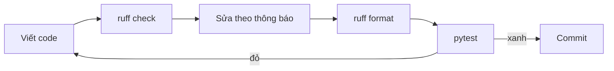

Một dự án AI phần lớn là các script nhỏ để làm sạch, tách và biến đổi dữ liệu. Chúng thường được viết vội, và code viết vội hay giấu lỗi: một biến lẽ ra là tổng thì lại thành biến khác, một list bị dùng chung giữa các lần gọi, một `except:` nuốt mọi lỗi. **Linter** (công cụ kiểm tra code: đọc code mà không chạy nó và chỉ ra những chỗ đáng ngờ) tìm ra nhiều lỗi kiểu này chỉ trong một giây. Bài này giới thiệu **ruff**, công cụ nhanh mà khóa học dùng để lint code và giữ cho cách trình bày code gọn gàng.

## 1. Linter và formatter làm hai việc khác nhau

Hãy nghĩ đến việc viết một bài văn. Công cụ soát chính tả gạch chân những từ có vẻ sai. Công cụ dàn trang thì chỉnh lề và khoảng cách nhưng không bao giờ đổi chữ của bạn. Ruff gộp cả hai công cụ trong một chương trình:

| công cụ | câu hỏi nó trả lời | nó thay đổi gì | lệnh ruff |
|---|---|---|---|
| linter | "Chỗ nào ở đây có vẻ sai hoặc rủi ro?" | không đổi gì, trừ khi bạn yêu cầu sửa | `ruff check` |
| formatter (công cụ định dạng) | "Cách trình bày có theo chuẩn chung không?" | khoảng trắng, dấu nháy, xuống dòng, không bao giờ đổi ý nghĩa | `ruff format` |

Ruff được viết bằng Rust nên kiểm tra cả dự án trong chớp mắt. Nó thay cho vài công cụ cũ (flake8, isort, black, pyupgrade) bằng một công cụ duy nhất. Đây là vòng lặp bạn sẽ lặp lại cả ngày:



> [!NOTE]
> Ruff là chương trình chạy trong terminal, nên **không chạy được trong app này**. Các khối `bash` và `text` cho thấy bạn sẽ gõ gì và thấy gì trong terminal của riêng bạn. Các khối `python` vẫn có nút Chạy và Visualize như thường. Bài tập ở đây được chấm bằng cách chạy hàm của bạn, không phải bằng cách chạy ruff.

## 2. Chạy ruff: ba lệnh

Thêm ruff vào dự án một lần, rồi dùng ba lệnh:

```bash
uv add --dev ruff
uv run ruff check
uv run ruff check --fix
uv run ruff format
```

- `ruff check` liệt kê các vấn đề và không đổi gì.
- `ruff check --fix` còn sửa luôn những vấn đề có cách sửa tự động **an toàn**.
- `ruff format` viết lại cách trình bày các file của bạn.

Thêm `--check` vào lệnh format (`ruff format --check`) để chỉ liệt kê những file *sẽ* bị đổi. Các bước kiểm tra tự động dùng cách này.

## 3. Đọc một thông báo của ruff

Mọi thông báo đều có cùng các phần. Đây là một thông báo cho file `clean.py` có dòng đầu là `import os`:

```text
F401 [*] `os` imported but unused
 --> clean.py:1:8
  |
1 | import os
  |        ^^
help: Remove unused import: `os`
```

```text
F401 [*] `os` imported but unused
(1)  (2) (3)
 --> clean.py:1:8
     (4)
  |
1 | import os
  |        ^^
  |        (5)
help: Remove unused import: `os`
(6)
```

| phần | ý nghĩa |
|---|---|
| (1) `F401` | **mã rule** (rule code): chữ cái là tên nhóm, chữ số là tên rule |
| (2) `[*]` | ruff tự sửa được lỗi này bằng `--fix` |
| (3) văn bản | điều gì sai, trong một câu |
| (4) `clean.py:1:8` | file, dòng, cột |
| (5) `^^` | chính xác những ký tự nào là vấn đề |
| (6) `help:` | cách sửa mà ruff gợi ý |

Nếu bạn chỉ muốn một dòng cho mỗi vấn đề, ví dụ để tìm kiếm hay đếm, hãy dùng dạng ngắn. Mỗi dòng có dạng `file:dòng:cột: MÃ thông báo`:

```bash
uv run ruff check --output-format concise
uv run ruff rule F401
```

```text
clean.py:1:8: F401 [*] `os` imported but unused
```

Lệnh thứ hai, `ruff rule F401`, in ra lời giải thích đầy đủ của một rule. Hãy dùng nó mỗi khi một mã nhìn như bí ẩn. Cách diễn đạt và bố cục hơi khác nhau giữa các phiên bản ruff, nhưng các phần vẫn như vậy.

## 4. Các nhóm rule

Những chữ cái đầu của mã là tên một **nhóm** (family) rule:

| nhóm | bắt lỗi gì | ví dụ |
|---|---|---|
| `F` (Pyflakes) | lỗi thật: tên không dùng hoặc chưa định nghĩa | `F401` import không dùng, `F841` biến không dùng |
| `E` và `W` (pycodestyle) | lỗi phong cách và vài thói quen rủi ro | `E501` dòng quá dài, `E711` so sánh với `None`, `E722` `except` trần |
| `B` (bugbear) | các mẫu code hay thành lỗi | `B006` giá trị mặc định có thể thay đổi |
| `UP` (pyupgrade) | cú pháp cũ đã có cách viết mới | `UP045` cách viết cũ `Optional[str]` |

Ba phần tiếp theo đi qua các thông báo bạn sẽ gặp nhiều nhất. Với mỗi cái: dấu hiệu xấu (smell), thông báo, cách sửa.

## 5. Thứ không dùng: F401 và F841

**Ý chính:** một tên được tạo ra mà không bao giờ dùng thì hoặc là rác, hoặc là gõ nhầm. Ruff báo `import` không dùng là `F401`, còn biến cục bộ không dùng là `F841`.

Hãy xem hàm này. Nó lẽ ra phải đếm số từ của mọi văn bản, nhưng lại trả về `0`:

```python
import os


def count_words(texts):
    total = 0
    for text in texts:
        totl = total + len(text.split())
    return total


print(count_words(["a b", "c"]))   # 0, nhưng đáp án phải là 3
```

Ruff báo hai thông báo:

```text
F401 [*] `os` imported but unused
F841 Local variable `totl` is assigned to but never used
```

Cái đầu là rác: hãy xóa dòng import. Cái thứ hai mới là phát hiện thật. Ruff không biết `totl` là gõ nhầm, nhưng nó thấy một giá trị được ghi vào mà không bao giờ được đọc. Đó chính là dáng vẻ của một lỗi gõ nhầm. Hãy sửa tên:

```python
def count_words(texts):
    total = 0
    for text in texts:
        total = total + len(text.split())
    return total


print(count_words(["a b", "c"]))   # 3
```

**Để ý:** thông báo `F841` không có `[*]`. Ruff có thể xóa dòng đó, nhưng như vậy chỉ làm thông báo im đi mà lỗi vẫn còn. Khi ruff báo một tên không dùng, hãy tự hỏi "mình định dùng cái gì ở đây?" trước khi xóa bất cứ thứ gì.

## 6. Code nguy hiểm: B006 và E722

**B006, giá trị mặc định có thể thay đổi (mutable default argument).** Python tạo giá trị mặc định **một lần duy nhất**, lúc dòng `def` chạy. Mặc định `[]` tạo ra một list, và mọi lần gọi không tự truyền list đều dùng chung list đó.

Bấm **Visualize** ở khối code này để xem `items` đã chứa `"a"` ngay từ đầu lần gọi thứ hai, còn `first` tự dài ra.

```python
def add_item(item, items=[]):
    items.append(item)
    return items


first = add_item("a")
second = add_item("b")
print(first)             # ['a', 'b']
print(first is second)   # True
```

| lần gọi | `items` lúc bắt đầu lần gọi | trả về |
|---|---|---|
| `add_item("a")` | `[]` | `['a']` |
| `add_item("b")` | `['a']` (chính là list cũ) | `['a', 'b']` |

Ruff báo `B006 Do not use mutable data structures for argument defaults`. Cách sửa là mẫu với `None` mà bạn đã thấy ở bài typing: mặc định là `None`, rồi tạo list ngay bên trong hàm.

```python
def add_item(item, items=None):
    if items is None:
        items = []
    items.append(item)
    return items


print(add_item("a"))   # ['a']
print(add_item("b"))   # ['b']
```

Ruff có đề xuất cách sửa này, nhưng nó không có dấu `[*]`. Đây là **unsafe fix** (cách sửa không an toàn): nó có thể đổi hành vi chương trình, nên `--fix` bỏ qua cho đến khi bạn tự quyết định.

**E722, `except` trần (bare except).** Một `except:` trơn bắt *mọi* lỗi, kể cả lỗi trong chính code của bạn:

```python
def to_int(text):
    try:
        return int(text)
    except:
        return -1


print(to_int("12"))    # 12
print(to_int("abc"))   # -1, đúng ý
print(to_int(None))    # -1, nhưng None là lỗi của nơi gọi hàm. Nó phải báo lỗi ầm lên.
```

Ruff báo `E722 Do not use bare except`. Hãy nêu tên loại lỗi bạn chờ đợi:

```python
def to_int(text):
    try:
        return int(text)
    except ValueError:
        return -1


print(to_int("12"))    # 12
print(to_int("abc"))   # -1
# to_int(None) giờ ném ra TypeError, nên lỗi lộ ra thay vì bị giấu
```

## 7. Phong cách và cú pháp cũ: E711, E501, UP045 và các rule khác

**E711, so sánh với None.** `==` hỏi "hai thứ này có bằng nhau không?", và một class có thể trả lời theo cách riêng của nó. `is None` hỏi "đây có phải đối tượng `None` duy nhất không?" và luôn trả lời trung thực. Ruff báo `E711 Comparison to None should be cond is None`.

```python
def describe(data):
    if data is None:
        return "no data"
    return "got " + str(len(data)) + " rows"


print(describe(None))     # no data
print(describe([1, 2]))   # got 2 rows
```

Đây là những thông báo khác bạn hay gặp:

| mã | ruff thấy gì | hãy viết thế này |
|---|---|---|
| `E501` | dòng dài hơn `line-length` | tách dòng, hoặc để `ruff format` tự xuống dòng |
| `E712` | `if flag == True:` | `if flag:` |
| `E713` | `if not a in b:` | `if a not in b:` |
| `E731` | `strip = lambda s: s.strip()` | `def strip(s):` kèm một dòng `return` |
| `E741` | biến tên `l`, `O` hoặc `I` (dễ nhầm với chữ số) | một cái tên thật như `label` |
| `UP045` | `Optional[str]` | dạng viết ngắn ở bài typing (`str` hoặc `None`, nối bằng dấu gạch đứng) |

Một phiên bản đã dọn gọn những thói quen đó:

```python
KNOWN = {"spam", "ham"}


def strip_text(text):
    return text.strip()


label = strip_text("  eggs ")
if label not in KNOWN:
    print("unknown label:", label)   # unknown label: eggs
```

`UP045` có `[*]`, nên `ruff check --fix` sẽ viết lại giúp bạn. Nó cho thấy việc thứ hai của ruff: giữ code cũ luôn được cập nhật.

**Thêm một dấu hiệu xấu không có mã trong cấu hình của ta.** Đặt tên biến trùng tên hàm có sẵn (built-in) như `sum`, `list` hay `len` sẽ che mất hàm đó. Ruff có nhóm `A` cho việc này, nhưng ta không bật. Hãy biết triệu chứng của nó. Khối này cố tình bị lỗi:

```python
sum = 0
for n in [1, 2, 3]:
    sum += n
print(sum)           # 6
print(sum([4, 5]))   # TypeError: 'int' object is not callable
```

Lúc này `sum` là số `6`, nên `sum([4, 5])` đang cố gọi một con số. Hãy chọn tên khác, ví dụ `total`.

## 8. `ruff format`: chỉ đổi cách trình bày

Formatter làm khoảng trắng, dấu nháy và dòng trống nhất quán. Đoạn code này xấu nhưng vẫn chạy:

```python
def  total(prices) :
    return sum( prices )
x = {'a':1,'b':2}
print(total([1,2,3]) , x)   # 6 {'a': 1, 'b': 2}
```

Sau khi `ruff format`, cùng chương trình đó trông như sau:

```python
def total(prices):
    return sum(prices)


x = {"a": 1, "b": 2}
print(total([1, 2, 3]), x)   # 6 {'a': 1, 'b': 2}
```

Cùng kết quả, trình bày mới: không còn khoảng trắng thừa, dùng dấu nháy kép, hai dòng trống sau một hàm, có một khoảng trắng sau mỗi dấu phẩy. Formatter không bao giờ đổi tên và không đụng vào logic của bạn.

| lệnh | tìm lỗi? | đổi cách trình bày? | đổi code? |
|---|---|---|---|
| `ruff check` | có | không | không |
| `ruff check --fix` | có | không | chỉ các cách sửa an toàn |
| `ruff format` | không | có | không |

Hãy chạy `check --fix` trước và `format` sau cùng. Rồi chạy test: một cách sửa chỉ tốt khi test vẫn xanh.

## 9. Cấu hình ruff trong `pyproject.toml`

Ruff đọc cấu hình từ file `pyproject.toml` ở thư mục gốc của dự án, trong một bảng tên là `[tool.ruff]`:

```toml
[tool.ruff]
line-length = 100
target-version = "py311"
extend-exclude = ["notebooks"]

[tool.ruff.lint]
select = ["E", "F", "W", "B", "UP"]
ignore = ["E731"]

[tool.ruff.lint.per-file-ignores]
"__init__.py" = ["F401"]
"scripts/*" = ["E501"]
```

- `line-length`: độ dài dòng tối đa (mặc định là 88). `ruff format` xuống dòng theo độ dài này.
- `target-version`: bản Python cũ nhất bạn hỗ trợ. Nó quyết định `UP` được phép gợi ý nâng cấp nào.
- `extend-exclude`: các thư mục ruff nên bỏ qua.
- `select`: các nhóm rule cần bật. Nó **thay thế** danh sách mặc định, nên hãy nêu đủ mọi thứ bạn muốn.
- `ignore`: các rule tắt ở mọi nơi. Ở đây `E731` bị tắt vì nhóm này thích các hàm `lambda` nhỏ.
- `per-file-ignores`: các rule chỉ tắt cho những file khớp mẫu. Ở đây các file `__init__.py` được giữ import không dùng, vì việc của chúng là xuất lại (re-export) các tên.

> [!TIP]
> Trước khi bỏ qua một rule, hãy chạy `uv run ruff rule MÃ` và đọc xem vì sao nó tồn tại. Phần lớn các rule đều đáng giữ.

## 10. Tắt một thông báo bằng `# noqa`

Đôi khi ruff đúng nói chung nhưng sai ở một dòng. Hãy thêm `# noqa: MÃ` ở cuối dòng đó và ruff sẽ bỏ qua rule này tại đó. Một cách dùng hợp lý là với một đường link dài không thể tách ra:

```python
DOCS_URL = "https://example.com/docs/a/very/long/path/that/cannot/be/split/without/breaking/the/link"  # noqa: E501
print(DOCS_URL.split("/")[2])   # example.com
```

Ba quy tắc giữ cho `noqa` trung thực:

1. Luôn viết mã. `# noqa: E501` chỉ tắt một rule. Một `# noqa` trần tắt **mọi thứ** trên dòng đó, kể cả những lỗi bạn thêm vào sau này.
2. Thêm một lý do ngắn khi nó không hiển nhiên.
3. Thử sửa trước. Nếu một rule báo khắp một file hay thư mục, hãy dùng `per-file-ignores`.

## 11. Ruff trong editor, pre-commit và CI

Bạn không cần nhớ các lệnh. Hãy cài extension **Ruff** trong VS Code, rồi thêm đoạn này vào `.vscode/settings.json`. Lỗi sẽ được gạch chân ngay khi bạn gõ, và mỗi lần lưu file sẽ được format và áp dụng các cách sửa an toàn:

```json
{
  "[python]": {
    "editor.defaultFormatter": "charliermarsh.ruff",
    "editor.formatOnSave": true,
    "editor.codeActionsOnSave": {
      "source.fixAll.ruff": "explicit"
    }
  }
}
```

Hai bước kiểm tra này cũng có thể tự chạy trước mỗi commit, nhờ công cụ `pre-commit` (file `.pre-commit-config.yaml`):

```yaml
repos:
  - repo: https://github.com/astral-sh/ruff-pre-commit
    rev: v0.17.1
    hooks:
      - id: ruff-check
        args: [--fix]
      - id: ruff-format
```

Trên máy chủ CI (máy kiểm tra mỗi lần push), hãy chạy `uv run ruff check` và `uv run ruff format --check`. Nếu một trong hai lệnh thất bại, lần push bị từ chối. Với `rev`, hãy dùng tag mới nhất.

## 12. Lỗi thường gặp

**Một `# noqa` trần giấu mọi thứ.** Comment này tắt ruff cho cả dòng, kể cả lỗi gõ nhầm bên dưới:

```python
total = 0
for n in [1, 2, 3]:
    totl = total + n  # noqa
print(total)   # 0, và ruff không nói gì
```

Cách sửa: xóa `# noqa` và sửa tên, `total = total + n`. Nếu thật sự cần `noqa`, hãy viết mã, như `# noqa: F841`, và thêm lý do.

**Mong `ruff format` tìm ra lỗi.** Hàm này được trình bày hoàn hảo mà vẫn sai:

```python
def add_item(item, items=[]):
    items.append(item)
    return items
```

```text
1 file left unchanged
```

Formatter không có gì để nói về nó. Chỉ `ruff check` mới báo `B006`. Hãy chạy cả hai.

**Tắt rule để được kết quả xanh.** Một danh sách `ignore` dài là cách để giấu lỗi thật:

```toml
[tool.ruff.lint]
select = ["E", "F", "W", "B", "UP"]
ignore = ["F841", "B006"]
```

Giờ lỗi gõ nhầm ở §5 và list dùng chung ở §6 lọt qua trong im lặng. Hãy sửa code, và chỉ bỏ qua một rule khi có lý do.

**Sửa B006 dở dang.** Bạn đổi mặc định thành `None` nhưng quên dòng `if` tạo list. Khối này cố tình bị lỗi:

```python
def add_item(item, items=None):
    items.append(item)
    return items


add_item("a")   # AttributeError: 'NoneType' object has no attribute 'append'
```

Cách sửa: thêm `if items is None:` và `items = []` trước `items.append(item)`, rồi chạy test. Đó là lý do ruff không tự áp dụng cách sửa này.

> [!WARNING]
> `--fix` và "fix all khi lưu" tự sửa code của bạn. Hãy đọc phần diff và chạy test sau mỗi lần sửa. Các cách sửa không an toàn (những cái không có `[*]`) cần phán đoán của chính bạn.

## Tóm tắt

- **Linter** (`ruff check`) tìm code đáng ngờ mà không chạy nó. **Formatter** (`ruff format`) chỉ đổi cách trình bày.
- Một thông báo có dạng `MÃ thông điệp` tại `file:dòng:cột`. Chữ cái của mã là tên nhóm (`F`, `E`, `W`, `B`, `UP`). `[*]` nghĩa là `--fix` sửa được an toàn.
- Tên không dùng (`F401`, `F841`) là rác hoặc gõ nhầm. `B006` (mặc định có thể thay đổi) và `E722` (`except` trần) chỉ ra lỗi thật. `E711` muốn `is None`.
- Cấu hình nằm trong `[tool.ruff]` của `pyproject.toml`: `line-length`, `select`, `ignore`, `per-file-ignores`.
- Tắt một dòng bằng `# noqa: MÃ` kèm lý do. Không bao giờ dùng `# noqa` trần.
- Dùng ruff trong editor, pre-commit và CI, và luôn chạy test sau khi sửa.
