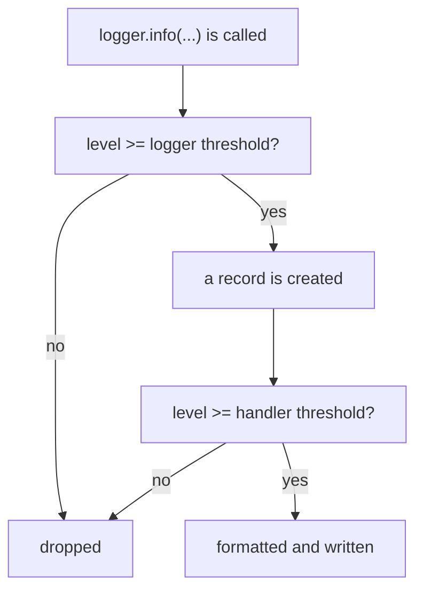

An AI pipeline often runs while nobody is watching: it embeds ten thousand documents overnight, or answers questions for users all day. When something goes wrong at 3 a.m., the only clue you have is what the program wrote down. **Logging** is how a program keeps a useful diary: what it did, how long it took, and what went wrong. It replaces the `print` calls you scatter while testing.

## 1. Why `print` is not enough

`print` works for a quick check, but it has no sense of importance. A "starting" message and a "disk is full" message look the same, and to silence them you must delete the lines. The `logging` module from the standard library fixes this.

```python
import logging

print("loaded 3 documents")
logging.warning("embedding service is slow")
# loaded 3 documents
# WARNING:root:embedding service is slow   (this line goes to stderr, the error channel)
```

| | `print` | `logging` |
|---|---|---|
| Importance | none | five levels, from `DEBUG` to `CRITICAL` |
| Turn messages off | delete or comment out lines | change one setting |
| Time, file, line number | write it yourself | format fields |
| Where it goes | the screen | the screen, a file, or both |

Think of a ship's logbook. Every entry has a severity and a place, and the captain decides how much of it to read today.

## 2. The five levels

Every log message has a **level** (log level, mức log): a number that says how serious it is. You choose a **threshold**. Messages at or above the threshold are shown, and messages below it are dropped.

| level | number | use it for | example |
|---|---|---|---|
| `DEBUG` | 10 | details for finding a bug | `prompt has 512 characters` |
| `INFO` | 20 | normal milestones | `model call finished` |
| `WARNING` | 30 | something odd, the program carries on | `reply was empty, retrying` |
| `ERROR` | 40 | an operation failed | `document 7 could not be parsed` |
| `CRITICAL` | 50 | the whole program cannot go on | `no API key, stopping` |

Without any setup the threshold is `WARNING`, so `DEBUG` and `INFO` messages are silently dropped. That surprises almost every beginner (see the mistakes section). The picture below shows what happens to one call such as `logger.info(...)`:



A **record** is the small object that holds one message and its details. A **handler** decides where records go (section 7). Here are all five levels with the threshold at `WARNING`. For now treat the `basicConfig` lines as setup; section 3 explains them.

```python
import logging
import sys

logging.basicConfig(
    stream=sys.stdout,
    level=logging.WARNING,
    format="%(levelname)s %(message)s",
    force=True,
)

logging.debug("prompt has 512 characters")
logging.info("model call finished")
logging.warning("reply was empty, retrying")
logging.error("document 7 could not be parsed")
logging.critical("no API key, stopping")
# WARNING reply was empty, retrying
# ERROR document 7 could not be parsed
# CRITICAL no API key, stopping
```

Press **Visualize** on this block and watch the output grow: the first two calls add nothing, the last three each add a line. Change `logging.WARNING` to `logging.DEBUG` and all five lines appear.

> [!TIP]
> A good habit: `DEBUG` for details you only want while hunting a bug, `INFO` for the story of a normal run, and `WARNING` and above for things a human should look at.

## 3. Set it up once with `basicConfig`

`logging.basicConfig(...)` sets up logging for the whole program. Call it **once, at the start**, with these keyword arguments:

| argument | meaning |
|---|---|
| `level` | the threshold, such as `logging.INFO` |
| `format` | a template for every line, built from the fields below |
| `stream` | where to write; the default is stderr, `sys.stdout` is the normal output |
| `force=True` | replace any earlier setup (explained in the mistakes section) |

The `format` template uses **fields** written as `%(name)s`. The most useful ones:

| field | gives you |
|---|---|
| `%(asctime)s` | the time of the message |
| `%(levelname)s` | `INFO`, `WARNING`, ... |
| `%(name)s` | the name of the logger |
| `%(message)s` | the text you logged |
| `%(funcName)s` and `%(lineno)d` | the function name and line number |

```python
import logging
import sys

logging.basicConfig(
    stream=sys.stdout,
    level=logging.INFO,
    format="%(asctime)s %(levelname)s %(name)s %(message)s",
    datefmt="%H:%M:%S",
    force=True,
)

logging.info("started")
# 14:03:07 INFO root started   (your time will differ)
```

`datefmt` shortens the time. The name is `root` because we used `logging.info` directly. Next we give each part of the program its own name.

## 4. A logger per module

Instead of calling `logging.info(...)`, create a **logger**: a named object you log through. The name appears in `%(name)s`, so you can tell which part of the program wrote each line.

```python
import logging
import sys

logging.basicConfig(
    stream=sys.stdout,
    level=logging.INFO,
    format="%(name)s | %(message)s",
    force=True,
)

logger = logging.getLogger("app.llm")
logger.info("model call finished")
# app.llm | model call finished
```

In real code, write this once at the top of every file:

```python
import logging

logger = logging.getLogger(__name__)
```

`__name__` is a variable Python sets for each file: the module's own name, such as `app.llm`. So every module gets its own logger, named after itself, with no typing.

Dots in a name build a **hierarchy** (a tree):

```text
root
 └── app
      ├── app.llm
      └── app.cache
```

Two rules follow from the tree. First, a logger without a level of its own uses the level of its nearest parent that has one. Second, the level check happens **once, at the logger you call**; after that the record travels up to the handlers of every parent without checking their levels again.

```python
import logging
import sys

logging.basicConfig(
    stream=sys.stdout,
    level=logging.WARNING,
    format="%(name)s | %(message)s",
    force=True,
)

logging.getLogger("app").setLevel(logging.DEBUG)
llm = logging.getLogger("app.llm")
llm.debug("prompt has 512 characters")
# app.llm | prompt has 512 characters
```

`app.llm` has no level, so it uses the level of `app` (`DEBUG`), the debug call passes, and the record goes up to the root's handler, which `basicConfig` created. Setting `logger.propagate = False` stops a logger from sending records up.

## 5. Lazy arguments, not f-strings

You can pass values to a log call as extra arguments and mark their places in the message with `%s` (any value), `%d` (a whole number) or `%.2f` (a decimal with two digits):

```python
import logging
import sys

logging.basicConfig(stream=sys.stdout, level=logging.INFO, format="%(levelname)s %(message)s", force=True)
logger = logging.getLogger("app")

logger.info("latency=%.2fs tokens=%d", 0.5, 120)
# INFO latency=0.50s tokens=120
```

Why not an f-string? An f-string builds the text **before** the call, even when the message will be dropped. The `%s` form builds it only if the message passes the level check. This block uses `__str__`, the method Python calls to turn an object into text (from the classes lesson), to make the work visible:

```python
import logging
import sys

logging.basicConfig(stream=sys.stdout, level=logging.INFO, format="%(levelname)s %(message)s", force=True)
logger = logging.getLogger("app")


class Slow:
    def __str__(self):
        print("formatting!")
        return "slow value"


logger.debug("value=%s", Slow())
logger.debug(f"value={Slow()}")
logger.info("value=%s", Slow())
# formatting!
# formatting!
# INFO value=slow value
```

The first call is below the threshold and does nothing. The second one still ran `__str__` (the first `formatting!`) and then threw the text away. The third one formats once and prints. For cheap values the difference is tiny, but a log line that formats a big prompt or a list of 10,000 items in a busy loop can slow a program down.

## 6. Logging errors with the traceback

Inside `except`, use `logger.exception`. It logs at `ERROR` level **and** adds the full **traceback** (the list of calls that led to the error), so you can see exactly where it broke.

```python
import logging
import sys

logging.basicConfig(stream=sys.stdout, level=logging.INFO, format="%(levelname)s %(message)s", force=True)
logger = logging.getLogger("app")

try:
    int("abc")
except ValueError:
    logger.exception("could not parse score")
print("program goes on")
# ERROR could not parse score
# Traceback (most recent call last):
#   File "...", line 8, in <module>
# ValueError: invalid literal for int() with base 10: 'abc'
# program goes on
```

Logging does not stop the program, so the last line still prints. If you only write `logger.error("could not parse score: %s", err)`, you keep the message but lose the traceback. Use `logger.exception` only inside `except`, because it needs an error to describe.

## 7. Handlers: where messages go

A **handler** sends records to one destination. `StreamHandler` writes to the screen. `FileHandler` writes to a file. One logger can have several handlers, and each handler has its own level and its own format. A common setup: the screen shows `INFO` and above, and the file keeps everything from `DEBUG`.

The next block writes to a file in a temporary folder. A file handler keeps the file open, so, like in the context managers lesson, we clean up in `finally`:

```python
import logging
import tempfile

with tempfile.TemporaryDirectory() as tmp:
    handler = logging.FileHandler(f"{tmp}/run.log", encoding="utf-8")
    handler.setFormatter(logging.Formatter("%(levelname)s %(message)s"))

    logger = logging.getLogger("filedemo")
    logger.setLevel(logging.INFO)
    logger.propagate = False
    logger.addHandler(handler)
    try:
        logger.info("saved to the file, not the screen")
    finally:
        logger.removeHandler(handler)
        handler.close()

    with open(f"{tmp}/run.log", encoding="utf-8") as f:
        print(f.read().strip())
# INFO saved to the file, not the screen
```

`logging.Formatter(...)` holds a format template and `handler.setFormatter` gives it to the handler. For a quick script, `basicConfig(filename="run.log")` does a similar job in one line.

## 8. Logging in AI pipelines

Every call to a language model costs money and time, so log each one: the **model**, the **number of tokens**, the **latency** (how many seconds it took), and the **attempt** number. Put the facts in `key=value` form so a person (or a tool) can search and split them:

```python
import logging
import sys

logging.basicConfig(stream=sys.stdout, level=logging.INFO, format="%(levelname)s %(message)s", force=True)
logger = logging.getLogger("app.llm")

logger.info("llm_call model=%s tokens=%d latency=%.2fs", "small", 120, 0.84)
logger.warning("llm_retry attempt=%d reason=%s", 2, "timeout")
# INFO llm_call model=small tokens=120 latency=0.84s
# WARNING llm_retry attempt=2 reason=timeout
```

Logs like this are **structured**: every line has the same shape, so you can count retries or average the latency with a few lines of code. A second way is `extra=`, which attaches fields to the record, and the format can print them:

```python
import logging
import sys

logging.basicConfig(
    stream=sys.stdout,
    level=logging.INFO,
    format="%(levelname)s %(message)s model=%(model)s tokens=%(tokens)s",
    force=True,
)
logger = logging.getLogger("app.llm")

logger.info("llm_call", extra={"model": "small", "tokens": 120})
# INFO llm_call model=small tokens=120
```

> [!WARNING]
> With `extra=`, every record that uses this format must carry those fields, or logging prints an error. An extra key also cannot be a name logging already uses, such as `name` or `message`. The `key=value` message is simpler, so start there.

**What never goes in a log.** Logs are copied to files, dashboards and chat messages, and they live for months. Do not log API keys, passwords or tokens. Do not log full prompts or replies when they can contain private data such as names, emails or customer text. Log facts about them instead:

```python
import logging
import sys

logging.basicConfig(stream=sys.stdout, level=logging.INFO, format="%(levelname)s %(message)s", force=True)
logger = logging.getLogger("app.llm")

api_key = "sk-demo-1234567890"
prompt = "Hello, my email is ana@example.com"
logger.info("calling model key_tail=%s prompt_chars=%d", api_key[-4:], len(prompt))
# INFO calling model key_tail=7890 prompt_chars=34
```

## 9. Testing logs with `caplog`

pytest has a built-in fixture, `caplog`, that collects the records your code logs. It follows the same threshold rule as everything else, so use `caplog.at_level(...)` to lower the threshold, or `INFO` records never arrive. This block only defines a function and a test; run the test with pytest.

```python
import logging

logger = logging.getLogger(__name__)


def load(text):
    logger.info("loading %d characters", len(text))
    return text.strip()


def test_load_logs_one_info_record(caplog):
    with caplog.at_level(logging.DEBUG):
        load("  hi ")
    assert len(caplog.records) == 1
    assert caplog.records[0].levelname == "INFO"
    assert caplog.records[0].getMessage() == "loading 5 characters"
```

`caplog.records` is the list of records. `record.levelname` is the level name, and `record.getMessage()` is the final text with the `%s` values filled in. `caplog.text` is all captured lines as one string, handy for `assert "loading" in caplog.text`.

## 10. Common mistakes

**Nothing shows up.** `INFO` is below the default `WARNING` threshold:

```python
import logging

logging.info("model call finished")
print("done")
# done
```

There is no log line at all. Fix: set the threshold first with `logging.basicConfig(level=logging.INFO)`.

**A second `basicConfig` is ignored.** Once logging has a handler, later `basicConfig` calls do nothing unless you pass `force=True`:

```python
import logging
import sys

logging.basicConfig(level=logging.WARNING, stream=sys.stdout, format="%(message)s", force=True)
logging.basicConfig(level=logging.DEBUG)
logging.debug("details")
print("end")
# end
```

The `DEBUG` line is missing because the second call changed nothing. Fix: configure once at the start, or pass `force=True` to replace the old setup.

**Secrets in the log.** Easy to do while debugging, painful when the log is shared:

```python
import logging
import sys

logging.basicConfig(stream=sys.stdout, level=logging.INFO, format="%(levelname)s %(message)s", force=True)
logger = logging.getLogger("app.llm")

api_key = "sk-demo-1234567890"
logger.info("calling model with key %s", api_key)
# INFO calling model with key sk-demo-1234567890
```

Anyone who can read the log can now use your key. Fix: do not log it, or log only `api_key[-4:]`.

**Every line appears twice (or more).** Each call adds one more handler:

```python
import logging
import sys


def get_logger():
    logger = logging.getLogger("dup")
    logger.addHandler(logging.StreamHandler(sys.stdout))
    return logger


get_logger().warning("hello")
get_logger().warning("hello")
# hello
# hello
# hello
```

The second call prints two lines, because the logger now has two handlers. Fix: add a handler only `if not logger.handlers:`, or set up logging once at the start of the program.

## Recap

- Use `logging`, not `print`, for anything you may want to read later. Messages have a **level**: `DEBUG`, `INFO`, `WARNING`, `ERROR`, `CRITICAL`.
- The default threshold is `WARNING`: lower levels are dropped until you call `logging.basicConfig(level=...)` once, at the start (with `force=True` to replace an earlier setup).
- Put `logger = logging.getLogger(__name__)` at the top of each module, and use a `format` such as `%(asctime)s %(levelname)s %(name)s %(message)s`.
- Pass values as arguments (`logger.info("tokens=%d", n)`), not f-strings, and use `logger.exception` inside `except` to keep the traceback.
- **Handlers** choose the destination (screen, file), each with its own level and format.
- For LLM calls, log model, tokens, latency and attempt as `key=value`. Never log API keys or private text. Test logs with `caplog`.
