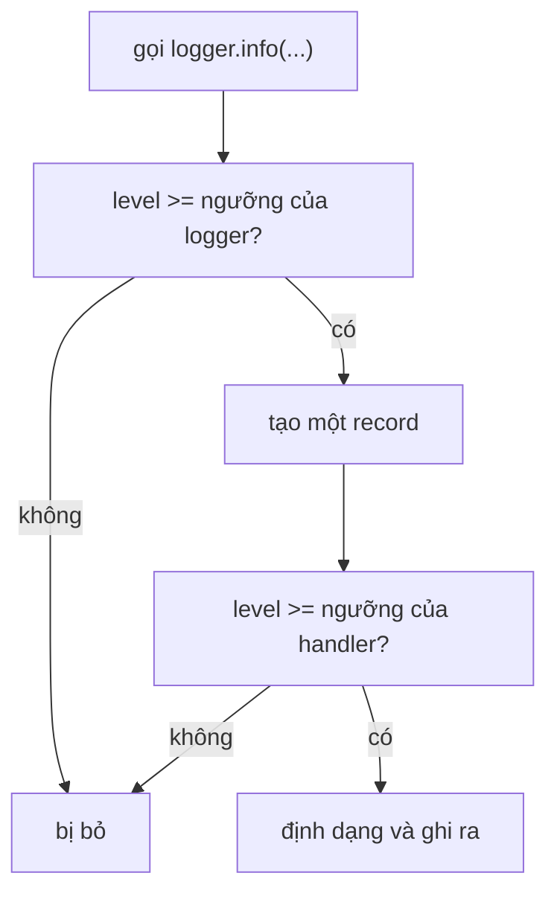

Một pipeline AI thường chạy khi không có ai theo dõi: nó nhúng (embed) mười nghìn tài liệu qua đêm, hoặc trả lời câu hỏi của người dùng suốt cả ngày. Khi có chuyện xảy ra lúc 3 giờ sáng, manh mối duy nhất của bạn là những gì chương trình đã ghi lại. **Logging** (ghi log) là cách một chương trình giữ một cuốn nhật ký hữu ích: nó đã làm gì, mất bao lâu, và đã sai ở đâu. Nó thay cho những lệnh `print` mà bạn rải khắp nơi khi thử code.

## 1. Vì sao `print` là chưa đủ

`print` dùng được cho một lần kiểm tra nhanh, nhưng nó không biết gì về mức độ quan trọng. Một thông báo "bắt đầu" và một thông báo "đĩa đã đầy" trông giống hệt nhau, và muốn tắt chúng bạn phải xóa dòng code. Module `logging` của thư viện chuẩn giải quyết việc này.

```python
import logging

print("loaded 3 documents")
logging.warning("embedding service is slow")
# loaded 3 documents
# WARNING:root:embedding service is slow   (dòng này đi vào stderr, kênh báo lỗi)
```

| | `print` | `logging` |
|---|---|---|
| Mức độ quan trọng | không có | năm mức, từ `DEBUG` đến `CRITICAL` |
| Tắt thông báo | xóa hoặc comment các dòng | đổi một cài đặt |
| Giờ, file, số dòng | tự viết | dùng các field của format |
| Đi đến đâu | màn hình | màn hình, file, hoặc cả hai |

Hãy nghĩ tới nhật ký hàng hải của một con tàu. Mỗi mục đều có mức nghiêm trọng và địa điểm, và thuyền trưởng quyết định hôm nay đọc bao nhiêu.

## 2. Năm mức log

Mỗi thông báo log có một **level** (mức log): một con số cho biết nó nghiêm trọng đến đâu. Bạn chọn một **ngưỡng** (threshold). Thông báo có mức bằng hoặc cao hơn ngưỡng thì được hiển thị, còn thông báo thấp hơn thì bị bỏ.

| level | số | dùng cho | ví dụ |
|---|---|---|---|
| `DEBUG` | 10 | chi tiết để tìm lỗi | `prompt has 512 characters` |
| `INFO` | 20 | các cột mốc bình thường | `model call finished` |
| `WARNING` | 30 | có gì đó lạ, chương trình vẫn chạy tiếp | `reply was empty, retrying` |
| `ERROR` | 40 | một thao tác thất bại | `document 7 could not be parsed` |
| `CRITICAL` | 50 | cả chương trình không thể tiếp tục | `no API key, stopping` |

Khi chưa cài đặt gì, ngưỡng là `WARNING`, nên thông báo `DEBUG` và `INFO` bị bỏ mà không báo gì. Điều này làm gần như mọi người mới học đều bất ngờ (xem phần lỗi thường gặp). Hình dưới cho thấy chuyện gì xảy ra với một lời gọi như `logger.info(...)`:



**Record** là đối tượng nhỏ chứa một thông báo cùng các chi tiết của nó. **Handler** quyết định các record đi đâu (phần 7). Dưới đây là cả năm mức với ngưỡng là `WARNING`. Tạm thời hãy coi các dòng `basicConfig` là phần cài đặt; phần 3 sẽ giải thích.

```python
import logging
import sys

logging.basicConfig(
    stream=sys.stdout,
    level=logging.WARNING,
    format="%(levelname)s %(message)s",
    force=True,
)

logging.debug("prompt has 512 characters")
logging.info("model call finished")
logging.warning("reply was empty, retrying")
logging.error("document 7 could not be parsed")
logging.critical("no API key, stopping")
# WARNING reply was empty, retrying
# ERROR document 7 could not be parsed
# CRITICAL no API key, stopping
```

Bấm **Visualize** ở khối code này để xem phần output dài ra: hai lời gọi đầu không thêm gì, ba lời gọi cuối mỗi cái thêm một dòng. Đổi `logging.WARNING` thành `logging.DEBUG` và cả năm dòng sẽ xuất hiện.

> [!TIP]
> Một thói quen tốt: `DEBUG` cho những chi tiết bạn chỉ cần khi đang săn lỗi, `INFO` cho câu chuyện của một lần chạy bình thường, và `WARNING` trở lên cho những việc con người nên xem.

## 3. Cài đặt một lần bằng `basicConfig`

`logging.basicConfig(...)` cài đặt logging cho cả chương trình. Hãy gọi nó **một lần, ngay từ đầu**, với các keyword argument sau:

| tham số | ý nghĩa |
|---|---|
| `level` | ngưỡng, như `logging.INFO` |
| `format` | khuôn mẫu cho mỗi dòng, ghép từ các field bên dưới |
| `stream` | nơi ghi ra; mặc định là stderr, còn `sys.stdout` là đầu ra thông thường |
| `force=True` | thay thế mọi cài đặt trước đó (giải thích ở phần lỗi thường gặp) |

Khuôn mẫu `format` dùng các **field** viết dạng `%(name)s`. Những field hữu ích nhất:

| field | cho bạn |
|---|---|
| `%(asctime)s` | thời điểm của thông báo |
| `%(levelname)s` | `INFO`, `WARNING`, ... |
| `%(name)s` | tên của logger |
| `%(message)s` | đoạn chữ bạn đã log |
| `%(funcName)s` và `%(lineno)d` | tên hàm và số dòng |

```python
import logging
import sys

logging.basicConfig(
    stream=sys.stdout,
    level=logging.INFO,
    format="%(asctime)s %(levelname)s %(name)s %(message)s",
    datefmt="%H:%M:%S",
    force=True,
)

logging.info("started")
# 14:03:07 INFO root started   (giờ của bạn sẽ khác)
```

`datefmt` làm giờ ngắn lại. Tên là `root` vì ta gọi thẳng `logging.info`. Tiếp theo ta cho mỗi phần của chương trình một cái tên riêng.

## 4. Mỗi module một logger

Thay vì gọi `logging.info(...)`, hãy tạo một **logger**: một đối tượng có tên mà bạn log qua đó. Tên này hiện trong `%(name)s`, nên bạn biết phần nào của chương trình đã viết từng dòng.

```python
import logging
import sys

logging.basicConfig(
    stream=sys.stdout,
    level=logging.INFO,
    format="%(name)s | %(message)s",
    force=True,
)

logger = logging.getLogger("app.llm")
logger.info("model call finished")
# app.llm | model call finished
```

Trong code thật, hãy viết đoạn này một lần ở đầu mỗi file:

```python
import logging

logger = logging.getLogger(__name__)
```

`__name__` là một biến Python đặt cho mỗi file: chính tên module, như `app.llm`. Nhờ vậy mỗi module có logger riêng, đặt theo tên của nó, mà bạn không phải gõ gì.

Dấu chấm trong tên tạo ra một **hierarchy** (cây phân cấp):

```text
root
 └── app
      ├── app.llm
      └── app.cache
```

Từ cái cây này có hai quy tắc. Thứ nhất, logger không có level riêng sẽ dùng level của logger cha gần nhất có level. Thứ hai, việc kiểm tra level diễn ra **một lần, ở logger bạn gọi**; sau đó record đi lên handler của mọi logger cha mà không kiểm tra lại level của chúng.

```python
import logging
import sys

logging.basicConfig(
    stream=sys.stdout,
    level=logging.WARNING,
    format="%(name)s | %(message)s",
    force=True,
)

logging.getLogger("app").setLevel(logging.DEBUG)
llm = logging.getLogger("app.llm")
llm.debug("prompt has 512 characters")
# app.llm | prompt has 512 characters
```

`app.llm` không có level, nên nó dùng level của `app` (`DEBUG`), lời gọi debug đi qua, và record đi lên handler của root, cái mà `basicConfig` đã tạo. Đặt `logger.propagate = False` sẽ ngăn một logger gửi record lên trên.

## 5. Đối số lười, không dùng f-string

Bạn có thể truyền giá trị vào lời gọi log dưới dạng đối số thêm, và đánh dấu chỗ của chúng trong thông báo bằng `%s` (giá trị bất kỳ), `%d` (số nguyên) hoặc `%.2f` (số thập phân hai chữ số):

```python
import logging
import sys

logging.basicConfig(stream=sys.stdout, level=logging.INFO, format="%(levelname)s %(message)s", force=True)
logger = logging.getLogger("app")

logger.info("latency=%.2fs tokens=%d", 0.5, 120)
# INFO latency=0.50s tokens=120
```

Vì sao không dùng f-string? F-string dựng chuỗi **trước** khi gọi, kể cả khi thông báo sẽ bị bỏ. Dạng `%s` chỉ dựng chuỗi khi thông báo qua được bước kiểm tra level. Khối này dùng `__str__`, method Python gọi để biến một object thành chữ (từ bài về class), để làm cho công việc đó hiện ra:

```python
import logging
import sys

logging.basicConfig(stream=sys.stdout, level=logging.INFO, format="%(levelname)s %(message)s", force=True)
logger = logging.getLogger("app")


class Slow:
    def __str__(self):
        print("formatting!")
        return "slow value"


logger.debug("value=%s", Slow())
logger.debug(f"value={Slow()}")
logger.info("value=%s", Slow())
# formatting!
# formatting!
# INFO value=slow value
```

Lời gọi đầu nằm dưới ngưỡng nên không làm gì. Lời gọi thứ hai vẫn chạy `__str__` (dòng `formatting!` đầu tiên) rồi vứt chuỗi đi. Lời gọi thứ ba định dạng một lần và in ra. Với giá trị rẻ thì khác biệt rất nhỏ, nhưng một dòng log định dạng cả prompt lớn hay list 10.000 phần tử trong vòng lặp bận rộn có thể làm chương trình chậm đi.

## 6. Log lỗi kèm traceback

Bên trong `except`, hãy dùng `logger.exception`. Nó log ở mức `ERROR` **và** thêm **traceback** đầy đủ (danh sách các lời gọi dẫn tới lỗi), để bạn thấy chính xác nó hỏng ở đâu.

```python
import logging
import sys

logging.basicConfig(stream=sys.stdout, level=logging.INFO, format="%(levelname)s %(message)s", force=True)
logger = logging.getLogger("app")

try:
    int("abc")
except ValueError:
    logger.exception("could not parse score")
print("program goes on")
# ERROR could not parse score
# Traceback (most recent call last):
#   File "...", line 8, in <module>
# ValueError: invalid literal for int() with base 10: 'abc'
# program goes on
```

Logging không làm chương trình dừng, nên dòng cuối vẫn được in. Nếu bạn chỉ viết `logger.error("could not parse score: %s", err)`, bạn giữ được thông báo nhưng mất traceback. Chỉ dùng `logger.exception` bên trong `except`, vì nó cần một lỗi để mô tả.

## 7. Handler: thông báo đi đâu

Một **handler** gửi các record tới một đích. `StreamHandler` ghi ra màn hình. `FileHandler` ghi vào file. Một logger có thể có nhiều handler, và mỗi handler có level và format riêng. Một cách cài đặt phổ biến: màn hình hiện từ `INFO` trở lên, còn file giữ mọi thứ từ `DEBUG`.

Khối sau ghi vào một file trong thư mục tạm. Handler của file giữ file mở, nên, như trong bài về context manager, ta dọn dẹp trong `finally`:

```python
import logging
import tempfile

with tempfile.TemporaryDirectory() as tmp:
    handler = logging.FileHandler(f"{tmp}/run.log", encoding="utf-8")
    handler.setFormatter(logging.Formatter("%(levelname)s %(message)s"))

    logger = logging.getLogger("filedemo")
    logger.setLevel(logging.INFO)
    logger.propagate = False
    logger.addHandler(handler)
    try:
        logger.info("saved to the file, not the screen")
    finally:
        logger.removeHandler(handler)
        handler.close()

    with open(f"{tmp}/run.log", encoding="utf-8") as f:
        print(f.read().strip())
# INFO saved to the file, not the screen
```

`logging.Formatter(...)` giữ một khuôn mẫu format và `handler.setFormatter` trao nó cho handler. Với script nhanh, `basicConfig(filename="run.log")` làm việc tương tự chỉ trong một dòng.

## 8. Logging trong pipeline AI

Mỗi lần gọi một mô hình ngôn ngữ đều tốn tiền và thời gian, nên hãy log từng lần: **model**, **số token**, **latency** (mất bao nhiêu giây), và số thứ tự **lần thử** (attempt). Đặt các dữ kiện ở dạng `key=value` để người (hoặc công cụ) có thể tìm kiếm và tách chúng:

```python
import logging
import sys

logging.basicConfig(stream=sys.stdout, level=logging.INFO, format="%(levelname)s %(message)s", force=True)
logger = logging.getLogger("app.llm")

logger.info("llm_call model=%s tokens=%d latency=%.2fs", "small", 120, 0.84)
logger.warning("llm_retry attempt=%d reason=%s", 2, "timeout")
# INFO llm_call model=small tokens=120 latency=0.84s
# WARNING llm_retry attempt=2 reason=timeout
```

Log như vậy gọi là **structured** (có cấu trúc): mọi dòng có cùng một dạng, nên bạn đếm số lần retry hay tính latency trung bình chỉ với vài dòng code. Cách thứ hai là `extra=`, gắn thêm field vào record, và format có thể in chúng ra:

```python
import logging
import sys

logging.basicConfig(
    stream=sys.stdout,
    level=logging.INFO,
    format="%(levelname)s %(message)s model=%(model)s tokens=%(tokens)s",
    force=True,
)
logger = logging.getLogger("app.llm")

logger.info("llm_call", extra={"model": "small", "tokens": 120})
# INFO llm_call model=small tokens=120
```

> [!WARNING]
> Với `extra=`, mọi record dùng format này đều phải mang các field đó, nếu không logging sẽ in ra một lỗi. Key của `extra` cũng không được trùng tên mà logging đã dùng, như `name` hay `message`. Thông báo dạng `key=value` đơn giản hơn, nên hãy bắt đầu từ đó.

**Những thứ không bao giờ được đưa vào log.** Log được sao chép sang file, dashboard và tin nhắn chat, và tồn tại hàng tháng. Đừng log API key, mật khẩu hay token. Đừng log nguyên prompt hay câu trả lời khi chúng có thể chứa dữ liệu riêng tư như tên, email hoặc nội dung của khách hàng. Hãy log các dữ kiện về chúng:

```python
import logging
import sys

logging.basicConfig(stream=sys.stdout, level=logging.INFO, format="%(levelname)s %(message)s", force=True)
logger = logging.getLogger("app.llm")

api_key = "sk-demo-1234567890"
prompt = "Hello, my email is ana@example.com"
logger.info("calling model key_tail=%s prompt_chars=%d", api_key[-4:], len(prompt))
# INFO calling model key_tail=7890 prompt_chars=34
```

## 9. Kiểm tra log bằng `caplog`

pytest có sẵn một fixture là `caplog`, gom các record mà code của bạn đã log. Nó theo cùng quy tắc ngưỡng như mọi thứ khác, nên hãy dùng `caplog.at_level(...)` để hạ ngưỡng xuống, nếu không các record `INFO` sẽ không tới. Khối này chỉ định nghĩa một hàm và một test; hãy chạy test bằng pytest.

```python
import logging

logger = logging.getLogger(__name__)


def load(text):
    logger.info("loading %d characters", len(text))
    return text.strip()


def test_load_logs_one_info_record(caplog):
    with caplog.at_level(logging.DEBUG):
        load("  hi ")
    assert len(caplog.records) == 1
    assert caplog.records[0].levelname == "INFO"
    assert caplog.records[0].getMessage() == "loading 5 characters"
```

`caplog.records` là list các record. `record.levelname` là tên level, và `record.getMessage()` là đoạn chữ cuối cùng sau khi các giá trị `%s` được điền vào. `caplog.text` là toàn bộ các dòng đã gom thành một chuỗi, tiện cho `assert "loading" in caplog.text`.

## 10. Lỗi thường gặp

**Không thấy gì hiện ra.** `INFO` thấp hơn ngưỡng mặc định `WARNING`:

```python
import logging

logging.info("model call finished")
print("done")
# done
```

Không có dòng log nào cả. Cách sửa: đặt ngưỡng trước bằng `logging.basicConfig(level=logging.INFO)`.

**`basicConfig` lần thứ hai bị bỏ qua.** Khi logging đã có handler, các lần gọi `basicConfig` sau đó không làm gì trừ khi bạn truyền `force=True`:

```python
import logging
import sys

logging.basicConfig(level=logging.WARNING, stream=sys.stdout, format="%(message)s", force=True)
logging.basicConfig(level=logging.DEBUG)
logging.debug("details")
print("end")
# end
```

Dòng `DEBUG` biến mất vì lời gọi thứ hai không thay đổi gì. Cách sửa: cài đặt một lần ở đầu chương trình, hoặc truyền `force=True` để thay cài đặt cũ.

**Bí mật nằm trong log.** Rất dễ xảy ra khi đang debug, và đau đầu khi log bị chia sẻ:

```python
import logging
import sys

logging.basicConfig(stream=sys.stdout, level=logging.INFO, format="%(levelname)s %(message)s", force=True)
logger = logging.getLogger("app.llm")

api_key = "sk-demo-1234567890"
logger.info("calling model with key %s", api_key)
# INFO calling model with key sk-demo-1234567890
```

Bây giờ bất kỳ ai đọc được log đều dùng được key của bạn. Cách sửa: đừng log nó, hoặc chỉ log `api_key[-4:]`.

**Mỗi dòng xuất hiện hai lần (hoặc nhiều hơn).** Mỗi lời gọi lại thêm một handler:

```python
import logging
import sys


def get_logger():
    logger = logging.getLogger("dup")
    logger.addHandler(logging.StreamHandler(sys.stdout))
    return logger


get_logger().warning("hello")
get_logger().warning("hello")
# hello
# hello
# hello
```

Lời gọi thứ hai in ra hai dòng vì logger giờ có hai handler. Cách sửa: chỉ thêm handler khi `if not logger.handlers:`, hoặc cài đặt logging một lần ở đầu chương trình.

## Tóm tắt

- Dùng `logging`, không dùng `print`, cho mọi thứ bạn có thể muốn đọc lại sau này. Thông báo có **level**: `DEBUG`, `INFO`, `WARNING`, `ERROR`, `CRITICAL`.
- Ngưỡng mặc định là `WARNING`: các level thấp hơn bị bỏ cho đến khi bạn gọi `logging.basicConfig(level=...)` một lần, ngay từ đầu (kèm `force=True` để thay cài đặt trước đó).
- Đặt `logger = logging.getLogger(__name__)` ở đầu mỗi module, và dùng `format` như `%(asctime)s %(levelname)s %(name)s %(message)s`.
- Truyền giá trị dưới dạng đối số (`logger.info("tokens=%d", n)`), không dùng f-string, và dùng `logger.exception` bên trong `except` để giữ traceback.
- **Handler** chọn đích đến (màn hình, file), mỗi handler có level và format riêng.
- Với các lần gọi LLM, log model, token, latency và attempt dưới dạng `key=value`. Không bao giờ log API key hay nội dung riêng tư. Kiểm tra log bằng `caplog`.
