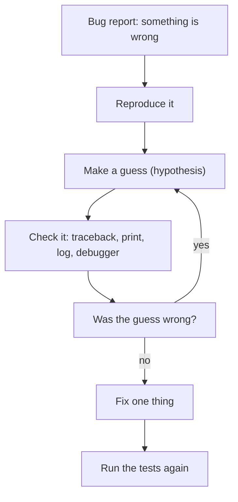

Every program has bugs, and in AI work they are sneaky: a prompt template drops a word, a text cleaner removes too much, a score is off by one. **Debugging** is the skill of finding the cause of a bug and fixing it on purpose. Good debuggers do not guess faster than other people. They follow a short routine, and this lesson gives you that routine and the tools to run it.

## 1. The debugging loop

Debugging is detective work. You collect clues, make a guess, test the guess, and repeat. The only rule is to change code **after** you understand the cause, not before.



A **hypothesis** (giả thuyết) is a guess you can test, such as "the list is empty when the function starts". "Something is wrong with the loop" is not a hypothesis, because you cannot check it.

## 2. Read the traceback

When an error is not caught, Python prints a **traceback**: the list of calls that led to the error. Many beginners skip it and stare at the code. The traceback already tells you where to look. Here is a real one for a small program:

```text
Traceback (most recent call last):
  File "app.py", line 12, in <module>
    main()
  File "app.py", line 9, in main
    score = parse_score(line)
  File "app.py", line 4, in parse_score
    return int(text)
ValueError: invalid literal for int() with base 10: 'abc'
```

**Read it from the bottom up.**

| step | what to read | here |
|---|---|---|
| 1 | the last line: the error type and message | `ValueError`: `int()` got `'abc'` |
| 2 | the last `File` line: where it was raised | `parse_score`, line 4 |
| 3 | the lines above: who called whom | `main` called `parse_score` |
| 4 | your own code, not library code | all three frames are ours |

The call order, from top to bottom, is the story of how the program got there:

```text
<module>  →  main()  →  parse_score("abc")  →  int("abc")  ✗
```

The line of code shown under each `File` line is the call that was running. The bug is usually in the **last frame of your own code**, or in the data that was passed into it. Here `parse_score` is fine; the question is why `main` sent it `'abc'`.

These are the errors you will see most often:

| error | usual cause |
|---|---|
| `NameError` | a typo in a name, or a variable used before it exists |
| `TypeError` | the wrong kind of value, such as `"1" + 2` |
| `ValueError` | the right kind but a bad value, such as `int("abc")` |
| `KeyError` | a missing key in a dictionary |
| `IndexError` | a position past the end of a list |
| `AttributeError` | an object has no such attribute, often because it is `None` |
| `ZeroDivisionError` | dividing by zero, often from an empty list |

You can also look at an error inside your own code with `except ... as err`. `type(err).__name__` gives the type, and `str(err)` gives the message:

```python
try:
    {"model": "small"}["tokens"]
except KeyError as err:
    print(type(err).__name__, err)
# KeyError 'tokens'
```

## 3. Reproduce first

You cannot fix a bug you cannot repeat. To **reproduce** a bug means to find a small input that makes it happen every time. Start from the report ("the summary is wrong for some documents") and shrink it: remove items until the bug is still there but nothing else is. Then write it down as a test or a short script. It is the first test you will need after the fix.

Here is a classic. A function should return the last `n` items:

```python
def last_n(items, n):
    return items[-n:]


print(last_n([1, 2, 3, 4], 2))
print(last_n([1, 2, 3, 4], 0))
# [3, 4]
# [1, 2, 3, 4]
```

The first call is fine. The second should return `[]`. The smallest input that shows the bug is `n=0`. Once you know that, the guess comes quickly: `-0` is the same as `0`, so `items[-0:]` is `items[0:]`, which is the whole list.

> [!NOTE]
> Keep the bug alive while you work. If your "fix" makes the bug disappear but you do not know why, you may have hidden it, and it will come back.

## 4. Narrow it down with checkpoints

When a pipeline of several steps gives a wrong answer, you do not need to read all the code. Add **checkpoints**: a `print` (or a `logger.debug`) after each step that shows the value. The bug is between the last correct checkpoint and the first wrong one. This is the same idea as binary search: cut the problem in half.

```python
import re


def clean(text):
    return text.strip().lower()


def split_words(text):
    return re.split(r"\s+", text)


def count_words(words):
    return len(words)


text = "  Hello   Python  "
step1 = clean(text)
print("after clean:", repr(step1))
step2 = split_words(step1)
print("after split:", step2)
step3 = count_words(step2)
print("after count:", step3)
# after clean: 'hello   python'
# after split: ['hello', 'python']
# after count: 2
```

Press **Visualize** on this block and watch each variable appear. If `count` were wrong, you would see at once that `split_words` was fine and `count_words` was the broken step. A trace table of what you see:

| step | variable | value | correct? |
|---|---|---|---|
| 1 | `step1` | `'hello   python'` | yes |
| 2 | `step2` | `['hello', 'python']` | yes |
| 3 | `step3` | `2` | yes |

Use `repr(...)` when you print text: it shows quotes and hidden spaces, which `print` alone would hide. For code that runs for a long time, prefer `logger.debug(...)` from the logging lesson, because you can leave it in the code and turn it off with the level.

## 5. Stop the program with `breakpoint()`

Checkpoints show you values after the fact. A **debugger** lets you stop the program in the middle and look around. In Python the quickest way is the built-in `breakpoint()`. Put it on the line where you want to pause:

```python
def average(numbers):
    total = 0
    for n in numbers:
        total += n
    # breakpoint()  # remove the leading "# " to stop here
    return total / len(numbers)


print(average([2, 4, 6]))
# 4.0
```

With the `#` removed and the file run in a terminal, Python stops at that line and opens **pdb**, the Python debugger. You type short commands at the `(Pdb)` prompt:

```bash
python app.py
```

```text
> app.py(6)average()
-> return total / len(numbers)
(Pdb) p total
12
(Pdb) p numbers
[2, 4, 6]
(Pdb) c
4.0
```

The `>` line shows where you are, and the `->` line is the next line to run. These are the commands to learn first:

| command | name | what it does |
|---|---|---|
| `p name` | print | show the value of an expression, such as `p total` |
| `l` | list | show the code around the current line |
| `n` | next | run this line and stop at the next one in the same function |
| `s` | step | step **into** a function call on this line |
| `c` | continue | run until the next breakpoint, or until the end |
| `q` | quit | stop the program |

`n` and `s` differ only on a line that calls a function: `n` runs the whole call and stays in your current function, and `s` goes inside the function.

You can also start the debugger only when a test fails:

```bash
pytest --pdb
```

pytest stops at the line where the test failed, and you can inspect the variables with `p`.

> [!WARNING]
> `breakpoint()` waits for you to type. A program that still contains one will hang when it runs on a server or in a test. Remove every `breakpoint()` (and every debugging `print`) before you commit.

## 6. The debugger in VS Code

The same ideas have a friendlier face in VS Code. Click in the gutter (the space left of the line numbers) to set a **breakpoint**, a red dot where the program will stop. Press `F5` to start debugging, and the program runs until it reaches the dot.

```text
 8   for n in numbers:
 9 ●     total += n          ← the program stops here
10   return total / len(numbers)

VARIABLES      CALL STACK         WATCH
n = 6          average            total / len(numbers)
total = 6      <module>           (shows ZeroDivisionError if numbers is empty)
```

| button | key | same as pdb |
|---|---|---|
| Continue | `F5` | `c` |
| Step Over | `F10` | `n` |
| Step Into | `F11` | `s` |
| Step Out | `Shift+F11` | run until the function returns |
| Stop | `Shift+F5` | `q` |

The panels replace the `p` command. **Variables** shows every local variable and updates as you step. **Call stack** is the traceback, live: click a frame to see the variables of the caller. **Watch** is a list of expressions that you type, and VS Code re-calculates them at every step. A **conditional breakpoint** (right-click the red dot) stops only when an expression is true, such as `n == 0`, which saves you from pressing continue 9,999 times.

Which tool should you pick?

| situation | use this |
|---|---|
| an error with a traceback | read the traceback first |
| a pipeline gives a wrong answer | checkpoints with `print` or `logger.debug` |
| you need to see many variables at one moment | `breakpoint()` or the VS Code debugger |
| the bug appears only on a server or overnight | logging, because you cannot sit in front of it |

## 7. Habits that save hours

- **Change one thing at a time**, then run again. If you change three things and it works, you do not know which one mattered.
- **Read the error message** slowly and fully. It often names the exact value.
- **Explain the code out loud.** This is called **rubber duck debugging**: describe each line to a rubber duck (or a friend, or a note). Saying "this line takes the last `n` items" often makes you notice that it does not do that for `n=0`.
- **Doubt your assumptions.** "This list can't be empty" is exactly the kind of thought that hides a bug. Check it with a `print`.
- **Take a break** when you are stuck for a long time. A fresh look catches what a tired one misses.
- **Turn the bug into a test** before you fix it. The test fails now, passes after the fix, and stops the same bug from returning.

## 8. Common mistakes

**Changing code at random.** The test is red, so you flip a `<` to `<=`, then add `+ 1`, and the test turns green by luck:

```python
def last_n(items, n):
    return items[len(items) - n + 1 :] if n else items
```

This hides the bug for some inputs and breaks others. Fix: find the cause first (here `-0`), then make the smallest change that removes it.

**Swallowing the error.** An empty `except` makes the traceback vanish, so the bug is still there but silent:

```python
try:
    value = int("abc")
except Exception:
    pass
print("value is missing, and we don't know why")
# value is missing, and we don't know why
```

Fix: catch the specific error you expect, and log it with `logger.exception(...)` so the traceback is kept.

**Reading the traceback from the top.** The first lines are only the way in. Start at the last line, where the error type and the message are.

**Leaving debug code behind.** A forgotten `print("HERE 2")` pollutes the output, and a forgotten `breakpoint()` freezes a program that nobody is watching. Search for them before you commit, or use `logger.debug` so you can turn them off.

## Recap

- Debugging is a loop: **reproduce, guess, check, fix one thing, test again**. Change code only after you understand the cause.
- A **traceback** is read from the bottom: error type and message first, then the last frame of your own code, then who called it.
- **Reproduce** a bug with the smallest input that still shows it, and turn it into a test.
- Narrow the problem down with **checkpoints** (`print` with `repr`, or `logger.debug`) after each step.
- `breakpoint()` opens **pdb**: `p` prints, `n` goes to the next line, `s` steps in, `c` continues, `l` lists, `q` quits. `pytest --pdb` stops at a failing test.
- VS Code gives the same tools with buttons: breakpoints, `F5`/`F10`/`F11`, Variables, Call stack and Watch. Never commit a `breakpoint()`.
