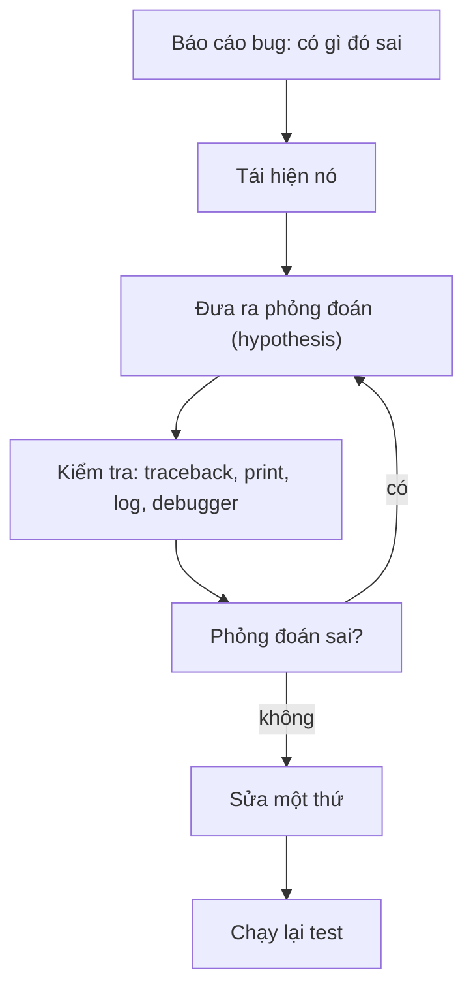

Chương trình nào cũng có bug, và trong công việc AI chúng rất khó nhận ra: một prompt template làm rơi mất một từ, một bộ làm sạch văn bản xóa quá tay, một điểm số bị lệch một đơn vị. **Debugging** (gỡ lỗi) là kỹ năng tìm ra nguyên nhân của bug và sửa nó một cách có chủ đích. Người debug giỏi không đoán nhanh hơn người khác. Họ theo một quy trình ngắn, và bài này cho bạn quy trình đó cùng các công cụ để chạy nó.

## 1. Vòng lặp debug

Debug giống công việc của thám tử. Bạn thu thập manh mối, đưa ra một phỏng đoán, kiểm tra phỏng đoán, rồi lặp lại. Quy tắc duy nhất: chỉ sửa code **sau khi** đã hiểu nguyên nhân, đừng sửa trước.



**Hypothesis** (giả thuyết) là một phỏng đoán có thể kiểm tra, ví dụ "list bị rỗng khi hàm bắt đầu". "Vòng lặp có vấn đề gì đó" không phải là hypothesis, vì bạn không có cách nào kiểm tra nó.

## 2. Đọc traceback

Khi một lỗi không được bắt, Python in ra một **traceback**: danh sách các lời gọi dẫn tới lỗi. Nhiều bạn mới bỏ qua nó và cứ nhìn chằm chằm vào code. Thực ra traceback đã cho bạn biết cần nhìn ở đâu. Đây là một traceback thật của một chương trình nhỏ:

```text
Traceback (most recent call last):
  File "app.py", line 12, in <module>
    main()
  File "app.py", line 9, in main
    score = parse_score(line)
  File "app.py", line 4, in parse_score
    return int(text)
ValueError: invalid literal for int() with base 10: 'abc'
```

**Hãy đọc từ dưới lên.**

| bước | đọc gì | ở đây |
|---|---|---|
| 1 | dòng cuối: loại lỗi và thông báo | `ValueError`: `int()` nhận `'abc'` |
| 2 | dòng `File` cuối: nơi lỗi được ném ra | `parse_score`, dòng 4 |
| 3 | các dòng phía trên: ai gọi ai | `main` gọi `parse_score` |
| 4 | code của bạn, không phải code thư viện | cả ba frame đều là code của ta |

Thứ tự gọi, từ trên xuống dưới, là câu chuyện về việc chương trình đã đi tới đó như thế nào:

```text
<module>  →  main()  →  parse_score("abc")  →  int("abc")  ✗
```

Dòng code hiện dưới mỗi dòng `File` là lời gọi đang chạy. Bug thường nằm ở **frame cuối cùng thuộc code của bạn**, hoặc ở dữ liệu được truyền vào đó. Ở đây `parse_score` không sai; câu hỏi là vì sao `main` lại gửi cho nó `'abc'`.

Đây là những lỗi bạn sẽ gặp nhiều nhất:

| lỗi | nguyên nhân thường gặp |
|---|---|
| `NameError` | gõ sai tên, hoặc dùng biến trước khi nó tồn tại |
| `TypeError` | sai loại giá trị, như `"1" + 2` |
| `ValueError` | đúng loại nhưng giá trị không hợp lệ, như `int("abc")` |
| `KeyError` | thiếu key trong dictionary |
| `IndexError` | vị trí vượt quá cuối list |
| `AttributeError` | object không có attribute đó, thường vì nó là `None` |
| `ZeroDivisionError` | chia cho không, thường do list rỗng |

Bạn cũng có thể xem một lỗi ngay trong code của mình bằng `except ... as err`. `type(err).__name__` cho loại lỗi, và `str(err)` cho thông báo:

```python
try:
    {"model": "small"}["tokens"]
except KeyError as err:
    print(type(err).__name__, err)
# KeyError 'tokens'
```

## 3. Tái hiện trước

Bạn không thể sửa một bug mà bạn không lặp lại được. **Tái hiện** (reproduce) một bug nghĩa là tìm một input nhỏ khiến bug xảy ra mọi lần. Hãy bắt đầu từ báo cáo ("bản tóm tắt sai với một số tài liệu") rồi thu nhỏ nó: bỏ dần các phần tử cho đến khi bug vẫn còn nhưng không còn gì khác. Sau đó viết nó thành một test hoặc một script ngắn. Đó chính là test đầu tiên bạn sẽ cần sau khi sửa.

Đây là một ví dụ kinh điển. Một hàm cần trả về `n` phần tử cuối:

```python
def last_n(items, n):
    return items[-n:]


print(last_n([1, 2, 3, 4], 2))
print(last_n([1, 2, 3, 4], 0))
# [3, 4]
# [1, 2, 3, 4]
```

Lời gọi đầu tiên đúng. Lời gọi thứ hai lẽ ra phải trả về `[]`. Input nhỏ nhất làm lộ bug là `n=0`. Khi đã biết điều đó, phỏng đoán đến rất nhanh: `-0` bằng `0`, nên `items[-0:]` là `items[0:]`, tức là cả list.

> [!NOTE]
> Hãy giữ bug "còn sống" trong lúc làm việc. Nếu cách "sửa" của bạn làm bug biến mất nhưng bạn không biết vì sao, có thể bạn chỉ vừa giấu nó đi, và nó sẽ quay lại.

## 4. Thu hẹp vùng lỗi bằng các điểm kiểm tra

Khi một pipeline gồm nhiều bước cho ra đáp án sai, bạn không cần đọc toàn bộ code. Hãy thêm **checkpoint** (điểm kiểm tra): một lệnh `print` (hoặc `logger.debug`) sau mỗi bước để hiện giá trị. Bug nằm giữa checkpoint đúng cuối cùng và checkpoint sai đầu tiên. Đây là cùng ý tưởng với tìm kiếm nhị phân: cắt đôi vấn đề.

```python
import re


def clean(text):
    return text.strip().lower()


def split_words(text):
    return re.split(r"\s+", text)


def count_words(words):
    return len(words)


text = "  Hello   Python  "
step1 = clean(text)
print("after clean:", repr(step1))
step2 = split_words(step1)
print("after split:", step2)
step3 = count_words(step2)
print("after count:", step3)
# after clean: 'hello   python'
# after split: ['hello', 'python']
# after count: 2
```

Bấm **Visualize** ở khối code này để xem từng biến xuất hiện. Nếu `count` bị sai, bạn sẽ thấy ngay `split_words` vẫn đúng còn `count_words` là bước hỏng. Bảng trace của những gì bạn thấy:

| bước | biến | giá trị | đúng chưa? |
|---|---|---|---|
| 1 | `step1` | `'hello   python'` | rồi |
| 2 | `step2` | `['hello', 'python']` | rồi |
| 3 | `step3` | `2` | rồi |

Hãy dùng `repr(...)` khi in văn bản: nó hiện dấu nháy và các khoảng trắng ẩn mà `print` thường sẽ giấu đi. Với code chạy lâu, nên dùng `logger.debug(...)` từ bài logging, vì bạn có thể để nó trong code và tắt bằng level.

## 5. Dừng chương trình bằng `breakpoint()`

Checkpoint cho bạn thấy giá trị sau khi mọi việc đã xảy ra. **Debugger** cho phép bạn dừng chương trình giữa chừng và nhìn xung quanh. Trong Python, cách nhanh nhất là hàm có sẵn `breakpoint()`. Đặt nó ở dòng bạn muốn dừng:

```python
def average(numbers):
    total = 0
    for n in numbers:
        total += n
    # breakpoint()  # xóa "# " ở đầu dòng để dừng tại đây
    return total / len(numbers)


print(average([2, 4, 6]))
# 4.0
```

Khi đã xóa dấu `#` và chạy file trong terminal, Python dừng ở dòng đó và mở **pdb**, debugger của Python. Bạn gõ các lệnh ngắn ở dấu nhắc `(Pdb)`:

```bash
python app.py
```

```text
> app.py(6)average()
-> return total / len(numbers)
(Pdb) p total
12
(Pdb) p numbers
[2, 4, 6]
(Pdb) c
4.0
```

Dòng `>` cho biết bạn đang ở đâu, và dòng `->` là dòng sắp chạy tiếp theo. Đây là những lệnh nên học trước:

| lệnh | tên | làm gì |
|---|---|---|
| `p name` | print | hiện giá trị của một biểu thức, như `p total` |
| `l` | list | hiện code xung quanh dòng hiện tại |
| `n` | next | chạy dòng này và dừng ở dòng kế tiếp trong cùng hàm |
| `s` | step | đi **vào trong** một lời gọi hàm trên dòng này |
| `c` | continue | chạy tới breakpoint kế tiếp, hoặc tới hết chương trình |
| `q` | quit | dừng chương trình |

`n` và `s` chỉ khác nhau ở dòng có gọi hàm: `n` chạy trọn lời gọi và ở lại trong hàm hiện tại, còn `s` đi vào bên trong hàm.

Bạn cũng có thể chỉ mở debugger khi một test thất bại:

```bash
pytest --pdb
```

pytest dừng ngay ở dòng làm test thất bại, và bạn xem các biến bằng `p`.

> [!WARNING]
> `breakpoint()` đứng chờ bạn gõ. Một chương trình còn sót `breakpoint()` sẽ bị treo khi chạy trên server hoặc trong test. Hãy xóa mọi `breakpoint()` (và mọi lệnh `print` debug) trước khi commit.

## 6. Debugger trong VS Code

Cùng những ý tưởng đó, nhưng có giao diện thân thiện hơn trong VS Code. Bấm vào lề (khoảng trống bên trái số dòng) để đặt **breakpoint**, một chấm đỏ nơi chương trình sẽ dừng. Nhấn `F5` để bắt đầu debug, và chương trình chạy tới khi gặp chấm đỏ.

```text
 8   for n in numbers:
 9 ●     total += n          ← the program stops here
10   return total / len(numbers)

VARIABLES      CALL STACK         WATCH
n = 6          average            total / len(numbers)
total = 6      <module>           (shows ZeroDivisionError if numbers is empty)
```

| nút | phím | giống pdb |
|---|---|---|
| Continue | `F5` | `c` |
| Step Over | `F10` | `n` |
| Step Into | `F11` | `s` |
| Step Out | `Shift+F11` | chạy tới khi hàm trả về |
| Stop | `Shift+F5` | `q` |

Các panel thay cho lệnh `p`. **Variables** hiện mọi biến cục bộ và cập nhật khi bạn chạy từng bước. **Call stack** chính là traceback nhưng sống động: bấm vào một frame để xem biến của nơi gọi. **Watch** là danh sách các biểu thức bạn gõ vào, và VS Code tính lại chúng ở mỗi bước. **Conditional breakpoint** (bấm chuột phải vào chấm đỏ) chỉ dừng khi một biểu thức đúng, như `n == 0`, giúp bạn khỏi phải bấm continue 9.999 lần.

Nên chọn công cụ nào?

| tình huống | dùng cái này |
|---|---|
| một lỗi có traceback | đọc traceback trước |
| pipeline cho đáp án sai | checkpoint bằng `print` hoặc `logger.debug` |
| cần thấy nhiều biến tại một thời điểm | `breakpoint()` hoặc debugger của VS Code |
| bug chỉ xuất hiện trên server hoặc qua đêm | logging, vì bạn không thể ngồi canh nó |

## 7. Những thói quen tiết kiệm hàng giờ

- **Mỗi lần chỉ đổi một thứ**, rồi chạy lại. Nếu bạn đổi ba thứ và nó chạy được, bạn không biết thứ nào mới quan trọng.
- **Đọc thông báo lỗi** thật chậm và đầy đủ. Nó thường nêu đúng giá trị gây lỗi.
- **Giải thích code thành tiếng.** Cách này gọi là **rubber duck debugging** (debug với con vịt cao su): mô tả từng dòng cho một con vịt cao su (hoặc một người bạn, hoặc một ghi chú). Nói "dòng này lấy `n` phần tử cuối" thường khiến bạn nhận ra rằng nó không làm vậy khi `n=0`.
- **Nghi ngờ các giả định.** "List này không thể rỗng" chính là kiểu suy nghĩ che giấu bug. Hãy kiểm tra bằng một lệnh `print`.
- **Nghỉ một chút** khi bạn bí quá lâu. Một cái nhìn mới bắt được thứ mà đầu óc mệt mỏi bỏ sót.
- **Biến bug thành một test** trước khi sửa. Test đó thất bại bây giờ, đạt sau khi sửa, và ngăn cùng bug đó quay lại.

## 8. Lỗi thường gặp

**Sửa code ngẫu nhiên.** Test đang đỏ, bạn đổi `<` thành `<=`, rồi thêm `+ 1`, và test chuyển xanh do may mắn:

```python
def last_n(items, n):
    return items[len(items) - n + 1 :] if n else items
```

Cách này giấu bug với vài input và làm hỏng những input khác. Cách sửa: tìm nguyên nhân trước (ở đây là `-0`), rồi mới thực hiện thay đổi nhỏ nhất để loại bỏ nó.

**Nuốt lỗi.** Một `except` rỗng làm traceback biến mất, nên bug vẫn còn đó nhưng im lặng:

```python
try:
    value = int("abc")
except Exception:
    pass
print("value is missing, and we don't know why")
# value is missing, and we don't know why
```

Cách sửa: bắt đúng loại lỗi bạn chờ đợi, và log nó bằng `logger.exception(...)` để giữ lại traceback.

**Đọc traceback từ trên xuống.** Những dòng đầu chỉ là lối vào. Hãy bắt đầu từ dòng cuối, nơi có loại lỗi và thông báo.

**Bỏ quên code debug.** Một lệnh `print("HERE 2")` bị quên làm bẩn output, và một `breakpoint()` bị quên làm treo chương trình mà không ai theo dõi. Hãy tìm chúng trước khi commit, hoặc dùng `logger.debug` để có thể tắt chúng đi.

## Tóm tắt

- Debug là một vòng lặp: **tái hiện, đoán, kiểm tra, sửa một thứ, test lại**. Chỉ sửa code sau khi hiểu nguyên nhân.
- **Traceback** được đọc từ dưới lên: loại lỗi và thông báo trước, rồi frame cuối thuộc code của bạn, rồi ai đã gọi nó.
- **Tái hiện** bug bằng input nhỏ nhất mà vẫn còn lỗi, và biến nó thành một test.
- Thu hẹp vấn đề bằng các **checkpoint** (`print` kèm `repr`, hoặc `logger.debug`) sau mỗi bước.
- `breakpoint()` mở **pdb**: `p` để in, `n` sang dòng kế, `s` đi vào, `c` chạy tiếp, `l` liệt kê, `q` thoát. `pytest --pdb` dừng ngay tại test thất bại.
- VS Code cho cùng các công cụ đó bằng nút bấm: breakpoint, `F5`/`F10`/`F11`, Variables, Call stack và Watch. Đừng bao giờ commit một `breakpoint()`.
