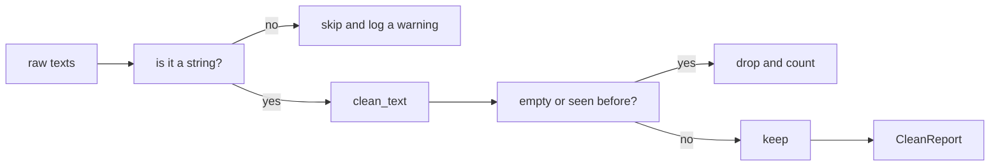

Before text goes into an embedding model or a fine-tuning set, it has to be cleaned. Web pages come with extra spaces, links, duplicates and empty rows, and a model trained on that learns the noise. A **text-cleaning toolkit** is a small module that does this job, and nearly every AI project grows one. In this lesson you build the personal version, with everything from phase 3: tests, logging and a debugging routine.

There is almost nothing new to learn. The point is to **combine** what you know: small functions, a dataclass for settings, `logging` for what happened, and `pytest` to prove it works.

## 1. The plan

The toolkit takes a list of raw texts and returns a clean list plus a report of what was dropped:



Write the plan before the code. Each piece has one job, one input and one output:

| Piece | Input | Output |
|---|---|---|
| `CleanConfig` | settings: lowercase, drop URLs, max length | one frozen object |
| `normalize_spaces(text)` | a string | the string with single spaces |
| `remove_urls(text)` | a string | the string without link words |
| `clean_text(text, config)` | a string and a config | the cleaned string |
| `clean_dataset(texts, config)` | a list of anything | a `CleanReport` and a log |

Exercise 1 is the first four rows. Exercise 2 is the last row.

## 2. Piece 1: the config

A cleaning job has options: lowercase or not, remove links or not, cut long texts or not. Passing them as three loose arguments everywhere is easy to get wrong. A **frozen dataclass** keeps them in one named bundle that nobody can change by accident:

```python
from dataclasses import dataclass


@dataclass(frozen=True)
class CleanConfig:
    lowercase: bool = True
    drop_urls: bool = True
    max_chars: int | None = None


config = CleanConfig(max_chars=50)
print(config)
# CleanConfig(lowercase=True, drop_urls=True, max_chars=50)

try:
    config.lowercase = False
except AttributeError:
    print("read-only")
# read-only
```

`int | None` means "a whole number or `None`". Here `None` means "no limit". Every field has a default, so `CleanConfig()` is the normal setup and you only name the options you change.

## 3. Pieces 2 and 3: small pure functions

A **pure function** gives the same output for the same input and touches nothing else: no file, no network, no global variable. Pure functions are the easiest code to test and to debug, because you can call them with one value and look at the result.

```python
def normalize_spaces(text: str) -> str:
    return " ".join(text.split())


def remove_urls(text: str) -> str:
    words = [w for w in text.split() if not w.startswith(("http://", "https://"))]
    return " ".join(words)


print(normalize_spaces("  Hello   world \n"))
print(remove_urls("see https://example.com now"))
print(repr(remove_urls("https://only.url")))
# Hello world
# see now
# ''
```

`text.split()` with no argument cuts at any run of spaces, tabs and newlines, and drops the empty pieces. `" ".join(...)` glues the words back with one space. `startswith` accepts a tuple of prefixes. A text that was only a link becomes an empty string `''`.

## 4. Piece 4: `clean_text`

`clean_text` runs the steps in a fixed order and lets the config decide which ones apply. Order matters: remove links first, then fix spaces, then change case, and cut the length last, so the cut counts the final characters.

```python
from dataclasses import dataclass


@dataclass(frozen=True)
class CleanConfig:
    lowercase: bool = True
    drop_urls: bool = True
    max_chars: int | None = None


def normalize_spaces(text):
    return " ".join(text.split())


def remove_urls(text):
    words = [w for w in text.split() if not w.startswith(("http://", "https://"))]
    return " ".join(words)


def clean_text(text, config=None):
    if not isinstance(text, str):
        raise TypeError("text must be a string")
    if config is None:
        config = CleanConfig()
    if config.drop_urls:
        text = remove_urls(text)
    text = normalize_spaces(text)
    if config.lowercase:
        text = text.lower()
    if config.max_chars is not None:
        text = text[: config.max_chars].rstrip()
    return text


print(clean_text("  Read https://x.io  TODAY "))
print(clean_text("Hello  WORLD", CleanConfig(lowercase=False)))
print(clean_text("hello brave new world", CleanConfig(max_chars=11)))
# read today
# Hello WORLD
# hello brave
```

Press **Visualize** on this block and watch `text` change at each step of `clean_text`. For the first call it looks like this:

| step | `text` |
|---|---|
| start | `'  Read https://x.io  TODAY '` |
| `remove_urls` | `'Read TODAY'` |
| `normalize_spaces` | `'Read TODAY'` |
| `lower` | `'read today'` |

The default for `config` is `None`, not `CleanConfig()`. A call in the default would run once when the function is defined; with `None` we create a fresh config only when needed. `text[:n].rstrip()` keeps at most `n` characters and removes a space left at the end. A wrong type raises `TypeError` with a clear message, so bad data is refused at the door.

## 5. Piece 5: a whole dataset, with logging

Real data is messy: the list may hold `None`, numbers, empty strings and duplicates. `clean_dataset` cleans each item, **counts** what it drops, and **logs** it. The log levels from the logging lesson fit naturally:

| event | level | why |
|---|---|---|
| an item is not a string | `WARNING` | something odd, we carry on |
| the run is over | `INFO` | one summary line for the normal story |

Empty texts and duplicates are expected in scraped data, so we only count them; logging each one would make 10,000 lines of noise.

```python
import logging
import sys
from dataclasses import dataclass

logging.basicConfig(
    stream=sys.stdout,
    level=logging.INFO,
    format="%(levelname)s %(message)s",
    force=True,
)
logger = logging.getLogger("textclean")


@dataclass
class CleanReport:
    kept: list[str]
    skipped: int = 0
    empty: int = 0
    duplicates: int = 0


def clean_dataset(texts):
    report = CleanReport(kept=[])
    seen = set()
    for index, item in enumerate(texts):
        if not isinstance(item, str):
            logger.warning("skipping item %d: not a string", index)
            report.skipped += 1
            continue
        cleaned = " ".join(item.split()).lower()
        if not cleaned:
            report.empty += 1
        elif cleaned in seen:
            report.duplicates += 1
        else:
            seen.add(cleaned)
            report.kept.append(cleaned)
    logger.info("kept %d of %d texts", len(report.kept), len(texts))
    return report


print(clean_dataset(["Hello  World", "hello world", "", None, "Bye"]))
# WARNING skipping item 3: not a string
# INFO kept 2 of 5 texts
# CleanReport(kept=['hello world', 'bye'], skipped=1, empty=1, duplicates=1)
```

Three ideas are at work. A **set** (`seen`) answers "have I met this text before?" very fast. `enumerate` gives the position `index` together with each item, so the warning can say which item was bad. And the report is a (non-frozen) dataclass, because the function adds to its counters while it runs. In the exercise you call `clean_text` here instead of repeating the two cleaning steps.

> [!NOTE]
> The messages use lazy arguments (`%d`) and a fixed shape, `skipping item 3: not a string`. A fixed shape is easy to search and, as the next section shows, easy to test.

## 6. Testing the toolkit

You wrote the functions to be tested. Here is the shape of a test file for the toolkit. This block only defines the tests; pytest runs them.

```text
import logging

import pytest

from textclean import CleanConfig, clean_dataset, clean_text, normalize_spaces


@pytest.fixture
def messy():
    return "  Read   https://x.io  TODAY "


def test_default_config_cleans_everything(messy):
    assert clean_text(messy) == "read today"


@pytest.mark.parametrize(
    "text, expected",
    [
        ("  a   b ", "a b"),
        ("a\n\tb", "a b"),
        ("", ""),
        ("   ", ""),
    ],
)
def test_normalize_spaces(text, expected):
    assert normalize_spaces(text) == expected


def test_a_non_string_item_logs_one_warning(caplog):
    with caplog.at_level(logging.DEBUG):
        clean_dataset(["ok", 42])
    warnings = [r for r in caplog.records if r.levelname == "WARNING"]
    assert len(warnings) == 1
    assert warnings[0].getMessage() == "skipping item 1: not a string"


def test_a_wrong_type_raises():
    with pytest.raises(TypeError):
        clean_text(5)
```

Each tool has one job. The **fixture** `messy` is shared setup that a test receives by naming it as a parameter. `parametrize` runs one test body with many `(text, expected)` pairs, and each pair is reported on its own, so a failure tells you exactly which input broke. `caplog` collects the log records, so you can check that the right level and message were logged. `pytest.raises` checks that bad input is refused.

A good first set of test cases: a normal input, an empty input, an input that is only the thing you remove, the options switched off, and a wrong type.

## 7. When a test turns red

Sooner or later a test fails. Use the routine from the debugging lesson instead of guessing:

```text
FAILED test_clean.py::test_default_config_cleans_everything
E   AssertionError: assert 'read today ' == 'read today'
```

1. **Read** the last lines: the result has a space at the end, so something left a space.
2. **Reproduce** with the smallest input, such as `clean_text("a https://x.io")`.
3. **Checkpoint**: print the value after each step. If the space appears after `remove_urls`, you know where to look.
4. **Fix one thing**, run the tests again, and keep the small input as a test.

If you swap the order of two steps, the tests tell you right away. That is the reason to write them.

## 8. Your turn

Open the two exercises. Exercise 1 is the config and the three text functions (sections 2 to 4). Exercise 2 is `clean_dataset` with its report and its logging (section 5). The editor already holds function skeletons with `# TODO` steps, and the tests appear in the report under your code. Press **Check** often: one green test at a time is a good way to build a project.

## 9. Common mistakes

**Cutting the text before cleaning it.** If the cut comes first, spaces and links use up your character budget:

```python
text = "  a   b   c  "
print(repr(text[:5]))
print(repr(" ".join(text.split())[:5]))
# '  a  '
# 'a b c'
```

Fix: clean first, cut last.

**A mutable default argument.** A list in a default is created once and shared by every call:

```python
def add_text(text, seen=[]):
    seen.append(text)
    return seen


print(add_text("a"))
print(add_text("b"))
# ['a']
# ['a', 'b']
```

The second call remembers the first. Fix: use `None` as the default and create the list inside the function, like `config=None` above.

**Treating `0` like `None`.** `max_chars=0` is a valid limit, but `if config.max_chars:` treats it like `None`:

```python
max_chars = 0
print(bool(max_chars))
print(max_chars is not None)
# False
# True
```

Fix: write `if config.max_chars is not None:`.

**Logging inside a loop for expected cases.** One `INFO` line per empty text turns a 10,000-row run into 10,000 lines. Count them and log one summary.

## Recap

- A project is small pieces that each have one job. Write the plan (piece, input, output) before the code.
- A **frozen dataclass** holds the settings; `None` defaults avoid shared mutable state.
- **Pure functions** (`normalize_spaces`, `remove_urls`, `clean_text`) are easy to call, test and debug. Order the steps on purpose: links, spaces, case, then the length cut.
- Count the expected drops, `WARNING` for odd items, and one `INFO` summary line. A set finds duplicates fast.
- Test with `parametrize` for many cases, a fixture for shared setup, `caplog` for logs and `pytest.raises` for errors.
- When a test is red: read the last line, reproduce small, add checkpoints, fix one thing.

## Take it further

Done early? Try these once the project works:

- Add a `strip_html` step that removes anything between `<` and `>`.
- Treat `HTTP://` and `HTTPS://` links in capitals as links too.
- Add a `min_chars` option and count the texts that are too short.
- Write the report as one `INFO` line with all four counts.
- Read the texts from a file and write the clean ones to another.
