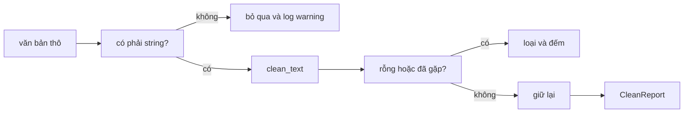

Trước khi văn bản được đưa vào một embedding model hay một bộ dữ liệu fine-tuning, nó phải được làm sạch. Trang web đi kèm khoảng trắng thừa, đường link, dữ liệu trùng và các dòng trống, và một model học từ đó sẽ học luôn cả nhiễu. Một **bộ công cụ làm sạch văn bản** (text-cleaning toolkit) là một module nhỏ làm việc này, và gần như dự án AI nào cũng sinh ra một cái. Trong bài này bạn xây phiên bản của riêng mình, với mọi thứ của phase 3: test, logging và quy trình debug.

Gần như không có kiến thức mới nào cần học. Điểm mấu chốt là **kết hợp** những gì bạn đã biết: các hàm nhỏ, một dataclass cho thiết lập, `logging` để ghi lại điều đã xảy ra, và `pytest` để chứng minh nó chạy đúng.

## 1. Kế hoạch

Bộ công cụ nhận một list văn bản thô và trả về một list đã sạch cùng một báo cáo về những gì đã bị loại:



Hãy viết kế hoạch trước khi viết code. Mỗi phần có một nhiệm vụ, một đầu vào và một đầu ra:

| Phần | Đầu vào | Đầu ra |
|---|---|---|
| `CleanConfig` | thiết lập: lowercase, bỏ URL, độ dài tối đa | một object frozen |
| `normalize_spaces(text)` | một string | string với khoảng trắng đơn |
| `remove_urls(text)` | một string | string không còn các từ là link |
| `clean_text(text, config)` | một string và một config | string đã được làm sạch |
| `clean_dataset(texts, config)` | một list bất kỳ | một `CleanReport` và một log |

Bài tập 1 là bốn dòng đầu. Bài tập 2 là dòng cuối.

## 2. Phần 1: config

Một việc làm sạch có các tùy chọn: chuyển chữ thường hay không, bỏ link hay không, cắt văn bản dài hay không. Truyền chúng thành ba đối số rời rạc khắp nơi rất dễ sai. Một **frozen dataclass** giữ chúng trong một gói có tên mà không ai có thể vô tình thay đổi:

```python
from dataclasses import dataclass


@dataclass(frozen=True)
class CleanConfig:
    lowercase: bool = True
    drop_urls: bool = True
    max_chars: int | None = None


config = CleanConfig(max_chars=50)
print(config)
# CleanConfig(lowercase=True, drop_urls=True, max_chars=50)

try:
    config.lowercase = False
except AttributeError:
    print("read-only")
# read-only
```

`int | None` nghĩa là "một số nguyên hoặc `None`". Ở đây `None` nghĩa là "không giới hạn". Mọi field đều có giá trị mặc định, nên `CleanConfig()` là thiết lập bình thường và bạn chỉ gọi tên những tùy chọn muốn đổi.

## 3. Phần 2 và 3: các hàm thuần nhỏ

Một **hàm thuần** (pure function) cho cùng một đầu ra với cùng một đầu vào và không đụng tới thứ gì khác: không file, không mạng, không biến global. Hàm thuần là loại code dễ test và dễ debug nhất, vì bạn có thể gọi nó với một giá trị và nhìn kết quả.

```python
def normalize_spaces(text: str) -> str:
    return " ".join(text.split())


def remove_urls(text: str) -> str:
    words = [w for w in text.split() if not w.startswith(("http://", "https://"))]
    return " ".join(words)


print(normalize_spaces("  Hello   world \n"))
print(remove_urls("see https://example.com now"))
print(repr(remove_urls("https://only.url")))
# Hello world
# see now
# ''
```

`text.split()` không có đối số sẽ cắt ở mọi chuỗi khoảng trắng, tab và xuống dòng, và bỏ các mảnh rỗng. `" ".join(...)` ghép các từ lại bằng một khoảng trắng. `startswith` nhận một tuple các tiền tố. Một văn bản chỉ gồm một link sẽ thành chuỗi rỗng `''`.

## 4. Phần 4: `clean_text`

`clean_text` chạy các bước theo một thứ tự cố định và để config quyết định bước nào được áp dụng. Thứ tự rất quan trọng: bỏ link trước, rồi sửa khoảng trắng, rồi đổi chữ hoa/thường, và cắt độ dài sau cùng, để việc cắt tính theo các ký tự cuối cùng.

```python
from dataclasses import dataclass


@dataclass(frozen=True)
class CleanConfig:
    lowercase: bool = True
    drop_urls: bool = True
    max_chars: int | None = None


def normalize_spaces(text):
    return " ".join(text.split())


def remove_urls(text):
    words = [w for w in text.split() if not w.startswith(("http://", "https://"))]
    return " ".join(words)


def clean_text(text, config=None):
    if not isinstance(text, str):
        raise TypeError("text must be a string")
    if config is None:
        config = CleanConfig()
    if config.drop_urls:
        text = remove_urls(text)
    text = normalize_spaces(text)
    if config.lowercase:
        text = text.lower()
    if config.max_chars is not None:
        text = text[: config.max_chars].rstrip()
    return text


print(clean_text("  Read https://x.io  TODAY "))
print(clean_text("Hello  WORLD", CleanConfig(lowercase=False)))
print(clean_text("hello brave new world", CleanConfig(max_chars=11)))
# read today
# Hello WORLD
# hello brave
```

Bấm **Visualize** ở khối code này để xem `text` thay đổi ở từng bước của `clean_text`. Với lời gọi đầu tiên, nó như sau:

| bước | `text` |
|---|---|
| bắt đầu | `'  Read https://x.io  TODAY '` |
| `remove_urls` | `'Read TODAY'` |
| `normalize_spaces` | `'Read TODAY'` |
| `lower` | `'read today'` |

Giá trị mặc định của `config` là `None`, không phải `CleanConfig()`. Một lời gọi trong giá trị mặc định chỉ chạy một lần khi hàm được định nghĩa; với `None` ta tạo config mới chỉ khi cần. `text[:n].rstrip()` giữ tối đa `n` ký tự và bỏ khoảng trắng còn sót ở cuối. Sai kiểu thì ném `TypeError` với thông báo rõ ràng, nên dữ liệu xấu bị từ chối ngay ở cửa.

## 5. Phần 5: cả một dataset, kèm logging

Dữ liệu thật rất lộn xộn: list có thể chứa `None`, số, chuỗi rỗng và dữ liệu trùng. `clean_dataset` làm sạch từng mục, **đếm** những gì nó loại, và **log** lại. Các level log từ bài logging rất hợp ở đây:

| sự kiện | level | vì sao |
|---|---|---|
| một mục không phải string | `WARNING` | có gì đó lạ, ta vẫn đi tiếp |
| lần chạy kết thúc | `INFO` | một dòng tổng kết cho câu chuyện bình thường |

Văn bản rỗng và dữ liệu trùng là chuyện bình thường trong dữ liệu cào về, nên ta chỉ đếm chúng; log từng cái sẽ tạo ra 10.000 dòng nhiễu.

```python
import logging
import sys
from dataclasses import dataclass

logging.basicConfig(
    stream=sys.stdout,
    level=logging.INFO,
    format="%(levelname)s %(message)s",
    force=True,
)
logger = logging.getLogger("textclean")


@dataclass
class CleanReport:
    kept: list[str]
    skipped: int = 0
    empty: int = 0
    duplicates: int = 0


def clean_dataset(texts):
    report = CleanReport(kept=[])
    seen = set()
    for index, item in enumerate(texts):
        if not isinstance(item, str):
            logger.warning("skipping item %d: not a string", index)
            report.skipped += 1
            continue
        cleaned = " ".join(item.split()).lower()
        if not cleaned:
            report.empty += 1
        elif cleaned in seen:
            report.duplicates += 1
        else:
            seen.add(cleaned)
            report.kept.append(cleaned)
    logger.info("kept %d of %d texts", len(report.kept), len(texts))
    return report


print(clean_dataset(["Hello  World", "hello world", "", None, "Bye"]))
# WARNING skipping item 3: not a string
# INFO kept 2 of 5 texts
# CleanReport(kept=['hello world', 'bye'], skipped=1, empty=1, duplicates=1)
```

Có ba ý tưởng đang hoạt động. Một **set** (`seen`) trả lời câu "mình đã gặp văn bản này chưa?" rất nhanh. `enumerate` cho vị trí `index` cùng với từng mục, nên warning có thể nói mục nào bị sai. Và báo cáo là một dataclass (không frozen), vì hàm cộng dồn vào các bộ đếm của nó khi chạy. Trong bài tập, bạn gọi `clean_text` ở đây thay vì lặp lại hai bước làm sạch.

> [!NOTE]
> Các thông báo dùng đối số lười (`%d`) và một dạng cố định, `skipping item 3: not a string`. Dạng cố định dễ tìm kiếm và, như phần tiếp theo cho thấy, dễ test.

## 6. Test bộ công cụ

Bạn viết các hàm để chúng được test. Đây là hình dạng của một file test cho bộ công cụ. Khối này chỉ định nghĩa các test; pytest sẽ chạy chúng.

```python
import logging

import pytest

from textclean import CleanConfig, clean_dataset, clean_text, normalize_spaces


@pytest.fixture
def messy():
    return "  Read   https://x.io  TODAY "


def test_default_config_cleans_everything(messy):
    assert clean_text(messy) == "read today"


@pytest.mark.parametrize(
    "text, expected",
    [
        ("  a   b ", "a b"),
        ("a\n\tb", "a b"),
        ("", ""),
        ("   ", ""),
    ],
)
def test_normalize_spaces(text, expected):
    assert normalize_spaces(text) == expected


def test_a_non_string_item_logs_one_warning(caplog):
    with caplog.at_level(logging.DEBUG):
        clean_dataset(["ok", 42])
    warnings = [r for r in caplog.records if r.levelname == "WARNING"]
    assert len(warnings) == 1
    assert warnings[0].getMessage() == "skipping item 1: not a string"


def test_a_wrong_type_raises():
    with pytest.raises(TypeError):
        clean_text(5)
```

Mỗi công cụ có một nhiệm vụ. **Fixture** `messy` là phần chuẩn bị dùng chung mà một test nhận được bằng cách gọi tên nó làm tham số. `parametrize` chạy một thân test với nhiều cặp `(text, expected)`, và mỗi cặp được báo cáo riêng, nên một lần thất bại cho bạn biết chính xác input nào đã hỏng. `caplog` thu các log record, để bạn kiểm tra đúng level và đúng thông báo đã được log. `pytest.raises` kiểm tra rằng đầu vào xấu bị từ chối.

Một bộ test case đầu tiên tốt gồm: một input bình thường, một input rỗng, một input chỉ toàn thứ bạn sẽ bỏ đi, các tùy chọn bị tắt, và một kiểu dữ liệu sai.

## 7. Khi một test chuyển sang đỏ

Sớm muộn gì cũng có test thất bại. Hãy dùng quy trình từ bài debug thay vì đoán mò:

```text
FAILED test_clean.py::test_default_config_cleans_everything
E   AssertionError: assert 'read today ' == 'read today'
```

1. **Đọc** những dòng cuối: kết quả có một khoảng trắng ở cuối, nên có bước nào đó để sót một khoảng trắng.
2. **Tái hiện** bằng input nhỏ nhất, như `clean_text("a https://x.io")`.
3. **Checkpoint**: in giá trị sau mỗi bước. Nếu khoảng trắng xuất hiện sau `remove_urls`, bạn biết cần nhìn ở đâu.
4. **Sửa một thứ**, chạy lại test, và giữ input nhỏ đó thành một test.

Nếu bạn đổi thứ tự của hai bước, các test sẽ báo ngay. Đó là lý do để viết chúng.

## 8. Đến lượt bạn

Hãy mở hai bài tập. Bài tập 1 là config và ba hàm xử lý văn bản (phần 2 đến 4). Bài tập 2 là `clean_dataset` với báo cáo và logging của nó (phần 5). Trình soạn thảo đã có sẵn khung hàm với các bước `# TODO`, và các test hiện trong báo cáo dưới code của bạn. Hãy bấm **Check** thường xuyên: mỗi lần một test xanh là cách tốt để xây một dự án.

## 9. Lỗi thường gặp

**Cắt văn bản trước khi làm sạch.** Nếu cắt trước, khoảng trắng và link sẽ ăn mất số ký tự cho phép của bạn:

```python
text = "  a   b   c  "
print(repr(text[:5]))
print(repr(" ".join(text.split())[:5]))
# '  a  '
# 'a b c'
```

Cách sửa: làm sạch trước, cắt sau cùng.

**Đối số mặc định có thể thay đổi (mutable).** Một list trong giá trị mặc định chỉ được tạo một lần và dùng chung cho mọi lời gọi:

```python
def add_text(text, seen=[]):
    seen.append(text)
    return seen


print(add_text("a"))
print(add_text("b"))
# ['a']
# ['a', 'b']
```

Lời gọi thứ hai nhớ lời gọi thứ nhất. Cách sửa: dùng `None` làm giá trị mặc định và tạo list bên trong hàm, như `config=None` ở trên.

**Coi `0` như `None`.** `max_chars=0` là một giới hạn hợp lệ, nhưng `if config.max_chars:` coi nó như `None`:

```python
max_chars = 0
print(bool(max_chars))
print(max_chars is not None)
# False
# True
```

Cách sửa: viết `if config.max_chars is not None:`.

**Log trong vòng lặp cho các trường hợp đã biết trước.** Một dòng `INFO` cho mỗi văn bản rỗng biến một lần chạy 10.000 dòng thành 10.000 dòng log. Hãy đếm chúng và log một dòng tổng kết.

## Tóm tắt

- Một dự án là các phần nhỏ, mỗi phần một nhiệm vụ. Viết kế hoạch (phần, đầu vào, đầu ra) trước khi viết code.
- Một **frozen dataclass** giữ các thiết lập; giá trị mặc định `None` tránh trạng thái mutable dùng chung.
- **Hàm thuần** (`normalize_spaces`, `remove_urls`, `clean_text`) dễ gọi, dễ test và dễ debug. Sắp xếp các bước có chủ đích: link, khoảng trắng, chữ hoa/thường, rồi mới cắt độ dài.
- Đếm những thứ bị loại đã biết trước, `WARNING` cho mục lạ, và một dòng tổng kết `INFO`. Dùng set để tìm dữ liệu trùng nhanh.
- Test bằng `parametrize` cho nhiều trường hợp, fixture cho phần chuẩn bị dùng chung, `caplog` cho log và `pytest.raises` cho lỗi.
- Khi test đỏ: đọc dòng cuối, tái hiện nhỏ, thêm checkpoint, sửa một thứ.

## Làm thêm

Xong sớm? Hãy thử những việc này khi dự án đã chạy được:

- Thêm bước `strip_html` để bỏ mọi thứ nằm giữa `<` và `>`.
- Coi các link `HTTP://` và `HTTPS://` viết hoa cũng là link.
- Thêm tùy chọn `min_chars` và đếm các văn bản quá ngắn.
- Viết báo cáo thành một dòng `INFO` có đủ bốn bộ đếm.
- Đọc các văn bản từ một file và ghi những văn bản sạch sang file khác.
