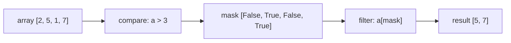

In AI engineering, almost everything is numbers in blocks: a single text embedding is a vector of 384 numbers, and a batch of model predictions is a table of probabilities. Doing math over those numbers with Python lists and `for` loops is both verbose and slow. **NumPy** solves both problems by storing numbers in compact arrays and doing math on the whole block at once.

## 1. What is a NumPy array?

A NumPy **array** (`ndarray`) is an ordered grid where every element has the **same data type**, unlike a Python `list` that can mix strings, ints, and dicts. Think of a list as a box of mixed items and an array as a tray of identical slots. By convention, everyone imports NumPy as `np`.

```python
import numpy as np

scores = np.array([8.5, 9.0, 7.5])
print(scores)        # [8.5 9.  7.5]
print(scores.shape)  # (3,)
print(scores.dtype)  # float64
print(scores.ndim)   # 1
print(len(scores))   # 3
```

Notice four useful properties: `shape` tells you the size along each dimension as a tuple, `dtype` shows the element type (such as `int64`, `int32` or `float64`), `ndim` counts the dimensions, and `len(scores)` gives the length along the first dimension. Calling `scores.tolist()` converts the array back into a plain Python `list`.

| Python `list` | NumPy `array` |
|---|---|
| Can hold mixed types (`[1, "a", True]`) | Every element has one `dtype` |
| `a * 2` repeats the list | `a * 2` multiplies every number |
| Slow for large numeric loops | Fast C-level math on whole blocks |
| Built into Python | Imported via `import numpy as np` |

> [!NOTE]
> If you pass a mix of ints and floats into `np.array([1, 2.5, 3])`, NumPy promotes all of them to `float64` so every slot shares the same type.

## 2. Vectorised math

With a Python list, multiplying every number by 2 requires a loop or a comprehension like `[x * 2 for x in xs]`. With a NumPy array, you write the math directly on the whole array — this style is called **vectorization**.

```python
import numpy as np

xs = [1, 2, 3]
print(xs * 2)                # [1, 2, 3, 1, 2, 3]
print([x * 2 for x in xs])   # [2, 4, 6]

a = np.array([1, 2, 3])
b = np.array([10, 20, 30])
print(a * 2)                 # [2 4 6]
print(a + b)                 # [11 22 33]
print(a ** 2)                # [1 4 9]
```

Notice the big difference on line 4 vs line 9: `list * 2` repeats the list, whereas `array * 2` multiplies every element by `2`. When you combine an array with a single number (a scalar) like `a * 2` or `a + 10`, NumPy stretches that single number across every element automatically — a mechanism called **broadcasting** (see the link in Further reading for multi-dimensional cases).

## 3. Summary functions

NumPy gives you fast built-in methods to summarise an array into a single number, instead of writing an accumulator loop from scratch.

```python
import numpy as np

latencies = np.array([120, 95, 140, 105])
print(latencies.sum())            # 460
print(latencies.mean())           # 115.0
print(latencies.min())            # 95
print(latencies.max())            # 140
print(latencies.argmax())         # 2
print(np.round(latencies / 1000, 2))  # [0.12 0.1  0.14 0.1 ]
```

Look closely at `argmax()`: it returns the **index** of the largest value (`2`, because `140` is at position `2`), not the value itself. Remember how you computed a mean earlier with a loop and a running total? Here is what `latencies.mean()` replaces behind the scenes:

| step | value | running total |
|---|---|---|
| start | `—` | `0` |
| 1 | `120` | `120` |
| 2 | `95` | `215` |
| 3 | `140` | `355` |
| 4 | `105` | `460` (divide by 4 -> `115.0`) |

> [!TIP]
> Most summary functions work both as methods (`a.mean()`) and as `np.` functions (`np.mean(a)`). For rounding an array, use `np.round(a, 2)`.

## 4. 2D arrays

Data in AI is usually 2D — rows of examples by columns of features or classes. A 2D array has `shape == (rows, cols)`, and you index it with `[row, col]`.

```text
          col 0   col 1   col 2
        +-------+-------+-------+
row 0   |  10   |  20   |  30   |   --> axis=1 (across each row)
        +-------+-------+-------+
row 1   |  40   |  50   |  60   |
        +-------+-------+-------+
            |
            v
          axis=0 (down each column)
```

Think of `axis=0` as collapsing the rows (one answer per column) and `axis=1` as collapsing the columns (one answer per row).

```python
import numpy as np

grid = np.array([
    [10, 20, 30],
    [40, 50, 60],
])
print(grid.shape)          # (2, 3)
print(grid[0, 2])          # 30
print(grid[1])             # [40 50 60]
print(grid[:, 0])          # [10 40]
print(grid.mean(axis=0))   # [25. 35. 45.]
print(grid.mean(axis=1))   # [20. 50.]
print(grid.max(axis=1))    # [30 60]
print(grid.argmax(axis=1)) # [2 2]
```

Notice `grid[1]` selects row `1`, while `grid[:, 0]` uses `:` ("all rows") to grab column `0`. And `grid.mean(axis=0)` returns 3 numbers (one per column), while `grid.mean(axis=1)`, `grid.max(axis=1)`, and `grid.argmax(axis=1)` return 2 numbers (one per row).

## 5. Boolean masks

Comparing an array with a value produces a **boolean mask** — an array of `True` and `False` of the same shape — which you can put inside `[...]` to keep only the matching items.



Let's trace this step by step in code:

```python
import numpy as np

scores = np.array([0.4, 0.9, 0.2, 0.8])
mask = scores >= 0.5
high = scores[mask]
count = int(mask.sum())

print(mask)   # [False  True False  True]
print(high)   # [0.9 0.8]
print(count)  # 2
```

Press **Visualize** on this block and watch `mask`, `high`, and `count` appear step by step. Because `True` counts as `1` and `False` counts as `0`, calling `.sum()` on a boolean mask counts how many items matched!

To combine two conditions on an array, use `&` (and) or `|` (or), and always wrap each comparison in parentheses:

```python
import numpy as np

temps = np.array([18, 24, 31, 15, 27])
in_range = temps[(temps >= 20) & (temps <= 28)]
print(in_range)              # [24 27]
print((temps > 25).sum())    # 2
```

## 6. Creating arrays quickly

Instead of typing every number by hand, NumPy has helper functions to build ranges, grids of zeros or ones, evenly spaced numbers, and new shapes.

```python
import numpy as np

print(np.arange(0, 10, 2))      # [0 2 4 6 8]
print(np.zeros((2, 3)))         # [[0. 0. 0.]
                                #  [0. 0. 0.]]
print(np.ones(4))               # [1. 1. 1. 1.]
print(np.linspace(0, 1, 5))     # [0.   0.25 0.5  0.75 1.  ]
print(np.arange(6).reshape(2, 3))  # [[0 1 2]
                                   #  [3 4 5]]
```

`np.arange(start, stop, step)` works like Python's `range`, `np.linspace(start, stop, count)` splits an interval into an exact number of points including both ends, and `.reshape(rows, cols)` rearranges elements without changing them.

## 7. Common mistakes

**Using `and` / `or` instead of `&` / `|` on arrays.** Python's `and` expects a single `True`/`False`, not a whole array:

```python
import numpy as np

a = np.array([1, 4, 6])
# Wrong: a > 2 and a < 5
# ValueError: The truth value of an array with more than one element is ambiguous.
print(a[(a > 2) & (a < 5)])   # [4]
```

Fix: use `&` for element-wise "and", `|` for "or", and `~` for "not".

**Forgetting parentheses around each condition.** `&` binds tighter than `>` and `<`, so `a > 1 & a < 5` is read by Python as `a > (1 & a) < 5`:

```python
import numpy as np

a = np.array([0, 3, 6])
# Wrong: a[a > 1 & a < 5] -> ValueError
print(a[(a > 1) & (a < 5)])   # [3]
```

Fix: always put `( ... )` around every comparison before `&` or `|`.

**Assigning a float into an integer array.** An array has a fixed `dtype`, so writing a decimal into an integer slot silently drops the fraction:

```python
import numpy as np

a = np.array([1, 2, 3])
a[0] = 2.7
print(a)   # [2 2 3]
```

Fix: create the array as floats (`np.array([1.0, 2.0, 3.0])` or `dtype=float`) if decimals will be stored.

**Editing a slice and accidentally changing the original.** Unlike Python lists, slicing a NumPy array returns a **view** sharing the same memory, not a copy:

```python
import numpy as np

orig = np.array([10, 20, 30, 40])
part = orig[1:3]
part[0] = 999
print(orig)   # [ 10 999  30  40]

safe = orig[1:3].copy()
safe[0] = 0
print(orig)   # [ 10 999  30  40]
```

Fix: call `.copy()` whenever you want an independent array you can edit safely.

> [!WARNING]
> Slicing shares memory (`view`), while boolean indexing (`a[a > 3]`) creates a fresh copy. When in doubt and you plan to mutate a slice, call `.copy()`.

## Recap

- A NumPy `array` holds elements of one `dtype` and exposes `.shape`, `.dtype`, and `.ndim`.
- Vectorised math (`a * 2`, `a + b`) applies operations to every element without a `for` loop, and scalar broadcasting stretches a single number across the array.
- Summary methods (`sum`, `mean`, `min`, `max`, `argmax`) aggregate values; on 2D arrays, `axis=0` runs down columns and `axis=1` runs across rows.
- Boolean masks (`a[a > 3]`) filter elements cleanly; combine conditions with `&` and `|` wrapped in parentheses, and count matches with `.sum()`.
- Use `np.arange`, `np.zeros`, `np.ones`, `np.linspace`, and `.reshape` to build arrays quickly, and `.copy()` when you want to edit a slice safely.
