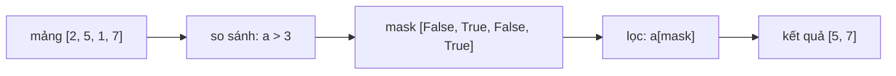

Trong kỹ thuật AI, hầu hết dữ liệu đều là những khối số: một embedding văn bản là một vector gồm 384 con số, còn một lô dự đoán của mô hình là một bảng các xác suất. Tính toán trên những con số đó bằng Python `list` và vòng lặp `for` vừa dài dòng vừa chậm. **NumPy** giải quyết cả hai vấn đề bằng cách lưu số trong các mảng gọn nhẹ và tính toán trên cả khối cùng một lúc.

## 1. Mảng NumPy là gì?

**Mảng** (array, kiểu `ndarray`) của NumPy là một lưới có thứ tự mà mọi phần tử đều có **cùng một kiểu dữ liệu**, khác với `list` của Python vốn có thể trộn lẫn chuỗi, số nguyên và dict. Hãy hình dung `list` như một chiếc hộp đựng đủ thứ, còn `array` là một khay gồm các ô giống hệt nhau. Theo quy ước, mọi người luôn import NumPy với tên ngắn là `np`.

```python
import numpy as np

scores = np.array([8.5, 9.0, 7.5])
print(scores)        # [8.5 9.  7.5]
print(scores.shape)  # (3,)
print(scores.dtype)  # float64
print(scores.ndim)   # 1
print(len(scores))   # 3
```

Để ý bốn thuộc tính hữu ích: `shape` cho biết kích thước theo từng chiều dưới dạng tuple, `dtype` (kiểu dữ liệu phần tử) hiển thị kiểu như `int64`, `int32` hay `float64`, `ndim` đếm số chiều, còn `len(scores)` trả về độ dài theo chiều đầu tiên.

| Python `list` | NumPy `array` |
|---|---|
| Chứa được nhiều kiểu lẫn lộn (`[1, "a", True]`) | Mọi phần tử có chung một `dtype` |
| `a * 2` lặp lại cả list | `a * 2` nhân từng con số |
| Chậm khi lặp tính toán số lượng lớn | Tính ở mức C cực nhanh trên cả khối |
| Có sẵn trong Python | Cần import bằng `import numpy as np` |

> [!NOTE]
> Nếu bạn truyền lẫn lộn số nguyên và số thực vào `np.array([1, 2.5, 3])`, NumPy tự nâng tất cả lên `float64` để mọi ô dùng chung một kiểu.

## 2. Tính toán vector hóa

Với Python `list`, muốn nhân đôi mọi phần tử bạn phải viết vòng lặp hoặc comprehension như `[x * 2 for x in xs]`. Với mảng NumPy, bạn viết phép tính thẳng lên cả mảng — cách làm này gọi là **vectorization** (tính toán vector hóa).

```python
import numpy as np

xs = [1, 2, 3]
print(xs * 2)                # [1, 2, 3, 1, 2, 3]
print([x * 2 for x in xs])   # [2, 4, 6]

a = np.array([1, 2, 3])
b = np.array([10, 20, 30])
print(a * 2)                 # [2 4 6]
print(a + b)                 # [11 22 33]
print(a ** 2)                # [1 4 9]
```

Hãy chú ý khác biệt lớn giữa dòng 4 và dòng 9: `list * 2` lặp lại cả list, còn `array * 2` nhân từng phần tử với `2`. Khi bạn kết hợp một mảng với một con số đơn lẻ (scalar) như `a * 2` hay `a + 10`, NumPy tự trải con số đó ra cho mọi phần tử — cơ chế này gọi là **broadcasting** (xem thêm liên kết ở mục Đọc thêm cho trường hợp nhiều chiều).

## 3. Các hàm tổng hợp

NumPy cung cấp sẵn các phương thức nhanh để tóm tắt cả mảng thành một con số, thay vì phải tự viết vòng lặp tích lũy (accumulator).

```python
import numpy as np

latencies = np.array([120, 95, 140, 105])
print(latencies.sum())            # 460
print(latencies.mean())           # 115.0
print(latencies.min())            # 95
print(latencies.max())            # 140
print(latencies.argmax())         # 2
print(np.round(latencies / 1000, 2))  # [0.12 0.1  0.14 0.1 ]
```

Hãy nhìn kỹ `argmax()`: nó trả về **chỉ số** (index) của giá trị lớn nhất (`2`, vì `140` nằm ở vị trí `2`), chứ không phải bản thân giá trị đó. Bạn còn nhớ cách tính trung bình bằng vòng lặp và biến tích lũy ở các bài trước không? Đây là những gì `latencies.mean()` thay thế phía sau:

| bước | giá trị | tổng tích lũy |
|---|---|---|
| bắt đầu | `—` | `0` |
| 1 | `120` | `120` |
| 2 | `95` | `215` |
| 3 | `140` | `355` |
| 4 | `105` | `460` (chia 4 -> `115.0`) |

> [!TIP]
> Đa số hàm tổng hợp dùng được cả dạng phương thức (`a.mean()`) lẫn hàm của `np.` (`np.mean(a)`). Để làm tròn một mảng, hãy dùng `np.round(a, 2)`.

## 4. Mảng 2D

Dữ liệu trong AI thường có dạng 2 chiều (2D) — các hàng là mẫu dữ liệu, các cột là đặc trưng hoặc lớp dự đoán. Một mảng 2D có `shape == (rows, cols)`, và bạn truy cập phần tử bằng `[row, col]`.

```text
          col 0   col 1   col 2
        +-------+-------+-------+
row 0   |  10   |  20   |  30   |   --> axis=1 (across each row)
        +-------+-------+-------+
row 1   |  40   |  50   |  60   |
        +-------+-------+-------+
            |
            v
          axis=0 (down each column)
```

Hãy hiểu `axis=0` (trục 0) là gộp dọc theo các hàng (cho một kết quả cho mỗi cột), còn `axis=1` (trục 1) là gộp ngang theo các cột (cho một kết quả cho mỗi hàng).

```python
import numpy as np

grid = np.array([
    [10, 20, 30],
    [40, 50, 60],
])
print(grid.shape)          # (2, 3)
print(grid[0, 2])          # 30
print(grid[1])             # [40 50 60]
print(grid[:, 0])          # [10 40]
print(grid.mean(axis=0))   # [25. 35. 45.]
print(grid.mean(axis=1))   # [20. 50.]
```

Để ý `grid[1]` chọn cả hàng `1`, còn `grid[:, 0]` dùng `:` ("mọi hàng") để lấy riêng cột `0`. Và `grid.mean(axis=0)` trả về 3 con số (mỗi cột một số), trong khi `grid.mean(axis=1)` trả về 2 con số (mỗi hàng một số).

## 5. Boolean mask

Khi so sánh một mảng với một giá trị, ta nhận được một **boolean mask** (mặt nạ boolean) — một mảng gồm `True` và `False` có cùng `shape` — và bạn đặt nó vào trong `[...]` để giữ lại đúng những phần tử thỏa điều kiện.



Hãy theo dõi từng bước qua đoạn code sau:

```python
import numpy as np

scores = np.array([0.4, 0.9, 0.2, 0.8])
mask = scores >= 0.5
high = scores[mask]
count = int(mask.sum())

print(mask)   # [False  True False  True]
print(high)   # [0.9 0.8]
print(count)  # 2
```

Bấm **Visualize** ở khối code này để xem `mask`, `high` và `count` lần lượt xuất hiện qua từng dòng. Vì `True` được tính là `1` và `False` là `0`, gọi `.sum()` trên một boolean mask sẽ đếm được có bao nhiêu phần tử đạt điều kiện!

Để kết hợp hai điều kiện trên mảng, hãy dùng `&` (và) hoặc `|` (hoặc), và luôn bọc từng phép so sánh trong dấu ngoặc đơn:

```python
import numpy as np

temps = np.array([18, 24, 31, 15, 27])
in_range = temps[(temps >= 20) & (temps <= 28)]
print(in_range)              # [24 27]
print((temps > 25).sum())    # 2
```

## 6. Tạo mảng nhanh

Thay vì gõ từng con số bằng tay, NumPy có sẵn các hàm tạo dãy số, lưới số 0 hoặc số 1, các điểm chia đều nhau và đổi hình dạng mảng.

```python
import numpy as np

print(np.arange(0, 10, 2))      # [0 2 4 6 8]
print(np.zeros((2, 3)))         # [[0. 0. 0.]
                                #  [0. 0. 0.]]
print(np.ones(4))               # [1. 1. 1. 1.]
print(np.linspace(0, 1, 5))     # [0.   0.25 0.5  0.75 1.  ]
print(np.arange(6).reshape(2, 3))  # [[0 1 2]
                                   #  [3 4 5]]
```

`np.arange(start, stop, step)` hoạt động giống `range` của Python, `np.linspace(start, stop, count)` chia một đoạn thành đúng số điểm cho trước gồm cả hai đầu mút, và `.reshape(rows, cols)` sắp xếp lại các phần tử sang kích thước mới mà không làm thay đổi giá trị.

## 7. Lỗi thường gặp

**Dùng `and` / `or` thay cho `&` / `|` trên mảng.** Từ khóa `and` của Python đòi hỏi một giá trị `True`/`False` duy nhất, không nhận cả một mảng:

```python
import numpy as np

a = np.array([1, 4, 6])
# Sai: a > 2 and a < 5
# ValueError: The truth value of an array with more than one element is ambiguous.
print(a[(a > 2) & (a < 5)])   # [4]
```

Cách sửa: dùng `&` cho "và" theo từng phần tử, `|` cho "hoặc", và `~` cho "phủ định".

**Quên dấu ngoặc quanh từng điều kiện.** Toán tử `&` có độ ưu tiên cao hơn `>` và `<`, nên `a > 1 & a < 5` bị Python hiểu thành `a > (1 & a) < 5`:

```python
import numpy as np

a = np.array([0, 3, 6])
# Sai: a[a > 1 & a < 5] -> ValueError
print(a[(a > 1) & (a < 5)])   # [3]
```

Cách sửa: luôn bọc `( ... )` quanh mỗi phép so sánh trước khi nối bằng `&` hoặc `|`.

**Gán số thực vào mảng số nguyên.** Mảng có `dtype` cố định, nên gán số thập phân vào ô số nguyên sẽ lặng lẽ cắt mất phần thập phân:

```python
import numpy as np

a = np.array([1, 2, 3])
a[0] = 2.7
print(a)   # [2 2 3]
```

Cách sửa: tạo mảng ở dạng số thực ngay từ đầu (`np.array([1.0, 2.0, 3.0])` hoặc `dtype=float`) nếu mảng sẽ chứa số thập phân.

**Sửa lát cắt (slice) làm thay đổi mảng gốc.** Khác với list Python, cắt một mảng NumPy trả về một **view** dùng chung bộ nhớ, chứ không phải bản sao:

```python
import numpy as np

orig = np.array([10, 20, 30, 40])
part = orig[1:3]
part[0] = 999
print(orig)   # [ 10 999  30  40]

safe = orig[1:3].copy()
safe[0] = 0
print(orig)   # [ 10 999  30  40]
```

Cách sửa: gọi `.copy()` mỗi khi bạn muốn một mảng độc lập để chỉnh sửa an toàn.

> [!WARNING]
> Phép cắt slice dùng chung bộ nhớ (`view`), còn lọc bằng boolean mask (`a[a > 3]`) tạo ra bản sao mới. Khi không chắc và bạn định sửa phần đã cắt, hãy gọi `.copy()`.

## Tóm tắt

- Mảng NumPy (`array`) chứa các phần tử cùng một `dtype` và cung cấp `.shape`, `.dtype`, `.ndim`.
- Tính toán vector hóa (`a * 2`, `a + b`) áp dụng phép tính lên mọi phần tử mà không cần vòng lặp `for`, còn scalar broadcasting tự trải một con số ra toàn mảng.
- Các hàm tổng hợp (`sum`, `mean`, `min`, `max`, `argmax`) gom giá trị lại; trên mảng 2D, `axis=0` chạy dọc theo cột và `axis=1` chạy ngang theo hàng.
- Boolean mask (`a[a > 3]`) lọc phần tử gọn gàng; nối nhiều điều kiện bằng `&` và `|` có ngoặc đơn bao quanh, và đếm số phần tử thỏa mãn bằng `.sum()`.
- Dùng `np.arange`, `np.zeros`, `np.ones`, `np.linspace` và `.reshape` để tạo mảng nhanh, và dùng `.copy()` khi cần sửa một slice an toàn.
