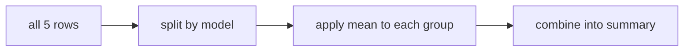

In AI engineering, most data arrives as a table: chatbot conversation logs where each row is a session, or evaluation results comparing multiple models across tasks. A NumPy array handles numbers well, but it cannot mix text labels, counts, and decimal scores in one grid. **pandas** is like "Excel in Python" — built on top of NumPy, it adds column names, row labels, and mixed column types so you can slice and summarise tables in a few lines.

## 1. Series and DataFrame

A **DataFrame** is a 2D table with named columns and a row **index**, while a single column pulled out of it is a **Series** (1D, with the same row index). The easiest way to build a small DataFrame in code is from a `dict` of lists, where each key becomes a column name. By convention, everyone imports pandas as `pd`.

```python
import pandas as pd

df = pd.DataFrame({
    "model": ["gpt-4o", "claude", "llama"],
    "tokens": [420, 310, 580],
    "score": [0.92, 0.88, 0.79],
})
print(df)
#     model  tokens  score
# 0  gpt-4o     420   0.92
# 1  claude     310   0.88
# 2   llama     580   0.79
print(df.shape)                # (3, 3)
print(list(df.columns))        # ['model', 'tokens', 'score']
print(len(df))                 # 3
print(df.dtypes)
# model      object
# tokens      int64
# score     float64
# dtype: object
```

Notice how `.shape` returns `(rows, cols)` just like NumPy, `len(df)` counts the rows, and `.dtypes` shows each column's type (`object` is how pandas stores text strings here). Grabbing one column gives a `Series`, and `.head(n)` previews the first `n` rows of a big table:

```python
import pandas as pd

df = pd.DataFrame({
    "model": ["gpt-4o", "claude", "llama"],
    "score": [0.92, 0.88, 0.79],
})
scores = df["score"]
print(type(scores))   # <class 'pandas.core.series.Series'>
print(scores)
# 0    0.92
# 1    0.88
# 2    0.79
# Name: score, dtype: float64
print(df.head(2))
#     model  score
# 0  gpt-4o   0.92
# 1  claude   0.88
```

| NumPy array | pandas DataFrame |
|---|---|
| All elements share one `dtype` | Each column can have its own `dtype` |
| Columns accessed by integer (`[:, 0]`) | Columns accessed by name (`df["score"]`) |
| Plain positional rows (`0, 1, 2`) | Labelled row **index** (numbers or names) |
| Best for math matrices and vectors | Best for mixed tabular logs and CSVs |

> [!NOTE]
> Every column in a DataFrame is stored as a Series backed by NumPy under the hood, so vectorised math like `df["score"] * 100` works automatically.

## 2. Reading CSV data

Real datasets usually arrive as CSV files rather than Python dictionaries. To run CSV examples right here in your browser without an external file, we use `io.StringIO` — a standard-library helper that wraps a text string so Python treats it like an open file.

```python
import io
import pandas as pd

csv_text = """model,tokens,score
gpt-4o,420,0.92
claude,310,0.88
llama,580,0.79"""

df = pd.read_csv(io.StringIO(csv_text))
print(df)
#     model  tokens  score
# 0  gpt-4o     420   0.92
# 1  claude     310   0.88
# 2   llama     580   0.79
```

Notice that `pd.read_csv` automatically detects the header row (`model`, `tokens`, `score`) and parses numbers into `int64` and `float64` columns for you. In a real project on your machine, you simply pass the file path instead: `pd.read_csv("data.csv")`.

## 3. Selecting data

Use square brackets `df[...]` to pick columns, `.loc[...]` to select by **label**, and `.iloc[...]` to select by integer **position** (just like a Python list). Think of the index on the left as a street address (`loc`), while `iloc` counts house numbers from `0`.

```text
  index (label)   |  model   | score      pos (iloc)
  ----------------+----------+-------     ----------
      "r1"        |  gpt-4o  |  0.92   <--   0
      "r2"        |  claude  |  0.88   <--   1
      "r3"        |  llama   |  0.79   <--   2

  df.loc["r2"]              -> selects row with label "r2"
  df.iloc[1]                -> selects row at position 1
  df.loc[["r1", "r3"], ["score"]]  -> rows + columns by label
```

Watch how single brackets return a `Series`, double brackets `[["model", "score"]]` return a smaller `DataFrame`, and `loc` / `iloc` pick specific rows or slices of rows and columns:

```python
import pandas as pd

df = pd.DataFrame(
    {"model": ["gpt-4o", "claude", "llama"], "score": [0.92, 0.88, 0.79]},
    index=["r1", "r2", "r3"],
)
print(df["score"])
# r1    0.92
# r2    0.88
# r3    0.79
# Name: score, dtype: float64

print(df[["model", "score"]])
#      model  score
# r1  gpt-4o   0.92
# r2  claude   0.88
# r3   llama   0.79

print(df.loc["r2"])
# model    claude
# score      0.88
# Name: r2, dtype: object

print(df.iloc[1])
# model    claude
# score      0.88
# Name: r2, dtype: object

print(df.loc[["r1", "r3"], ["score"]])
#     score
# r1   0.92
# r3   0.79
```

Notice that `df.loc["r2"]` and `df.iloc[1]` return the exact same row here because `"r2"` happens to sit at position `1`. Passing a list of row labels and column labels to `df.loc[rows, cols]` lets you carve out any sub-table cleanly.

## 4. Filtering and sorting

Just like NumPy boolean masks from the previous lesson, comparing a column produces a `Series` of `True`/`False` values that filters rows when placed inside `df[...]`. Combine conditions with `&` (and) and `|` (or) wrapped in parentheses, use `.isin([...])` to match any value from a list, and chain `.sort_values(..., ascending=False)` with `.reset_index(drop=True)` to renumber rows from `0`.

```python
import pandas as pd

logs = pd.DataFrame({
    "model": ["gpt-4o", "claude", "llama", "gpt-4o"],
    "tokens": [420, 310, 580, 190],
    "score": [0.92, 0.88, 0.79, 0.95],
})
good = logs[(logs["score"] >= 0.85) & (logs["tokens"] < 450)]
print(good)
#     model  tokens  score
# 0  gpt-4o     420   0.92
# 1  claude     310   0.88
# 3  gpt-4o     190   0.95

picked = logs[logs["model"].isin(["gpt-4o", "claude"])]
ranked = picked.sort_values("score", ascending=False).reset_index(drop=True)
print(ranked)
#     model  tokens  score
# 0  gpt-4o     190   0.95
# 1  gpt-4o     420   0.92
# 2  claude     310   0.88
```

Look at `good`'s index on the left: `0, 1, 3` — filtering kept the original row labels and skipped `2`. Adding `.reset_index(drop=True)` after sorting gives `ranked` a fresh `0, 1, 2` index (`drop=True` avoids saving the old index as an extra column).

> [!TIP]
> Write `.isin(["gpt-4o", "claude"])` instead of chaining `(df["model"] == "gpt-4o") | (df["model"] == "claude")` — it reads like plain English and scales to any list of options.

## 5. Adding new columns

You can compute a new column in one line using vectorised math across existing columns, and round floating-point columns with `.round(n)` — no row-by-row `for` loop needed.

```python
import pandas as pd

calls = pd.DataFrame({
    "model": ["gpt-4o", "claude", "llama"],
    "prompt": [200, 150, 300],
    "reply": [100, 160, 120],
})
calls["tokens"] = calls["prompt"] + calls["reply"]
calls["cost"] = (calls["tokens"] * 0.002).round(3)
print(calls[["model", "tokens", "cost"]])
#     model  tokens  cost
# 0  gpt-4o     300  0.60
# 1  claude     310  0.62
# 2   llama     420  0.84
```

Press **Visualize** on this block and watch `calls` gain the `tokens` and `cost` columns line by line. Assigning `calls["new_col"] = ...` adds the column if it does not exist yet, or replaces it if it already does.

## 6. Grouping with groupby

When you have many eval runs per model, **groupby** answers "what is the average score for each model?" in one step. Behind the scenes it follows the **split → apply → combine** pattern:



Let's trace how `groupby("model")["score"].mean()` handles five eval rows:

| group | rows | scores | mean |
|---|---|---|---|
| `claude` | 1, 3 | `0.86, 0.90` | `0.88` |
| `gpt-4o` | 0, 2 | `0.90, 0.94` | `0.92` |
| `llama` | 4 | `0.78` | `0.78` |

You can ask for a single summary like `.mean()`, multiple summaries at once with `.agg(["mean", "count"])`, or simply count how often each category appears with `.value_counts()`:

```python
import pandas as pd

evals = pd.DataFrame({
    "model": ["gpt-4o", "claude", "gpt-4o", "claude", "llama"],
    "score": [0.90, 0.86, 0.94, 0.90, 0.78],
})
print(evals.groupby("model")["score"].mean())
# model
# claude    0.88
# gpt-4o    0.92
# llama     0.78
# Name: score, dtype: float64

print(evals.groupby("model")["score"].agg(["mean", "count"]))
#         mean  count
# model
# claude  0.88      2
# gpt-4o  0.92      2
# llama   0.78      1

print(evals["model"].value_counts())
# model
# gpt-4o    2
# claude    2
# llama     1
# Name: count, dtype: int64
```

Notice that `groupby` sorts the group names alphabetically (`claude`, `gpt-4o`, `llama`), whereas `value_counts()` sorts by frequency from highest to lowest.

## 7. Common mistakes

**`KeyError` from a typo, wrong case, or extra space in a column name.** CSV headers often hide uppercase letters or trailing spaces like `"Model "`:

```python
import pandas as pd

df = pd.DataFrame({"Model ": ["gpt-4o", "claude"], "score": [0.9, 0.88]})
print(list(df.columns))     # ['Model ', 'score']
# Wrong: df["model"] -> KeyError: 'model'
print(list(df["Model "]))   # ['gpt-4o', 'claude']
```

Fix: print `list(df.columns)` first whenever you hit a `KeyError` so you see the exact spelling and spaces.

**Assigning through chained indexing `df[df["x"] > 0]["y"] = 1`.** Writing two `[...]` steps in a row edits a temporary copy instead of `df`, and pandas 2.3 warns you while leaving `df` unchanged:

```python
import pandas as pd

df = pd.DataFrame({"x": [1, -2, 3], "y": [0, 0, 0]})
# Wrong: df[df["x"] > 0]["y"] = 1
# SettingWithCopyWarning:
# A value is trying to be set on a copy of a slice from a DataFrame.
# Try using .loc[row_indexer,col_indexer] = value instead
df.loc[df["x"] > 0, "y"] = 1
print(df)
#    x  y
# 0  1  1
# 1 -2  0
# 2  3  1
```

Fix: always assign into a filtered subset in a single step with `df.loc[mask, "col"] = value`.

> [!WARNING]
> Never ignore `SettingWithCopyWarning` — it almost always means your assignment was silently thrown away and `df` was not updated.

**Confusing `loc` and `iloc` after filtering.** Filtering keeps the original row labels, so row position `0` might no longer have label `0`:

```python
import pandas as pd

df = pd.DataFrame({"model": ["a", "b", "c"], "score": [0.4, 0.9, 0.8]})
high = df[df["score"] >= 0.8]
# Wrong: high.loc[0] -> KeyError: 0  (index is [1, 2], not [0, 1])
print(high.iloc[0]["model"])          # b
clean = high.reset_index(drop=True)
print(clean.loc[0, "model"])          # b
```

Fix: use `.iloc[0]` if you want the first row by position, or call `.reset_index(drop=True)` right after filtering.

**Using `and` / `or` instead of `&` / `|` on Series masks.** Just like NumPy arrays, Python's `and` cannot evaluate a whole column of booleans at once:

```python
import pandas as pd

df = pd.DataFrame({"x": [1, 4, 6]})
# Wrong: df[(df["x"] > 2) and (df["x"] < 5)]
# ValueError: The truth value of a Series is ambiguous. Use a.empty, a.bool(), a.item(), a.any() or a.all().
print(df[(df["x"] > 2) & (df["x"] < 5)])
#    x
# 1  4
```

Fix: use `&` and `|` with parentheses around each comparison.

## Recap

- A **DataFrame** is a 2D labelled table (`shape`, `columns`, `dtypes`, `head()`, `len(df)`), and each column is a 1D **Series**.
- Load CSV files with `pd.read_csv("data.csv")`, or test inline CSV strings with `pd.read_csv(io.StringIO(text))`.
- Select columns with `df["col"]` or `df[["a", "b"]]`, rows/cells by **label** with `.loc[...]`, and by **position** with `.iloc[...]`.
- Filter with boolean masks (`&`, `|`, `.isin(...)`), sort with `.sort_values(..., ascending=False)`, and renumber rows with `.reset_index(drop=True)`.
- Add columns vectorised (`df["cost"] = df["tokens"] * price`), update subsets safely with `df.loc[mask, "col"] = value`, and summarise categories with `.groupby(...).agg(...)` and `.value_counts()`.
