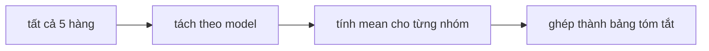

Trong kỹ thuật AI, phần lớn dữ liệu có dạng bảng: log hội thoại của chatbot với mỗi hàng là một phiên trò chuyện, hay kết quả eval so sánh nhiều mô hình trên nhiều tác vụ. Mảng NumPy xử lý con số rất tốt, nhưng không thể trộn nhãn văn bản, số đếm và điểm số thực trong cùng một lưới. **pandas** giống như "Excel trong Python" — được xây dựng trên nền NumPy, bổ sung tên cột, nhãn hàng và mỗi cột một kiểu dữ liệu riêng để bạn cắt lọc và tổng hợp bảng chỉ trong vài dòng.

## 1. Series và DataFrame

**DataFrame** là một bảng 2 chiều có tên cột và **index** (chỉ mục nhãn) cho từng hàng, còn một cột đơn lẻ rút ra từ bảng đó là một **Series** (cột dữ liệu 1 chiều, dùng chung index hàng). Cách dễ nhất để tạo một DataFrame nhỏ trong code là từ một `dict` chứa các list, trong đó mỗi key trở thành một tên cột. Theo quy ước, mọi người luôn import pandas với tên ngắn là `pd`.

```python
import pandas as pd

df = pd.DataFrame({
    "model": ["gpt-4o", "claude", "llama"],
    "tokens": [420, 310, 580],
    "score": [0.92, 0.88, 0.79],
})
print(df)
#     model  tokens  score
# 0  gpt-4o     420   0.92
# 1  claude     310   0.88
# 2   llama     580   0.79
print(df.shape)                # (3, 3)
print(list(df.columns))        # ['model', 'tokens', 'score']
print(len(df))                 # 3
print(df.dtypes)
# model      object
# tokens      int64
# score     float64
# dtype: object
```

Để ý cách `.shape` trả về `(hàng, cột)` giống hệt NumPy, `len(df)` đếm số hàng, và `.dtypes` cho thấy kiểu dữ liệu từng cột (`object` là cách pandas lưu chuỗi văn bản ở đây). Lấy riêng một cột sẽ cho ta một `Series`, còn `.head(n)` xem nhanh `n` hàng đầu của bảng lớn:

```python
import pandas as pd

df = pd.DataFrame({
    "model": ["gpt-4o", "claude", "llama"],
    "score": [0.92, 0.88, 0.79],
})
scores = df["score"]
print(type(scores))   # <class 'pandas.core.series.Series'>
print(scores)
# 0    0.92
# 1    0.88
# 2    0.79
# Name: score, dtype: float64
print(df.head(2))
#     model  score
# 0  gpt-4o   0.92
# 1  claude   0.88
```

| NumPy array | pandas DataFrame |
|---|---|
| Mọi phần tử dùng chung một `dtype` | Mỗi cột có thể có một `dtype` riêng |
| Truy cập cột theo chỉ số nguyên (`[:, 0]`) | Truy cập cột theo tên (`df["score"]`) |
| Hàng đánh số vị trí thuần (`0, 1, 2`) | Có **index** gắn nhãn cho hàng (số hoặc tên) |
| Phù hợp nhất cho ma trận và vector toán học | Phù hợp nhất cho dữ liệu bảng lẫn kiểu và CSV |

> [!NOTE]
> Mỗi cột trong DataFrame là một Series được xây trên mảng NumPy bên dưới, nên các phép tính vector hóa như `df["score"] * 100` chạy được ngay.

## 2. Đọc CSV

Dữ liệu thực tế thường đến từ file CSV chứ không phải dictionary viết sẵn trong Python. Để chạy các ví dụ CSV ngay trên trình duyệt mà không cần file ngoài, ta dùng `io.StringIO` — một công cụ trong thư viện chuẩn giả làm file từ một chuỗi văn bản.

```python
import io
import pandas as pd

csv_text = """model,tokens,score
gpt-4o,420,0.92
claude,310,0.88
llama,580,0.79"""

df = pd.read_csv(io.StringIO(csv_text))
print(df)
#     model  tokens  score
# 0  gpt-4o     420   0.92
# 1  claude     310   0.88
# 2   llama     580   0.79
```

Hãy để ý `pd.read_csv` tự động nhận ra dòng tiêu đề (`model`, `tokens`, `score`) và chuyển các con số thành cột `int64` và `float64` giúp bạn. Trong dự án thật trên máy, bạn chỉ việc truyền đường dẫn file vào thay thế: `pd.read_csv("data.csv")`.

## 3. Chọn dữ liệu

Bạn dùng ngoặc vuông `df[...]` để chọn cột, `.loc[...]` để chọn theo **nhãn** (label), và `.iloc[...]` để chọn theo **vị trí** số nguyên (giống chỉ số list trong Python). Hãy coi cột index bên trái như số nhà gắn tên (`loc`), còn `iloc` đếm thứ tự từ `0`.

```text
  index (label)   |  model   | score      pos (iloc)
  ----------------+----------+-------     ----------
      "r1"        |  gpt-4o  |  0.92   <--   0
      "r2"        |  claude  |  0.88   <--   1
      "r3"        |  llama   |  0.79   <--   2

  df.loc["r2"]              -> selects row with label "r2"
  df.iloc[1]                -> selects row at position 1
  df.loc[["r1", "r3"], ["score"]]  -> rows + columns by label
```

Xem cách ngoặc vuông đơn `["score"]` trả về một `Series`, ngoặc vuông kép `[["model", "score"]]` trả về một `DataFrame` nhỏ hơn, và `loc` / `iloc` rút ra hàng hoặc lát cắt hàng-cột cụ thể:

```python
import pandas as pd

df = pd.DataFrame(
    {"model": ["gpt-4o", "claude", "llama"], "score": [0.92, 0.88, 0.79]},
    index=["r1", "r2", "r3"],
)
print(df["score"])
# r1    0.92
# r2    0.88
# r3    0.79
# Name: score, dtype: float64

print(df[["model", "score"]])
#      model  score
# r1  gpt-4o   0.92
# r2  claude   0.88
# r3   llama   0.79

print(df.loc["r2"])
# model    claude
# score      0.88
# Name: r2, dtype: object

print(df.iloc[1])
# model    claude
# score      0.88
# Name: r2, dtype: object

print(df.loc[["r1", "r3"], ["score"]])
#     score
# r1   0.92
# r3   0.79
```

Để ý `df.loc["r2"]` và `df.iloc[1]` trả về cùng một hàng vì nhãn `"r2"` đang nằm đúng ở vị trí `1`. Truyền danh sách nhãn hàng và nhãn cột vào `df.loc[rows, cols]` giúp bạn trích gọn bất kỳ bảng con nào.

## 4. Lọc và sắp xếp

Giống như **boolean mask** (mặt nạ boolean) ở bài NumPy trước, so sánh một cột tạo ra một `Series` gồm `True`/`False` để lọc hàng khi đặt trong `df[...]`. Bạn nối nhiều điều kiện bằng `&` (và) hoặc `|` (hoặc) kèm dấu ngoặc đơn, dùng `.isin([...])` để kiểm tra nằm trong danh sách, rồi nối `.sort_values(..., ascending=False)` với `.reset_index(drop=True)` để đánh lại số hàng từ `0`.

```python
import pandas as pd

logs = pd.DataFrame({
    "model": ["gpt-4o", "claude", "llama", "gpt-4o"],
    "tokens": [420, 310, 580, 190],
    "score": [0.92, 0.88, 0.79, 0.95],
})
good = logs[(logs["score"] >= 0.85) & (logs["tokens"] < 450)]
print(good)
#     model  tokens  score
# 0  gpt-4o     420   0.92
# 1  claude     310   0.88
# 3  gpt-4o     190   0.95

picked = logs[logs["model"].isin(["gpt-4o", "claude"])]
ranked = picked.sort_values("score", ascending=False).reset_index(drop=True)
print(ranked)
#     model  tokens  score
# 0  gpt-4o     190   0.95
# 1  gpt-4o     420   0.92
# 2  claude     310   0.88
```

Nhìn cột index bên trái của `good`: `0, 1, 3` — phép lọc giữ nguyên nhãn hàng cũ và bỏ qua hàng `2`. Thêm `.reset_index(drop=True)` sau khi sắp xếp sẽ cấp cho `ranked` bộ index mới `0, 1, 2` (`drop=True` để không biến index cũ thành một cột thừa).

> [!TIP]
> Hãy viết `.isin(["gpt-4o", "claude"])` thay vì ghép `(df["model"] == "gpt-4o") | (df["model"] == "claude")` — vừa dễ đọc vừa mở rộng gọn khi danh sách lựa chọn dài ra.

## 5. Tạo cột mới

Bạn có thể tính một cột mới chỉ trong một dòng bằng phép toán vector hóa giữa các cột sẵn có, và làm tròn cột số thực với `.round(n)` — không cần vòng lặp `for` qua từng hàng.

```python
import pandas as pd

calls = pd.DataFrame({
    "model": ["gpt-4o", "claude", "llama"],
    "prompt": [200, 150, 300],
    "reply": [100, 160, 120],
})
calls["tokens"] = calls["prompt"] + calls["reply"]
calls["cost"] = (calls["tokens"] * 0.002).round(3)
print(calls[["model", "tokens", "cost"]])
#     model  tokens  cost
# 0  gpt-4o     300  0.60
# 1  claude     310  0.62
# 2   llama     420  0.84
```

Bấm **Visualize** ở khối code này để xem `calls` lần lượt có thêm cột `tokens` và `cost` qua từng dòng. Phép gán `calls["new_col"] = ...` tự tạo cột mới nếu chưa có, hoặc ghi đè nếu cột đã tồn tại.

## 6. Gom nhóm với groupby

Khi có nhiều lượt eval cho từng mô hình, **groupby** (gom nhóm) trả lời câu hỏi "điểm trung bình của mỗi mô hình là bao nhiêu?" chỉ trong một bước. Phía sau, nó chạy theo quy trình **split → apply → combine** (tách → áp dụng → ghép):



Cùng theo dõi cách `groupby("model")["score"].mean()` xử lý năm dòng eval:

| nhóm | các hàng | điểm số | trung bình |
|---|---|---|---|
| `claude` | 1, 3 | `0.86, 0.90` | `0.88` |
| `gpt-4o` | 0, 2 | `0.90, 0.94` | `0.92` |
| `llama` | 4 | `0.78` | `0.78` |

Bạn có thể tính một **aggregation** (phép tổng hợp) đơn lẻ như `.mean()`, tính nhiều chỉ số cùng lúc với `.agg(["mean", "count"])`, hoặc đếm nhanh số lần xuất hiện của mỗi loại bằng `.value_counts()`:

```python
import pandas as pd

evals = pd.DataFrame({
    "model": ["gpt-4o", "claude", "gpt-4o", "claude", "llama"],
    "score": [0.90, 0.86, 0.94, 0.90, 0.78],
})
print(evals.groupby("model")["score"].mean())
# model
# claude    0.88
# gpt-4o    0.92
# llama     0.78
# Name: score, dtype: float64

print(evals.groupby("model")["score"].agg(["mean", "count"]))
#         mean  count
# model
# claude  0.88      2
# gpt-4o  0.92      2
# llama   0.78      1

print(evals["model"].value_counts())
# model
# gpt-4o    2
# claude    2
# llama     1
# Name: count, dtype: int64
```

Để ý `groupby` sắp xếp tên nhóm theo thứ tự chữ cái (`claude`, `gpt-4o`, `llama`), trong khi `value_counts()` sắp theo tần suất từ cao xuống thấp.

## 7. Lỗi thường gặp

**`KeyError` do gõ sai tên cột, lệch hoa thường hoặc dính khoảng trắng.** Tiêu đề CSV thường giấu chữ viết hoa hoặc dấu cách thừa như `"Model "`:

```python
import pandas as pd

df = pd.DataFrame({"Model ": ["gpt-4o", "claude"], "score": [0.9, 0.88]})
print(list(df.columns))     # ['Model ', 'score']
# Sai: df["model"] -> KeyError: 'model'
print(list(df["Model "]))   # ['gpt-4o', 'claude']
```

Cách sửa: hãy in `list(df.columns)` trước mỗi khi gặp `KeyError` để thấy chính xác từng chữ hoa và dấu cách.

**Gán giá trị qua chained indexing `df[df["x"] > 0]["y"] = 1`.** Viết hai cặp `[...]` nối tiếp nhau sẽ sửa trên một bản sao tạm chứ không đổi `df`, và pandas 2.3 sẽ bật cảnh báo trong khi `df` vẫn y nguyên:

```python
import pandas as pd

df = pd.DataFrame({"x": [1, -2, 3], "y": [0, 0, 0]})
# Sai: df[df["x"] > 0]["y"] = 1
# SettingWithCopyWarning:
# A value is trying to be set on a copy of a slice from a DataFrame.
# Try using .loc[row_indexer,col_indexer] = value instead
df.loc[df["x"] > 0, "y"] = 1
print(df)
#    x  y
# 0  1  1
# 1 -2  0
# 2  3  1
```

Cách sửa: luôn gán vào tập con đã lọc chỉ trong một bước bằng `df.loc[mask, "col"] = value`.

> [!WARNING]
> Đừng bao giờ bỏ qua `SettingWithCopyWarning` — gần như chắc chắn phép gán của bạn đã bị vứt đi và `df` không hề thay đổi.

**Nhầm lẫn `loc` và `iloc` sau khi lọc.** Phép lọc giữ lại nhãn hàng gốc, nên hàng ở vị trí `0` có thể không còn mang nhãn `0`:

```python
import pandas as pd

df = pd.DataFrame({"model": ["a", "b", "c"], "score": [0.4, 0.9, 0.8]})
high = df[df["score"] >= 0.8]
# Sai: high.loc[0] -> KeyError: 0  (index là [1, 2], không phải [0, 1])
print(high.iloc[0]["model"])          # b
clean = high.reset_index(drop=True)
print(clean.loc[0, "model"])          # b
```

Cách sửa: dùng `.iloc[0]` nếu muốn lấy hàng đầu theo vị trí, hoặc gọi `.reset_index(drop=True)` ngay sau khi lọc.

**Dùng `and` / `or` thay cho `&` / `|` trên mask của Series.** Giống như mảng NumPy, từ khóa `and` của Python không thể đánh giá cả một cột boolean cùng lúc:

```python
import pandas as pd

df = pd.DataFrame({"x": [1, 4, 6]})
# Sai: df[(df["x"] > 2) and (df["x"] < 5)]
# ValueError: The truth value of a Series is ambiguous. Use a.empty, a.bool(), a.item(), a.any() or a.all().
print(df[(df["x"] > 2) & (df["x"] < 5)])
#    x
# 1  4
```

Cách sửa: dùng `&` và `|` kèm dấu ngoặc đơn bao quanh mỗi phép so sánh.

## Tóm tắt

- **DataFrame** là bảng 2 chiều có nhãn (`.shape`, `.columns`, `.dtypes`, `.head()`, `len(df)`), và mỗi cột là một **Series** 1 chiều.
- Đọc file CSV bằng `pd.read_csv("data.csv")`, hoặc thử chuỗi CSV viết sẵn bằng `pd.read_csv(io.StringIO(text))`.
- Chọn cột với `df["col"]` hoặc `df[["a", "b"]]`, chọn hàng/ô theo **nhãn** với `.loc[...]`, và theo **vị trí** với `.iloc[...]`.
- Lọc hàng bằng boolean mask (`&`, `|`, `.isin(...)`), sắp xếp với `.sort_values(..., ascending=False)`, và đánh lại index bằng `.reset_index(drop=True)`.
- Tính cột mới theo kiểu vector hóa (`df["cost"] = df["tokens"] * price`), sửa tập con an toàn bằng `df.loc[mask, "col"] = value`, và tổng hợp theo nhóm với `.groupby(...).agg(...)` cùng `.value_counts()`.
