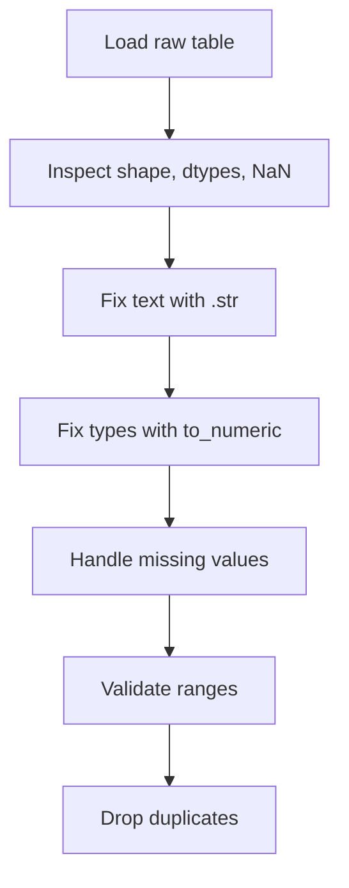

Real-world data is rarely tidy when it reaches your script: user ratings are left blank, `" GPT-4o"` and `"gpt-4o"` look like two different models, numbers arrive as text like `"1,200"`, and the same row appears twice. If you feed dirty tables straight into an evaluation or model, your metrics and predictions will be wrong — "garbage in, garbage out". Cleaning data in **pandas** turns raw logs into reliable inputs in a few repeatable steps.

## 1. Inspect the data first

Before changing anything, check the table's size, column types, missing counts, and unique category values so you know which columns are broken. Look at a messy log table using `.shape`, `.dtypes`, `.isna().sum()`, `.unique()`, `.nunique()` (count of distinct values), and `.value_counts()` — think of this as walking around a car before opening the hood.

```python
import io
import pandas as pd

csv_text = """model,tokens,rating
 GPT-4o,"1,200",5
gpt-4o,450,
Claude,310,4
 GPT-4o,"1,200",5"""

df = pd.read_csv(io.StringIO(csv_text))
print(df.shape)
# (4, 3)
print(df.dtypes)
# model      object
# tokens     object
# rating    float64
# dtype: object
print(df.isna().sum())
# model     0
# tokens    0
# rating    1
# dtype: int64
print(df["model"].unique().tolist())
# [' GPT-4o', 'gpt-4o', 'Claude']
print(df["model"].nunique())
# 3
print(df["model"].value_counts())
# model
#  GPT-4o    2
# gpt-4o     1
# Claude     1
# Name: count, dtype: int64
```

Notice three clues right away: `tokens` came in as `object` (text) because of `"1,200"`, `rating` has `1` missing value, and `" GPT-4o"` and `"gpt-4o"` are split into separate counts because of a leading space and uppercase letters.

## 2. Handling missing values

In pandas, empty cells show up as **`NaN`** (Not a Number) or `None`, and `.isna()` marks every missing cell as `True`. You can drop rows that are missing an essential column with `.dropna(subset=[...])`, or fill gaps in a secondary numeric column with `.fillna(value)` — often using the column's `.median()` so one extreme score does not skew the fill value. Note that `.mean()` and `.median()` skip `NaN` values automatically.

```python
import numpy as np
import pandas as pd

survey = pd.DataFrame({
    "user": ["an", None, "chi", "dung", "em", "gia"],
    "score": [4.0, 1.0, np.nan, 5.0, 3.0, np.nan],
})
print(survey.isna().sum())
# user     1
# score    2
# dtype: int64
print(round(float(survey["score"].mean()), 2))
# 3.25

valid = survey.dropna(subset=["user"]).reset_index(drop=True)
median_score = float(valid["score"].median())
valid["score"] = valid["score"].fillna(median_score)
print(valid)
#    user  score
# 0    an    4.0
# 1   chi    4.0
# 2  dung    5.0
# 3    em    3.0
# 4   gia    4.0
```

Here is how `valid["score"].fillna(4.0)` updates each row of `valid` (after dropping the row with missing `user` and resetting the index):

| row | before | after |
|---|---|---|
| 0 | `4.0` | `4.0` |
| 1 | `NaN` | `4.0` |
| 2 | `5.0` | `5.0` |
| 3 | `3.0` | `3.0` |
| 4 | `NaN` | `4.0` |

> [!TIP]
> Drop a row when a key identifier like `user` or `text` is missing; fill with `.median()` only when a secondary numeric field is missing and the row is still useful.

## 3. Fixing column types

Columns that look like numbers (`"1,200"`, `" 350 "`) or booleans (`"yes"`, `"no"`) often load as `object` text because of commas, spaces, or `"N/A"` entries. Strip formatting characters with `.str.replace(...)`, convert safely with `pd.to_numeric(..., errors="coerce")` so unreadable strings become `NaN` instead of crashing, and convert `"yes"`/`"no"` strings with `.map(...)`. Once no `NaN` values remain in an integer column, call `.astype("int64")` to lock in a whole-number type.

```text
  raw (object)          str.replace         to_numeric          dropna + astype("int64")
  "1,200"     --->      "1200"      --->    1200.0      --->    1200
  " 350 "     --->      " 350 "     --->     350.0      --->     350
  "N/A"       --->      "N/A"       --->       NaN      --->    (dropped)
```

Watch how `errors="coerce"` turns `"N/A"` into `NaN`, `.map({"yes": True, "no": False})` converts text flags into `bool`, and `.astype("int64")` succeeds after dropping the missing row:

```python
import pandas as pd

orders = pd.DataFrame({
    "price": ["1,200", "N/A", " 350 "],
    "paid": ["yes", "no", "yes"],
})
cleaned_text = orders["price"].str.replace(",", "", regex=False)
orders["price"] = pd.to_numeric(cleaned_text, errors="coerce")
orders["paid"] = orders["paid"].map({"yes": True, "no": False})
print(orders)
#     price   paid
# 0  1200.0   True
# 1     NaN  False
# 2   350.0   True

ready = orders.dropna(subset=["price"]).copy()
ready["price"] = ready["price"].astype("int64")
print(ready.dtypes)
# price    int64
# paid      bool
# dtype: object
```

Notice `pd.to_numeric` returned `float64` first because `NaN` is a floating-point value; removing `NaN` lets `.astype("int64")` finish cleanly.

## 4. Cleaning text

Messy category names usually hide leading or trailing spaces, mixed capitalisation, and inconsistent separators (`" GPT-4o "`, `"gpt_4o"`, `" gpt-4o"`). Chain pandas' `.str` accessor methods — `.str.strip()`, `.str.lower()`, and `.str.replace(...)` — to normalise every value at once and collapse duplicate label variants.

```python
import pandas as pd

raw = pd.Series([" GPT-4o ", "gpt_4o", "Claude ", " gpt-4o"])
print(raw.value_counts())
#  GPT-4o     1
# gpt_4o      1
# Claude      1
#  gpt-4o     1
# Name: count, dtype: int64

stripped = raw.str.strip()
lowered = stripped.str.lower()
cleaned = lowered.str.replace("_", "-", regex=False)
print(cleaned.value_counts())
# gpt-4o    3
# claude    1
# Name: count, dtype: int64
```

Press **Visualize** on this block and watch `raw` step through `stripped`, `lowered`, and `cleaned` until all three `gpt-4o` variants merge into a count of `3`. Passing `regex=False` to `.str.replace` tells pandas to match literal text rather than a regular expression.

## 5. Duplicates and invalid rows

Even after fixing text and types, datasets often contain repeated submissions or out-of-range values such as a rating of `9` on a 1-to-5 scale. Use `.duplicated()` to spot repeats, `.between(low, high)` to keep only valid rows first, and `.drop_duplicates(subset=..., keep="last")` afterwards so a bad entry never wins over an earlier valid one.

```python
import pandas as pd

ratings = pd.DataFrame({
    "user": ["an", "binh", "an", "chi"],
    "rating": [3, 5, 4, 9],
})
print(ratings.duplicated(subset=["user"]).tolist())
# [False, False, True, False]

valid_ratings = ratings[ratings["rating"].between(1, 5)]
deduped = valid_ratings.drop_duplicates(subset=["user"], keep="last").reset_index(drop=True)
print(deduped)
#    user  rating
# 0  binh       5
# 1    an       4
```

Notice two details: `.between(1, 5)` filters out `9` first (keeping `1 <= rating <= 5` inclusive), and `drop_duplicates(subset=["user"], keep="last")` then keeps row `2` (`an`, `4`) instead of the earlier row `0` (`an`, `3`).

## 6. Putting it into a pipeline

In real projects, you wrap every cleaning step inside a function `clean(df)` that starts with `df = df.copy()` so callers' original data stays untouched. Following one clear order — inspect, normalise text, coerce types, handle missing values, validate ranges, then drop duplicates — avoids subtle bugs like keeping a duplicate row whose rating turns out to be invalid.



| problem | tool |
|---|---|
| Count missing cells per column | `df.isna().sum()` |
| Drop rows missing key fields | `df.dropna(subset=[...])` |
| Fill missing numbers safely | `df["col"].fillna(df["col"].median())` |
| Parse messy numeric strings | `pd.to_numeric(..., errors="coerce")` |
| Normalise messy text labels | `.str.strip().str.lower().str.replace(...)` |
| Filter to an allowed range | `df[df["col"].between(low, high)]` |
| Remove repeated keys | `df.drop_duplicates(subset=[...], keep="last")` |

Watch how `clean(raw_df)` applies all of those steps in one reusable function:

```python
import pandas as pd


def clean(df):
    df = df.copy()
    df["user"] = df["user"].str.strip().str.lower()
    df["price"] = pd.to_numeric(
        df["price"].str.replace(",", "", regex=False), errors="coerce"
    )
    df = df.dropna(subset=["user", "price"])
    df = df[df["price"].between(1, 10000)]
    df = df.drop_duplicates(subset=["user"], keep="last")
    df["price"] = df["price"].astype("int64")
    return df.reset_index(drop=True)


raw_df = pd.DataFrame({
    "user": [" An ", "binh", "an", "chi"],
    "price": ["1,200", "N/A", " 950 ", "-5"],
})
print(clean(raw_df))
#   user  price
# 0   an    950
```

Notice how `"binh"` (`"N/A"`) and `"chi"` (`-5`) were filtered out, `" An "` and `"an"` merged under `"an"`, and `keep="last"` kept `950` as an `int64` column.

## 7. Common mistakes

**Forgetting to reassign after `dropna()` or `fillna()`.** Cleaning methods return a new DataFrame by default and leave the original table untouched:

```python
import numpy as np
import pandas as pd

d1 = pd.DataFrame({"score": [4.0, np.nan]})
d1.fillna(0)
print(d1["score"].tolist())   # [4.0, nan]
d1 = d1.fillna(0)
print(d1["score"].tolist())   # [4.0, 0.0]
```

Fix: always assign the returned DataFrame or Series back (`d1 = d1.fillna(0)`).

**Calling `.astype("int64")` while `NaN` values are still present.** Standard `int64` slots cannot store `NaN`, so pandas raises `IntCastingNaNError`:

```python
import numpy as np
import pandas as pd

s = pd.Series([1.0, np.nan, 3.0])
# Wrong: s.astype("int64")
# IntCastingNaNError: Cannot convert non-finite values (NA or inf) to integer
s = s.fillna(0).astype("int64")
print(s.tolist())   # [1, 0, 3]
```

Fix: drop or fill missing values first before converting to `"int64"`.

**Checking for missing values with `== np.nan`.** In IEEE floating-point math, `NaN` is never equal to anything — not even itself — so `scores == np.nan` is `False` on every row:

```python
import numpy as np
import pandas as pd

scores = pd.Series([4.0, np.nan])
print((scores == np.nan).tolist())   # [False, False]
print(scores.isna().tolist())        # [False, True]
```

Fix: always detect missing values with `.isna()` (or `.notna()`).

> [!WARNING]
> Never write `col == np.nan` or `col != None` to filter missing numbers — it silently returns the wrong mask without raising an error.

**Calling `.strip()` directly on a Series instead of `.str.strip()`.** String methods live under the `.str` accessor, not directly on the `Series` object:

```python
import pandas as pd

names = pd.Series([" gpt-4o ", " claude"])
# Wrong: names.strip()
# AttributeError: 'Series' object has no attribute 'strip'
print(names.str.strip().tolist())   # ['gpt-4o', 'claude']
```

Fix: prefix text operations on a pandas column with `.str` (`.str.strip()`, `.str.lower()`, `.str.replace(...)`).

## Recap

- Inspect raw data first with `.shape`, `.dtypes`, `.isna().sum()`, `.unique()`, and `.value_counts()`.
- Handle missing values by dropping rows missing required fields (`.dropna(subset=[...])`) or filling secondary numbers (`.fillna(median)`), and always detect `NaN` with `.isna()`.
- Clean number strings with `.str.replace(...)` and `pd.to_numeric(..., errors="coerce")`, map text flags with `.map(...)`, and cast to `"int64"` only after `NaN` values are gone.
- Normalise messy strings with `.str.strip()`, `.str.lower()`, and `.str.replace(..., regex=False)`.
- Remove repeated records with `.drop_duplicates(subset=..., keep="last")`, filter valid ranges with `.between(...)`, and wrap the pipeline in `clean(df)` starting with `df = df.copy()`.
