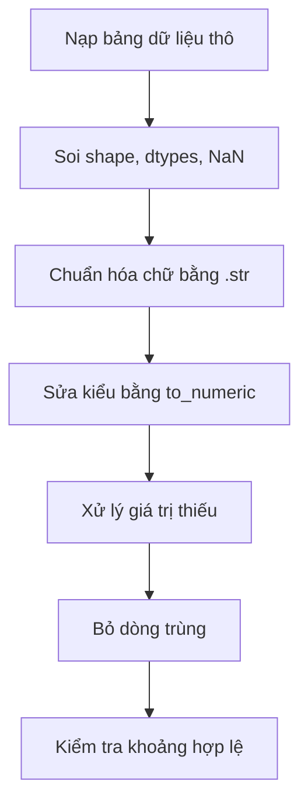

Dữ liệu thực tế hiếm khi sạch sẽ khi đi vào script của bạn: điểm đánh giá bị bỏ trống, `" GPT-4o"` và `"gpt-4o"` bị coi là hai mô hình khác nhau, con số lại lưu dưới dạng chữ `"1,200"`, và cùng một dòng bị lặp lại hai lần. Nếu đưa dữ liệu bẩn thẳng vào bước đánh giá hay huấn luyện mô hình, kết quả sẽ sai lệch theo đúng nghĩa "garbage in, garbage out" (rác vào thì rác ra). **Data cleaning** (làm sạch dữ liệu) bằng **pandas** giúp bạn biến log thô thành đầu vào đáng tin cậy chỉ qua vài bước lặp lại được.

## 1. Soi dữ liệu trước

Trước khi sửa bất cứ thứ gì, hãy kiểm tra kích thước bảng, kiểu dữ liệu từng cột, số ô thiếu và các giá trị phân loại hiện có để biết cột nào đang hỏng. Hãy xem một bảng log lộn xộn qua `.shape`, `.dtypes`, `.isna().sum()`, `.unique()` và `.value_counts()` — giống như đi một vòng kiểm tra xe trước khi mở nắp capo.

```python
import io
import pandas as pd

csv_text = """model,tokens,rating
 GPT-4o,"1,200",5
gpt-4o,450,
Claude,310,4
 GPT-4o,"1,200",5"""

df = pd.read_csv(io.StringIO(csv_text))
print(df.shape)
# (4, 3)
print(df.dtypes)
# model      object
# tokens     object
# rating    float64
# dtype: object
print(df.isna().sum())
# model     0
# tokens    0
# rating    1
# dtype: int64
print(df["model"].unique().tolist())
# [' GPT-4o', 'gpt-4o', 'Claude']
print(df["model"].value_counts())
# model
#  GPT-4o    2
# gpt-4o     1
# Claude     1
# Name: count, dtype: int64
```

Hãy để ý ngay ba manh mối: `tokens` bị đọc thành `object` (chuỗi) vì có `"1,200"`, `rating` có `1` **missing value** (giá trị thiếu), còn `" GPT-4o"` và `"gpt-4o"` bị tách làm hai nhóm đếm riêng chỉ vì dư dấu cách đầu và khác chữ hoa thường.

## 2. Xử lý giá trị thiếu

Trong pandas, ô trống hiện ra dưới dạng **`NaN`** (Not a Number) hoặc `None`, và `.isna()` đánh dấu mọi ô thiếu là `True`. Bạn có thể bỏ các hàng thiếu cột bắt buộc bằng `.dropna(subset=[...])`, hoặc điền ô trống ở cột số phụ bằng `.fillna(value)` — thường dùng `.median()` (trung vị) để một giá trị quá lớn hoặc quá nhỏ không kéo lệch kết quả. Lưu ý rằng `.mean()` và `.median()` tự động bỏ qua `NaN` khi tính.

```python
import numpy as np
import pandas as pd

survey = pd.DataFrame({
    "user": ["an", None, "chi", "dung", "em", "gia"],
    "score": [4.0, 1.0, np.nan, 5.0, 3.0, np.nan],
})
print(survey.isna().sum())
# user     1
# score    2
# dtype: int64
print(round(float(survey["score"].mean()), 2))
# 3.25

valid = survey.dropna(subset=["user"]).reset_index(drop=True)
median_score = float(valid["score"].median())
valid["score"] = valid["score"].fillna(median_score)
print(valid)
#    user  score
# 0    an    4.0
# 1   chi    4.0
# 2  dung    5.0
# 3    em    3.0
# 4   gia    4.0
```

Bảng theo dõi dưới đây cho thấy `valid["score"].fillna(4.0)` cập nhật từng hàng của `valid` ra sao (sau khi bỏ hàng thiếu `user` và đánh lại index):

| hàng | trước | sau |
|---|---|---|
| 0 | `4.0` | `4.0` |
| 1 | `NaN` | `4.0` |
| 2 | `5.0` | `5.0` |
| 3 | `3.0` | `3.0` |
| 4 | `NaN` | `4.0` |

> [!TIP]
> Hãy bỏ hàng khi thiếu trường định danh bắt buộc như `user` hay `text`; chỉ điền bằng `.median()` khi thiếu một cột số phụ và hàng đó vẫn còn giá trị sử dụng.

## 3. Sửa kiểu dữ liệu

Các cột trông như số (`"1,200"`, `" 350 "`) hoặc boolean (`"yes"`, `"no"`) thường bị nạp thành chuỗi `object` do dính dấu phẩy, khoảng trắng hay chữ `"N/A"`. Hãy xóa ký tự thừa bằng `.str.replace(...)`, dùng **type coercion** (ép kiểu an toàn) với `pd.to_numeric(..., errors="coerce")` để chuỗi không đọc được biến thành `NaN` thay vì làm sập code, và đổi `"yes"`/`"no"` bằng `.map(...)`. Khi chắc chắn không còn `NaN`, bạn gọi `.astype("int64")` để đưa cột về số nguyên.

```text
  raw (object)          str.replace         to_numeric          dropna + astype("int64")
  "1,200"     --->      "1200"      --->    1200.0      --->    1200
  " 350 "     --->      " 350 "     --->     350.0      --->     350
  "N/A"       --->      "N/A"       --->       NaN      --->    (dropped)
```

Xem cách `errors="coerce"` biến `"N/A"` thành `NaN`, `.map({"yes": True, "no": False})` đổi chuỗi thành `bool`, và `.astype("int64")` chạy mượt sau khi bỏ hàng thiếu:

```python
import pandas as pd

orders = pd.DataFrame({
    "price": ["1,200", "N/A", " 350 "],
    "paid": ["yes", "no", "yes"],
})
cleaned_text = orders["price"].str.replace(",", "", regex=False)
orders["price"] = pd.to_numeric(cleaned_text, errors="coerce")
orders["paid"] = orders["paid"].map({"yes": True, "no": False})
print(orders)
#     price   paid
# 0  1200.0   True
# 1     NaN  False
# 2   350.0   True

ready = orders.dropna(subset=["price"]).copy()
ready["price"] = ready["price"].astype("int64")
print(ready.dtypes)
# price    int64
# paid      bool
# dtype: object
```

Để ý `pd.to_numeric` trả về `float64` trước vì `NaN` là một giá trị số thực; bỏ `NaN` xong thì `.astype("int64")` mới chạy được.

## 4. Làm sạch văn bản

Tên nhãn lộn xộn thường giấu khoảng trắng ở hai đầu, chữ hoa thường lẫn lộn và dấu nối không đồng nhất (`" GPT-4o "`, `"gpt_4o"`, `" gpt-4o"`). Bạn nối các phương thức qua `.str` — `.str.strip()`, `.str.lower()` và `.str.replace(...)` — để chuẩn hóa cả cột một lượt và gộp các biến thể bị tách lẻ.

```python
import pandas as pd

raw = pd.Series([" GPT-4o ", "gpt_4o", "Claude ", " gpt-4o"])
print(raw.value_counts())
#  GPT-4o     1
# gpt_4o      1
# Claude      1
#  gpt-4o     1
# Name: count, dtype: int64

stripped = raw.str.strip()
lowered = stripped.str.lower()
cleaned = lowered.str.replace("_", "-", regex=False)
print(cleaned.value_counts())
# gpt-4o    3
# claude    1
# Name: count, dtype: int64
```

Bấm **Visualize** ở khối code này để xem `raw` đi qua từng bước `stripped`, `lowered` rồi `cleaned`, cho tới khi cả ba biến thể của `gpt-4o` gộp thành số đếm `3`. Truyền `regex=False` vào `.str.replace` báo cho pandas thay đúng chuỗi ký tự gốc chứ không dùng biểu thức chính quy.

## 5. Dòng trùng và dòng không hợp lệ

Ngay cả khi văn bản và kiểu dữ liệu đã gọn, bảng vẫn có thể chứa **duplicate** (dòng trùng) hoặc giá trị ngoài khoảng cho phép như đánh giá `9` trên thang 1–5. Hãy dùng `.duplicated()` để phát hiện dòng lặp, `.drop_duplicates(subset=..., keep="last")` để giữ lại dòng mới nhất cho mỗi khóa, và `.between(low, high)` để lọc các dòng hợp lệ.

```python
import pandas as pd

ratings = pd.DataFrame({
    "user": ["an", "binh", "an", "chi"],
    "rating": [3, 5, 4, 9],
})
print(ratings.duplicated(subset=["user"]).tolist())
# [False, False, True, False]

deduped = ratings.drop_duplicates(subset=["user"], keep="last")
valid_ratings = deduped[deduped["rating"].between(1, 5)].reset_index(drop=True)
print(valid_ratings)
#    user  rating
# 0  binh       5
# 1    an       4
```

Hãy để ý hai chi tiết: `keep="last"` giữ lại hàng `2` (`an`, `4`) thay vì hàng `0` (`an`, `3`), và `.between(1, 5)` tính cả hai đầu mút (`1 <= rating <= 5`) nên loại bỏ `9`.

## 6. Gộp thành pipeline

Trong dự án thật, bạn bọc toàn bộ các bước làm sạch vào một hàm `clean(df)` bắt đầu bằng `df = df.copy()` để không làm biến đổi dữ liệu gốc của nơi gọi. Đi theo một trình tự rõ ràng — soi dữ liệu, chuẩn hóa chữ, ép kiểu, xử lý thiếu, bỏ trùng, kiểm tra khoảng hợp lệ — giúp tránh các lỗi tinh vi như giữ nhầm một dòng trùng có giá trị hỏng.



| vấn đề | công cụ |
|---|---|
| Đếm số ô thiếu theo cột | `df.isna().sum()` |
| Bỏ hàng thiếu trường bắt buộc | `df.dropna(subset=[...])` |
| Điền số thiếu một cách an toàn | `df["col"].fillna(df["col"].median())` |
| Chuyển chuỗi số lộn xộn sang số | `pd.to_numeric(..., errors="coerce")` |
| Chuẩn hóa nhãn văn bản | `.str.strip().str.lower().str.replace(...)` |
| Loại bỏ khóa bị trùng | `df.drop_duplicates(subset=[...], keep="last")` |
| Lọc giá trị nằm trong khoảng | `df[df["col"].between(low, high)]` |

Xem hàm `clean(raw_df)` gom toàn bộ các bước trên thành một pipeline dùng lại được:

```python
import pandas as pd


def clean(df):
    df = df.copy()
    df["user"] = df["user"].str.strip().str.lower()
    df["price"] = pd.to_numeric(
        df["price"].str.replace(",", "", regex=False), errors="coerce"
    )
    df = df.dropna(subset=["user", "price"])
    df = df[df["price"].between(1, 10000)]
    df = df.drop_duplicates(subset=["user"], keep="last")
    df["price"] = df["price"].astype("int64")
    return df.reset_index(drop=True)


raw_df = pd.DataFrame({
    "user": [" An ", "binh", "an", "chi"],
    "price": ["1,200", "N/A", " 950 ", "-5"],
})
print(clean(raw_df))
#   user  price
# 0   an    950
```

Để ý `"binh"` (`"N/A"`) và `"chi"` (`-5`) đều bị loại, `" An "` và `"an"` gộp thành `"an"`, và `keep="last"` giữ lại `950` với kiểu `int64`.

## 7. Lỗi thường gặp

**Quên gán lại sau `dropna()` hoặc `fillna()`.** Các hàm làm sạch mặc định trả về một DataFrame mới và giữ nguyên bảng gốc:

```python
import numpy as np
import pandas as pd

d1 = pd.DataFrame({"score": [4.0, np.nan]})
d1.fillna(0)
print(d1["score"].tolist())   # [4.0, nan]
d1 = d1.fillna(0)
print(d1["score"].tolist())   # [4.0, 0.0]
```

Cách sửa: luôn gán kết quả trả về vào biến (`d1 = d1.fillna(0)`).

**Gọi `.astype("int64")` khi cột vẫn còn `NaN`.** Kiểu `int64` chuẩn không chứa được `NaN`, nên pandas báo lỗi `IntCastingNaNError`:

```python
import numpy as np
import pandas as pd

s = pd.Series([1.0, np.nan, 3.0])
# Sai: s.astype("int64")
# IntCastingNaNError: Cannot convert non-finite values (NA or inf) to integer
s = s.fillna(0).astype("int64")
print(s.tolist())   # [1, 0, 3]
```

Cách sửa: bỏ hoặc điền hết giá trị thiếu trước khi chuyển sang `"int64"`.

**Kiểm tra giá trị thiếu bằng `== np.nan`.** Trong chuẩn số thực IEEE, `NaN` không bao giờ bằng bất cứ thứ gì — kể cả chính nó — nên `scores == np.nan` luôn cho `False` ở mọi hàng:

```python
import numpy as np
import pandas as pd

scores = pd.Series([4.0, np.nan])
print((scores == np.nan).tolist())   # [False, False]
print(scores.isna().tolist())        # [False, True]
```

Cách sửa: luôn kiểm tra giá trị thiếu bằng `.isna()` (hoặc `.notna()`).

> [!WARNING]
> Đừng bao giờ viết `col == np.nan` hay `col != None` để lọc số thiếu — phép so sánh đó âm thầm trả về mặt nạ sai mà không báo lỗi nào.

**Gọi `.strip()` thẳng trên Series thay vì `.str.strip()`.** Các phương thức xử lý chuỗi nằm dưới bộ truy cập `.str`, không nằm trực tiếp trên đối tượng `Series`:

```python
import pandas as pd

names = pd.Series([" gpt-4o ", " claude"])
# Sai: names.strip()
# AttributeError: 'Series' object has no attribute 'strip'
print(names.str.strip().tolist())   # ['gpt-4o', 'claude']
```

Cách sửa: luôn đặt `.str` trước thao tác chuỗi trên cột pandas (`.str.strip()`, `.str.lower()`, `.str.replace(...)`).

## Tóm tắt

- Soi dữ liệu trước bằng `.shape`, `.dtypes`, `.isna().sum()`, `.unique()` và `.value_counts()`.
- Xử lý giá trị thiếu bằng cách bỏ hàng thiếu trường bắt buộc (`.dropna(subset=[...])`) hoặc điền cột số phụ (`.fillna(median)`), và luôn phát hiện `NaN` bằng `.isna()`.
- Sửa chuỗi số bằng `.str.replace(...)` và `pd.to_numeric(..., errors="coerce")`, đổi cờ văn bản bằng `.map(...)`, và chỉ ép sang `"int64"` khi đã hết `NaN`.
- Chuẩn hóa văn bản lộn xộn bằng `.str.strip()`, `.str.lower()` và `.str.replace(..., regex=False)`.
- Bỏ dòng trùng với `.drop_duplicates(subset=..., keep="last")`, lọc khoảng hợp lệ bằng `.between(...)`, và gom vào hàm `clean(df)` bắt đầu bằng `df = df.copy()`.
