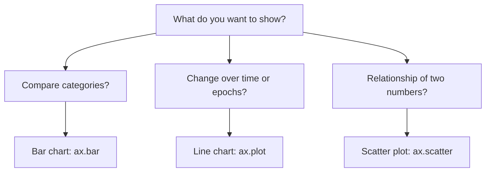

A chart shows at a glance whether training loss is dropping or which model costs the least — patterns that are easy to miss in a table of numbers. **Matplotlib** is Python's standard plotting library, and **pandas** uses it under the hood whenever you plot a table.

> [!NOTE]
> The first time you press **Run** on a chart in the app, the browser downloads matplotlib, which takes a few extra seconds. Later runs are fast.

## 1. Your first chart

Matplotlib separates the outer canvas (**Figure**) from the individual plot area inside it (**Axes**). Think of the Figure as a sheet of paper and the Axes as one framed graph drawn on that paper, complete with its own x-axis, y-axis, title, and legend.

```text
+------------------------------------------+
|  Figure (canvas)                         |
|   +----------------------------------+   |
|   |          Title                   |   |
|   |  y  |       *--*      [Legend]   |   |
|   |     |   *--*                     |   |
|   |     +-----------------------     |   |
|   |               x                  |   |
|   +----------------------------------+   |
+------------------------------------------+
```

Using `fig, ax = plt.subplots()` gives you direct handles to both objects so every chart stays explicit and clean (you may also see `plt.plot(...)` in quick scripts as a shortcut, which targets the latest axes implicitly).

```python
import matplotlib.pyplot as plt

epochs = [1, 2, 3, 4]
losses = [0.90, 0.65, 0.48, 0.36]

fig, ax = plt.subplots()
ax.plot(epochs, losses)
plt.show()
# (shows a line chart: loss drops from 0.90 at epoch 1 to 0.36 at epoch 4)
```

Notice the two steps: `ax.plot(epochs, losses)` draws the line onto `ax`, and `plt.show()` displays the open figure.

## 2. Labels, markers, and legends

A raw line without labels forces readers to guess the units. Add `ax.set_title()`, `ax.set_xlabel()`, and `ax.set_ylabel()` for context, pass `marker="o"` to show each measured point, call `ax.grid(True)` for light reference lines, and give each curve a `label=` before calling `ax.legend()`.

Here is a 6-epoch training log where both training and validation loss are recorded:

| epoch | train_loss | val_loss |
|---|---|---|
| 1 | 0.92 | 0.95 |
| 2 | 0.68 | 0.72 |
| 3 | 0.51 | 0.58 |
| 4 | 0.39 | 0.54 |
| 5 | 0.31 | 0.59 |
| 6 | 0.25 | 0.67 |

```python
import matplotlib.pyplot as plt

epochs = [1, 2, 3, 4, 5, 6]
train_loss = [0.92, 0.68, 0.51, 0.39, 0.31, 0.25]
val_loss = [0.95, 0.72, 0.58, 0.54, 0.59, 0.67]

fig, ax = plt.subplots()
ax.plot(epochs, train_loss, marker="o", label="train_loss")
ax.plot(epochs, val_loss, marker="o", label="val_loss")
ax.set_title("Training vs validation loss")
ax.set_xlabel("epoch")
ax.set_ylabel("loss")
ax.legend()
ax.grid(True)
plt.show()
# (shows two marked lines: train_loss keeps falling while val_loss turns up after epoch 4)
```

Look at epoch 4: `train_loss` keeps falling toward `0.25`, while `val_loss` stops improving and starts rising — a classic sign of **overfitting** that you will study in Phase 5.

## 3. Bar charts

Use `ax.bar(names, values)` to compare quantities across categories, such as total API spend per model. Sorting the pairs before plotting puts the tallest or shortest bars in order so the ranking jumps out immediately.

```python
import matplotlib.pyplot as plt

models = ["mini", "claude", "gpt-4o"]
costs = [0.40, 2.95, 4.25]
pairs = sorted(zip(costs, models), reverse=True)
sorted_costs, sorted_models = zip(*pairs)

fig, ax = plt.subplots()
ax.bar(sorted_models, sorted_costs)
ax.set_title("Monthly API cost by model")
ax.set_ylabel("cost (USD)")
plt.show()
# (shows a bar chart ordered tallest to shortest: gpt-4o, claude, mini)
```

When category labels are long strings that would collide along the bottom axis, switch to horizontal bars with `ax.barh(names, values)`:

```python
import matplotlib.pyplot as plt

tasks = ["Summarise PDF", "Extract JSON", "Classify ticket"]
counts = [120, 340, 215]

fig, ax = plt.subplots()
ax.barh(tasks, counts)
ax.set_title("Requests by task")
ax.set_xlabel("requests")
plt.show()
# (shows horizontal bars so long task names stay readable on the left)
```

Notice that `ax.barh` swaps the axes: categories sit along the vertical y-axis and values stretch horizontally along the x-axis.

## 4. Scatter plots

When you want to see how two numeric variables relate across individual requests — such as prompt length in tokens and response latency in milliseconds — use `ax.scatter(x, y)` to plot each measurement as its own dot.

```python
import matplotlib.pyplot as plt

tokens = [120, 240, 310, 480, 560, 720, 890, 1050]
latency_ms = [210, 240, 330, 390, 475, 535, 710, 790]

fig, ax = plt.subplots()
ax.scatter(tokens, latency_ms)
ax.set_title("Prompt tokens vs latency")
ax.set_xlabel("tokens")
ax.set_ylabel("latency (ms)")
ax.grid(True)
plt.show()
# (shows 8 dots climbing from bottom-left to top-right as tokens increase)
```

Notice how the dots climb along an upward diagonal: when two variables rise together like this, they have a positive relationship.

## 5. Plotting from a DataFrame

Pandas DataFrames and Series have a `.plot(..., ax=ax)` method that hands your `Axes` directly to matplotlib, saving you from unpacking columns into lists by hand. Passing `y=[...]` plots multiple columns on the same axes with an automatic legend.

```python
import matplotlib.pyplot as plt
import pandas as pd

history = pd.DataFrame({
    "epoch": [1, 2, 3, 4],
    "train_loss": [0.92, 0.68, 0.51, 0.39],
    "val_loss": [0.95, 0.72, 0.58, 0.54],
})

fig, ax = plt.subplots()
history.plot(x="epoch", y=["train_loss", "val_loss"], marker="o", ax=ax)
ax.set_title("Loss from DataFrame")
ax.set_ylabel("loss")
plt.show()
# (shows both loss columns plotted against epoch with an automatic legend)
```

Often you first summarise a table with `.groupby()` and `.sort_values()` before plotting the result as bars:

```python
import matplotlib.pyplot as plt
import pandas as pd

logs = pd.DataFrame({
    "model": ["gpt-4o", "mini", "claude", "gpt-4o"],
    "cost": [2.40, 0.25, 1.50, 1.85],
})
totals = logs.groupby("model")["cost"].sum().sort_values()

fig, ax = plt.subplots()
totals.plot(kind="bar", ax=ax)
ax.set_title("Total cost by model")
ax.set_ylabel("cost (USD)")
plt.show()
# (shows a bar chart sorted from mini 0.25 up to gpt-4o 4.25)
```

Press **Visualize** on this block and watch `totals` get grouped and sorted from `mini` to `gpt-4o` before the bars are drawn.

## 6. Choosing the right chart

Picking the right chart depends on the question you are asking about your data:



| question | chart | matplotlib call |
|---|---|---|
| How do totals compare across categories? | Bar chart | `ax.bar(names, values)` or `ax.barh(...)` |
| How does a metric change over epochs or time? | Line chart | `ax.plot(x, y, marker="o")` |
| How do two numeric measurements move together? | Scatter plot | `ax.scatter(x, y)` |

> [!TIP]
> Always sort bar chart values before calling `ax.bar` or `.plot(kind="bar")` — unsorted bars make it hard to tell second place from third.

## 7. Multiple charts side by side

Passing rows and columns to `plt.subplots(1, 2, figsize=(8, 3))` creates one `Figure` holding two `Axes` side by side. Calling `fig.tight_layout()` adjusts spacing automatically so titles and axis labels do not overlap.

```python
import matplotlib.pyplot as plt

epochs = [1, 2, 3, 4]
losses = [0.90, 0.62, 0.45, 0.34]
models = ["gpt-4o", "claude", "mini"]
costs = [4.25, 2.95, 0.40]

fig, (ax1, ax2) = plt.subplots(1, 2, figsize=(8, 3))
ax1.plot(epochs, losses, marker="o")
ax1.set_title("Training loss")
ax2.bar(models, costs)
ax2.set_title("Cost (USD)")
fig.tight_layout()
plt.show()
# (shows two side-by-side panels inside one Figure without overlapping labels)
```

Notice how each panel keeps its own title and scale (`ax1` is a line chart, `ax2` is a bar chart) while sharing one figure canvas.

## 8. Common mistakes

**Calling `ax.title("Loss")` instead of `ax.set_title("Loss")`.** On an `Axes` object, `ax.title` is already a `Text` object, not a setter function:

```python
import matplotlib.pyplot as plt

fig, ax = plt.subplots()
ax.plot([1, 2, 3], [0.8, 0.5, 0.3])
# Wrong: ax.title("Loss")
# TypeError: 'Text' object is not callable
ax.set_title("Loss")
plt.show()
# (shows the line chart with title "Loss")
```

Fix: use `ax.set_title(...)`, `ax.set_xlabel(...)`, and `ax.set_ylabel(...)` on `Axes` objects.

**Calling `ax.legend()` without setting `label=`.** Without labels on your plotted lines, matplotlib warns `"No artists with labels found to put in legend"` and draws an empty legend box:

```python
import matplotlib.pyplot as plt

fig, ax = plt.subplots()
# Wrong: ax.plot([1, 2, 3], [0.8, 0.5, 0.3]); ax.legend()
# UserWarning: No artists with labels found to put in legend...
ax.plot([1, 2, 3], [0.8, 0.5, 0.3], label="train_loss")
ax.legend()
print([t.get_text() for t in ax.get_legend().get_texts()])
# ['train_loss']
plt.show()
# (shows the line chart with a legend containing "train_loss")
```

Fix: pass `label="name"` to each `ax.plot(...)` call before calling `ax.legend()`.

**Plotting a line with unsorted `x` values.** `ax.plot(x, y)` connects points in list order, so out-of-order `x` values draw a messy zigzag back and forth across the chart:

```python
import matplotlib.pyplot as plt

x = [3, 1, 4, 2]
y = [0.4, 0.9, 0.3, 0.6]
pairs = sorted(zip(x, y))
x_sorted, y_sorted = zip(*pairs)
print(list(x_sorted), list(y_sorted))
# [1, 2, 3, 4] [0.9, 0.6, 0.4, 0.3]

fig, ax = plt.subplots()
ax.plot(x_sorted, y_sorted, marker="o")
plt.show()
# (shows a clean decreasing curve instead of a zigzag line)
```

Fix: sort `(x, y)` pairs by `x` before calling `ax.plot(...)` (or use `ax.scatter` if order does not matter).

**Mixing `plt.xlabel(...)` with multiple `ax` objects.** Top-level `plt.*` helpers apply only to the current (last) axes, leaving earlier panels unlabeled:

```python
import matplotlib.pyplot as plt

fig, (ax1, ax2) = plt.subplots(1, 2, figsize=(8, 3))
ax1.plot([1, 2], [0.8, 0.5])
ax2.bar(["a", "b"], [3, 5])
# Wrong: plt.xlabel("step")  -> sets only ax2, leaves ax1 blank
ax1.set_xlabel("epoch")
ax2.set_xlabel("model")
print(ax1.get_xlabel(), "|", ax2.get_xlabel())
# epoch | model
fig.tight_layout()
plt.show()
# (shows both subplots with their own x-axis labels)
```

Fix: always call `ax1.set_xlabel(...)` and `ax2.set_xlabel(...)` directly on each `Axes`.

## Recap

- Create plots with `fig, ax = plt.subplots()`, draw onto `ax`, and call `plt.show()` at the end.
- Label every chart with `ax.set_title()`, `ax.set_xlabel()`, `ax.set_ylabel()`, `label=` + `ax.legend()`, `marker="o"`, and `ax.grid(True)`.
- Pick the chart for the question: `ax.plot` for trends over epochs or time, `ax.bar` / `ax.barh` (sorted) for comparing categories, and `ax.scatter` for relationships between two numbers.
- Plot straight from pandas with `df.plot(..., ax=ax)` or `series.plot(kind="bar", ax=ax)`.
- Arrange multiple charts with `fig, (ax1, ax2) = plt.subplots(1, 2, figsize=(8, 3))` followed by `fig.tight_layout()`.
