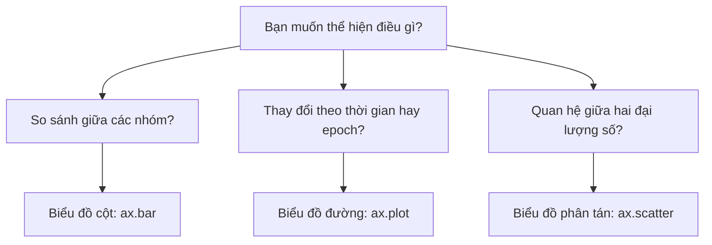

Một biểu đồ giúp bạn thấy ngay **loss** (hàm mất mát) đang giảm hay mô hình nào tốn ít chi phí nhất — những điều rất khó nhận ra khi nhìn bảng số thô. **Matplotlib** là thư viện vẽ biểu đồ chuẩn của Python, và **pandas** cũng dùng chính nó bên dưới mỗi khi bạn vẽ từ bảng dữ liệu.

> [!NOTE]
> Lần đầu tiên bạn bấm **Run** ở một khối có biểu đồ trong app, trình duyệt sẽ tải matplotlib nên mất thêm vài giây. Những lần chạy sau sẽ nhanh ngay.

## 1. Biểu đồ đầu tiên

Matplotlib tách phần khung chứa bên ngoài (**figure**, khung hình/canvas) khỏi vùng biểu đồ bên trong (**axes**, hệ trục biểu đồ). Hãy hình dung Figure giống tờ giấy vẽ, còn Axes là một khung đồ thị nằm trên tờ giấy đó, có trục x, trục y, tiêu đề và chú thích riêng.

```text
+------------------------------------------+
|  Figure (canvas)                         |
|   +----------------------------------+   |
|   |          Title                   |   |
|   |  y  |       *--*      [Legend]   |   |
|   |     |   *--*                     |   |
|   |     +-----------------------     |   |
|   |               x                  |   |
|   +----------------------------------+   |
+------------------------------------------+
```

Dùng kiểu hướng đối tượng `fig, ax = plt.subplots()` cho bạn biến trỏ thẳng vào từng phần để code rõ ràng và dễ mở rộng (bạn cũng có thể gặp `plt.plot(...)` như một lối tắt nhanh trong các script ngắn, nó ngầm vẽ lên axes mới nhất).

```python
import matplotlib.pyplot as plt

epochs = [1, 2, 3, 4]
losses = [0.90, 0.65, 0.48, 0.36]

fig, ax = plt.subplots()
ax.plot(epochs, losses)
plt.show()
# (hiện biểu đồ đường: loss giảm từ 0.90 ở epoch 1 xuống 0.36 ở epoch 4)
```

Hãy để ý hai bước: `ax.plot(epochs, losses)` vẽ đường lên `ax`, còn `plt.show()` hiển thị figure đang mở.

## 2. Nhãn trục, tiêu đề và chú thích

Một đường kẻ trơn không có nhãn buộc người đọc phải tự đoán đơn vị. Hãy thêm `ax.set_title()`, `ax.set_xlabel()` và `ax.set_ylabel()` để nêu ngữ cảnh, truyền `marker="o"` để chấm rõ từng mốc đo, gọi `ax.grid(True)` để bật lưới nhẹ, và đặt `label=` cho từng đường trước khi gọi `ax.legend()` (hộp chú thích).

Dưới đây là log huấn luyện qua 6 epoch ghi lại cả train loss và validation loss:

| epoch | train_loss | val_loss |
|---|---|---|
| 1 | 0.92 | 0.95 |
| 2 | 0.68 | 0.72 |
| 3 | 0.51 | 0.58 |
| 4 | 0.39 | 0.54 |
| 5 | 0.31 | 0.59 |
| 6 | 0.25 | 0.67 |

```python
import matplotlib.pyplot as plt

epochs = [1, 2, 3, 4, 5, 6]
train_loss = [0.92, 0.68, 0.51, 0.39, 0.31, 0.25]
val_loss = [0.95, 0.72, 0.58, 0.54, 0.59, 0.67]

fig, ax = plt.subplots()
ax.plot(epochs, train_loss, marker="o", label="train_loss")
ax.plot(epochs, val_loss, marker="o", label="val_loss")
ax.set_title("Training vs validation loss")
ax.set_xlabel("epoch")
ax.set_ylabel("loss")
ax.legend()
ax.grid(True)
plt.show()
# (hiện hai đường có điểm chấm: train_loss tiếp tục giảm còn val_loss bật tăng sau epoch 4)
```

Nhìn vào epoch 4: `train_loss` vẫn giảm về `0.25`, nhưng `val_loss` ngừng giảm và bắt đầu đi lên — đây là dấu hiệu kinh điển của **overfitting** (quá khớp) mà bạn sẽ học kỹ ở Phase 5.

## 3. Biểu đồ cột

Dùng `ax.bar(names, values)` để vẽ **bar chart** (biểu đồ cột) so sánh giá trị giữa các nhóm, chẳng hạn tổng chi phí API của từng mô hình. Sắp xếp dữ liệu trước khi vẽ giúp các cột xếp theo thứ tự cao thấp rõ ràng ngay lập tức.

```python
import matplotlib.pyplot as plt

models = ["mini", "claude", "gpt-4o"]
costs = [0.40, 2.95, 4.25]
pairs = sorted(zip(costs, models), reverse=True)
sorted_costs, sorted_models = zip(*pairs)

fig, ax = plt.subplots()
ax.bar(sorted_models, sorted_costs)
ax.set_title("Monthly API cost by model")
ax.set_ylabel("cost (USD)")
plt.show()
# (hiện biểu đồ cột xếp từ cao xuống thấp: gpt-4o, claude, mini)
```

Khi tên nhóm là chuỗi dài dễ đè lên nhau ở trục ngang, hãy chuyển sang cột nằm ngang bằng `ax.barh(names, values)`:

```python
import matplotlib.pyplot as plt

tasks = ["Summarise PDF", "Extract JSON", "Classify ticket"]
counts = [120, 340, 215]

fig, ax = plt.subplots()
ax.barh(tasks, counts)
ax.set_title("Requests by task")
ax.set_xlabel("requests")
plt.show()
# (hiện biểu đồ cột ngang giúp tên tác vụ dài nằm gọn bên trái dễ đọc)
```

Để ý `ax.barh` đảo hai trục: tên nhóm nằm dọc theo trục y, còn độ dài cột trải ngang theo trục x.

## 4. Biểu đồ phân tán (scatter)

Khi muốn xem hai đại lượng số liên hệ với nhau thế nào qua từng mẫu đo — ví dụ số token đầu vào và độ trễ phản hồi tính bằng mili-giây — hãy dùng `ax.scatter(x, y)` để vẽ **scatter plot** (biểu đồ phân tán) chấm từng điểm riêng lẻ.

```python
import matplotlib.pyplot as plt

tokens = [120, 240, 310, 480, 560, 720, 890, 1050]
latency_ms = [210, 240, 330, 390, 475, 535, 710, 790]

fig, ax = plt.subplots()
ax.scatter(tokens, latency_ms)
ax.set_title("Prompt tokens vs latency")
ax.set_xlabel("tokens")
ax.set_ylabel("latency (ms)")
ax.grid(True)
plt.show()
# (hiện 8 điểm đi lên từ góc dưới-trái lên trên-phải khi số token tăng)
```

Để ý các điểm đi lên theo đường chéo: khi hai đại lượng cùng tăng như vậy, chúng có mối quan hệ đồng biến.

## 5. Vẽ trực tiếp từ DataFrame

DataFrame và Series của pandas có sẵn phương thức `.plot(..., ax=ax)` tự đưa biểu đồ vào đúng `Axes` matplotlib của bạn, đỡ phải tách từng cột thành list thủ công. Truyền `y=[...]` sẽ vẽ nhiều cột lên cùng một trục kèm hộp chú thích tự động.

```python
import matplotlib.pyplot as plt
import pandas as pd

history = pd.DataFrame({
    "epoch": [1, 2, 3, 4],
    "train_loss": [0.92, 0.68, 0.51, 0.39],
    "val_loss": [0.95, 0.72, 0.58, 0.54],
})

fig, ax = plt.subplots()
history.plot(x="epoch", y=["train_loss", "val_loss"], marker="o", ax=ax)
ax.set_title("Loss from DataFrame")
ax.set_ylabel("loss")
plt.show()
# (hiện hai cột loss theo epoch kèm legend tự động)
```

Thông thường bạn sẽ tổng hợp bảng bằng `.groupby()` và `.sort_values()` trước rồi mới vẽ biểu đồ cột:

```python
import matplotlib.pyplot as plt
import pandas as pd

logs = pd.DataFrame({
    "model": ["gpt-4o", "mini", "claude", "gpt-4o"],
    "cost": [2.40, 0.25, 1.50, 1.85],
})
totals = logs.groupby("model")["cost"].sum().sort_values()

fig, ax = plt.subplots()
totals.plot(kind="bar", ax=ax)
ax.set_title("Total cost by model")
ax.set_ylabel("cost (USD)")
plt.show()
# (hiện biểu đồ cột sắp xếp tăng dần từ mini 0.25 tới gpt-4o 4.25)
```

Bấm **Visualize** ở khối code này để xem `totals` được gom nhóm và sắp xếp từ `mini` đến `gpt-4o` trước khi các cột được vẽ lên biểu đồ.

## 6. Chọn loại biểu đồ

Chọn đúng loại biểu đồ phụ thuộc vào câu hỏi bạn đang đặt ra cho dữ liệu:



| câu hỏi | loại biểu đồ | lệnh matplotlib |
|---|---|---|
| So sánh tổng giữa các nhóm? | Biểu đồ cột | `ax.bar(names, values)` hoặc `ax.barh(...)` |
| Giá trị thay đổi thế nào theo epoch/thời gian? | Biểu đồ đường (**line chart**) | `ax.plot(x, y, marker="o")` |
| Hai đại lượng số liên hệ với nhau ra sao? | Biểu đồ phân tán | `ax.scatter(x, y)` |

> [!TIP]
> Hãy luôn sắp xếp giá trị trước khi gọi `ax.bar` hoặc `.plot(kind="bar")` — các cột chưa sắp xếp khiến người xem khó phân biệt thứ hạng cao nhì và ba.

## 7. Nhiều biểu đồ cạnh nhau

Truyền số hàng và số cột vào `plt.subplots(1, 2, figsize=(8, 3))` sẽ tạo một `Figure` chứa hai `Axes` nằm cạnh nhau. Gọi `fig.tight_layout()` tự động căn lề để tiêu đề và nhãn trục không đè lên nhau.

```python
import matplotlib.pyplot as plt

epochs = [1, 2, 3, 4]
losses = [0.90, 0.62, 0.45, 0.34]
models = ["gpt-4o", "claude", "mini"]
costs = [4.25, 2.95, 0.40]

fig, (ax1, ax2) = plt.subplots(1, 2, figsize=(8, 3))
ax1.plot(epochs, losses, marker="o")
ax1.set_title("Training loss")
ax2.bar(models, costs)
ax2.set_title("Cost (USD)")
fig.tight_layout()
plt.show()
# (hiện hai biểu đồ cạnh nhau trong cùng một Figure mà nhãn không bị đè)
```

Hãy để ý mỗi khung giữ tiêu đề và thang đo riêng (`ax1` là biểu đồ đường, `ax2` là biểu đồ cột) dù nằm chung trên một tờ canvas.

## 8. Lỗi thường gặp

**Gọi `ax.title("Loss")` thay vì `ax.set_title("Loss")`.** Trên đối tượng `Axes`, `ax.title` đã là một đối tượng `Text` chứ không phải hàm đặt tiêu đề:

```python
import matplotlib.pyplot as plt

fig, ax = plt.subplots()
ax.plot([1, 2, 3], [0.8, 0.5, 0.3])
# Sai: ax.title("Loss")
# TypeError: 'Text' object is not callable
ax.set_title("Loss")
plt.show()
# (hiện biểu đồ đường với tiêu đề "Loss")
```

Cách sửa: luôn dùng `ax.set_title(...)`, `ax.set_xlabel(...)` và `ax.set_ylabel(...)` trên đối tượng `Axes`.

**Gọi `ax.legend()` mà quên đặt `label=`.** Nếu các đường chưa có nhãn, matplotlib phát cảnh báo `"No artists with labels found to put in legend"` và vẽ hộp chú thích rỗng:

```python
import matplotlib.pyplot as plt

fig, ax = plt.subplots()
# Sai: ax.plot([1, 2, 3], [0.8, 0.5, 0.3]); ax.legend()
# UserWarning: No artists with labels found to put in legend...
ax.plot([1, 2, 3], [0.8, 0.5, 0.3], label="train_loss")
ax.legend()
print([t.get_text() for t in ax.get_legend().get_texts()])
# ['train_loss']
plt.show()
# (hiện biểu đồ đường kèm chú thích chứa "train_loss")
```

Cách sửa: truyền `label="tên"` vào mỗi lệnh `ax.plot(...)` trước khi gọi `ax.legend()`.

**Vẽ biểu đồ đường khi `x` chưa sắp xếp.** `ax.plot(x, y)` nối các điểm theo đúng thứ tự trong list, nên `x` lộn xộn sẽ tạo ra đường zigzag chạy qua chạy lại:

```python
import matplotlib.pyplot as plt

x = [3, 1, 4, 2]
y = [0.4, 0.9, 0.3, 0.6]
pairs = sorted(zip(x, y))
x_sorted, y_sorted = zip(*pairs)
print(list(x_sorted), list(y_sorted))
# [1, 2, 3, 4] [0.9, 0.6, 0.4, 0.3]

fig, ax = plt.subplots()
ax.plot(x_sorted, y_sorted, marker="o")
plt.show()
# (hiện đường cong đi xuống gọn gàng thay vì đường zigzag)
```

Cách sửa: sắp xếp các cặp `(x, y)` theo `x` trước khi gọi `ax.plot(...)` (hoặc dùng `ax.scatter` nếu thứ tự không quan trọng).

**Trộn `plt.xlabel(...)` khi dùng nhiều `ax`.** Các hàm cấp cao `plt.*` chỉ tác động lên axes cuối cùng, khiến biểu đồ trước đó bị thiếu nhãn:

```python
import matplotlib.pyplot as plt

fig, (ax1, ax2) = plt.subplots(1, 2, figsize=(8, 3))
ax1.plot([1, 2], [0.8, 0.5])
ax2.bar(["a", "b"], [3, 5])
# Sai: plt.xlabel("step")  -> chỉ gán cho ax2, bỏ trống ax1
ax1.set_xlabel("epoch")
ax2.set_xlabel("model")
print(ax1.get_xlabel(), "|", ax2.get_xlabel())
# epoch | model
fig.tight_layout()
plt.show()
# (hiện cả hai biểu đồ con với nhãn trục x riêng)
```

Cách sửa: luôn gọi `ax1.set_xlabel(...)` và `ax2.set_xlabel(...)` trực tiếp trên từng `Axes`.

## Tóm tắt

- Tạo biểu đồ bằng `fig, ax = plt.subplots()`, vẽ lên `ax`, rồi gọi `plt.show()` ở cuối.
- Gắn nhãn đầy đủ bằng `ax.set_title()`, `ax.set_xlabel()`, `ax.set_ylabel()`, `label=` + `ax.legend()`, `marker="o"` và `ax.grid(True)`.
- Chọn biểu đồ theo câu hỏi: `ax.plot` cho xu hướng theo epoch/thời gian, `ax.bar` / `ax.barh` (đã sắp xếp) để so sánh nhóm, và `ax.scatter` để xem quan hệ giữa hai đại lượng số.
- Vẽ thẳng từ pandas bằng `df.plot(..., ax=ax)` hoặc `series.plot(kind="bar", ax=ax)`.
- Xếp nhiều biểu đồ cạnh nhau bằng `fig, (ax1, ax2) = plt.subplots(1, 2, figsize=(8, 3))` kèm `fig.tight_layout()`.
