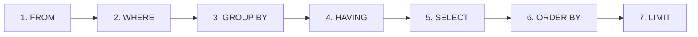

Ứng dụng AI thực tế lưu lịch sử chat, phản hồi người dùng và điểm đánh giá (eval) trong **database** (cơ sở dữ liệu) thay vì để rời rạc trong các list trên RAM. **SQL** (Structured Query Language — ngôn ngữ truy vấn có cấu trúc) là ngôn ngữ chung để hỏi đáp với database, còn **SQLite** có sẵn trong thư viện chuẩn của Python (`import sqlite3`) nên bạn dùng được ngay mà không cần cài thêm server.

## 1. Kết nối và tạo bảng

Một database SQL tổ chức dữ liệu thành các **table** (bảng) có tên, trong đó mỗi cột (**column**) có tên và kiểu dữ liệu riêng, còn mỗi dòng (**row**) lưu một bản ghi. Hãy hình dung bảng như một trang bảng tính đã khai báo sẵn kiểu cho từng cột (`INTEGER` cho số nguyên, `TEXT` cho chuỗi, `REAL` cho số thực), kèm một cột **primary key** (khóa chính) tùy chọn để định danh duy nhất từng dòng.

```text
table: messages
+----+------+-------------+----------------------+
| id | user | role        | text                 |
|INT | TEXT | TEXT        | TEXT                 |
+----+------+-------------+----------------------+
|  1 | "an" | "user"      | "Summarise this PDF" |
|  2 | "an" | "assistant" | "Here is a summary." |
+----+------+-------------+----------------------+
```

Gọi `sqlite3.connect(":memory:")` sẽ mở một database tạm trong RAM, và `conn.execute(...)` thực thi câu lệnh SQL như `CREATE TABLE`.

```python
import sqlite3

conn = sqlite3.connect(":memory:")
conn.execute("""
    CREATE TABLE messages (
        id INTEGER PRIMARY KEY,
        user TEXT,
        role TEXT,
        text TEXT
    )
""")
tables = conn.execute(
    "SELECT name FROM sqlite_master WHERE type = 'table' ORDER BY name"
).fetchall()
print(tables)
# [('messages',)]
conn.close()
```

Hãy để ý hai quy ước xuyên suốt bài này: các từ khóa SQL như `CREATE TABLE`, `INTEGER`, `PRIMARY KEY` được viết IN HOA, còn tên bảng và tên cột giữ chữ thường.

## 2. Thêm dữ liệu

Dùng `INSERT INTO table (col1, col2, ...) VALUES (?, ?, ...)` để thêm dòng, đặt dấu `?` (**placeholder**, vị trí giữ chỗ) tại mọi nơi truyền giá trị Python và đưa các giá trị đó thành một tuple riêng. Khi cần thêm nhiều dòng cùng lúc, truyền một list các tuple vào `conn.executemany(...)` thay vì tự viết vòng lặp.

Bọc phần thêm dữ liệu trong `with conn:` — chính là mẫu **context manager** bạn đã học ở Phase 2 — sẽ tự động gọi `conn.commit()` khi khối lệnh chạy xong không lỗi (hoặc hủy thao tác nếu có exception). Lưu ý rằng database `:memory:` trong bộ nhớ sẽ biến mất khi chương trình kết thúc; ở dự án thật, bạn truyền đường dẫn file như `sqlite3.connect("app.db")` để dữ liệu được lưu xuống ổ đĩa.

```python
import sqlite3

conn = sqlite3.connect(":memory:")
conn.execute("""
    CREATE TABLE messages (
        id INTEGER PRIMARY KEY,
        user TEXT,
        role TEXT,
        text TEXT
    )
""")

rows = [
    ("an", "user", "Summarise this PDF"),
    ("an", "assistant", "Here is a summary."),
    ("binh", "user", "Translate to Vietnamese"),
]
with conn:
    conn.execute(
        "INSERT INTO messages (user, role, text) VALUES (?, ?, ?)",
        ("an", "user", "Hello!"),
    )
    conn.executemany(
        "INSERT INTO messages (user, role, text) VALUES (?, ?, ?)",
        rows,
    )

count = conn.execute("SELECT COUNT(*) FROM messages").fetchone()
print(count)
# (4,)
conn.close()
```

Để ý ta không cần truyền cột `id` khi chèn vì SQLite tự động điền `1, 2, 3, 4` cho cột `INTEGER PRIMARY KEY`.

## 3. Truy vấn với SELECT

Một câu **query** (truy vấn) `SELECT` đọc các cột từ bảng (`SELECT *` lấy mọi cột, còn `SELECT DISTINCT col` loại bỏ giá trị trùng lặp): `.fetchall()` trả về mọi dòng khớp dưới dạng list các tuple Python, còn `.fetchone()` chỉ trả về tuple đầu tiên (hoặc `None` nếu không có dòng nào). Bạn lọc dòng bằng `WHERE` (`=`, `>`, `AND`, `OR`, `LIKE` với `%` đại diện chuỗi bất kỳ), sắp xếp bằng `ORDER BY ... DESC` (hoặc `ASC`), và giới hạn số dòng bằng `LIMIT`.

```python
import sqlite3

conn = sqlite3.connect(":memory:")
conn.execute("""
    CREATE TABLE prompts (
        id INTEGER PRIMARY KEY,
        user TEXT,
        model TEXT,
        tokens INTEGER
    )
""")
with conn:
    conn.executemany(
        "INSERT INTO prompts (user, model, tokens) VALUES (?, ?, ?)",
        [
            ("an", "gpt-4o", 320),
            ("binh", "mini", 110),
            ("an", "gpt-4o-mini", 480),
            ("chi", "claude", 260),
        ],
    )

long_an = conn.execute("""
    SELECT id, model, tokens
    FROM prompts
    WHERE user = ? AND (tokens > ? OR model LIKE ?)
    ORDER BY tokens DESC
    LIMIT 2
""", ("an", 300, "gpt%")).fetchall()
print(long_an)
# [(3, 'gpt-4o-mini', 480), (1, 'gpt-4o', 320)]

top_one = conn.execute(
    "SELECT user, tokens FROM prompts ORDER BY tokens DESC LIMIT 1"
).fetchone()
print(top_one)
# ('an', 480)

unique_users = conn.execute(
    "SELECT DISTINCT user FROM prompts ORDER BY user ASC"
).fetchall()
print(unique_users)
# [('an',), ('binh',), ('chi',)]
conn.close()
```

Cặp ngoặc quanh `(tokens > ? OR model LIKE ?)` giúp `AND` gắn với cả cụm `OR` chứ không chỉ điều kiện đầu tiên. Bây giờ xem một truy vấn nhỏ hơn rồi dùng vòng `for` in từng dòng:

```python
import sqlite3

conn = sqlite3.connect(":memory:")
conn.execute("CREATE TABLE scores (id INTEGER PRIMARY KEY, model TEXT, score REAL)")
with conn:
    conn.executemany(
        "INSERT INTO scores (model, score) VALUES (?, ?)",
        [("mini", 0.78), ("gpt-4o", 0.91), ("claude", 0.88)],
    )

rows = conn.execute(
    "SELECT model, score FROM scores WHERE score > 0.80 ORDER BY score DESC"
).fetchall()
for model, score in rows:
    print(f"{model}: {score}")
# gpt-4o: 0.91
# claude: 0.88
conn.close()
```

Bấm **Visualize** ở khối code này để xem `rows` nhận về danh sách tuple đã sắp xếp, rồi `model` và `score` lần lượt nhận từng dòng qua mỗi vòng lặp.

## 4. Tổng hợp với GROUP BY

Giống `.groupby()` trong pandas, `GROUP BY col` gom các dòng có cùng giá trị thành một dòng tóm tắt để bạn tính `COUNT(*)`, `SUM(...)` và `AVG(...)` (kèm `ROUND(x, 2)` cho số thập phân gọn gàng). Muốn giữ lại chỉ những nhóm thỏa điều kiện tổng hợp — ví dụ các model có ít nhất 2 lượt đánh giá — bạn thêm `HAVING` sau `GROUP BY`.

Đây là cách `GROUP BY model` gộp 5 dòng feedback trước khi `HAVING COUNT(*) >= 2` loại `claude`:

| model | rows | ratings | AVG |
|---|---|---|---|
| `claude` | 1 | `5` | `5.0` |
| `gpt-4o` | 2 | `5, 4` | `4.5` |
| `mini` | 2 | `3, 4` | `3.5` |

```python
import sqlite3

conn = sqlite3.connect(":memory:")
conn.execute("CREATE TABLE feedback (id INTEGER PRIMARY KEY, model TEXT, rating INTEGER)")
with conn:
    conn.executemany(
        "INSERT INTO feedback (model, rating) VALUES (?, ?)",
        [
            ("gpt-4o", 5),
            ("mini", 3),
            ("gpt-4o", 4),
            ("mini", 4),
            ("claude", 5),
        ],
    )

stats = conn.execute("""
    SELECT
        model,
        COUNT(*) AS total,
        SUM(rating) AS pts,
        ROUND(AVG(rating), 2) AS avg_rating
    FROM feedback
    GROUP BY model
    HAVING COUNT(*) >= 2
    ORDER BY avg_rating DESC, model ASC
""").fetchall()
print(stats)
# [('gpt-4o', 2, 9, 4.5), ('mini', 2, 7, 3.5)]
conn.close()
```

Để ý `ORDER BY avg_rating DESC, model ASC`: thêm cột phụ phá thế hòa giúp thứ tự luôn xác định ngay cả khi hai model có điểm trung bình bằng nhau.

## 5. SQL và pandas

Khi sẵn sàng phân tích hoặc vẽ biểu đồ, `pd.read_sql_query(sql, conn, params=(...))` chạy câu SQL rồi trả thẳng về một `DataFrame` của pandas. Lọc và gom nhóm trong SQL trước khi kéo dữ liệu sang pandas giúp bạn tải ít dữ liệu hơn vào bộ nhớ Python khi bảng lớn.

| SQL | pandas |
|---|---|
| `WHERE rating >= 4` | `df[df["rating"] >= 4]` |
| `ORDER BY score DESC` | `df.sort_values("score", ascending=False)` |
| `GROUP BY model` | `df.groupby("model")` |
| `LIMIT 5` | `df.head(5)` |

```python
import sqlite3
import pandas as pd

conn = sqlite3.connect(":memory:")
conn.execute("CREATE TABLE runs (model TEXT, task TEXT, score REAL)")
with conn:
    conn.executemany(
        "INSERT INTO runs (model, task, score) VALUES (?, ?, ?)",
        [
            ("gpt-4o", "qa", 0.92),
            ("mini", "qa", 0.79),
            ("gpt-4o", "summary", 0.88),
            ("mini", "summary", 0.74),
        ],
    )

sql = """
    SELECT model, task, score
    FROM runs
    WHERE score >= ?
    ORDER BY score DESC
"""
df = pd.read_sql_query(sql, conn, params=(0.80,))
print(df)
#     model     task  score
# 0  gpt-4o       qa   0.92
# 1  gpt-4o  summary   0.88
conn.close()
```

Để ý `params=(0.80,)` truyền ngưỡng lọc an toàn qua tuple thay vì nối trực tiếp số hay chuỗi vào câu SQL.

## 6. Thứ tự SQL thực sự chạy

Bạn viết `SELECT` ở đầu câu truy vấn, nhưng bên dưới SQL thực thi các mệnh đề theo một thứ tự khác:



Thứ tự chạy này giải thích vì sao `WHERE` không dùng được hàm tổng hợp như `COUNT(*)` hay `AVG(rating)` còn `HAVING` thì được: `WHERE` lọc từng dòng ở bước 2 *trước khi* `GROUP BY` tạo nhóm, trong khi `HAVING` lọc trên các nhóm ở bước 4 *sau khi* giá trị tổng hợp đã được tính.

## 7. Lỗi thường gặp

**Ghép chuỗi hoặc f-string vào SQL thay vì dùng placeholder `?`.** Nối thẳng text của người dùng vào chuỗi SQL sẽ làm vỡ câu lệnh khi gặp dấu nháy đơn như `"O'Brien"` và mở đường cho lỗ hổng **SQL injection**, nơi dữ liệu nhập vào làm thay đổi cấu trúc câu truy vấn.

> [!WARNING]
> Đừng bao giờ ghép chuỗi đầu vào của người dùng vào câu SQL bằng f-string hoặc dấu `+`. Kẻ xấu có thể chèn thêm cú pháp SQL để đọc lén hoặc xóa dữ liệu; luôn dùng **parameterized query** (truy vấn tham số hóa) với dấu `?`.

```python
import sqlite3

conn = sqlite3.connect(":memory:")
conn.execute("CREATE TABLE users (name TEXT)")
name = "O'Brien"
# Sai: conn.execute(f"INSERT INTO users (name) VALUES ('{name}')")
# sqlite3.OperationalError: near "Brien": syntax error

with conn:
    conn.execute("INSERT INTO users (name) VALUES (?)", (name,))
print(conn.execute("SELECT name FROM users ORDER BY name").fetchall())
# [("O'Brien",)]
conn.close()
```

Cách sửa: giữ dấu `?` bên trong chuỗi SQL và truyền `(name,)` làm đối số thứ hai cho `execute`.

**Quên dấu phẩy khi truyền tuple chỉ có một tham số.** Viết `("ab")` tạo ra một chuỗi 2 ký tự chứ không phải tuple, nên SQLite tưởng bạn đang truyền 2 giá trị cho 1 dấu `?`:

```python
import sqlite3

conn = sqlite3.connect(":memory:")
conn.execute("CREATE TABLE users (name TEXT)")
with conn:
    conn.execute("INSERT INTO users (name) VALUES (?)", ("ab",))

# Sai: conn.execute("SELECT name FROM users WHERE name = ?", ("ab"))
# sqlite3.ProgrammingError: Incorrect number of bindings supplied. The current statement uses 1, and there are 2 supplied.
rows = conn.execute("SELECT name FROM users WHERE name = ?", ("ab",)).fetchall()
print(rows)
# [('ab',)]
conn.close()
```

Cách sửa: luôn thêm dấu phẩy ở cuối — `("ab",)` — khi truyền một tham số duy nhất.

**So sánh bằng `= NULL` thay vì `IS NULL`.** Trong SQL, `NULL` nghĩa là "không xác định", nên `col = NULL` không bao giờ đúng và âm thầm trả về rỗng:

```python
import sqlite3

conn = sqlite3.connect(":memory:")
conn.execute("CREATE TABLE logs (user TEXT, note TEXT)")
with conn:
    conn.executemany(
        "INSERT INTO logs (user, note) VALUES (?, ?)",
        [("an", None), ("binh", "ok")],
    )

print(conn.execute("SELECT user FROM logs WHERE note = NULL ORDER BY user").fetchall())
# []
print(conn.execute("SELECT user FROM logs WHERE note IS NULL ORDER BY user").fetchall())
# [('an',)]
conn.close()
```

Cách sửa: dùng `IS NULL` (hoặc `IS NOT NULL`) mỗi khi kiểm tra giá trị `NULL` trong SQL.

**Quên `ORDER BY` khi mong đợi thứ tự dòng cố định.** Bảng SQL là tập hợp các dòng không có thứ tự mặc định: nếu thiếu `ORDER BY`, SQLite không đảm bảo thứ tự dòng trả về giữa các lần chạy hoặc sau khi cập nhật bảng. Hãy luôn kết thúc các câu `SELECT` nhiều dòng bằng `ORDER BY` (và thêm cột phụ khi có thể hòa) bất cứ khi nào thứ tự quan trọng:

```python
import sqlite3

conn = sqlite3.connect(":memory:")
conn.execute("CREATE TABLE evals (user TEXT, score REAL)")
with conn:
    conn.executemany(
        "INSERT INTO evals (user, score) VALUES (?, ?)",
        [("binh", 0.8), ("an", 0.9), ("chi", 0.9)],
    )

# Đúng: luôn thêm ORDER BY khi thứ tự dòng quan trọng
rows = conn.execute(
    "SELECT user, score FROM evals ORDER BY score DESC, user ASC"
).fetchall()
print(rows)
# [('an', 0.9), ('chi', 0.9), ('binh', 0.8)]
conn.close()
```

## Tóm tắt

- Mở database tạm trong bộ nhớ bằng `sqlite3.connect(":memory:")`, tạo bảng bằng `CREATE TABLE` và đóng kết nối với `conn.close()` khi xong việc.
- Thêm dữ liệu an toàn trong khối `with conn:` bằng placeholder `?` (`execute` hoặc `executemany`) — không dùng f-string, và nhớ dấu phẩy cho tuple một phần tử như `(x,)`.
- Truy vấn dữ liệu bằng `SELECT ... FROM ... WHERE ... ORDER BY ... LIMIT`, rồi lấy kết quả qua `.fetchall()` hoặc `.fetchone()`.
- Tổng hợp theo nhóm với `COUNT(*)`, `SUM`, `AVG`, `ROUND(..., 2)`, `GROUP BY` và `HAVING`.
- Đưa dữ liệu đã lọc sẵn từ SQL vào pandas bằng `pd.read_sql_query(sql, conn, params=(...,))`.
- Nhớ thứ tự SQL thực sự chạy (`FROM` → `WHERE` → `GROUP BY` → `HAVING` → `SELECT` → `ORDER BY` → `LIMIT`), nhờ vậy hiểu rõ vì sao `WHERE` lọc dòng trước khi gom nhóm còn `HAVING` lọc nhóm sau khi gom.
