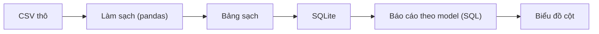

Nhóm của bạn đang chạy một chatbot với ba model khác nhau và hằng tuần đều cần trả lời: model nào tốn nhiều token nhất, model nào phản hồi chậm nhất, model nào lỗi nhiều nhất và người dùng chấm điểm ra sao. Thứ duy nhất bạn có là một file CSV log request thô—biến những log lộn xộn như vậy thành báo cáo rõ ràng là việc mà AI engineer làm mỗi tuần.

Bài này gần như không có kiến thức mới: bạn kết hợp mọi thứ đã học ở phase 4—làm sạch bằng pandas, tổng hợp bằng SQLite và vẽ biểu đồ.

## 1. Kế hoạch

Trước khi viết hàm nào, hãy phác thảo pipeline từ văn bản thô tới biểu đồ cuối cùng:



Chia công việc thành ba mảnh nhỏ, mỗi mảnh đảm nhận đúng một việc:

| Mảnh (Piece) | Đầu vào (Input) | Đầu ra (Output) |
|---|---|---|
| `load_and_clean(csv_text)` | chuỗi CSV thô | `DataFrame` sạch 6 cột |
| `model_report(df)` | `DataFrame` sạch | `DataFrame` tóm tắt theo model đã sắp xếp |
| `plot_report(report)` | `DataFrame` tóm tắt | biểu đồ cột `(fig, ax)` |

Exercise 1 làm mảnh `load_and_clean`. Exercise 2 làm hai mảnh `model_report` và `plot_report`.

## 2. Nhìn dữ liệu thô

Đừng vội sửa khi chưa nhìn kỹ dữ liệu: hãy nạp CSV bằng `pd.read_csv(io.StringIO(csv_text))` rồi kiểm tra `shape`, `dtypes`, `isna().sum()` và `value_counts()` trước:

```python
import io
import pandas as pd

csv_text = """request_id,model,tokens,latency_ms,status,rating
r01, GPT-4o,"1,200",850,ok,5
r02,gpt_4o,900,920,ok,4
r02,gpt_4o,950,999,error,1
r03,GPT-4o ,"1,100",N/A,error,
r04,gpt_4o,800,790,error,9
r05,gpt_4o,,600,ok,4
r06,Claude ,750,620,ok,5
r07,claude,650,580,ok,4
r08, CLAUDE,700,640,error,2
r09,claude ,500,timeout,ok,
r07,claude,999,700,ok,3
r10,mini,300,210,ok,4
r11, MINI ,250,190,ok,3
r12,mini,350,230,ok,5"""

df = pd.read_csv(io.StringIO(csv_text))
print(df[["request_id", "model", "tokens", "rating"]].head(5))
#   request_id    model tokens  rating
# 0        r01   GPT-4o  1,200     5.0
# 1        r02   gpt_4o    900     4.0
# 2        r02   gpt_4o    950     1.0
# 3        r03  GPT-4o   1,100     NaN
# 4        r04   gpt_4o    800     9.0

print(df.shape)
# (14, 6)
print(df.dtypes)
# request_id     object
# model          object
# tokens         object
# latency_ms     object
# status         object
# rating        float64
# dtype: object

print(df.isna().sum())
# request_id    0
# model         0
# tokens        1
# latency_ms    1
# status        0
# rating        2
# dtype: int64

print(df["model"].value_counts().head(4))
# model
# gpt_4o     4
# mini       2
# claude     2
#  GPT-4o    1
# Name: count, dtype: int64
```

Mọi vấn đề hiện ra ngay ở vài dòng đầu tiên:

```text
request_id, model,     tokens,  latency_ms, status, rating
r02,        gpt_4o,    900,     920,        ok,     4
r02,        gpt_4o,    950,     999,        error,  1      <- duplicate request_id
r03,        GPT-4o ,   "1,100", N/A,        error,         <- spaces, comma, N/A, blank
r04,        gpt_4o,    800,     790,        error,  9      <- underscore, rating 9 > 5
r05,        gpt_4o,    ,        600,        ok,     4      <- missing tokens
r09,        claude ,   500,     timeout,    ok,            <- text in latency_ms
```

Để ý lúc đầu `latency_ms` mới báo `1` ô thiếu (`N/A`) vì chữ `"timeout"` vẫn đang nằm dưới dạng chuỗi (`object`) cho tới khi ta ép kiểu cột này sang số.

## 3. Phần 1: làm sạch dữ liệu

Ta sửa bảng thô từng bước một theo đúng thứ tự. Trước hết, chuẩn hóa tên `model` bằng cách cắt khoảng trắng, chuyển chữ thường và thay `"_"` bằng `"-"`:

```python
import io
import pandas as pd

csv_text = """request_id,model,tokens,latency_ms,status,rating
r01, GPT-4o,"1,200",850,ok,5
r02,gpt_4o,900,920,ok,4
r02,gpt_4o,950,999,error,1
r03,GPT-4o ,"1,100",N/A,error,
r04,gpt_4o,800,790,error,9
r05,gpt_4o,,600,ok,4
r06,Claude ,750,620,ok,5
r07,claude,650,580,ok,4
r08, CLAUDE,700,640,error,2
r09,claude ,500,timeout,ok,
r07,claude,999,700,ok,3
r10,mini,300,210,ok,4
r11, MINI ,250,190,ok,3
r12,mini,350,230,ok,5"""

df = pd.read_csv(io.StringIO(csv_text))
df["model"] = df["model"].str.strip().str.lower().str.replace("_", "-", regex=False)
print(df["model"].value_counts())
# model
# gpt-4o    6
# claude    5
# mini      3
# Name: count, dtype: int64
```

Tiếp theo, xóa dấu phẩy ở cột `tokens` rồi ép kiểu cả `tokens` lẫn `latency_ms` sang số bằng `pd.to_numeric(..., errors="coerce")`:

```python
import io
import pandas as pd

csv_text = """request_id,model,tokens,latency_ms,status,rating
r01, GPT-4o,"1,200",850,ok,5
r02,gpt_4o,900,920,ok,4
r02,gpt_4o,950,999,error,1
r03,GPT-4o ,"1,100",N/A,error,
r04,gpt_4o,800,790,error,9
r05,gpt_4o,,600,ok,4"""

df = pd.read_csv(io.StringIO(csv_text))
clean_tokens = df["tokens"].astype(str).str.replace(",", "", regex=False)
df["tokens"] = pd.to_numeric(clean_tokens, errors="coerce")
df["latency_ms"] = pd.to_numeric(df["latency_ms"], errors="coerce")
print(df[["request_id", "tokens", "latency_ms"]].iloc[2:6])
#   request_id  tokens  latency_ms
# 2        r02   950.0       999.0
# 3        r03  1100.0         NaN
# 4        r04   800.0       790.0
# 5        r05     NaN       600.0
print(df[["tokens", "latency_ms"]].dtypes)
# tokens        float64
# latency_ms    float64
# dtype: object
```

Để ý `tokens` tạm thời có kiểu `float64` vì dòng `r05` đang là `NaN`; ta chỉ ép `tokens` sang `"int64"` sau khi bỏ các dòng thiếu `tokens`. Với `rating`, bạn ép sang số trước rồi đổi các giá trị ngoài khoảng `1..5` thành `NaN` bằng `.where(df["rating"].between(1, 5))`:

```python
import io
import pandas as pd

csv_text = """request_id,model,tokens,latency_ms,status,rating
r01, GPT-4o,"1,200",850,ok,5
r02,gpt_4o,900,920,ok,4
r02,gpt_4o,950,999,error,1
r03,GPT-4o ,"1,100",N/A,error,
r04,gpt_4o,800,790,error,9
r05,gpt_4o,,600,ok,4
r06,Claude ,750,620,ok,5"""

df = pd.read_csv(io.StringIO(csv_text))
df["rating"] = pd.to_numeric(df["rating"], errors="coerce")
df["rating"] = df["rating"].where(df["rating"].between(1, 5))
print(df[["request_id", "rating"]].iloc[3:7])
#   request_id  rating
# 3        r03     NaN
# 4        r04     NaN
# 5        r05     4.0
# 6        r06     5.0
```

Cuối cùng, bỏ các dòng trùng `request_id` (`keep="first"`), bỏ các dòng thiếu `tokens`, đánh lại index rồi ép `tokens` sang `"int64"`. Bấm **Visualize** ở khối code này để xem `df` thu gọn dần qua từng bước:

```python
import io
import pandas as pd

csv_text = """request_id,model,tokens,latency_ms,status,rating
r02,gpt_4o,900,920,ok,4
r02,gpt_4o,950,999,error,1
r04,gpt_4o,800,790,error,9
r05,gpt_4o,,600,ok,4"""

df = pd.read_csv(io.StringIO(csv_text))
df["rating"] = df["rating"].where(df["rating"].between(1, 5))
df = df.drop_duplicates(subset=["request_id"], keep="first")
df = df.dropna(subset=["tokens"]).reset_index(drop=True)
df["tokens"] = df["tokens"].astype("int64")
print(df[["request_id", "tokens", "rating"]])
#   request_id  tokens  rating
# 0        r02     900     4.0
# 1        r04     800     NaN
```

Tổng hợp các lỗi dữ liệu và cách xử lý:

| vấn đề (problem) | cách sửa (fix) |
|---|---|
| Khoảng trắng, hoa thường, `_` ở `model` | `.str.strip().str.lower().str.replace("_", "-", regex=False)` |
| Dấu phẩy và ô trống ở `tokens` | xóa `","`, `pd.to_numeric(..., errors="coerce")`, `dropna`, `.astype("int64")` |
| `"N/A"` hoặc `"timeout"` ở `latency_ms` | `pd.to_numeric(..., errors="coerce")` |
| `rating` ngoài khoảng 1–5 (`9`) | `df["rating"].where(df["rating"].between(1, 5))` |
| Dòng bị lặp `request_id` | `df.drop_duplicates(subset=["request_id"], keep="first")` |
| Index bị nhảy số sau khi bỏ dòng | `.reset_index(drop=True)` |

## 4. Phần 2: báo cáo bằng SQL

Khi bảng đã sạch, bạn ghi nó vào database SQLite trong RAM bằng `df.to_sql("requests", conn, index=False)` rồi tính toàn bộ chỉ số chỉ trong một câu truy vấn `GROUP BY model`. Có hai mẹo nhỏ trong SQLite giúp câu lệnh rất gọn:

- Phép so sánh `status = 'error'` trả về `1` nếu lỗi và `0` nếu `"ok"`, nên `AVG(status = 'error')` chính là **error rate** (tỉ lệ lỗi).
- `AVG(latency_ms)` và `AVG(rating)` tự động bỏ qua `NULL`, nên các ô thiếu không làm kéo tụt giá trị trung bình.

```python
import io
import sqlite3
import pandas as pd

csv_text = """request_id,model,tokens,latency_ms,status,rating
r01, GPT-4o,"1,200",850,ok,5
r02,gpt_4o,900,920,ok,4
r02,gpt_4o,950,999,error,1
r03,GPT-4o ,"1,100",N/A,error,
r04,gpt_4o,800,790,error,9
r05,gpt_4o,,600,ok,4
r06,Claude ,750,620,ok,5
r07,claude,650,580,ok,4
r08, CLAUDE,700,640,error,2
r09,claude ,500,timeout,ok,
r07,claude,999,700,ok,3
r10,mini,300,210,ok,4
r11, MINI ,250,190,ok,3
r12,mini,350,230,ok,5"""

df = pd.read_csv(io.StringIO(csv_text))
df["model"] = df["model"].str.strip().str.lower().str.replace("_", "-", regex=False)
df["tokens"] = pd.to_numeric(df["tokens"].astype(str).str.replace(",", "", regex=False), errors="coerce")
df["latency_ms"] = pd.to_numeric(df["latency_ms"], errors="coerce")
df["rating"] = pd.to_numeric(df["rating"], errors="coerce")
df["rating"] = df["rating"].where(df["rating"].between(1, 5))
df = df.drop_duplicates(subset=["request_id"], keep="first")
df = df.dropna(subset=["tokens"]).reset_index(drop=True)
df["tokens"] = df["tokens"].astype("int64")

conn = sqlite3.connect(":memory:")
df.to_sql("requests", conn, index=False)
report = pd.read_sql_query("""
    SELECT
        model,
        COUNT(*) AS requests,
        SUM(tokens) AS total_tokens,
        ROUND(AVG(status = 'error'), 3) AS error_rate,
        ROUND(AVG(latency_ms), 1) AS avg_latency,
        ROUND(AVG(rating), 2) AS avg_rating
    FROM requests
    GROUP BY model
    ORDER BY total_tokens DESC, model ASC
""", conn)
conn.close()

for _, row in report.iterrows():
    print(
        f"{row['model']:<7} req={row['requests']} tok={row['total_tokens']} "
        f"err={row['error_rate']} lat={row['avg_latency']} rat={row['avg_rating']}"
    )
# gpt-4o  req=4 tok=4000 err=0.5 lat=853.3 rat=4.5
# claude  req=4 tok=2600 err=0.25 lat=613.3 rat=3.67
# mini    req=3 tok=900 err=0.0 lat=210.0 rat=4.0
```

Cùng theo dõi cách SQLite tổng hợp 4 dòng sạch của `gpt-4o`:

| request_id | tokens | status (`error`=1) | latency_ms | rating |
|---|---|---|---|---|
| `r01` | `1200` | `ok` (`0`) | `850.0` | `5.0` |
| `r02` | `900` | `ok` (`0`) | `920.0` | `4.0` |
| `r03` | `1100` | `error` (`1`) | `NaN` | `NaN` |
| `r04` | `800` | `error` (`1`) | `790.0` | `NaN` |
| **tổng hợp** | **4000** | **0.5** (`2 / 4`) | **853.3** (`2560 / 3`) | **4.5** (`9 / 2`) |

Để ý `ORDER BY total_tokens DESC, model ASC` đưa model tốn nhiều token nhất lên đầu và phá thế hòa theo thứ tự bảng chữ cái.

## 5. Phần 3: biểu đồ và đọc kết quả

Đưa các cột của `report` đã sắp xếp thẳng vào `ax.bar(...)` kèm tiêu đề và nhãn trục đầy đủ:

```python
import matplotlib.pyplot as plt
import pandas as pd

report = pd.DataFrame({
    "model": ["gpt-4o", "claude", "mini"],
    "total_tokens": [4000, 2600, 900],
})

fig, ax = plt.subplots()
ax.bar(report["model"].tolist(), report["total_tokens"].tolist())
ax.set_title("Tokens by model")
ax.set_xlabel("model")
ax.set_ylabel("tokens")
plt.show()
# (hiện biểu đồ cột: gpt-4o 4000, claude 2600, mini 900)
```

Đọc báo cáo: `gpt-4o` là model cần tối ưu trước tiên vì nó ngốn nhiều token nhất (`4000`, hơn một nửa tổng lượng token), chậm nhất (`853.3 ms`) và tỉ lệ lỗi lên tới một nửa (`error_rate = 0.5`). Trong khi đó, `mini` phản hồi trong `210.0 ms`, `0.0` lỗi và rating `4.0`, nên chuyển bớt các câu hỏi đơn giản sang `mini` hoặc thêm retry và cache cho `gpt-4o` sẽ mang lại cải thiện rõ rệt nhất.

> [!TIP]
> Một báo cáo tốt luôn trả lời một câu hỏi cụ thể. Bảng số liệu và biểu đồ mới chỉ là một nửa công việc—hãy luôn chốt lại bằng một hai câu nói rõ bước hành động tiếp theo cho nhóm.

## 6. Lỗi thường gặp

**Gọi `to_sql` hai lần trên cùng một tên bảng.** Mặc định `to_sql` báo lỗi nếu bảng đã tồn tại:

```python
import sqlite3
import pandas as pd

conn = sqlite3.connect(":memory:")
df = pd.DataFrame({"model": ["mini"], "tokens": [100]})
df.to_sql("requests", conn, index=False)
# Sai: df.to_sql("requests", conn, index=False)
# ValueError: Table 'requests' already exists.

df.to_sql("requests", conn, index=False, if_exists="replace")
print(conn.execute("SELECT COUNT(*) FROM requests").fetchone())
# (1,)
conn.close()
```

Cách sửa: truyền `if_exists="replace"` khi chạy lại trên cùng một kết nối.

**Quên chuẩn hóa `model` trước khi gom nhóm.** Bỏ qua bước `.strip().lower()` và thay `"_"` khiến một model bị tách thành nhiều nhóm riêng trong SQL:

```python
import sqlite3
import pandas as pd

raw = pd.DataFrame({
    "model": [" GPT-4o", "gpt_4o", "Claude "],
    "tokens": [1200, 900, 750],
})
conn = sqlite3.connect(":memory:")
raw.to_sql("requests", conn, index=False)
bad = pd.read_sql_query(
    "SELECT model, SUM(tokens) AS total FROM requests GROUP BY model ORDER BY model",
    conn,
)
print(bad)
#      model  total
# 0   GPT-4o   1200
# 1  Claude     750
# 2   gpt_4o    900
conn.close()
```

Cách sửa: luôn chạy đủ các bước làm sạch trước khi đưa dữ liệu vào SQLite.

**Ép `tokens` sang `"int64"` trước khi bỏ dòng thiếu.** Cột số nguyên không chứa được `NaN`, nên ép kiểu quá sớm sẽ làm sập chương trình:

```python
import pandas as pd

tokens = pd.Series([1200.0, float("nan"), 800.0])
# Sai: tokens.astype("int64")
# pandas.errors.IntCastingNaNError: Cannot convert non-finite values (NA or inf) to integer

clean_tokens = tokens.dropna().astype("int64")
print(clean_tokens.tolist())
# [1200, 800]
```

Cách sửa: gọi `.dropna(...)` trước rồi mới `.astype("int64")`.

## Tóm tắt

- Lập kế hoạch cho pipeline (`load_and_clean` → `model_report` → `plot_report`) để mỗi hàm chỉ làm một việc rõ ràng.
- Soi dữ liệu CSV thô bằng `shape`, `dtypes`, `isna().sum()` và `value_counts()` trước khi sửa.
- Làm sạch theo thứ tự an toàn: chuẩn hóa văn bản, ép kiểu số, lọc giá trị ngoài khoảng, bỏ dòng trùng, bỏ dòng thiếu cột bắt buộc, đánh lại index rồi mới ép `"int64"`.
- Đưa bảng sạch vào SQLite (`to_sql`), tính `COUNT`, `SUM`, `AVG(status = 'error')` và `ROUND(AVG(...))` trong một câu `GROUP BY` có `ORDER BY` kèm cột phá hòa, rồi đọc về bằng `pd.read_sql_query`.
- Vẽ biểu đồ cột đã sắp xếp với đầy đủ nhãn và kết thúc bằng nhận xét hành động trả lời đúng câu hỏi của nhóm.

## Đi xa hơn

Khi cả hai bài tập đã xanh, bạn có thể thử mở rộng thêm:

- Thêm cột `cost_usd` dựa trên bảng giá mỗi 1.000 token của từng model rồi xếp hạng theo tổng chi phí.
- Vẽ thêm một biểu đồ so sánh `avg_latency` hoặc `error_rate` giữa các model.
- Xuất bảng `report` cuối cùng ra file CSV bằng `report.to_csv(..., index=False)`.
