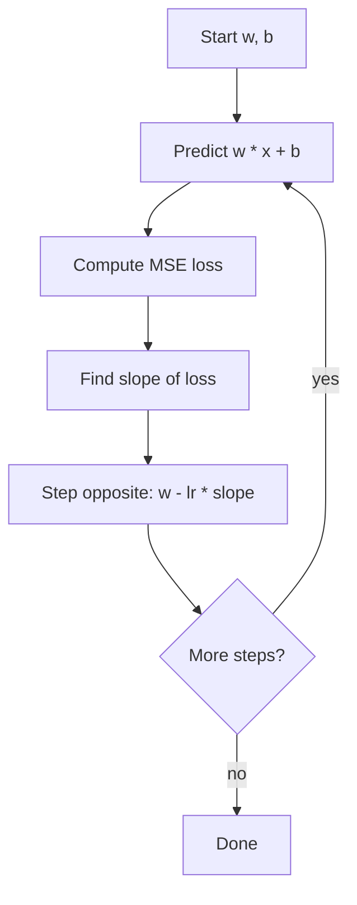

A machine learning model is just a handful of numbers — called **weights** — that get nudged step by step until the model's errors shrink. You do not need calculus proofs or derivative symbols to understand how that works. This lesson builds the entire picture with three simple ideas: **vectors**, the **dot product**, and **gradients**.

## 1. Vectors: meaningful lists of numbers

In AI engineering, a **vector** is an ordered list of numbers that describes one thing — for example, a request's token count, latency in seconds, and number of messages stored in a 1D NumPy array. You can picture a 2-number vector like `[3, 4]` as an arrow starting at `(0, 0)` and pointing to `(3, 4)`.

```text
y
4 |         * (3, 4)
3 |       /
2 |     /   sqrt(3^2 + 4^2) = 5.0
1 |   /
0 +-------------> x
  0  1  2  3  4
```

The length (or magnitude) of a vector is the straight-line distance from the origin `(0, 0)` to the tip of the arrow. NumPy gives you `np.linalg.norm(v)` to compute that length directly, and `np.sqrt(x)` to take a square root if you compute it yourself.

```python
import numpy as np

request = np.array([320.0, 1.4, 5.0])  # tokens, latency (s), messages
v = np.array([3.0, 4.0])

length = np.linalg.norm(v)
by_hand = np.sqrt(np.sum(v ** 2))

print(request)                 # [320.    1.4   5. ]
print(round(float(length), 3))   # 5.0
print(round(float(by_hand), 3))  # 5.0
```

Notice that both `np.linalg.norm(v)` and `np.sqrt(np.sum(v ** 2))` return `5.0`, matching the `[3, 4]` arrow above.

## 2. The dot product

The **dot product** of two same-length vectors multiplies each matching pair of numbers and adds all the products into a single number. In NumPy you can write either `np.dot(a, b)` or the shorter `@` operator (`a @ b`, introduced just for matrix and vector multiplication).

| i | `a[i]` | `b[i]` | `a[i] * b[i]` | running sum |
|---|---|---|---|---|
| 0 | `2.0` | `1.0` | `2.0` | `2.0` |
| 1 | `3.0` | `0.5` | `1.5` | `3.5` |
| 2 | `4.0` | `2.0` | `8.0` | `11.5` |

The dot product shows up everywhere in AI for two reasons:

1. **Weighted scores:** a linear model scores a feature vector with `prediction = weights @ features + bias`, where each weight says how much that feature matters.
2. **Direction similarity (preview of Phase 7):** two text embeddings pointing in the same direction produce a large dot product; dividing by both vector lengths gives **cosine similarity** (`a @ b / (np.linalg.norm(a) * np.linalg.norm(b))`), which stays between `-1` and `1` regardless of arrow length.

```python
import numpy as np

a = np.array([2.0, 3.0, 4.0])
b = np.array([1.0, 0.5, 2.0])
print(round(float(np.dot(a, b)), 3))  # 11.5
print(round(float(a @ b), 3))         # 11.5

# 1. Weighted score for a request [tokens, latency, messages]
features = np.array([120.0, 0.8, 3.0])
weights = np.array([0.01, -0.5, 0.2])
bias = 0.4
prediction = weights @ features + bias
print(round(float(prediction), 3))    # 1.8

# 2. Cosine similarity between a query and two document embeddings
q = np.array([1.0, 0.8, 0.1])
doc_a = np.array([0.9, 0.7, 0.2])
doc_b = np.array([0.1, 0.0, 0.9])
sim_a = (q @ doc_a) / (np.linalg.norm(q) * np.linalg.norm(doc_a))
sim_b = (q @ doc_b) / (np.linalg.norm(q) * np.linalg.norm(doc_b))
print(round(float(sim_a), 3), round(float(sim_b), 3))  # 0.995 0.163
```

Notice how `doc_a` points almost the same way as `q` (`0.995`), while `doc_b` points mostly along the third dimension (`0.163`).

## 3. Measuring error with loss

To improve a model, we first need one number — called the **loss** — that measures how wrong its predictions are overall. Suppose we fit a straight line `y = w * x + b` with `b = 1.0` fixed and want to find the best slope weight `w`.

A standard loss is **mean squared error (MSE)**: `np.mean((pred - y) ** 2)`. We square each error for two reasons: positive and negative errors never cancel each other out, and big misses are punished much harder than tiny ones.

```python
import matplotlib.pyplot as plt
import numpy as np

xs = np.array([1.0, 2.0, 3.0, 4.0])
ys = np.array([3.0, 5.0, 7.0, 9.0])
b = 1.0

ws = np.array([0.0, 0.5, 1.0, 1.5, 2.0, 2.5, 3.0, 3.5, 4.0])
losses = [float(np.mean((w * xs + b - ys) ** 2)) for w in ws]

best_w = ws[int(np.argmin(losses))]
print(f"best_w={round(float(best_w), 3)}, min_loss={round(min(losses), 3)}")  # best_w=2.0, min_loss=0.0

fig, ax = plt.subplots()
ax.plot(ws, losses, marker="o")
ax.set_title("MSE loss as weight w changes")
ax.set_xlabel("w")
ax.set_ylabel("loss")
ax.grid(True)
plt.show()
# (shows a U-shaped curve that drops to 0.0 right at w = 2.0)
```

Testing a grid of candidate weights works for one parameter (here `np.argmin(losses)` gives the index of the lowest loss so we can look up the matching `w`), yet real models have millions of weights — we need a smarter way to find the bottom of that U-shaped valley.

## 4. Gradient = slope = downhill direction

Imagine standing blindfolded on that U-shaped loss curve: to walk downhill, you only need to feel the slope right under your feet. A **gradient** is just that slope — it tells us which direction makes the loss go up and which direction makes it drop.

Instead of memorising derivative formulas, we can measure the slope numerically by checking the loss a tiny step `h = 0.001` to the right and to the left: `slope = (loss(w + h) - loss(w - h)) / (2 * h)`.

| slope | what it means | which way to move `w` |
|---|---|---|
| positive (`> 0`) | loss rises as `w` grows | move **left** (decrease `w`) |
| zero (`0`) | flat at the bottom of the valley | stop — you are at the minimum |
| negative (`< 0`) | loss drops as `w` grows | move **right** (increase `w`) |

```python
import numpy as np

xs = np.array([1.0, 2.0, 3.0, 4.0])
ys = np.array([3.0, 5.0, 7.0, 9.0])


def loss_w(w: float) -> float:
    return float(np.mean((w * xs + 1.0 - ys) ** 2))


h = 0.001
for w_test in [0.5, 2.0, 3.5]:
    slope = (loss_w(w_test + h) - loss_w(w_test - h)) / (2 * h)
    print(f"w={w_test}: slope={round(slope, 3)}")
# w=0.5: slope=-22.5
# w=2.0: slope=0.0
# w=3.5: slope=22.5
```

Look at the signs: at `w = 0.5` the slope is `-22.5` (negative, so increase `w` toward `2.0`), while at `w = 3.5` the slope is `+22.5` (positive, so decrease `w` toward `2.0`).

## 5. Gradient descent

**Gradient descent** turns that downhill rule into a simple loop: at each step, measure the slope and take one step in the **opposite** direction using `w = w - lr * slope`, where `lr` is a small step-size multiplier.



Press **Visualize** on this block and watch `w` and `loss` update step by step.

```python
import numpy as np

xs = np.array([1.0, 2.0, 3.0, 4.0])
ys = np.array([3.0, 5.0, 7.0, 9.0])


def loss_w(w: float) -> float:
    return float(np.mean((w * xs + 1.0 - ys) ** 2))


w = 0.0
lr = 0.05
h = 0.001

for step in range(5):
    loss = loss_w(w)
    slope = (loss_w(w + h) - loss_w(w - h)) / (2 * h)
    print(f"step={step}  w={round(w, 3)}  loss={round(loss, 3)}")
    w = w - lr * slope
# step=0  w=0.0  loss=30.0
# step=1  w=1.5  loss=1.875
# step=2  w=1.875  loss=0.117
# step=3  w=1.969  loss=0.007
# step=4  w=1.992  loss=0.0
```

Here is the exact trace of those five steps as `w` glides down the curve toward `2.0`:

| step | `w` | `loss` |
|---|---|---|
| 0 | `0.0` | `30.0` |
| 1 | `1.5` | `1.875` |
| 2 | `1.875` | `0.117` |
| 3 | `1.969` | `0.007` |
| 4 | `1.992` | `0.0` |

When we fit **both** `w` and `b` together on real data, we can use the fast direct MSE gradient rules instead of nudging `h` twice per parameter: the slope for `w` is the average of `2 * error * x`, and the slope for `b` is the average of `2 * error` (where `error = pred - ys`).

```python
import matplotlib.pyplot as plt
import numpy as np

xs = np.array([1.0, 2.0, 3.0, 4.0])
ys = np.array([3.0, 5.0, 7.0, 9.0])

w = 0.0
b = 0.0
lr = 0.05
losses = []

for _ in range(100):
    pred = w * xs + b
    error = pred - ys
    losses.append(float(np.mean(error ** 2)))
    grad_w = float(np.mean(2 * error * xs))
    grad_b = float(np.mean(2 * error))
    w = w - lr * grad_w
    b = b - lr * grad_b

print(f"w={round(w, 3)}, b={round(b, 3)}, start={round(losses[0], 3)}, end={round(losses[-1], 3)}")
# w=2.022, b=0.937, start=41.0, end=0.001

fig, ax = plt.subplots()
ax.plot(range(len(losses)), losses)
ax.set_title("Loss over gradient descent steps")
ax.set_xlabel("step")
ax.set_ylabel("loss")
ax.grid(True)
plt.show()
# (shows loss dropping sharply from 41.0 near step 0 and flattening near 0.001)
```

Notice how the loss falls rapidly in the first few steps while the slope is steep, then levels off smoothly near zero.

## 6. Learning rate

The **learning rate** (`lr`) controls how big a step gradient descent takes each iteration. Pick one that is too small and training crawls; pick one that is too large and you leap right across the valley and climb higher on the other side.

```python
import numpy as np

xs = np.array([1.0, 2.0, 3.0, 4.0])
ys = np.array([3.0, 5.0, 7.0, 9.0])

for lr in [0.002, 0.05, 0.15]:
    w = 0.0
    b = 0.0
    for _ in range(10):
        error = (w * xs + b) - ys
        grad_w = float(np.mean(2 * error * xs))
        grad_b = float(np.mean(2 * error))
        w = w - lr * grad_w
        b = b - lr * grad_b
    final_loss = float(np.mean((w * xs + b - ys) ** 2))
    print(f"lr={lr}: loss={round(final_loss, 3)}")
# lr=0.002: loss=20.79
# lr=0.05: loss=0.01
# lr=0.15: loss=145846.619
```

| learning rate | what happens |
|---|---|
| too small (`0.002`) | tiny steps; after 10 steps loss is still `20.79` |
| just right (`0.05`) | steady downhill progress; loss reaches `0.01` |
| too large (`0.15`) | overshoots the valley and explodes to `145846.619` |

> [!TIP]
> Start with a modest learning rate like `0.01` or `0.05` and plot the loss curve: if loss climbs or bounces wildly, cut `lr` in half; if it drops smoothly but too slowly, try doubling it.

## 7. Common mistakes

**1. Using `*` instead of `@` for a dot product**

`*` multiplies element by element and returns an array, whereas `@` (or `np.dot`) adds those products into one number.

```python
import numpy as np

a = np.array([1.0, 2.0, 3.0])
b = np.array([4.0, 5.0, 6.0])

print(a * b)                 # [ 4. 10. 18.]  (wrong: still an array)
print(round(float(a @ b), 3))  # 32.0          (fix: single dot product)
```

**2. Passing vectors of different lengths to `np.dot`**

Every pair must line up, so mismatched lengths raise a `ValueError` immediately.

```python
import numpy as np

a = np.array([1.0, 2.0, 3.0])
b = np.array([4.0, 5.0])

try:
    np.dot(a, b)
except ValueError as err:
    print(err)
# shapes (3,) and (2,) not aligned: 3 (dim 0) != 2 (dim 0)
```

Fix: check `a.shape == b.shape` before computing a dot product or cosine similarity.

**3. Stepping with `+` instead of `-` along the gradient**

Adding `lr * slope` climbs **uphill** instead of walking downhill, so the loss grows every step.

```python
import numpy as np

xs = np.array([1.0, 2.0, 3.0, 4.0])
ys = np.array([3.0, 5.0, 7.0, 9.0])


def loss_w(w: float) -> float:
    return float(np.mean((w * xs + 1.0 - ys) ** 2))


w = 0.0
h = 0.001
for step in range(4):
    slope = (loss_w(w + h) - loss_w(w - h)) / (2 * h)
    print(f"step={step}: loss={round(loss_w(w), 3)}")
    w = w + 0.05 * slope  # wrong: + climbs uphill; fix: w - 0.05 * slope
# step=0: loss=30.0
# step=1: loss=91.875
# step=2: loss=281.367
# step=3: loss=861.687
```

**4. Using a learning rate that is too large**

Even with the right `-` sign, a giant `lr` jumps past the minimum to an even steeper wall on the other side, making the loss blow up.

```python
import numpy as np

xs = np.array([1.0, 2.0, 3.0, 4.0])
ys = np.array([3.0, 5.0, 7.0, 9.0])


def loss_w(w: float) -> float:
    return float(np.mean((w * xs + 1.0 - ys) ** 2))


w = 0.0
h = 0.001
for step in range(5):
    slope = (loss_w(w + h) - loss_w(w - h)) / (2 * h)
    print(f"step={step}: loss={round(loss_w(w), 3)}")
    w = w - 0.25 * slope  # too big; fix: lower lr to 0.05
# step=0: loss=30.0
# step=1: loss=226.875
# step=2: loss=1715.742
# step=3: loss=12975.3
# step=4: loss=98125.708
```

## Recap

- A **vector** is a NumPy array of numbers; `np.linalg.norm(v)` measures its length from the origin.
- The **dot product** (`a @ b` or `np.dot(a, b)`) multiplies matching elements and sums them, powering weighted scores (`weights @ features + bias`) and cosine similarity.
- **Mean squared error** `np.mean((pred - y) ** 2)` turns model errors into one non-negative loss number so we can tell if changes help.
- A **gradient** is the slope of the loss curve: subtract `lr * slope` to walk downhill in **gradient descent**.
- The **learning rate** (`lr`) sets the step size — too small crawls, too large overshoots and explodes.
