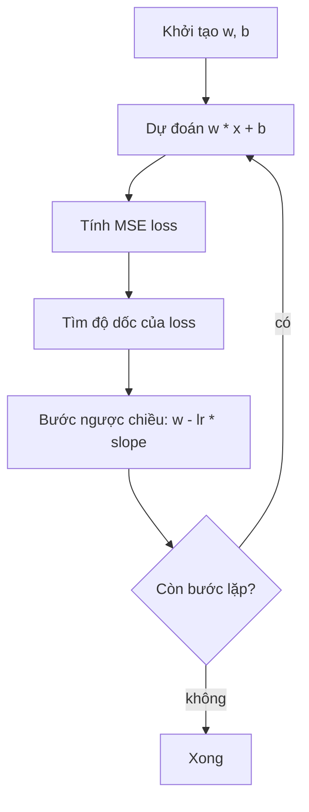

Một mô hình machine learning thực chất chỉ là vài con số — gọi là **trọng số (weights)** — được tinh chỉnh từng bước sao cho sai số nhỏ dần. Bạn không cần chứng minh giải tích hay nhớ ký hiệu đạo hàm để hiểu cơ chế này. Bài học này gói gọn toàn bộ bức tranh bằng đúng ba ý tưởng: **vector**, **tích vô hướng (dot product)** và **gradient**.

## 1. Vector: danh sách số có ý nghĩa

Trong kỹ thuật AI, **vector** là một danh sách số có thứ tự dùng để mô tả một đối tượng — ví dụ số token, độ trễ (giây) và số tin nhắn của một request lưu trong mảng NumPy 1 chiều. Bạn có thể hình dung vector 2 số như `[3, 4]` là một mũi tên xuất phát từ gốc `(0, 0)` và chỉ tới điểm `(3, 4)`.

```text
y
4 |         * (3, 4)
3 |       /
2 |     /   sqrt(3^2 + 4^2) = 5.0
1 |   /
0 +-------------> x
  0  1  2  3  4
```

Độ dài (hay chuẩn) của vector là khoảng cách đường thẳng từ gốc `(0, 0)` tới đầu mũi tên. NumPy có sẵn `np.linalg.norm(v)` để tính trực tiếp độ dài này, và `np.sqrt(x)` để lấy căn bậc hai khi bạn tự tính.

```python
import numpy as np

request = np.array([320.0, 1.4, 5.0])  # tokens, latency (s), messages
v = np.array([3.0, 4.0])

length = np.linalg.norm(v)
by_hand = np.sqrt(np.sum(v ** 2))

print(request)                 # [320.    1.4   5. ]
print(round(float(length), 3))   # 5.0
print(round(float(by_hand), 3))  # 5.0
```

Hãy để ý cả `np.linalg.norm(v)` và `np.sqrt(np.sum(v ** 2))` đều trả về `5.0`, khớp đúng độ dài mũi tên `[3, 4]` ở hình trên.

## 2. Tích vô hướng (dot product)

**Tích vô hướng (dot product)** của hai vector cùng độ dài sẽ nhân từng cặp số tương ứng rồi cộng tất cả lại thành một con số duy nhất. Trong NumPy bạn có thể viết `np.dot(a, b)` hoặc dùng toán tử `@` ngắn gọn hơn (`a @ b`, toán tử riêng cho phép nhân vector và ma trận).

| i | `a[i]` | `b[i]` | `a[i] * b[i]` | tổng tích lũy |
|---|---|---|---|---|
| 0 | `2.0` | `1.0` | `2.0` | `2.0` |
| 1 | `3.0` | `0.5` | `1.5` | `3.5` |
| 2 | `4.0` | `2.0` | `8.0` | `11.5` |

Tích vô hướng xuất hiện khắp nơi trong AI vì hai ý nghĩa sau:

1. **Điểm có trọng số:** một mô hình tuyến tính chấm điểm vector feature bằng `prediction = weights @ features + bias`, trong đó mỗi trọng số cho biết feature đó quan trọng đến mức nào.
2. **Độ giống nhau về hướng (xem trước Phase 7):** hai embedding văn bản hướng càng gần nhau thì tích vô hướng càng lớn; chia cho tích độ dài hai vector sẽ ra **cosine similarity** (`a @ b / (np.linalg.norm(a) * np.linalg.norm(b))`), luôn nằm trong đoạn `[-1, 1]` bất kể mũi tên dài ngắn thế nào.

```python
import numpy as np

a = np.array([2.0, 3.0, 4.0])
b = np.array([1.0, 0.5, 2.0])
print(round(float(np.dot(a, b)), 3))  # 11.5
print(round(float(a @ b), 3))         # 11.5

# 1. Điểm có trọng số cho một request [tokens, latency, messages]
features = np.array([120.0, 0.8, 3.0])
weights = np.array([0.01, -0.5, 0.2])
bias = 0.4
prediction = weights @ features + bias
print(round(float(prediction), 3))    # 1.8

# 2. Cosine similarity giữa câu hỏi và hai embedding tài liệu
q = np.array([1.0, 0.8, 0.1])
doc_a = np.array([0.9, 0.7, 0.2])
doc_b = np.array([0.1, 0.0, 0.9])
sim_a = (q @ doc_a) / (np.linalg.norm(q) * np.linalg.norm(doc_a))
sim_b = (q @ doc_b) / (np.linalg.norm(q) * np.linalg.norm(doc_b))
print(round(float(sim_a), 3), round(float(sim_b), 3))  # 0.995 0.163
```

Để ý `doc_a` hướng gần trùng với `q` (`0.995`), trong khi `doc_b` lại nghiêng hẳn về chiều thứ ba (`0.163`).

## 3. Đo sai số bằng hàm loss

Muốn cải thiện mô hình, trước tiên ta cần một con số — gọi là **loss** — để đo mức độ sai lệch tổng thể của các dự đoán. Giả sử ta khớp một đường thẳng `y = w * x + b` với `b = 1.0` cố định và muốn tìm hệ số góc `w` tốt nhất.

Một hàm loss chuẩn là **mean squared error (MSE)**: `np.mean((pred - y) ** 2)`. Ta bình phương mỗi sai số vì hai lý do: để sai lệch âm và dương không triệt tiêu nhau, đồng thời phạt những lần đoán lệch lớn nặng hơn nhiều so với lệch nhỏ.

```python
import matplotlib.pyplot as plt
import numpy as np

xs = np.array([1.0, 2.0, 3.0, 4.0])
ys = np.array([3.0, 5.0, 7.0, 9.0])
b = 1.0

ws = np.array([0.0, 0.5, 1.0, 1.5, 2.0, 2.5, 3.0, 3.5, 4.0])
losses = [float(np.mean((w * xs + b - ys) ** 2)) for w in ws]

best_w = ws[int(np.argmin(losses))]
print(f"best_w={round(float(best_w), 3)}, min_loss={round(min(losses), 3)}")  # best_w=2.0, min_loss=0.0

fig, ax = plt.subplots()
ax.plot(ws, losses, marker="o")
ax.set_title("MSE loss as weight w changes")
ax.set_xlabel("w")
ax.set_ylabel("loss")
ax.grid(True)
plt.show()
# (hiện đường cong hình chữ U chạm đáy 0.0 ngay tại w = 2.0)
```

Thử từng giá trị trên lưới như vậy làm được với một tham số, nhưng mô hình thật có hàng triệu trọng số — ta cần cách thông minh hơn để tự tìm đáy thung lũng chữ U đó.

## 4. Gradient = độ dốc = hướng xuống dốc

Hãy tưởng tượng bạn đang bị bịt mắt đứng trên đường cong loss hình chữ U: muốn đi xuống dốc, bạn chỉ cần cảm nhận độ nghiêng ngay dưới chân mình. **Gradient** chính là độ dốc đó — nó cho biết đi hướng nào thì loss tăng lên, và đi hướng ngược lại thì loss giảm xuống.

Thay vì nhớ công thức đạo hàm, ta có thể ước lượng độ dốc bằng số: kiểm tra loss ở vị trí nhích sang phải và sang trái một khoảng rất nhỏ `h = 0.001`: `slope = (loss(w + h) - loss(w - h)) / (2 * h)`.

| độ dốc (`slope`) | ý nghĩa | dịch chuyển `w` theo hướng nào |
|---|---|---|
| dương (`> 0`) | loss tăng khi `w` tăng | đi sang **trái** (giảm `w`) |
| bằng không (`0`) | mặt phẳng ngay đáy thung lũng | dừng lại — bạn đã ở điểm thấp nhất |
| âm (`< 0`) | loss giảm khi `w` tăng | đi sang **phải** (tăng `w`) |

```python
import numpy as np

xs = np.array([1.0, 2.0, 3.0, 4.0])
ys = np.array([3.0, 5.0, 7.0, 9.0])


def loss_w(w: float) -> float:
    return float(np.mean((w * xs + 1.0 - ys) ** 2))


h = 0.001
for w_test in [0.5, 2.0, 3.5]:
    slope = (loss_w(w_test + h) - loss_w(w_test - h)) / (2 * h)
    print(f"w={w_test}: slope={round(slope, 3)}")
# w=0.5: slope=-22.5
# w=2.0: slope=0.0
# w=3.5: slope=22.5
```

Hãy nhìn dấu của kết quả: tại `w = 0.5` độ dốc là `-22.5` (âm, nên tăng `w` về phía `2.0`), còn tại `w = 3.5` độ dốc là `+22.5` (dương, nên giảm `w` về phía `2.0`).

## 5. Gradient descent

**Gradient descent** biến quy tắc xuống dốc đó thành một vòng lặp đơn giản: ở mỗi bước, đo độ dốc rồi bước một đoạn theo chiều **ngược lại** bằng `w = w - lr * slope`, với `lr` là hệ số chỉnh kích thước bước đi.



Bấm **Visualize** ở khối code này để xem `w` và `loss` cập nhật qua từng bước.

```python
import numpy as np

xs = np.array([1.0, 2.0, 3.0, 4.0])
ys = np.array([3.0, 5.0, 7.0, 9.0])


def loss_w(w: float) -> float:
    return float(np.mean((w * xs + 1.0 - ys) ** 2))


w = 0.0
lr = 0.05
h = 0.001

for step in range(5):
    loss = loss_w(w)
    slope = (loss_w(w + h) - loss_w(w - h)) / (2 * h)
    print(f"step={step}  w={round(w, 3)}  loss={round(loss, 3)}")
    w = w - lr * slope
# step=0  w=0.0  loss=30.0
# step=1  w=1.5  loss=1.875
# step=2  w=1.875  loss=0.117
# step=3  w=1.969  loss=0.007
# step=4  w=1.992  loss=0.0
```

Đây là bảng vết chính xác của năm bước đó khi `w` trượt dọc đường cong về gần `2.0`:

| bước | `w` | `loss` |
|---|---|---|
| 0 | `0.0` | `30.0` |
| 1 | `1.5` | `1.875` |
| 2 | `1.875` | `0.117` |
| 3 | `1.969` | `0.007` |
| 4 | `1.992` | `0.0` |

Khi khớp **cả** `w` và `b` trên dữ liệu thật, ta có thể dùng công thức gradient trực tiếp của MSE cho nhanh thay vì nhích `h` hai lần cho mỗi tham số: độ dốc theo `w` là trung bình của `2 × sai số × x`, và độ dốc theo `b` là trung bình của `2 × sai số` (với `error = pred - ys`).

```python
import matplotlib.pyplot as plt
import numpy as np

xs = np.array([1.0, 2.0, 3.0, 4.0])
ys = np.array([3.0, 5.0, 7.0, 9.0])

w = 0.0
b = 0.0
lr = 0.05
losses = []

for _ in range(100):
    pred = w * xs + b
    error = pred - ys
    losses.append(float(np.mean(error ** 2)))
    grad_w = float(np.mean(2 * error * xs))
    grad_b = float(np.mean(2 * error))
    w = w - lr * grad_w
    b = b - lr * grad_b

print(f"w={round(w, 3)}, b={round(b, 3)}, start={round(losses[0], 3)}, end={round(losses[-1], 3)}")
# w=2.022, b=0.937, start=41.0, end=0.001

fig, ax = plt.subplots()
ax.plot(range(len(losses)), losses)
ax.set_title("Loss over gradient descent steps")
ax.set_xlabel("step")
ax.set_ylabel("loss")
ax.grid(True)
plt.show()
# (hiện đường loss rơi mạnh từ 41.0 ở bước 0 rồi phẳng dần gần 0.001)
```

Hãy để ý đường loss tụt rất nhanh ở vài bước đầu khi độ dốc còn lớn, rồi từ từ tiệm cận về 0.

## 6. Learning rate

**Learning rate** (`lr` — tốc độ học) quyết định độ dài mỗi bước đi trong gradient descent. Chọn quá nhỏ thì mô hình bò rất chậm; chọn quá lớn thì bạn nhảy vọt qua đáy thung lũng và leo lên cao hơn ở sườn bên kia.

```python
import numpy as np

xs = np.array([1.0, 2.0, 3.0, 4.0])
ys = np.array([3.0, 5.0, 7.0, 9.0])

for lr in [0.002, 0.05, 0.15]:
    w = 0.0
    b = 0.0
    for _ in range(10):
        error = (w * xs + b) - ys
        grad_w = float(np.mean(2 * error * xs))
        grad_b = float(np.mean(2 * error))
        w = w - lr * grad_w
        b = b - lr * grad_b
    final_loss = float(np.mean((w * xs + b - ys) ** 2))
    print(f"lr={lr}: loss={round(final_loss, 3)}")
# lr=0.002: loss=20.79
# lr=0.05: loss=0.01
# lr=0.15: loss=145846.619
```

| learning rate | điều gì xảy ra |
|---|---|
| quá nhỏ (`0.002`) | bước đi li ti; sau 10 bước loss vẫn còn `20.79` |
| vừa đẹp (`0.05`) | xuống dốc ổn định; loss giảm xuống `0.01` |
| quá lớn (`0.15`) | vọt lố qua đáy thung lũng và phình lên `145846.619` |

> [!TIP]
> Hãy bắt đầu với một learning rate vừa phải như `0.01` hoặc `0.05` rồi vẽ biểu đồ loss: nếu loss tăng vọt hoặc nhảy loạn xạ, hãy giảm `lr` đi một nửa; nếu loss giảm đều nhưng quá chậm, hãy thử tăng gấp đôi.

## 7. Lỗi thường gặp

**1. Dùng `*` thay cho `@` khi muốn tính tích vô hướng**

Toán tử `*` nhân từng phần tử và trả về một mảng, trong khi `@` (hoặc `np.dot`) cộng dồn chúng thành một con số duy nhất.

```python
import numpy as np

a = np.array([1.0, 2.0, 3.0])
b = np.array([4.0, 5.0, 6.0])

print(a * b)                 # [ 4. 10. 18.]  (sai: vẫn là mảng)
print(round(float(a @ b), 3))  # 32.0          (sửa: một số tích vô hướng)
```

**2. Truyền hai vector khác độ dài vào `np.dot`**

Từng cặp số phải khớp vị trí với nhau, nên khác độ dài sẽ gây `ValueError` ngay lập tức.

```python
import numpy as np

a = np.array([1.0, 2.0, 3.0])
b = np.array([4.0, 5.0])

try:
    np.dot(a, b)
except ValueError as err:
    print(err)
# shapes (3,) and (2,) not aligned: 3 (dim 0) != 2 (dim 0)
```

Cách sửa: kiểm tra `a.shape == b.shape` trước khi tính tích vô hướng hoặc cosine similarity.

**3. Bước cùng chiều `+` thay vì ngược chiều `-` gradient**

Cộng `lr * slope` nghĩa là leo **lên dốc** thay vì xuống dốc, nên loss tăng vọt sau mỗi bước.

```python
import numpy as np

xs = np.array([1.0, 2.0, 3.0, 4.0])
ys = np.array([3.0, 5.0, 7.0, 9.0])


def loss_w(w: float) -> float:
    return float(np.mean((w * xs + 1.0 - ys) ** 2))


w = 0.0
h = 0.001
for step in range(4):
    slope = (loss_w(w + h) - loss_w(w - h)) / (2 * h)
    print(f"step={step}: loss={round(loss_w(w), 3)}")
    w = w + 0.05 * slope  # sai: + làm leo dốc; sửa: w - 0.05 * slope
# step=0: loss=30.0
# step=1: loss=91.875
# step=2: loss=281.367
# step=3: loss=861.687
```

**4. Đặt learning rate quá lớn**

Dù đã dùng đúng dấu `-`, một `lr` quá lớn sẽ nhảy qua đáy thung lũng sang vách dốc cao hơn ở phía đối diện, khiến loss phình to liên tục.

```python
import numpy as np

xs = np.array([1.0, 2.0, 3.0, 4.0])
ys = np.array([3.0, 5.0, 7.0, 9.0])


def loss_w(w: float) -> float:
    return float(np.mean((w * xs + 1.0 - ys) ** 2))


w = 0.0
h = 0.001
for step in range(5):
    slope = (loss_w(w + h) - loss_w(w - h)) / (2 * h)
    print(f"step={step}: loss={round(loss_w(w), 3)}")
    w = w - 0.25 * slope  # quá lớn; sửa: hạ lr xuống 0.05
# step=0: loss=30.0
# step=1: loss=226.875
# step=2: loss=1715.742
# step=3: loss=12975.3
# step=4: loss=98125.708
```

## Tóm tắt

- **Vector** là mảng NumPy chứa các con số có ý nghĩa; `np.linalg.norm(v)` đo độ dài mũi tên từ gốc tọa độ.
- **Tích vô hướng** (`a @ b` hoặc `np.dot(a, b)`) nhân từng cặp phần tử rồi cộng lại, dùng để tính điểm có trọng số (`weights @ features + bias`) và cosine similarity.
- **Mean squared error** `np.mean((pred - y) ** 2)` gom sai số thành một số loss không âm để biết mô hình đang tốt lên hay tệ đi.
- **Gradient** là độ dốc của đường cong loss: trừ đi `lr * slope` để đi xuống dốc trong **gradient descent**.
- **Learning rate** (`lr`) quyết định độ lớn bước đi — quá nhỏ thì chậm chạp, quá lớn thì vọt lố và bùng nổ.
