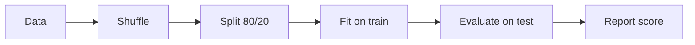

In **supervised learning**, a model learns from historical examples that **already have the right answers** — past support tickets labelled spam or not spam, or past API requests with measured latency. By studying those labelled examples, the model picks up patterns it can use to predict answers for brand-new inputs it has never seen before.

## 1. Features and labels

Every supervised dataset splits into two parts: **`X`** (the input **features**, arranged as a table where each row is one example and each column is one measurement) and **`y`** (the **label**, or known answer for each row).

```text
           X (features)           |  y (label)
----------------------------------+-----------
tokens   links   caps_ratio       |  is_spam
   42       0      0.05           |     0
  180       4      0.42           |     1
   25       1      0.08           |     0
```

| term | meaning | example |
|---|---|---|
| feature (`X`) | an input measurement describing one example | `tokens = 180`, `links = 4` |
| label (`y`) | the ground-truth answer the model tries to predict | `is_spam = 1` or `latency = 1.4` |
| example (row) | one complete `(features, label)` pair | one support ticket |

In Python, you typically keep columns together in a Pandas DataFrame and then extract `X` (2D NumPy array) and `y` (1D NumPy array).

```python
import pandas as pd

df = pd.DataFrame({
    "tokens": [42, 180, 25, 210],
    "links": [0, 4, 1, 5],
    "is_spam": [0, 1, 0, 1],
})
print(df)
#    tokens  links  is_spam
# 0      42      0        0
# 1     180      4        1
# 2      25      1        0
# 3     210      5        1

X = df[["tokens", "links"]].to_numpy()
y = df["is_spam"].to_numpy()
print(X.shape, y.shape)  # (4, 2) (4,)
```

Notice the shapes: `X` has shape `(4, 2)` (4 examples, 2 features each) while `y` has shape `(4,)` (1 label per example).

## 2. Regression and classification

Supervised learning tasks fall into two main families depending on what `y` looks like: **regression** predicts a continuous number, whereas **classification** predicts a discrete category.

| | regression | classification |
|---|---|---|
| output (`y`) | a continuous number (`1.42`, `350.0`) | a category or class label (`0` / `1`, `"billing"`) |
| common loss / metric | MSE (`np.mean((pred - y) ** 2)`) | accuracy (`(pred == y).mean()`) |
| AI engineering example | predict API latency or monthly token cost | flag spam tickets or detect user intent |

```python
import numpy as np

# Regression: compare predicted latency (s) against actual latency
pred_latency = np.array([1.1, 2.4, 0.8])
true_latency = np.array([1.0, 2.0, 1.0])
mse = float(np.mean((pred_latency - true_latency) ** 2))
print("Regression MSE:", round(mse, 3))  # Regression MSE: 0.07

# Classification: compare predicted spam labels against actual labels
pred_spam = np.array([0, 1, 1, 0])
true_spam = np.array([0, 1, 0, 0])
acc = float((pred_spam == true_spam).mean())
print("Classification accuracy:", round(acc, 3))  # Classification accuracy: 0.75
```

Notice that `pred_spam == true_spam` creates a boolean array of `True`/`False` values, and taking `.mean()` gives the fraction of predictions that matched.

## 3. Simplest classifier: a single threshold

In `p5-01-math-bridge`, we solved regression by fitting a straight line with gradient descent to shrink MSE. For a simple binary classification task, one basic model is a **threshold rule**: given a spam `score`, predict `1` (spam) whenever `score >= t`, and `0` otherwise.

By trying a few candidate thresholds `t` and checking **accuracy**, we can pick the threshold that gets the most labels right.

```python
import numpy as np

scores = np.array([0.15, 0.35, 0.45, 0.60, 0.72, 0.90])
y = np.array([0, 0, 1, 0, 1, 1])

for t in [0.3, 0.5, 0.7]:
    preds = (scores >= t).astype("int64")
    acc = float((preds == y).mean())
    print(f"t={t}: preds={preds.tolist()} acc={round(acc, 3)}")
# t=0.3: preds=[0, 1, 1, 1, 1, 1] acc=0.667
# t=0.5: preds=[0, 0, 0, 1, 1, 1] acc=0.667
# t=0.7: preds=[0, 0, 0, 0, 1, 1] acc=0.833
```

Here is the trace across the three candidate thresholds:

| `t` | `predictions` | `accuracy` |
|---|---|---|
| `0.3` | `[0, 1, 1, 1, 1, 1]` | `0.667` |
| `0.5` | `[0, 0, 0, 1, 1, 1]` | `0.667` |
| `0.7` | `[0, 0, 0, 0, 1, 1]` | `0.833` |

Notice how `t = 0.7` achieves `0.833` accuracy (5 out of 6 correct), beating both `0.3` and `0.5`.

## 4. The train/test split

Testing a model on the exact examples it learned from is like grading a student using only the practice homework they already memorized — you cannot tell if they actually understand the topic. Instead, we hold out a separate **test set** of unseen examples to measure real-world performance.



To shuffle rows reproducibly, `rng = np.random.default_rng(42)` creates a seeded random generator and `rng.permutation(len(X))` returns a shuffled array of row positions `0..len(X)-1`. Indexing both `X` and `y` with the same sliced positions (`idx[:split]` for train and `idx[split:]` for test) keeps every feature row aligned with its label.

Press **Visualize** on this block and watch `idx` shuffle the row positions and split `X` and `y` into train and test sets.

```python
import numpy as np

X = np.array([[10, 1], [20, 2], [30, 0], [40, 3], [50, 1], [60, 4], [70, 2], [80, 5]])
y = np.array([0, 0, 0, 1, 0, 1, 1, 1])

rng = np.random.default_rng(42)
idx = rng.permutation(len(X))
split = int(0.8 * len(X))
train_idx = idx[:split]
test_idx = idx[split:]

X_train, y_train = X[train_idx], y[train_idx]
X_test, y_test = X[test_idx], y[test_idx]

print("train_idx:", train_idx.tolist())  # train_idx: [3, 4, 2, 7, 6, 1]
print("test_idx:", test_idx.tolist())    # test_idx: [5, 0]
print("y_train:", y_train.tolist())      # y_train: [1, 0, 0, 1, 1, 0]
print("y_test:", y_test.tolist())        # y_test: [1, 0]
```

Notice that `X_train` and `y_train` get the first 6 shuffled rows while `X_test` and `y_test` keep the remaining 2 rows untouched for evaluation. Whether you take the first slice for train or for test does not matter as long as `X` and `y` match — in the first exercise you will take the first `n_test` shuffled indices for the test set.

## 5. Spotting overfitting visually

A model that is too flexible can wiggle through every noisy training point and score near zero error on train while failing badly on unseen test points. We can see this directly by fitting polynomial curves of degree `1`, `3`, and `6` on noisy points in `[0, 1]`, where `rng.normal(0.0, 0.12, size=len(x))` adds small bell-curve noise around `0.0` with spread `0.12`.

NumPy's `np.polyfit(x, y, deg)` fits a polynomial curve of degree `deg` and returns its coefficients, and `np.polyval(coeffs, x)` evaluates that curve at any `x` positions.

```python
import matplotlib.pyplot as plt
import numpy as np

rng = np.random.default_rng(14)
x = np.linspace(0.0, 1.0, 12)
y = 0.5 + 4.0 * x * (1.0 - x) + rng.normal(0.0, 0.12, size=len(x))

idx = rng.permutation(len(x))
x_train, x_test = x[idx[:8]], x[idx[8:]]
y_train, y_test = y[idx[:8]], y[idx[8:]]

grid = np.linspace(0.0, 1.0, 100)
fig, ax = plt.subplots()
ax.scatter(x_train, y_train, label="train")
ax.scatter(x_test, y_test, marker="s", label="test")

for deg in [1, 3, 6]:
    coeffs = np.polyfit(x_train, y_train, deg)
    tr_mse = float(np.mean((np.polyval(coeffs, x_train) - y_train) ** 2))
    te_mse = float(np.mean((np.polyval(coeffs, x_test) - y_test) ** 2))
    print(f"degree={deg}: train_mse={round(tr_mse, 3)}, test_mse={round(te_mse, 3)}")
    ax.plot(grid, np.polyval(coeffs, grid), label=f"degree {deg}")
# degree=1: train_mse=0.079, test_mse=0.302
# degree=3: train_mse=0.022, test_mse=0.057
# degree=6: train_mse=0.001, test_mse=0.79

ax.set_title("Model complexity: underfit vs overfit")
ax.set_xlabel("x")
ax.set_ylabel("y")
ax.legend()
ax.grid(True)
plt.show()
# (shows degree 1 as a flat line, degree 3 following the arch smoothly, and degree 6 swinging wildly to chase every train dot)
```

| degree | train MSE | test MSE |
|---|---|---|
| `1` | `0.079` | `0.302` |
| `3` | `0.022` | `0.057` |
| `6` | `0.001` | `0.79` |

Notice the trap: degree `6` looks "best" on train (`0.001`), yet its test MSE jumps to `0.79` — over 13 times worse than degree `3` (`0.057`).

## 6. Underfitting, good fit, and overfitting

Comparing train and test error side by side tells you immediately which regime your model is in and what to try next.

| | underfitting | good fit | overfitting |
|---|---|---|---|
| train error | high | low | very low (near zero) |
| test error | high | low (close to train) | much higher than train |
| visual sign | model is too stiff and misses the main trend | curve follows the true pattern smoothly | curve wiggles sharply to hit noisy train points |
| how to fix | use a more flexible model or add better features | keep the model and verify on fresh data | use a simpler model, gather more data, or regularize |

> [!TIP]
> Always compare **train error** and **test error** together: a tiny train error by itself means nothing if the test error is high.

## 7. Common mistakes

**1. Evaluating on the training set**

Reporting the score on the same rows used to fit the model hides overfitting behind a fake near-zero error.

```python
import numpy as np

rng = np.random.default_rng(14)
x = np.linspace(0.0, 1.0, 12)
y = 0.5 + 4.0 * x * (1.0 - x) + rng.normal(0.0, 0.12, size=len(x))
idx = rng.permutation(len(x))
x_train, x_test = x[idx[:8]], x[idx[8:]]
y_train, y_test = y[idx[:8]], y[idx[8:]]

c6 = np.polyfit(x_train, y_train, 6)
print("train MSE:", round(float(np.mean((np.polyval(c6, x_train) - y_train) ** 2)), 3))
print("test MSE:", round(float(np.mean((np.polyval(c6, x_test) - y_test) ** 2)), 3))
# train MSE: 0.001  (misleading if reported alone)
# test MSE: 0.79    (fix: always evaluate on held-out test data)
```

**2. Data leakage: scaling before splitting**

Computing `min` and `max` (like `min_max_scale` from `p4-01-numpy`) on the **entire** dataset lets test values change how the training set is scaled.

```python
import numpy as np

vals = np.array([10.0, 20.0, 30.0, 40.0, 100.0])
train, test = vals[:3], vals[3:]

# Wrong: computes min/max across all 5 values including test
leaked = (test - vals.min()) / (vals.max() - vals.min())
print("leaked test:", [round(float(v), 3) for v in leaked])  # leaked test: [0.333, 1.0]

# Fix: compute min/max from train only, then apply to test
low, high = train.min(), train.max()
clean = (test - low) / (high - low)
print("clean test:", [round(float(v), 3) for v in clean])    # clean test: [1.5, 4.5]
```

Notice that `clean test: [1.5, 4.5]` falls outside `[0, 1]` — that is expected whenever test values lie above `train.max()` (or below `train.min()`), because `test` is scaled strictly using the training bounds.

**3. Forgetting to shuffle sorted data before splitting**

If your dataset is grouped by label (all `0`s first, then all `1`s), taking the last rows as test leaves the test set with only one class.

```python
import numpy as np

y_sorted = np.array([0, 0, 0, 0, 0, 1, 1, 1, 1, 1])

# Wrong: last 2 rows contain only class 1
bad_test = y_sorted[8:]
print("no shuffle zeros/ones:", int((bad_test == 0).sum()), int((bad_test == 1).sum()))
# no shuffle zeros/ones: 0 2

# Fix: shuffle indices with rng.permutation first
rng = np.random.default_rng(42)
good_test = y_sorted[rng.permutation(len(y_sorted))[8:]]
print("shuffled zeros/ones:", int((good_test == 0).sum()), int((good_test == 1).sum()))
# shuffled zeros/ones: 1 1
```

**4. Splitting without a fixed random seed**

Calling `np.random.default_rng()` with no seed picks a different permutation on every run, so your test score changes each time you re-run your script and bugs become hard to reproduce. Fix it by passing an integer seed such as `rng = np.random.default_rng(42)`.

```python
import numpy as np

rng = np.random.default_rng(42)
print("seeded permutation:", rng.permutation(6).tolist())
# seeded permutation: [3, 2, 5, 4, 1, 0]
```

## Recap

- **Supervised learning** pairs input **features** `X` (2D rows × columns) with known **labels** `y` (1D answers) to learn patterns for new inputs.
- **Regression** predicts continuous numbers (evaluated with metrics like MSE), while **classification** predicts discrete categories (evaluated with metrics like **accuracy** `(pred == y).mean()`).
- Always **shuffle** with a seeded generator (`np.random.default_rng(seed).permutation(...)`) and **split** into train and test before computing any scaling statistics, avoiding **data leakage**.
- **Underfitting** gives high error on both train and test; **overfitting** gives tiny train error but high test error.
- Always compare train and test scores side by side to verify your model generalizes.
