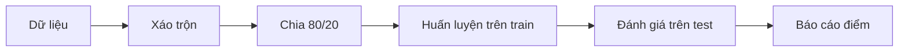

Trong **học có giám sát (supervised learning)**, mô hình học từ các ví dụ lịch sử **đã có sẵn đáp án đúng** — chẳng hạn những ticket hỗ trợ đã được gắn nhãn spam hay không spam, hoặc những request API cũ đã đo được độ trễ. Nhờ quan sát các ví dụ có nhãn đó, mô hình rút ra quy luật để dự đoán đáp án cho những đầu vào hoàn toàn mới chưa từng gặp.

## 1. Feature và label

Mỗi bộ dữ liệu có giám sát đều chia thành hai phần: **`X`** (các **feature** — đặc trưng đầu vào, xếp thành bảng với mỗi hàng là một ví dụ và mỗi cột là một đại lượng đo) và **`y`** (**label** — nhãn, hay đáp án đúng của từng hàng).

```text
           X (features)           |  y (label)
----------------------------------+-----------
tokens   links   caps_ratio       |  is_spam
   42       0      0.05           |     0
  180       4      0.42           |     1
   25       1      0.08           |     0
```

| thuật ngữ | ý nghĩa | ví dụ |
|---|---|---|
| feature (`X`) | đại lượng đầu vào mô tả một ví dụ | `tokens = 180`, `links = 4` |
| label (`y`) | đáp án chuẩn mà mô hình cần dự đoán | `is_spam = 1` hoặc `latency = 1.4` |
| ví dụ (hàng) | một cặp `(features, label)` hoàn chỉnh | một ticket hỗ trợ |

Trong Python, bạn thường giữ các cột chung trong Pandas DataFrame rồi tách riêng `X` (mảng NumPy 2 chiều) và `y` (mảng NumPy 1 chiều).

```python
import pandas as pd

df = pd.DataFrame({
    "tokens": [42, 180, 25, 210],
    "links": [0, 4, 1, 5],
    "is_spam": [0, 1, 0, 1],
})
print(df)
#    tokens  links  is_spam
# 0      42      0        0
# 1     180      4        1
# 2      25      1        0
# 3     210      5        1

X = df[["tokens", "links"]].to_numpy()
y = df["is_spam"].to_numpy()
print(X.shape, y.shape)  # (4, 2) (4,)
```

Hãy để ý kích thước: `X` có shape `(4, 2)` (4 ví dụ, mỗi ví dụ 2 feature) còn `y` có shape `(4,)` (1 label cho mỗi ví dụ).

## 2. Regression và classification

Bài toán học có giám sát chia làm hai nhánh chính tùy theo dạng của `y`: **regression** (hồi quy) dự đoán một con số liên tục, còn **classification** (phân loại) dự đoán một nhóm rời rạc.

| | regression | classification |
|---|---|---|
| đầu ra (`y`) | một số liên tục (`1.42`, `350.0`) | một nhóm hoặc nhãn lớp (`0` / `1`, `"billing"`) |
| loss / metric hay dùng | MSE (`np.mean((pred - y) ** 2)`) | accuracy (`(pred == y).mean()`) |
| ví dụ trong kỹ thuật AI | dự đoán độ trễ API hay chi phí token mỗi tháng | lọc ticket spam hay nhận diện ý định người dùng |

```python
import numpy as np

# Regression: so sánh độ trễ dự đoán (giây) với độ trễ thật
pred_latency = np.array([1.1, 2.4, 0.8])
true_latency = np.array([1.0, 2.0, 1.0])
mse = float(np.mean((pred_latency - true_latency) ** 2))
print("Regression MSE:", round(mse, 3))  # Regression MSE: 0.07

# Classification: so sánh nhãn spam dự đoán với nhãn thật
pred_spam = np.array([0, 1, 1, 0])
true_spam = np.array([0, 1, 0, 0])
acc = float((pred_spam == true_spam).mean())
print("Classification accuracy:", round(acc, 3))  # Classification accuracy: 0.75
```

Để ý rằng `pred_spam == true_spam` tạo ra một mảng boolean gồm `True`/`False`, và gọi `.mean()` sẽ trả về tỉ lệ các dự đoán khớp đúng.

## 3. Mô hình đơn giản nhất: một ngưỡng

Ở bài `p5-01-math-bridge`, ta giải bài toán regression bằng cách khớp (fit) một đường thẳng nhờ gradient descent để thu nhỏ MSE. Với một bài toán classification nhị phân đơn giản, mô hình cơ bản nhất là **quy tắc một ngưỡng (threshold)**: cho trước điểm spam `score`, đoán `1` (spam) nếu `score >= t`, ngược lại đoán `0`.

Bằng cách thử vài ngưỡng `t` khác nhau và đo **accuracy** (tỉ lệ đoán đúng), bạn chọn được ngưỡng đoán đúng nhiều nhất.

```python
import numpy as np

scores = np.array([0.15, 0.35, 0.45, 0.60, 0.72, 0.90])
y = np.array([0, 0, 1, 0, 1, 1])

for t in [0.3, 0.5, 0.7]:
    preds = (scores >= t).astype("int64")
    acc = float((preds == y).mean())
    print(f"t={t}: preds={preds.tolist()} acc={round(acc, 3)}")
# t=0.3: preds=[0, 1, 1, 1, 1, 1] acc=0.667
# t=0.5: preds=[0, 0, 0, 1, 1, 1] acc=0.667
# t=0.7: preds=[0, 0, 0, 0, 1, 1] acc=0.833
```

Đây là bảng theo dõi qua ba ngưỡng thử nghiệm:

| `t` | `predictions` | `accuracy` |
|---|---|---|
| `0.3` | `[0, 1, 1, 1, 1, 1]` | `0.667` |
| `0.5` | `[0, 0, 0, 1, 1, 1]` | `0.667` |
| `0.7` | `[0, 0, 0, 0, 1, 1]` | `0.833` |

Nhìn vào bảng, ngưỡng `t = 0.7` đạt accuracy `0.833` (đoán đúng 5 trên 6 ví dụ), cao hơn cả `0.3` và `0.5`.

## 4. Chia tập train/test

Đánh giá mô hình trên chính những ví dụ nó vừa học cũng giống như làm bài tập ở nhà rồi thi lại đúng đề bài tập đã thuộc lòng — bạn không biết người học có làm được đề mới hay không. Vì vậy ta tách riêng một **tập test (test set)** gồm những ví dụ mô hình chưa từng thấy để đo hiệu năng thực tế.



Để xáo hàng theo thứ tự tái lập được (chạy lại vẫn ra y hệt), `rng = np.random.default_rng(42)` tạo bộ sinh số ngẫu nhiên có seed cố định và `rng.permutation(len(X))` trả về mảng chỉ số hàng `0..len(X)-1` đã xáo ngẫu nhiên. Sau đó, dùng mảng chỉ số đã xáo được cắt ra (`idx[:split]` cho train và `idx[split:]` cho test) để lấy phần tử từ cả `X` lẫn `y` giúp mỗi hàng feature luôn đi đúng với label của nó.

Bấm **Visualize** ở khối code này để xem `idx` xáo thứ tự hàng rồi tách `X` và `y` thành hai tập train và test.

```python
import numpy as np

X = np.array([[10, 1], [20, 2], [30, 0], [40, 3], [50, 1], [60, 4], [70, 2], [80, 5]])
y = np.array([0, 0, 0, 1, 0, 1, 1, 1])

rng = np.random.default_rng(42)
idx = rng.permutation(len(X))
split = int(0.8 * len(X))
train_idx = idx[:split]
test_idx = idx[split:]

X_train, y_train = X[train_idx], y[train_idx]
X_test, y_test = X[test_idx], y[test_idx]

print("train_idx:", train_idx.tolist())  # train_idx: [3, 4, 2, 7, 6, 1]
print("test_idx:", test_idx.tolist())    # test_idx: [5, 0]
print("y_train:", y_train.tolist())      # y_train: [1, 0, 0, 1, 1, 0]
print("y_test:", y_test.tolist())        # y_test: [1, 0]
```

Hãy để ý `X_train` và `y_train` nhận 6 hàng đầu tiên sau khi xáo, còn `X_test` và `y_test` giữ nguyên 2 hàng còn lại để đánh giá. Lấy phần đầu sau khi xáo làm train hay làm test đều được miễn là áp dụng nhất quán cho cả `X` và `y` — trong bài tập đầu tiên bạn sẽ lấy `n_test` chỉ số đầu làm tập test.

## 5. Nhận ra overfitting bằng mắt

Một mô hình quá linh hoạt có thể uốn lượn đi qua từng điểm nhiễu trong tập train để đạt sai số gần như bằng 0, nhưng lại sai lệch nặng trên tập test mới (**overfitting** — học vẹt / khớp quá mức). Ta có thể nhìn thấy hiện tượng này ngay trên biểu đồ bằng cách khớp đường cong đa thức bậc `1`, `3` và `6` lên các điểm dữ liệu có nhiễu trong đoạn `[0, 1]`, trong đó `rng.normal(0.0, 0.12, size=len(x))` cộng thêm nhiễu hình chuông quanh `0.0` với độ lệch chuẩn `0.12`.

Hàm `np.polyfit(x, y, deg)` của NumPy khớp một đường cong đa thức bậc `deg` theo dữ liệu `(x, y)` rồi trả về các hệ số, còn `np.polyval(coeffs, x)` tính giá trị của đa thức đó tại các điểm `x` bất kỳ.

```python
import matplotlib.pyplot as plt
import numpy as np

rng = np.random.default_rng(14)
x = np.linspace(0.0, 1.0, 12)
y = 0.5 + 4.0 * x * (1.0 - x) + rng.normal(0.0, 0.12, size=len(x))

idx = rng.permutation(len(x))
x_train, x_test = x[idx[:8]], x[idx[8:]]
y_train, y_test = y[idx[:8]], y[idx[8:]]

grid = np.linspace(0.0, 1.0, 100)
fig, ax = plt.subplots()
ax.scatter(x_train, y_train, label="train")
ax.scatter(x_test, y_test, marker="s", label="test")

for deg in [1, 3, 6]:
    coeffs = np.polyfit(x_train, y_train, deg)
    tr_mse = float(np.mean((np.polyval(coeffs, x_train) - y_train) ** 2))
    te_mse = float(np.mean((np.polyval(coeffs, x_test) - y_test) ** 2))
    print(f"degree={deg}: train_mse={round(tr_mse, 3)}, test_mse={round(te_mse, 3)}")
    ax.plot(grid, np.polyval(coeffs, grid), label=f"degree {deg}")
# degree=1: train_mse=0.079, test_mse=0.302
# degree=3: train_mse=0.022, test_mse=0.057
# degree=6: train_mse=0.001, test_mse=0.79

ax.set_title("Model complexity: underfit vs overfit")
ax.set_xlabel("x")
ax.set_ylabel("y")
ax.legend()
ax.grid(True)
plt.show()
# (hiện đường bậc 1 khá phẳng, đường bậc 3 ôm mượt hình vòng cung, còn đường bậc 6 lắc mạnh để chạm từng điểm train)
```

| bậc | train MSE | test MSE |
|---|---|---|
| `1` | `0.079` | `0.302` |
| `3` | `0.022` | `0.057` |
| `6` | `0.001` | `0.79` |

Hãy chú ý cái bẫy ở đây: bậc `6` trông có vẻ "đẹp nhất" trên tập train (`0.001`), nhưng test MSE lại vọt lên `0.79` — tệ gấp hơn 13 lần so với bậc `3` (`0.057`).

## 6. Underfitting, vừa khớp và overfitting

So sánh song song sai số trên tập train và tập test giúp bạn biết ngay mô hình đang rơi vào trạng thái nào — **underfitting** (học chưa tới), **good fit** (vừa khớp) hay **overfitting** (khớp quá mức) — và cần chỉnh hướng nào tiếp theo.

| | underfitting (chưa khớp) | good fit (vừa khớp) | overfitting (khớp quá mức) |
|---|---|---|---|
| sai số train | cao | thấp | rất thấp (gần 0) |
| sai số test | cao | thấp (gần bằng train) | cao hơn train rất nhiều |
| dấu hiệu trên biểu đồ | mô hình quá cứng, bỏ sót đường cong chính | đường cong đi mượt theo xu hướng thật | đường cong ngoằn ngoèo để bám từng điểm nhiễu |
| cách khắc phục | chọn mô hình linh hoạt hơn hoặc thêm feature tốt hơn | giữ mô hình và kiểm chứng trên dữ liệu mới | dùng mô hình đơn giản hơn, thêm dữ liệu, hoặc dùng **regularization** (phạt độ phức tạp) |

> [!TIP]
> Luôn so sánh **train error** và **test error** cạnh nhau: một mức train error thật nhỏ không có ý nghĩa gì nếu test error vẫn cao.

## 7. Lỗi thường gặp

**1. Đánh giá trên chính tập train**

Chấm điểm trên chính những dòng vừa dùng để huấn luyện (fit) mô hình sẽ che giấu overfitting đằng sau một con số sai số đẹp giả tạo.

```python
import numpy as np

rng = np.random.default_rng(14)
x = np.linspace(0.0, 1.0, 12)
y = 0.5 + 4.0 * x * (1.0 - x) + rng.normal(0.0, 0.12, size=len(x))
idx = rng.permutation(len(x))
x_train, x_test = x[idx[:8]], x[idx[8:]]
y_train, y_test = y[idx[:8]], y[idx[8:]]

c6 = np.polyfit(x_train, y_train, 6)
print("train MSE:", round(float(np.mean((np.polyval(c6, x_train) - y_train) ** 2)), 3))
print("test MSE:", round(float(np.mean((np.polyval(c6, x_test) - y_test) ** 2)), 3))
# train MSE: 0.001
# test MSE: 0.79

# Chỉ nhìn train MSE sẽ bị hiểu nhầm. Cách sửa: luôn đánh giá trên tập test tách riêng
```

**2. Data leakage (rò rỉ dữ liệu): chuẩn hóa trước khi chia train/test**

Tính `min` và `max` (giống hàm `min_max_scale` ở bài `p4-01-numpy`) trên **toàn bộ** dữ liệu sẽ làm thông tin từ tập test lọt vào phép chuẩn hóa.

```python
import numpy as np

vals = np.array([10.0, 20.0, 30.0, 40.0, 100.0])
train, test = vals[:3], vals[3:]

# Sai: tính min/max trên cả 5 giá trị bao gồm tập test
leaked = (test - vals.min()) / (vals.max() - vals.min())
print("leaked test:", [round(float(v), 3) for v in leaked])  # leaked test: [0.333, 1.0]

# Sửa: chỉ tính min/max trên tập train rồi áp dụng cho test
low, high = train.min(), train.max()
clean = (test - low) / (high - low)
print("clean test:", [round(float(v), 3) for v in clean])    # clean test: [1.5, 4.5]
```

Để ý rằng kết quả chuẩn hóa sạch `clean test: [1.5, 4.5]` vượt ra ngoài đoạn `[0, 1]` — điều này hoàn toàn bình thường mỗi khi giá trị test nằm cao hơn `train.max()` (hoặc thấp hơn `train.min()`), vì tập test chỉ được quy đổi theo các mốc min/max của tập train.

**3. Quên xáo dữ liệu đã sắp theo label trước khi chia**

Nếu dữ liệu đang xếp theo nhóm nhãn (toàn bộ `0` đứng trước, toàn bộ `1` đứng sau), cắt thẳng phần cuối làm tập test sẽ khiến tập test chỉ toàn một lớp duy nhất.

```python
import numpy as np

y_sorted = np.array([0, 0, 0, 0, 0, 1, 1, 1, 1, 1])

# Sai: 2 dòng cuối chỉ chứa toàn lớp 1
bad_test = y_sorted[8:]
print("no shuffle zeros/ones:", int((bad_test == 0).sum()), int((bad_test == 1).sum()))
# no shuffle zeros/ones: 0 2

# Sửa: xáo chỉ số bằng rng.permutation trước khi cắt
rng = np.random.default_rng(42)
good_test = y_sorted[rng.permutation(len(y_sorted))[8:]]
print("shuffled zeros/ones:", int((good_test == 0).sum()), int((good_test == 1).sum()))
# shuffled zeros/ones: 1 1
```

**4. Chia dữ liệu mà không đặt random seed**

Gọi `np.random.default_rng()` mà không truyền seed sẽ tạo ra một thứ tự xáo khác nhau sau mỗi lần chạy, khiến điểm test thay đổi liên tục và rất khó tái hiện lỗi để debug. Cách sửa là truyền một số nguyên cố định như `rng = np.random.default_rng(42)`.

```python
import numpy as np

rng = np.random.default_rng(42)
print("seeded permutation:", rng.permutation(6).tolist())
# seeded permutation: [3, 2, 5, 4, 1, 0]
```

## Tóm tắt

- **Học có giám sát (supervised learning)** ghép **feature** `X` (bảng 2D hàng × cột) với **label** `y` (đáp án 1D) để học quy luật áp dụng cho dữ liệu mới.
- **Regression** dự đoán số liên tục (đo bằng MSE), còn **classification** dự đoán nhóm rời rạc (đo bằng **accuracy** `(pred == y).mean()`).
- Luôn **xáo dữ liệu** bằng bộ sinh có seed (`np.random.default_rng(seed).permutation(...)`) và **chia train/test** trước khi tính các thông số chuẩn hóa để tránh **data leakage** (rò rỉ dữ liệu).
- **Underfitting** cho sai số cao ở cả train lẫn test; **overfitting** cho sai số train rất nhỏ nhưng sai số test cao vọt.
- Luôn so sánh điểm train và test cạnh nhau để chắc chắn mô hình **generalize** (tổng quát hóa) tốt trên dữ liệu mới.
