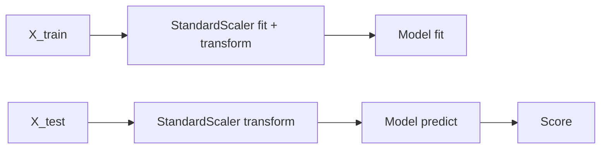

In `p5-02-supervised`, you wrote your own train/test split, threshold rule, and accuracy formula from scratch. **`scikit-learn`** gives you all of those building blocks out of the box, and **every model shares the exact same three-method API**: `fit`, `predict`, and `score` — swapping one algorithm for another takes a single line. It is the go-to classical machine learning library AI engineering teams reach for every day to build fast baselines before calling an LLM, route support tickets, or predict request latency.

## 1. Estimator: `fit`, `predict`, `score`

In `scikit-learn`, every model is an object called an **estimator** with three core methods: `.fit(X_train, y_train)` learns patterns from labelled data, `.predict(X_new)` predicts answers for new rows, and `.score(X, y)` evaluates performance (returning **accuracy** for classifiers, or **R^2** for regressors, where `1.0` is a perfect fit).

```text
LogisticRegression() ──> .fit(X, y) ──> .predict(X_new) ──> labels
                                   └──> .score(X, y)   ──> accuracy (or R^2)
```

| method | input | returns |
|---|---|---|
| `.fit(X, y)` | 2D features `X` and 1D labels `y` | the fitted estimator itself |
| `.predict(X_new)` | 2D new feature rows | 1D NumPy array of predicted labels/values |
| `.score(X, y)` | 2D features `X` and true `y` | Python `float` (accuracy or R^2) |

`LogisticRegression` from `sklearn.linear_model` is a classic linear classifier that predicts class labels (`0` or `1`) from numeric features; passing `max_iter=1000` gives its solver enough steps to converge cleanly on unscaled inputs.

```python
import numpy as np
from sklearn.linear_model import LogisticRegression

# Columns: [tokens, links]; label: 0 = normal, 1 = urgent
X = np.array([
    [30, 0], [45, 1], [60, 0], [80, 1],
    [150, 3], [190, 4], [210, 5], [240, 4],
], dtype=float)
y = np.array([0, 0, 0, 0, 1, 1, 1, 1])

model = LogisticRegression(max_iter=1000)
model.fit(X, y)

preds = model.predict(np.array([[40.0, 0.0], [200.0, 4.0]]))
print("predictions:", preds.tolist())              # predictions: [0, 1]
print("train accuracy:", round(model.score(X, y), 3))  # train accuracy: 1.0
```

Notice how `.predict()` returns a NumPy array (so `.tolist()` prints clean Python integers), while `.score()` returns a Python `float` that we round to 3 decimals.

## 2. Splitting data with `train_test_split`

Instead of writing `rng.permutation` and slicing indices yourself like in `p5-02-supervised`, `train_test_split` from `sklearn.model_selection` shuffles and splits `X` and `y` in one call. It automatically shuffles rows first (fixing the sorted-data bug from `p5-02-supervised`), takes `test_size` and `random_state` for reproducibility, and accepts `stratify=y` so both train and test keep the same class proportions.

```python
import numpy as np
from sklearn.model_selection import train_test_split

X = np.arange(40, dtype=float).reshape(20, 2)
y = np.array([0] * 15 + [1] * 5)

_, _, _, y_plain = train_test_split(X, y, test_size=0.2, random_state=0)
_, _, _, y_strat = train_test_split(X, y, test_size=0.2, random_state=0, stratify=y)

print("without stratify:", np.bincount(y_plain, minlength=2).tolist())  # without stratify: [2, 2]
print("with stratify:   ", np.bincount(y_strat, minlength=2).tolist())  # with stratify:    [3, 1]
```

Notice that `y` has a `3:1` ratio (`15` zeros and `5` ones): without `stratify=y`, the 4-row test split drifts to `[2, 2]`, whereas `stratify=y` preserves the exact `[3, 1]` balance.

## 3. Three models, one API

Because every estimator uses `.fit`, `.predict`, and `.score`, you can loop over completely different model families without changing a single line of training code. Notice that despite having "Regression" in its name, `LogisticRegression` is a **classification** model, not a regressor.

`make_classification` from `sklearn.datasets` generates a synthetic labelled classification dataset for quick experiments; `KNeighborsClassifier` from `sklearn.neighbors` classifies each point by majority vote of its `k` closest training neighbors; and `DecisionTreeClassifier` from `sklearn.tree` learns a tree of if/else thresholds (pass `random_state=0` for reproducible tie-breaking).

```python
from sklearn.datasets import make_classification
from sklearn.linear_model import LogisticRegression
from sklearn.model_selection import train_test_split
from sklearn.neighbors import KNeighborsClassifier
from sklearn.tree import DecisionTreeClassifier

X, y = make_classification(
    n_samples=60, n_features=4, n_informative=3, n_redundant=0, random_state=0
)
X_train, X_test, y_train, y_test = train_test_split(
    X, y, test_size=0.3, random_state=42, stratify=y
)

models = [
    ("LogReg", LogisticRegression(max_iter=1000)),
    ("KNN", KNeighborsClassifier(n_neighbors=3)),
    ("Tree", DecisionTreeClassifier(max_depth=3, random_state=0)),
]

for name, clf in models:
    clf.fit(X_train, y_train)
    tr = round(clf.score(X_train, y_train), 3)
    te = round(clf.score(X_test, y_test), 3)
    print(f"{name:<6} train={tr} test={te}")
# LogReg train=0.69 test=0.722
# KNN    train=0.952 test=0.778
# Tree   train=0.81 test=0.722
```

| model | idea in one line | key hyperparameter |
|---|---|---|
| `LogisticRegression` | scores a weighted sum of features and applies a threshold | `max_iter` (solver steps), `C` (regularization) |
| `KNeighborsClassifier` | lets the `k` nearest training examples vote on the label | `n_neighbors` (number of neighbors `k`) |
| `DecisionTreeClassifier` | splits data step by step with learned if/else rules | `max_depth` (maximum tree depth) |

For regression tasks (predicting a continuous number instead of a class), `LinearRegression` from `sklearn.linear_model` solves the exact straight-line fit you built with gradient descent in `p5-01-math-bridge` and exposes `.coef_` and `.intercept_`.

```python
import numpy as np
from sklearn.linear_model import LinearRegression

X = np.array([[1.0], [2.0], [3.0], [4.0], [5.0]])
y = np.array([3.1, 5.0, 6.9, 9.1, 11.0])

reg = LinearRegression()
reg.fit(X, y)

print("coef:", np.round(reg.coef_, 3).tolist())       # coef: [1.99]
print("intercept:", round(float(reg.intercept_), 3))  # intercept: 1.05
print("R^2:", round(reg.score(X, y), 3))              # R^2: 0.999
```

Notice that `reg.coef_` is `[1.99]` and `reg.intercept_` is `1.05` — almost the exact `y = 2x + 1` trend behind those noisy points, with `R^2 = 0.999`.

## 4. Feature scaling with `StandardScaler`

Distance-based models like `KNeighborsClassifier` break down when one feature has huge numbers (such as `tokens` from `200` to `4000`) and another lives in `[0, 1]` (such as `error_rate`): differences of hundreds of tokens completely drown out `error_rate`. `StandardScaler` from `sklearn.preprocessing` puts every column on the same scale by subtracting the training mean and dividing by the training standard deviation.

Just like in `p5-02-supervised`, you must fit the scaler **only** on `X_train` (`scaler.fit_transform(X_train)`) and reuse those training statistics on `X_test` (`scaler.transform(X_test)`) to prevent **data leakage**.

```python
import numpy as np
from sklearn.model_selection import train_test_split
from sklearn.neighbors import KNeighborsClassifier
from sklearn.preprocessing import StandardScaler

rng = np.random.default_rng(7)
tokens = rng.integers(200, 4000, size=40).astype(float)
error_rate = np.concatenate([rng.uniform(0.0, 0.12, 20), rng.uniform(0.18, 0.45, 20)])
X = np.column_stack([tokens, error_rate])
y = np.array([0] * 20 + [1] * 20)

X_train, X_test, y_train, y_test = train_test_split(
    X, y, test_size=0.3, random_state=42, stratify=y
)

raw_knn = KNeighborsClassifier(n_neighbors=3)
raw_knn.fit(X_train, y_train)
print("KNN raw test:", round(raw_knn.score(X_test, y_test), 3))  # KNN raw test: 0.5

scaler = StandardScaler()
X_train_s = scaler.fit_transform(X_train)
X_test_s = scaler.transform(X_test)

scaled_knn = KNeighborsClassifier(n_neighbors=3)
scaled_knn.fit(X_train_s, y_train)
print("KNN scaled test:", round(scaled_knn.score(X_test_s, y_test), 3))  # KNN scaled test: 1.0
```

Notice the jump from `0.5` (coin flip) to `1.0` on the exact same split — scaling lets `error_rate` actually contribute to neighbor distances.

## 5. Chaining steps with `Pipeline`

Calling `fit_transform` and `transform` by hand is easy to get wrong under deadline pressure. `make_pipeline` from `sklearn.pipeline` chains preprocessing transformers (like `StandardScaler()`) and a final estimator into **one** object: `.fit(X_train, y_train)` fits and transforms train inside the pipeline, while `.predict(X_test)` and `.score(X_test, y_test)` automatically call `.transform(X_test)` using the stored training mean and standard deviation — making test-set leakage impossible.



Press **Visualize** on this block and watch `pipe` store both steps and `acc` record the test score.

```python
import numpy as np
from sklearn.model_selection import train_test_split
from sklearn.neighbors import KNeighborsClassifier
from sklearn.pipeline import make_pipeline
from sklearn.preprocessing import StandardScaler

X = np.array([
    [500, 0.02], [1200, 0.05], [3000, 0.03], [800, 0.08], [2200, 0.06],
    [600, 0.25], [1500, 0.30], [3200, 0.22], [900, 0.35], [2500, 0.28],
])
y = np.array([0, 0, 0, 0, 0, 1, 1, 1, 1, 1])

X_train, X_test, y_train, y_test = train_test_split(
    X, y, test_size=0.4, random_state=42, stratify=y
)

pipe = make_pipeline(StandardScaler(), KNeighborsClassifier(n_neighbors=3))
pipe.fit(X_train, y_train)
acc = round(pipe.score(X_test, y_test), 3)

print("steps:", list(pipe.named_steps))  # steps: ['standardscaler', 'kneighborsclassifier']
print("test accuracy:", acc)             # test accuracy: 1.0
```

Notice `list(pipe.named_steps)` shows the lowercased step names created automatically by `make_pipeline`.

## 6. Comparing two models fairly

To tell which model truly generalizes better, every candidate must be judged under the exact same conditions: **one shared split** (same `random_state` and `stratify`), **identical preprocessing inside a pipeline**, and **selection strictly by test score**.

| fair comparison | unfair comparison |
|---|---|
| every model uses the exact same `train_test_split` | drawing a fresh random split for each model |
| scaling happens inside a `Pipeline` fitted on train | scaling the whole dataset before splitting (leakage) |
| selecting the winner by held-out test score | selecting the winner by training score |

`load_iris` from `sklearn.datasets` loads the classic 150-row, 3-class iris flower dataset built directly into `scikit-learn` (no network required).

```python
from sklearn.datasets import load_iris
from sklearn.linear_model import LogisticRegression
from sklearn.model_selection import train_test_split
from sklearn.pipeline import make_pipeline
from sklearn.preprocessing import StandardScaler
from sklearn.tree import DecisionTreeClassifier

iris = load_iris()
X_train, X_test, y_train, y_test = train_test_split(
    iris.data, iris.target, test_size=0.3, random_state=42, stratify=iris.target
)

candidates = [
    ("LogReg", LogisticRegression(max_iter=1000)),
    ("Tree(d=2)", DecisionTreeClassifier(max_depth=2, random_state=0)),
]

for name, estimator in candidates:
    pipe = make_pipeline(StandardScaler(), estimator)
    pipe.fit(X_train, y_train)
    tr = round(pipe.score(X_train, y_train), 3)
    te = round(pipe.score(X_test, y_test), 3)
    print(f"{name:<10} train={tr} test={te}")
# LogReg     train=0.981 test=0.911
# Tree(d=2)  train=0.971 test=0.889
```

Notice how both pipelines score close on train (`0.981` vs `0.971`), while `LogReg` leads on the unseen test split (`0.911` vs `0.889`).

> [!NOTE]
> Even a fair single train/test split still depends a bit on which rows happen to land in `test`. In `p5-04-evaluation`, you will learn **cross-validation** to average across multiple splits and compare models with much more confidence.

## 7. Common mistakes

**1. Calling `.predict()` before `.fit()`**

An estimator has no learned weights until `.fit()` runs, so calling `.predict()` on a fresh object raises `NotFittedError` (from `sklearn.exceptions`).

```python
import numpy as np
from sklearn.exceptions import NotFittedError
from sklearn.linear_model import LogisticRegression

model = LogisticRegression()
try:
    model.predict(np.array([[10.0, 2.0]]))
except NotFittedError as e:
    print("before fit:", type(e).__name__)  # before fit: NotFittedError

# Fix: call fit() on training data first
model.fit(np.array([[1.0, 0.0], [10.0, 2.0]]), np.array([0, 1]))
print("after fit:", model.predict(np.array([[10.0, 2.0]])).tolist())  # after fit: [1]
```

**2. Passing a 1D array for `X`**

Even with a single feature, `scikit-learn` expects a 2D table of shape `(n_samples, n_features)`; passing a 1D vector raises `ValueError`. Fix it with `.reshape(-1, 1)` (or `df[["col"]]` with double brackets in Pandas).

```python
import numpy as np
from sklearn.linear_model import LogisticRegression

x_1d = np.array([1.0, 2.0, 3.0, 4.0])
y = np.array([0, 0, 1, 1])

try:
    LogisticRegression().fit(x_1d, y)
except ValueError as e:
    print("1D error:", type(e).__name__)  # 1D error: ValueError

# Fix: reshape to (n_samples, 1)
X_2d = x_1d.reshape(-1, 1)
clf = LogisticRegression().fit(X_2d, y)
print("2D shape:", X_2d.shape, "preds:", clf.predict(X_2d).tolist())  # 2D shape: (4, 1) preds: [0, 0, 1, 1]
```

**3. Calling `fit_transform` on `X_test`**

Calling `scaler.fit_transform(X_test)` recomputes the mean and standard deviation from the test rows instead of reusing the training scaler, shifting test inputs to the wrong scale. Fix it by calling `scaler.transform(X_test)` — or better yet, wrap the scaler inside `make_pipeline`.

```python
import numpy as np
from sklearn.linear_model import LogisticRegression
from sklearn.preprocessing import StandardScaler

X_train = np.array([[1.0], [2.0], [3.0], [4.0]])
y_train = np.array([0, 0, 1, 1])
X_test = np.array([[10.0], [12.0]])
y_test = np.array([1, 1])

scaler = StandardScaler()
clf = LogisticRegression().fit(scaler.fit_transform(X_train), y_train)

# Wrong: fit_transform() re-centers test rows around their own mean
wrong_test = scaler.fit_transform(X_test)
print("fit_transform:", round(clf.score(wrong_test, y_test), 3), clf.predict(wrong_test).tolist())
# fit_transform: 0.5 [0, 1]

# Fix: fit on train only, then transform() reuses training mean and std
scaler.fit(X_train)
right_test = scaler.transform(X_test)
print("transform:    ", round(clf.score(right_test, y_test), 3), clf.predict(right_test).tolist())
# transform:     1.0 [1, 1]
```

**4. Picking a model by its training score**

An unconstrained `DecisionTreeClassifier(max_depth=None)` can memorize every training example to hit `1.0` on train while performing worse on test than a shallower tree (`max_depth=2`).

```python
from sklearn.datasets import make_classification
from sklearn.model_selection import train_test_split
from sklearn.tree import DecisionTreeClassifier

X, y = make_classification(
    n_samples=60, n_features=6, n_informative=2, n_redundant=0, flip_y=0.15, random_state=0
)
X_train, X_test, y_train, y_test = train_test_split(
    X, y, test_size=0.35, random_state=42, stratify=y
)

for depth in [2, None]:
    tree = DecisionTreeClassifier(max_depth=depth, random_state=0).fit(X_train, y_train)
    tr = round(tree.score(X_train, y_train), 3)
    te = round(tree.score(X_test, y_test), 3)
    print(f"max_depth={str(depth):<4} train={tr} test={te}")
# max_depth=2    train=0.897 test=0.619
# max_depth=None train=1.0 test=0.571
```

## Recap

- Every `scikit-learn` **estimator** shares one uniform API: `.fit(X_train, y_train)` learns, `.predict(X_new)` predicts, and `.score(X, y)` returns accuracy (classification) or R^2 (regression).
- Use `train_test_split(X, y, test_size=..., random_state=..., stratify=y)` to shuffle reproducibly and preserve class balance.
- Models like `KNeighborsClassifier` and `LogisticRegression` need feature scaling when columns have mismatched scales; `StandardScaler` must be fitted on train only.
- Wrap preprocessing and the model in `make_pipeline(StandardScaler(), model)` so `.fit`, `.predict`, and `.score` handle scaling cleanly with zero data leakage.
- Compare models fairly on **one shared split** with identical pipeline rules, and always pick the winner by **test score**, never train score.
