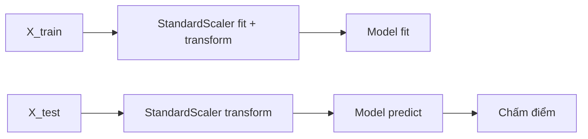

Ở bài `p5-02-supervised`, bạn đã tự tay viết hàm chia train/test, quy tắc ngưỡng và công thức tính accuracy. Thư viện **`scikit-learn`** làm sẵn toàn bộ những bước đó, và **mọi mô hình đều dùng chung đúng ba lệnh**: `fit`, `predict` và `score` — đổi từ mô hình này sang mô hình khác chỉ tốn một dòng code. Đây là thư viện ML cổ điển mà các team kỹ thuật AI dùng hằng ngày để dựng mô hình baseline nhanh trước khi gọi LLM, phân tuyến ticket hỗ trợ hay dự đoán độ trễ request.

## 1. Estimator: `fit`, `predict`, `score`

Trong `scikit-learn`, mỗi mô hình là một object gọi là **estimator (bộ ước lượng)** với ba phương thức cốt lõi: `.fit(X_train, y_train)` học quy luật từ dữ liệu có nhãn, `.predict(X_new)` dự đoán cho các hàng mới, còn `.score(X, y)` chấm điểm mô hình (trả về **accuracy** với bộ phân loại, hoặc **R^2** với bộ hồi quy, trong đó `1.0` là khớp hoàn hảo, `0.0` nghĩa là không hơn gì đoán giá trị trung bình, và có thể mang giá trị âm trên dữ liệu mới nếu dự đoán còn tệ hơn đoán trung bình).

```text
LogisticRegression() ──> .fit(X, y) ──> .predict(X_new) ──> labels
                                   └──> .score(X, y)   ──> accuracy (or R^2)
```

| phương thức | đầu vào | giá trị trả về |
|---|---|---|
| `.fit(X, y)` | mảng feature 2D `X` và mảng nhãn 1D `y` | chính estimator đã được huấn luyện |
| `.predict(X_new)` | các hàng feature mới dạng 2D | mảng NumPy 1D chứa nhãn hoặc giá trị dự đoán |
| `.score(X, y)` | feature 2D `X` và nhãn thật `y` | `float` Python (accuracy hoặc R^2) |

`LogisticRegression` từ `sklearn.linear_model` là bộ phân loại tuyến tính kinh điển dự đoán nhãn lớp (`0` hoặc `1`) từ các feature số; truyền `max_iter=1000` giúp bộ tối ưu có đủ bước lặp để hội tụ êm trên dữ liệu chưa chuẩn hóa.

```python
import numpy as np
from sklearn.linear_model import LogisticRegression

# Các cột: [tokens, links]; nhãn: 0 = bình thường, 1 = khẩn cấp
X = np.array([
    [30, 0], [45, 1], [60, 0], [80, 1],
    [150, 3], [190, 4], [210, 5], [240, 4],
], dtype=float)
y = np.array([0, 0, 0, 0, 1, 1, 1, 1])

model = LogisticRegression(max_iter=1000)
model.fit(X, y)

preds = model.predict(np.array([[40.0, 0.0], [200.0, 4.0]]))
print("predictions:", preds.tolist())              # predictions: [0, 1]
print("train accuracy:", round(model.score(X, y), 3))  # train accuracy: 1.0
```

Hãy để ý `.predict()` trả về mảng NumPy (nên dùng `.tolist()` để in ra list số nguyên Python gọn gàng), còn `.score()` trả về `float` Python và ta làm tròn 3 chữ số thập phân.

## 2. Chia dữ liệu bằng `train_test_split`

Thay vì tự viết `rng.permutation` và cắt chỉ số như ở `p5-02-supervised`, hàm `train_test_split` từ `sklearn.model_selection` xáo và tách `X`, `y` chỉ trong một lệnh. Hàm này tự động xáo trộn dữ liệu trước khi cắt (khắc phục luôn lỗi quên xáo dữ liệu đã sắp xếp ở `p5-02-supervised`), nhận `test_size` và `random_state` (hạt giống ngẫu nhiên) để lặp lại kết quả, và hỗ trợ `stratify=y` (chia giữ tỉ lệ lớp) để tập train và test giữ nguyên tỉ lệ nhãn gốc (`np.bincount(..., minlength=2)` đếm số phần tử `0` và `1` trong mỗi tập).

```python
import numpy as np
from sklearn.model_selection import train_test_split

X = np.arange(40, dtype=float).reshape(20, 2)
y = np.array([0] * 15 + [1] * 5)

_, _, _, y_plain = train_test_split(X, y, test_size=0.2, random_state=0)
_, _, _, y_strat = train_test_split(X, y, test_size=0.2, random_state=0, stratify=y)

print("without stratify:", np.bincount(y_plain, minlength=2).tolist())  # without stratify: [2, 2]
print("with stratify:   ", np.bincount(y_strat, minlength=2).tolist())  # with stratify:    [3, 1]
```

Nhìn vào kết quả đếm lớp: `y` gốc có tỉ lệ `3:1` (`15` số `0` và `5` số `1`); nếu không có `stratify=y`, 4 hàng test bị lệch thành `[2, 2]`, còn có `stratify=y` thì giữ đúng tỉ lệ `[3, 1]`.

## 3. Ba mô hình, một API

Vì mọi estimator đều dùng `.fit`, `.predict` và `.score`, bạn có thể chạy vòng `for` qua các họ mô hình hoàn toàn khác nhau mà không phải sửa một dòng code huấn luyện nào. Lưu ý quan trọng: dù tên có chữ "Regression", `LogisticRegression` thực chất là mô hình **classification (phân loại)**, không phải hồi quy.

`make_classification` từ `sklearn.datasets` tạo nhanh một bộ dữ liệu phân loại có nhãn để thử nghiệm; `KNeighborsClassifier` từ `sklearn.neighbors` đoán nhãn theo số đông của `k` điểm huấn luyện gần nhất; còn `DecisionTreeClassifier` từ `sklearn.tree` học một chuỗi câu hỏi rẽ nhánh if/else (truyền `random_state=0` để xử lý hòa tái lập được).

```python
from sklearn.datasets import make_classification
from sklearn.linear_model import LogisticRegression
from sklearn.model_selection import train_test_split
from sklearn.neighbors import KNeighborsClassifier
from sklearn.tree import DecisionTreeClassifier

X, y = make_classification(
    n_samples=60, n_features=4, n_informative=3, n_redundant=0, random_state=0
)
X_train, X_test, y_train, y_test = train_test_split(
    X, y, test_size=0.3, random_state=42, stratify=y
)

models = [
    ("LogReg", LogisticRegression(max_iter=1000)),
    ("KNN", KNeighborsClassifier(n_neighbors=3)),
    ("Tree", DecisionTreeClassifier(max_depth=3, random_state=0)),
]

for name, clf in models:
    clf.fit(X_train, y_train)
    tr = round(clf.score(X_train, y_train), 3)
    te = round(clf.score(X_test, y_test), 3)
    print(f"{name:<6} train={tr} test={te}")
# LogReg train=0.69 test=0.722
# KNN    train=0.952 test=0.778
# Tree   train=0.81 test=0.722
```

| mô hình | ý tưởng trong một dòng | hyperparameter (siêu tham số) chính |
|---|---|---|
| `LogisticRegression` | tính tổng có trọng số của feature rồi áp dụng ngưỡng phân loại | `max_iter` (số bước lặp), `C` (mức regularization) |
| `KNeighborsClassifier` | cho `k` điểm train gần nhất bỏ phiếu chọn nhãn | `n_neighbors` (số láng giềng `k`) |
| `DecisionTreeClassifier` | chia nhỏ dữ liệu từng bước bằng các quy tắc if/else tự học | `max_depth` (độ sâu tối đa của cây) |

Với bài toán regression (dự đoán số liên tục thay vì nhãn lớp), `LinearRegression` từ `sklearn.linear_model` khớp đúng đường thẳng bạn từng tối ưu bằng gradient descent ở bài `p5-01-math-bridge`, và cung cấp hệ số qua `.coef_` và `.intercept_`.

```python
import numpy as np
from sklearn.linear_model import LinearRegression

X = np.array([[1.0], [2.0], [3.0], [4.0], [5.0]])
y = np.array([3.1, 5.0, 6.9, 9.1, 11.0])

reg = LinearRegression()
reg.fit(X, y)

print("coef:", np.round(reg.coef_, 3).tolist())       # coef: [1.99]
print("intercept:", round(float(reg.intercept_), 3))  # intercept: 1.05
print("R^2:", round(reg.score(X, y), 3))              # R^2: 0.999
```

Để ý `reg.coef_` là `[1.99]` và `reg.intercept_` là `1.05` — khớp gần như chính xác quy luật `y = 2x + 1` ẩn sau các điểm có nhiễu, với `R^2 = 0.999`.

## 4. Chuẩn hóa feature với `StandardScaler`

Các mô hình dựa vào khoảng cách như `KNeighborsClassifier` gặp vấn đề ngay khi một feature mang giá trị hàng nghìn (như `tokens` từ `200` đến `4000`) còn feature khác nằm trong `[0, 1]` (như `error_rate`): chênh lệch vài trăm token sẽ lấn át hoàn toàn `error_rate`. `StandardScaler` từ `sklearn.preprocessing` đưa mọi cột về cùng thang đo bằng cách trừ đi trung bình và chia cho độ lệch chuẩn của tập train.

Giống như bạn đã học ở `p5-02-supervised`, bạn **chỉ được phép** học thông số chuẩn hóa từ `X_train` (`scaler.fit_transform(X_train)`) rồi dùng lại đúng thông số đó trên `X_test` (`scaler.transform(X_test)`) để tránh **data leakage (rò rỉ dữ liệu)**. Bên dưới, ta sinh dữ liệu mô phỏng bằng `rng.integers` và `rng.uniform`, nối hai mảng 1 chiều thành một bằng `np.concatenate`, rồi ghép các cột cạnh nhau thành ma trận `X` 2 chiều bằng `np.column_stack`.

```python
import numpy as np
from sklearn.model_selection import train_test_split
from sklearn.neighbors import KNeighborsClassifier
from sklearn.preprocessing import StandardScaler

rng = np.random.default_rng(7)
tokens = rng.integers(200, 4000, size=40).astype(float)
error_rate = np.concatenate([rng.uniform(0.0, 0.12, 20), rng.uniform(0.18, 0.45, 20)])
X = np.column_stack([tokens, error_rate])
y = np.array([0] * 20 + [1] * 20)

X_train, X_test, y_train, y_test = train_test_split(
    X, y, test_size=0.3, random_state=42, stratify=y
)

raw_knn = KNeighborsClassifier(n_neighbors=3)
raw_knn.fit(X_train, y_train)
print("KNN raw test:", round(raw_knn.score(X_test, y_test), 3))  # KNN raw test: 0.5

scaler = StandardScaler()
X_train_s = scaler.fit_transform(X_train)
X_test_s = scaler.transform(X_test)

scaled_knn = KNeighborsClassifier(n_neighbors=3)
scaled_knn.fit(X_train_s, y_train)
print("KNN scaled test:", round(scaled_knn.score(X_test_s, y_test), 3))  # KNN scaled test: 1.0
```

Hãy chú ý bước nhảy từ `0.5` (ngang tung đồng xu) lên `1.0` trên cùng một lần chia — chuẩn hóa giúp `error_rate` thực sự có tiếng nói khi KNN đo khoảng cách.

## 5. Nối các bước bằng `Pipeline`

Tự gọi `fit_transform` và `transform` bằng tay rất dễ nhầm khi code nhiều bước. Hàm `make_pipeline` từ `sklearn.pipeline` nối các bước biến đổi tiền xử lý (như `StandardScaler()`) và estimator cuối cùng thành **một** đối tượng duy nhất: `.fit(X_train, y_train)` vừa chuẩn hóa vừa học trên tập train, còn `.predict(X_test)` và `.score(X_test, y_test)` tự động gọi `.transform(X_test)` bằng trung bình và độ lệch chuẩn của tập train — nhờ vậy chặn được rò rỉ thống kê chuẩn hóa giữa train và test.



Bấm **Visualize** ở khối code này để xem `pipe` lưu cả hai bước xử lý và `acc` ghi nhận điểm số trên tập test.

```python
import numpy as np
from sklearn.model_selection import train_test_split
from sklearn.neighbors import KNeighborsClassifier
from sklearn.pipeline import make_pipeline
from sklearn.preprocessing import StandardScaler

X = np.array([
    [500, 0.02], [1200, 0.05], [3000, 0.03], [800, 0.08], [2200, 0.06],
    [600, 0.25], [1500, 0.30], [3200, 0.22], [900, 0.35], [2500, 0.28],
])
y = np.array([0, 0, 0, 0, 0, 1, 1, 1, 1, 1])

X_train, X_test, y_train, y_test = train_test_split(
    X, y, test_size=0.4, random_state=42, stratify=y
)

pipe = make_pipeline(StandardScaler(), KNeighborsClassifier(n_neighbors=3))
pipe.fit(X_train, y_train)
acc = round(pipe.score(X_test, y_test), 3)

print("steps:", list(pipe.named_steps))  # steps: ['standardscaler', 'kneighborsclassifier']
print("test accuracy:", acc)             # test accuracy: 1.0
```

Hãy để ý `list(pipe.named_steps)` cho ra tên viết thường của từng bước mà `make_pipeline` tự đặt.

## 6. So sánh hai mô hình công bằng

Để có cái nhìn đầu tiên trung thực xem mô hình nào tổng quát hóa tốt hơn, mọi ứng viên phải được đánh giá trong cùng điều kiện: **dùng chung một lần chia** (cùng `random_state` và `stratify`), **tiền xử lý giống nhau bên trong pipeline**, và **so sánh trên cùng phần held-out** (không bao giờ chọn theo điểm tập train).

| so sánh công bằng | so sánh thiếu công bằng |
|---|---|
| mọi mô hình dùng đúng một `train_test_split` chung | mỗi mô hình tự chia ngẫu nhiên một lần khác nhau |
| chuẩn hóa nằm trong `Pipeline` chỉ fit trên train | chuẩn hóa toàn bộ dữ liệu trước khi chia (rò rỉ dữ liệu) |
| so sánh các ứng viên trên cùng phần held-out (không chọn theo train) | chọn mô hình thắng dựa trên điểm tập train |

Hàm `load_iris` từ `sklearn.datasets` nạp bộ dữ liệu hoa diên vĩ `iris` kinh điển (150 mẫu, 3 lớp) có sẵn ngay trong gói `scikit-learn` (không cần mạng).

```python
from sklearn.datasets import load_iris
from sklearn.linear_model import LogisticRegression
from sklearn.model_selection import train_test_split
from sklearn.pipeline import make_pipeline
from sklearn.preprocessing import StandardScaler
from sklearn.tree import DecisionTreeClassifier

iris = load_iris()
X_train, X_test, y_train, y_test = train_test_split(
    iris.data, iris.target, test_size=0.3, random_state=42, stratify=iris.target
)

candidates = [
    ("LogReg", LogisticRegression(max_iter=1000)),
    ("Tree(d=2)", DecisionTreeClassifier(max_depth=2, random_state=0)),
]

for name, estimator in candidates:
    pipe = make_pipeline(StandardScaler(), estimator)
    pipe.fit(X_train, y_train)
    tr = round(pipe.score(X_train, y_train), 3)
    te = round(pipe.score(X_test, y_test), 3)
    print(f"{name:<10} train={tr} test={te}")
# LogReg     train=0.981 test=0.911
# Tree(d=2)  train=0.971 test=0.889
```

Cả hai pipeline có điểm train khá sát nhau (`0.981` và `0.971`), còn trên một lần chia held-out này thì `LogReg` nhỉnh hơn đúng 1 mẫu trên 45 (`0.911` so với `0.889`).

> [!NOTE]
> Một lần chia train/test duy nhất chỉ là **cái nhìn đầu tiên** — chênh lệch 1 mẫu trên 45 vẫn nằm trong phần may rủi của phép chia. Để chọn mô hình thật sự đáng tin, bạn sẽ dùng **cross-validation trên tập train** (`p5-04-evaluation`) và giữ tập test để chấm **một lần duy nhất ở cuối** (`p5-05-mini-project`).

## 7. Lỗi thường gặp

**1. Gọi `.predict()` trước khi `.fit()`**

Một estimator chưa có tham số nào được học cho tới khi `.fit()` chạy, nên gọi `.predict()` trên object mới tạo sẽ gây lỗi `NotFittedError` (từ `sklearn.exceptions`).

```python
import numpy as np
from sklearn.exceptions import NotFittedError
from sklearn.linear_model import LogisticRegression

model = LogisticRegression()
try:
    model.predict(np.array([[10.0, 2.0]]))
except NotFittedError as e:
    print("before fit:", type(e).__name__)  # before fit: NotFittedError

# Sửa: gọi fit() trên dữ liệu train trước
model.fit(np.array([[1.0, 0.0], [10.0, 2.0]]), np.array([0, 1]))
print("after fit:", model.predict(np.array([[10.0, 2.0]])).tolist())  # after fit: [1]
```

**2. Truyền mảng `X` một chiều**

Ngay cả khi chỉ có một feature, `scikit-learn` vẫn yêu cầu `X` là bảng 2 chiều có shape `(n_samples, n_features)`; truyền mảng 1 chiều sẽ gây `ValueError`. Cách sửa là gọi `.reshape(-1, 1)` (hoặc `df[["col"]]` với hai cặp ngoặc vuông trong Pandas).

```python
import numpy as np
from sklearn.linear_model import LogisticRegression

x_1d = np.array([1.0, 2.0, 3.0, 4.0])
y = np.array([0, 0, 1, 1])

try:
    LogisticRegression().fit(x_1d, y)
except ValueError as e:
    print("1D error:", type(e).__name__)  # 1D error: ValueError

# Sửa: đổi shape thành (n_samples, 1)
X_2d = x_1d.reshape(-1, 1)
clf = LogisticRegression().fit(X_2d, y)
print("2D shape:", X_2d.shape, "preds:", clf.predict(X_2d).tolist())  # 2D shape: (4, 1) preds: [0, 0, 1, 1]
```

**3. Gọi `fit_transform` trên `X_test`**

Gọi `scaler.fit_transform(X_test)` khiến scaler học lại trung bình và độ lệch chuẩn mới từ tập test thay vì dùng thông số của tập train, làm lệch thang đo đầu vào. Cách sửa là chỉ gọi `scaler.transform(X_test)` — hoặc tốt hơn nữa, bọc scaler bên trong `make_pipeline`.

```python
import numpy as np
from sklearn.linear_model import LogisticRegression
from sklearn.preprocessing import StandardScaler

X_train = np.array([[1.0], [2.0], [3.0], [4.0]])
y_train = np.array([0, 0, 1, 1])
X_test = np.array([[10.0], [12.0]])
y_test = np.array([1, 1])

scaler = StandardScaler()
clf = LogisticRegression().fit(scaler.fit_transform(X_train), y_train)

# Sai: fit_transform() tự kéo tâm tập test về quanh trung bình của chính nó
wrong_test = scaler.fit_transform(X_test)
print("fit_transform:", round(clf.score(wrong_test, y_test), 3), clf.predict(wrong_test).tolist())
# fit_transform: 0.5 [0, 1]

# Sửa: chỉ fit trên train, rồi transform() dùng lại trung bình và độ lệch chuẩn đó
scaler.fit(X_train)
right_test = scaler.transform(X_test)
print("transform:    ", round(clf.score(right_test, y_test), 3), clf.predict(right_test).tolist())
# transform:     1.0 [1, 1]
```

**4. Chọn mô hình dựa theo điểm train**

Một `DecisionTreeClassifier(max_depth=None)` không giới hạn độ sâu có thể học thuộc từng mẫu train để đạt `1.0` trên train, nhưng lại thua một cây nông hơn (`max_depth=2`) trên tập test.

```python
from sklearn.datasets import make_classification
from sklearn.model_selection import train_test_split
from sklearn.tree import DecisionTreeClassifier

X, y = make_classification(
    n_samples=60, n_features=6, n_informative=2, n_redundant=0, flip_y=0.15, random_state=0
)
X_train, X_test, y_train, y_test = train_test_split(
    X, y, test_size=0.35, random_state=42, stratify=y
)

for depth in [2, None]:
    tree = DecisionTreeClassifier(max_depth=depth, random_state=0).fit(X_train, y_train)
    tr = round(tree.score(X_train, y_train), 3)
    te = round(tree.score(X_test, y_test), 3)
    print(f"max_depth={str(depth):<4} train={tr} test={te}")
# max_depth=2    train=0.897 test=0.619
# max_depth=None train=1.0 test=0.571
```

## Tóm tắt

- Mọi **estimator** trong `scikit-learn` đều dùng chung một API: `.fit(X_train, y_train)` để học, `.predict(X_new)` để dự đoán và `.score(X, y)` trả về accuracy (phân loại) hoặc R^2 (hồi quy).
- Dùng `train_test_split(X, y, test_size=..., random_state=..., stratify=y)` để xáo dữ liệu tái lập được và giữ nguyên tỉ lệ các lớp.
- Các mô hình dựa vào khoảng cách như `KNeighborsClassifier` cần chuẩn hóa feature khi các cột lệch thang đo (và mô hình tuyến tính như `LogisticRegression` cũng hội tụ gọn hơn khi chuẩn hóa); `StandardScaler` chỉ được fit trên tập train.
- Gói bước tiền xử lý và mô hình vào `make_pipeline(StandardScaler(), model)` để `.fit`, `.predict` và `.score` tự xử lý chuẩn hóa mà không rò rỉ thống kê chuẩn hóa giữa train và test.
- So sánh các mô hình công bằng trên **cùng một phần held-out** với quy trình pipeline giống nhau (không chọn theo điểm train) để có cái nhìn đầu tiên; khi chọn mô hình thật sự, dùng cross-validation trên train (`p5-04-evaluation`) và chỉ chấm tập test một lần ở cuối (`p5-05-mini-project`).
