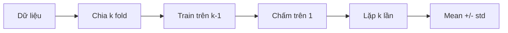

Giả sử 85% ticket hỗ trợ gửi về là bình thường và chỉ 15% là khẩn cấp. Một "mô hình" bỏ qua nội dung và lúc nào cũng trả lời "bình thường" vẫn đạt accuracy 0.85 dù không bắt được một ticket khẩn cấp nào. Đánh giá mô hình là chọn đúng con số cho đúng câu hỏi mà đội ngũ thực sự quan tâm.

## 1. Bẫy accuracy khi dữ liệu lệch lớp

Khi một lớp hiếm hơn lớp kia rất nhiều (**imbalanced data** — dữ liệu lệch lớp), **accuracy** nhìn qua rất cao dù mô hình chẳng có ích gì. Trước khi ăn mừng điểm số, hãy luôn đo một **baseline** (mức chuẩn tối thiểu) — chẳng hạn quy tắc luôn đoán lớp phổ biến nhất.

`DummyClassifier` từ `sklearn.dummy` tạo các bộ phân loại baseline theo quy tắc đơn giản (`strategy="most_frequent"` luôn đoán nhãn xuất hiện nhiều nhất trong tập train), giúp bạn thấy mức sàn mà mô hình thật phải vượt qua.

```python
import numpy as np
from sklearn.datasets import make_classification
from sklearn.dummy import DummyClassifier
from sklearn.linear_model import LogisticRegression
from sklearn.model_selection import train_test_split
from sklearn.pipeline import make_pipeline
from sklearn.preprocessing import StandardScaler

X, y = make_classification(
    n_samples=200, n_features=5, weights=[0.85], random_state=1
)
X_train, X_test, y_train, y_test = train_test_split(
    X, y, test_size=0.3, random_state=0, stratify=y
)

baseline = DummyClassifier(strategy="most_frequent").fit(X_train, y_train)
pipe = make_pipeline(StandardScaler(), LogisticRegression()).fit(X_train, y_train)

print("test counts:", np.bincount(y_test, minlength=2).tolist())  # test counts: [51, 9]
print("baseline acc:", round(float(baseline.score(X_test, y_test)), 3))  # baseline acc: 0.85
print("model acc:", round(float(pipe.score(X_test, y_test)), 3))        # model acc: 0.883
```

Hãy để ý `LogisticRegression` đạt accuracy `0.883`, chỉ nhỉnh hơn baseline ngây thơ `0.85` có `0.033` — chỉ nhìn accuracy ta không biết được nó bắt được bao nhiêu trong `9` ticket khẩn cấp. Luôn so với baseline.

## 2. Confusion matrix

**Confusion matrix** (ma trận nhầm lẫn) tách kết quả dự đoán thành bốn ô thay vì gộp vào một tỉ lệ chung: **True Positive (TP)** (dương tính thật) và **True Negative (TN)** (âm tính thật) là các ca đoán đúng, còn **False Positive (FP)** (báo động giả) và **False Negative (FN)** (bỏ sót ca khẩn cấp) là hai kiểu sai khác nhau.

Trong `scikit-learn`, hàm `confusion_matrix(y_true, y_pred)` từ `sklearn.metrics` xếp nhãn thật theo hàng và nhãn dự đoán theo cột:

```text
              predicted 0    predicted 1
actual 0   [     TN       ,     FP       ]
actual 1   [     FN       ,     TP       ]
```

Ta thử đếm tay cả bốn ô bằng boolean mask của NumPy (coi `1` = khẩn cấp là lớp dương) rồi đối chiếu với `confusion_matrix(y_test, preds).tolist()`.

```python
from sklearn.datasets import make_classification
from sklearn.linear_model import LogisticRegression
from sklearn.metrics import confusion_matrix
from sklearn.model_selection import train_test_split
from sklearn.pipeline import make_pipeline
from sklearn.preprocessing import StandardScaler

X, y = make_classification(
    n_samples=200, n_features=5, weights=[0.85], random_state=1
)
X_train, X_test, y_train, y_test = train_test_split(
    X, y, test_size=0.3, random_state=0, stratify=y
)
pipe = make_pipeline(StandardScaler(), LogisticRegression()).fit(X_train, y_train)
preds = pipe.predict(X_test)

tn = int(((y_test == 0) & (preds == 0)).sum())
fp = int(((y_test == 0) & (preds == 1)).sum())
fn = int(((y_test == 1) & (preds == 0)).sum())
tp = int(((y_test == 1) & (preds == 1)).sum())

print("manual: ", [[tn, fp], [fn, tp]])                    # manual:  [[51, 0], [7, 2]]
print("sklearn:", confusion_matrix(y_test, preds).tolist())  # sklearn: [[51, 0], [7, 2]]
```

Nhìn vào ma trận `51 + 0 + 7 + 2 = 60` ticket test: trong `9` ticket thật sự khẩn cấp (`FN + TP = 7 + 2`), mô hình bỏ sót tới `7` ticket và chỉ bắt được `2`!

| cell | meaning | ticket example |
|---|---|---|
| `TP` | thật là dương, đoán là dương | ticket khẩn cấp được chuyển đúng tới đội trực |
| `FP` | thật là âm, đoán là dương | ticket bình thường bị gắn nhầm thành khẩn cấp |
| `FN` | thật là dương, đoán là âm | ticket khẩn cấp bị lọt xuống hàng đợi bình thường |
| `TN` | thật là âm, đoán là âm | ticket bình thường nằm đúng hàng đợi bình thường |

## 3. Precision, recall và F1

Từ bốn ô đó ta có ba chỉ số chuyên biệt: **precision** (độ chính xác dự đoán dương) hỏi *"khi mô hình báo khẩn cấp, nó đúng bao nhiêu phần trăm?"* (`TP / (TP + FP)`), **recall** (độ phủ) hỏi *"trong tất cả ticket thật sự khẩn cấp, nó bắt được bao nhiêu?"* (`TP / (TP + FN)`), còn **F1 score** là trung bình điều hòa của cả hai (`2 * precision * recall / (precision + recall)`), sẽ tụt về gần 0 nếu một trong hai chỉ số thấp.

Trong `sklearn.metrics`, các hàm `precision_score(y_true, y_pred)`, `recall_score(y_true, y_pred)` và `f1_score(y_true, y_pred)` tính trực tiếp ba chỉ số này. Khi mô hình không dự đoán ca dương nào (`TP + FP == 0`), phép chia cho 0 sẽ sinh `UndefinedMetricWarning`, nên hãy truyền `zero_division=0` ở những chỗ có thể xảy ra tình huống đó.

```python
import numpy as np
from sklearn.datasets import make_classification
from sklearn.linear_model import LogisticRegression
from sklearn.metrics import f1_score, precision_score, recall_score
from sklearn.model_selection import train_test_split
from sklearn.pipeline import make_pipeline
from sklearn.preprocessing import StandardScaler

X, y = make_classification(
    n_samples=200, n_features=5, weights=[0.85], random_state=1
)
X_train, X_test, y_train, y_test = train_test_split(
    X, y, test_size=0.3, random_state=0, stratify=y
)
pipe = make_pipeline(StandardScaler(), LogisticRegression()).fit(X_train, y_train)
preds = pipe.predict(X_test)

tp = int(((y_test == 1) & (preds == 1)).sum())
fp = int(((y_test == 0) & (preds == 1)).sum())
fn = int(((y_test == 1) & (preds == 0)).sum())

prec = tp / (tp + fp)
rec = tp / (tp + fn)
f1 = 2 * prec * rec / (prec + rec)
print("manual: ", round(prec, 3), round(rec, 3), round(f1, 3))
# manual:  1.0 0.222 0.364

print(
    "sklearn:",
    round(float(precision_score(y_test, preds)), 3),
    round(float(recall_score(y_test, preds)), 3),
    round(float(f1_score(y_test, preds)), 3),
)
# sklearn: 1.0 0.222 0.364

all_zero = np.zeros_like(y_test)
print("baseline precision:", round(float(precision_score(y_test, all_zero, zero_division=0)), 3))
# baseline precision: 0.0
```

| metric | formula | value |
|---|---|---|
| precision | `TP / (TP + FP) = 2 / (2 + 0)` | `1.0` |
| recall | `TP / (TP + FN) = 2 / (2 + 7)` | `0.222` |
| F1 score | `2 * 1.0 * 0.222 / (1.0 + 0.222)` | `0.364` |

| situation | care most about | why |
|---|---|---|
| Lọc email spam | precision | chặn nhầm email quan trọng (`FP`) tệ hơn nhiều so với để lọt một thư rác |
| Ticket khẩn cấp / phát hiện gian lận | recall | bỏ sót sự cố hoặc giao dịch gian lận (`FN`) gây thiệt hại lớn hơn nhiều so với kiểm tra nhầm vài ca |
| Bài toán lệch lớp cần cân bằng | F1 score | gộp precision và recall thành một điểm mà không bị lớp đa số chi phối |

## 4. Đọc `classification_report`

Thay vì gọi rời rạc ba hàm, `classification_report` từ `sklearn.metrics` in ra bảng tóm tắt cho từng lớp chỉ trong một lệnh (`digits=3` chỉnh số chữ số thập phân).

```python
from sklearn.datasets import make_classification
from sklearn.linear_model import LogisticRegression
from sklearn.metrics import classification_report
from sklearn.model_selection import train_test_split
from sklearn.pipeline import make_pipeline
from sklearn.preprocessing import StandardScaler

X, y = make_classification(
    n_samples=200, n_features=5, weights=[0.85], random_state=1
)
X_train, X_test, y_train, y_test = train_test_split(
    X, y, test_size=0.3, random_state=0, stratify=y
)
pipe = make_pipeline(StandardScaler(), LogisticRegression()).fit(X_train, y_train)
preds = pipe.predict(X_test)

print(classification_report(y_test, preds, digits=3))
```

```text
              precision    recall  f1-score   support

           0      0.879     1.000     0.936        51
           1      1.000     0.222     0.364         9

    accuracy                          0.883        60
   macro avg      0.940     0.611     0.650        60
weighted avg      0.897     0.883     0.850        60

```

Bốn cột lần lượt cho biết `precision`, `recall`, `f1-score` và `support` (số mẫu thật của từng lớp trong `y_test`). Dòng `macro avg` lấy trung bình cộng đều giữa các lớp (`(0.936 + 0.364) / 2 = 0.650` cho F1), coi lớp hiếm quan trọng ngang lớp phổ biến; còn `weighted avg` tính trung bình có trọng số theo `support`, nên `51` ticket bình thường kéo weighted F1 lên tới `0.850`.

## 5. Ngưỡng quyết định và `predict_proba`

Giống như quy tắc ngưỡng bạn tự viết ở bài `p5-02-supervised`, `.predict(X)` thực ra so sánh xác suất với một **decision threshold** (ngưỡng quyết định) mặc định là `0.5`. Gọi `.predict_proba(X)[:, 1]` trả về xác suất dự đoán của lớp `1`, cho phép bạn hạ ngưỡng để bắt được nhiều ticket khẩn cấp hơn (tăng recall) và chấp nhận thêm báo động giả (giảm precision).

Bấm **Visualize** ở khối code này để xem `preds` và `rec` thay đổi khi `t` giảm dần từ `0.5` xuống `0.1`.

```python
from sklearn.datasets import make_classification
from sklearn.linear_model import LogisticRegression
from sklearn.metrics import precision_score, recall_score
from sklearn.model_selection import train_test_split
from sklearn.pipeline import make_pipeline
from sklearn.preprocessing import StandardScaler

X, y = make_classification(
    n_samples=200, n_features=5, weights=[0.85], random_state=1
)
X_train, X_test, y_train, y_test = train_test_split(
    X, y, test_size=0.3, random_state=0, stratify=y
)
pipe = make_pipeline(StandardScaler(), LogisticRegression()).fit(X_train, y_train)
probs = pipe.predict_proba(X_test)[:, 1]

for t in [0.5, 0.3, 0.1]:
    preds = (probs >= t).astype("int64")
    prec = round(float(precision_score(y_test, preds, zero_division=0)), 3)
    rec = round(float(recall_score(y_test, preds)), 3)
    print(f"t={t} prec={prec} rec={rec}")
# t=0.5 prec=1.0 rec=0.222
# t=0.3 prec=0.889 rec=0.889
# t=0.1 prec=0.471 rec=0.889
```

| threshold | precision | recall |
|---|---|---|
| `0.5` | `1.0` | `0.222` |
| `0.3` | `0.889` | `0.889` |
| `0.1` | `0.471` | `0.889` |

Hãy chú ý khi hạ ngưỡng xuống `0.3`, recall nhảy vọt từ `0.222` lên `0.889` (bắt được `8` trong `9` ticket khẩn cấp) mà precision vẫn giữ `0.889` — còn tụt xuống `0.1` chỉ làm tăng báo động giả mà không bắt thêm được ca khẩn cấp nào.

## 6. Cross-validation

Như đã hẹn ở cuối bài `p5-03-sklearn`, một lần chia train/test duy nhất vẫn phụ thuộc vào may rủi xem những dòng nào rơi vào `test`. **Cross-validation** (kiểm định chéo) chia dữ liệu thành `k` phần bằng nhau gọi là các **fold**, huấn luyện trên `k - 1` fold và chấm điểm trên fold còn lại đủ `k` lượt, rồi báo cáo trung bình và độ lệch chuẩn (`mean +/- std`) qua tất cả các fold.

```text
Fold 1: [T][ ][ ][ ][ ]
Fold 2: [ ][T][ ][ ][ ]
Fold 3: [ ][ ][T][ ][ ]
Fold 4: [ ][ ][ ][T][ ]
Fold 5: [ ][ ][ ][ ][T]
```



Hàm `cross_val_score` từ `sklearn.model_selection` chạy vòng lặp này tự động (`cv=5` tự chia 5 fold giữ tỉ lệ lớp cho bài toán phân loại), còn `StratifiedKFold` từ `sklearn.model_selection` cho phép bạn cố định `shuffle=True, random_state=0` và truyền `scoring="f1"` để so sánh mô hình công bằng trên dữ liệu lệch lớp.

```python
import numpy as np
from sklearn.datasets import make_classification
from sklearn.linear_model import LogisticRegression
from sklearn.model_selection import StratifiedKFold, cross_val_score
from sklearn.pipeline import make_pipeline
from sklearn.preprocessing import StandardScaler
from sklearn.tree import DecisionTreeClassifier

X, y = make_classification(
    n_samples=200, n_features=5, weights=[0.85], random_state=1
)

pipe = make_pipeline(StandardScaler(), LogisticRegression())
acc_scores = cross_val_score(pipe, X, y, cv=5)
print("5-fold acc:", np.round(acc_scores, 3).tolist())
# 5-fold acc: [0.9, 0.9, 0.825, 0.925, 0.925]
print("mean +/- std:", round(float(acc_scores.mean()), 3), "+/-", round(float(acc_scores.std()), 3))
# mean +/- std: 0.895 +/- 0.037

skf = StratifiedKFold(n_splits=5, shuffle=True, random_state=0)
lr_f1 = cross_val_score(pipe, X, y, cv=skf, scoring="f1")
tree_f1 = cross_val_score(
    DecisionTreeClassifier(max_depth=3, random_state=0), X, y, cv=skf, scoring="f1"
)
print("LogReg F1:", round(float(lr_f1.mean()), 3), "+/-", round(float(lr_f1.std()), 3))
# LogReg F1: 0.597 +/- 0.098
print("Tree   F1:", round(float(tree_f1.mean()), 3), "+/-", round(float(tree_f1.std()), 3))
# Tree   F1: 0.77 +/- 0.066
```

Khi đo bằng F1 trên 5 fold, `DecisionTreeClassifier(max_depth=3)` vượt trội pipeline `LogisticRegression` (`0.77 +/- 0.066` so với `0.597 +/- 0.098`) và dao động giữa các fold cũng ít hơn.

> [!TIP]
> Luôn đặt `StandardScaler()` **bên trong** `make_pipeline(...)` trước khi đưa vào `cross_val_score`. Nhờ vậy mỗi fold tự fit scaler chỉ trên `k - 1` fold train của riêng nó rồi mới transform fold test, không bao giờ làm rò rỉ thống kê của tập kiểm tra.

## 7. Lỗi thường gặp

**1. Chỉ nhìn accuracy trên dữ liệu lệch lớp**

Khi 95% mẫu thuộc lớp `0`, đoán toàn số `0` vẫn đạt accuracy `0.95` trong khi recall lớp hiếm bằng `0.0`. Luôn kiểm tra thêm `recall_score` hoặc `f1_score` (truyền `zero_division=0`) cho lớp thiểu số.

```python
import numpy as np
from sklearn.metrics import accuracy_score, recall_score

y_true = np.array([0] * 19 + [1])
y_pred = np.zeros_like(y_true)

print("accuracy:", round(float(accuracy_score(y_true, y_pred)), 3))               # accuracy: 0.95
print("recall:  ", round(float(recall_score(y_true, y_pred, zero_division=0)), 3))  # recall:   0.0
```

**2. Đảo thứ tự `y_true` và `y_pred` trong `confusion_matrix`**

Truyền `(y_pred, y_true)` thay vì `(y_true, y_pred)` làm ma trận bị chuyển vị, khiến bạn đọc ngược `FP` thành `FN`. Luôn truyền nhãn thật trước, nhãn dự đoán sau.

```python
import numpy as np
from sklearn.metrics import confusion_matrix

y_true = np.array([0, 0, 0, 1, 1, 1])
y_pred = np.array([0, 0, 1, 0, 0, 1])

# Sai: đảo đối số làm FP (1) và FN (2) đổi chỗ cho nhau
print("swapped:", confusion_matrix(y_pred, y_true).tolist())  # swapped: [[2, 2], [1, 1]]
# Sửa: y_true trước, y_pred sau
print("correct:", confusion_matrix(y_true, y_pred).tolist())  # correct: [[2, 1], [2, 1]]
```

**3. Chuẩn hóa toàn bộ `X` trước khi gọi `cross_val_score` (rò rỉ dữ liệu)**

Fit `StandardScaler` trên toàn bộ `X` trước khi chạy cross-validation khiến thông tin trung bình và độ lệch chuẩn của các fold test rò rỉ vào quá trình train. Ngay cả khi hai con số trung bình trên bộ dữ liệu nhỏ trông giống nhau (`0.895` và `0.895` dưới đây), quy trình bị rò rỉ vẫn sai về nguyên tắc và có thể làm điểm cao giả tạo trên dữ liệu thực tế lệch chuẩn — hãy đặt scaler vào trong `make_pipeline`.

```python
from sklearn.datasets import make_classification
from sklearn.linear_model import LogisticRegression
from sklearn.model_selection import cross_val_score
from sklearn.pipeline import make_pipeline
from sklearn.preprocessing import StandardScaler

X, y = make_classification(
    n_samples=200, n_features=5, weights=[0.85], random_state=1
)

# Sai: scaler nhìn thấy mọi fold trước khi chia
X_scaled = StandardScaler().fit_transform(X)
leaked = cross_val_score(LogisticRegression(), X_scaled, y, cv=5)

# Sửa: đặt scaler bên trong pipeline
pipe = make_pipeline(StandardScaler(), LogisticRegression())
clean = cross_val_score(pipe, X, y, cv=5)

print("leaked mean:", round(float(leaked.mean()), 3))  # leaked mean: 0.895
print("clean mean: ", round(float(clean.mean()), 3))   # clean mean:  0.895
```

**4. Báo cáo điểm trung bình CV mà bỏ qua `std`, hoặc chọn mô hình theo một fold tốt nhất**

Hai mô hình có thể đạt đỉnh trên một fold y hệt nhau (`0.727` bên dưới) nhưng độ ổn định qua các fold lại khác nhau. Hãy luôn báo cáo cả `mean` lẫn `std`, và chọn dựa trên trung bình cùng độ ổn định chứ không nhặt riêng `.max()`.

```python
from sklearn.datasets import make_classification
from sklearn.linear_model import LogisticRegression
from sklearn.model_selection import StratifiedKFold, cross_val_score
from sklearn.neighbors import KNeighborsClassifier
from sklearn.pipeline import make_pipeline
from sklearn.preprocessing import StandardScaler

X, y = make_classification(
    n_samples=200, n_features=5, weights=[0.85], random_state=1
)
skf = StratifiedKFold(n_splits=5, shuffle=True, random_state=0)

for name, est in [("LogReg", LogisticRegression()), ("KNN(k=1)", KNeighborsClassifier(n_neighbors=1))]:
    scores = cross_val_score(make_pipeline(StandardScaler(), est), X, y, cv=skf, scoring="f1")
    print(
        f"{name:<8} mean={round(float(scores.mean()), 3)}"
        f" std={round(float(scores.std()), 3)} best={round(float(scores.max()), 3)}"
    )
# LogReg   mean=0.597 std=0.098 best=0.727
# KNN(k=1) mean=0.592 std=0.122 best=0.727
```

## Tóm tắt

- Trên dữ liệu lệch lớp, **accuracy** dễ đánh lừa bằng cách giấu đi số ca thiểu số bị bỏ sót — hãy luôn đo **baseline** bằng `DummyClassifier` trước.
- **Confusion matrix** (`[[TN, FP], [FN, TP]]`) tách riêng báo động giả (`FP`) và ca bỏ sót (`FN`).
- **Precision** đo độ tin cậy khi mô hình báo dương; **recall** đo tỉ lệ ca dương thật được bắt trúng; **F1** cân bằng cả hai (nhớ truyền `zero_division=0` khi có thể không có dự đoán dương nào).
- `classification_report(..., digits=3)` hiển thị điểm từng lớp cùng `macro avg` (trung bình đều các lớp) và `weighted avg` (có trọng số theo `support`).
- Điều chỉnh **decision threshold** trên `.predict_proba(X)[:, 1]` để đánh đổi giữa precision và recall mà không cần huấn luyện lại.
- Dùng **cross-validation** (`cross_val_score` và `StratifiedKFold`) với tiền xử lý nằm trong `Pipeline`, và luôn báo cáo `mean +/- std`.
