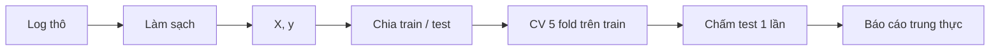

Đội hỗ trợ của bạn muốn tự động gắn cờ các ticket khẩn cấp để chuyển ngay cho kỹ sư trực sự cố. Bạn sẽ đi từ một bảng log ticket thô lộn xộn tới con số đánh giá cuối cùng mà cả đội thật sự **tin được**. Ở bài này gần như không có kiến thức mới—bạn ghép lại những gì đã học ở phase 4 và phase 5, và điều quan trọng nhất là báo cáo kết quả thật trung thực.

**Mới trong bài này**
- `make_scorer(f1_score, zero_division=0)` — bọc hàm `f1_score` cho `cross_val_score` để ghi rõ ý định trả về `0.0` khi mẫu số bằng 0 (ví dụ khi một fold không có dự đoán dương) thay vì dựa vào mặc định.
- `cross_val_predict(..., method="predict_proba")` — tính xác suất dự đoán ngoài-fold (out-of-fold) trên tập train giúp bạn chọn ngưỡng quyết định mà không chạm vào tập test.
- **Target leakage** (rò rỉ nhãn mục tiêu) — một cột feature chỉ biết được *sau* khi đáp án đã có, khiến điểm train và CV cao vọt một cách giả tạo.

## 1. Kế hoạch

Phác thảo toàn bộ quy trình từ log thô tới báo cáo trung thực trước khi viết code:



Chia công việc thành ba hàm gọn nhẹ, mỗi hàm đảm nhận đúng một việc:

| Thành phần | Đầu vào | Đầu ra |
|---|---|---|
| `prepare_features(raw)` | `DataFrame` thô | cặp mảng NumPy `(X, y)` (`float64`, `"int64"`) |
| `evaluate_models(X, y, seed)` | `(X, y)` tập train và `seed` | dict `{name: (mean, std)}` điểm CV F1 |
| `write_report(results, n_test)` | dict CV và `n_test` | danh sách các dòng báo cáo định dạng sẵn |

Exercise 1 xây dựng `prepare_features`. Exercise 2 xây dựng `evaluate_models` và `write_report`.

## 2. Nhìn dữ liệu thô

Đừng vội làm sạch hay huấn luyện khi chưa soi dữ liệu: hãy sinh bảng log 240 ticket thô rồi kiểm tra `shape`, số ID trùng, ô thiếu theo cột, nhãn bẩn và tỉ lệ lớp khẩn cấp trước:

```python
import numpy as np
import pandas as pd


def make_ticket_log(n=240, seed=21):
    rng = np.random.default_rng(seed)
    p0 = rng.choice(["free", "pro", "enterprise"], n, p=[0.45, 0.35, 0.20])
    tok, err = rng.integers(150, 2200, n).astype("float64"), rng.poisson(1.3, n).astype("float64")
    hrs = rng.uniform(0.5, 48.0, n).round(1)
    logit = -4.8 + 1.6 * err + 0.002 * tok - 0.08 * hrs + 1.2 * (p0 == "enterprise")
    y = (rng.random(n) < 1 / (1 + np.exp(-logit))).astype("int64")
    m = {"free": " Free", "pro": " PRO", "enterprise": "Enterprise "}
    plans = [m[str(p)] if i % 3 == 0 else str(p) for i, p in enumerate(p0)]
    tok_s = [f"{int(x):,}" if i % 6 == 0 else str(int(x)) for i, x in enumerate(tok)]
    tok_s[5], tok_s[37], tok_s[92], err[[12, 64]] = None, None, None, np.nan
    ids = [f"t{i:03d}" for i in range(n)]
    ids[20], ids[85], ids[140], ids[190] = ids[3], ids[11], ids[25], ids[44]
    leak = np.where(rng.random(n) < 0.98, y, 1 - y).astype("int64")
    return pd.DataFrame({
        "ticket_id": ids, "plan": plans, "tokens": tok_s, "error_count": err,
        "hours_since_deploy": hrs, "escalated_to_oncall": leak, "urgent": y,
    })


raw = make_ticket_log()
print("shape:", raw.shape)
# shape: (240, 7)
print("duplicates:", int(raw["ticket_id"].duplicated().sum()))
# duplicates: 4
print(raw.isna().sum())
# ticket_id              0
# plan                   0
# tokens                 3
# error_count            2
# hours_since_deploy     0
# escalated_to_oncall    0
# urgent                 0
# dtype: int64
print(raw["plan"].value_counts())
# plan
# free           86
# pro            49
#  PRO           31
#  Free          31
# enterprise     25
# Enterprise     18
# Name: count, dtype: int64
print(raw["urgent"].value_counts())
# urgent
# 0    183
# 1     57
# Name: count, dtype: int64
print("urgent rate:", round(float(raw["urgent"].mean()), 3))
# urgent rate: 0.237
```

Hàm `make_ticket_log` chỉ **giả lập** bảng log để bài chạy được trong trình duyệt—bạn không cần hiểu từng dòng của nó; các khối code sau chép lại y hệt hàm này để mỗi khối chạy độc lập.

Nhìn kỹ năm dòng mẫu để thấy hết mọi cái bẫy trong bảng thô:

```text
ticket_id  plan         tokens  error_count  escalated_to_oncall  urgent
t003        Free         575           1.0                    0       0   <- leading space + caps
t005       enterprise   None           2.0                    0       0   <- missing tokens
t012       Enterprise    657           NaN                    0       0   <- trailing space + NaN
t003       free         1902           1.0                    0       0   <- duplicate ticket_id
t042       Enterprise  1,638           1.0                    1       1   <- comma + leakage col
```

Chỉ `23.7%` ticket (`57` trên `240`) là khẩn cấp nên **accuracy** (tỉ lệ đoán đúng) thuần túy sẽ tâng bốc một mô hình vô dụng—còn `escalated_to_oncall` ghi nhận ticket sau đó có bị chuyển lên kỹ sư trực (on-call) hay không, thông tin chỉ có sau khi ticket đã được xử lý.

## 3. Phần 1: làm sạch và tạo feature

Hãy xem một lát cắt 5 dòng thu gọn và biến thành số qua từng bước: chuẩn hóa `plan`, xóa dấu `","` ở `tokens` trước khi gọi `pd.to_numeric(..., errors="coerce")`, bỏ dòng trùng `ticket_id` (`keep="first"`), bỏ dòng thiếu giá trị số và ánh xạ `"free" / "pro" / "enterprise"` sang `0.0 / 1.0 / 2.0`. Bấm **Visualize** ở khối code này để xem `mini` thu gọn từ `5` dòng còn `2` dòng:

```python
import numpy as np
import pandas as pd

mini = pd.DataFrame({
    "ticket_id": ["t003", "t005", "t012", "t003", "t042"],
    "plan": [" Free", "enterprise", "Enterprise ", "free", "Enterprise "],
    "tokens": ["575", None, "657", "1902", "1,638"],
    "error_count": [1.0, 2.0, np.nan, 1.0, 1.0],
    "hours_since_deploy": [44.2, 5.0, 36.4, 44.0, 15.0],
    "escalated_to_oncall": [0, 0, 0, 0, 1],
    "urgent": [0, 0, 0, 0, 1],
})
mini["plan"] = mini["plan"].astype(str).str.strip().str.lower()
mini["tokens"] = pd.to_numeric(mini["tokens"].astype(str).str.replace(",", "", regex=False), errors="coerce")
mini = mini.drop_duplicates(subset=["ticket_id"], keep="first")
mini = mini.dropna(subset=["tokens", "error_count", "hours_since_deploy"]).reset_index(drop=True)
mini["plan_code"] = mini["plan"].map({"free": 0.0, "pro": 1.0, "enterprise": 2.0})
print(mini[["ticket_id", "plan_code", "tokens", "error_count"]])
#   ticket_id  plan_code  tokens  error_count
# 0      t003        0.0   575.0          1.0
# 1      t042        2.0  1638.0          1.0
```

Ở đây ta chọn **bỏ dòng** có ô số bị thiếu thay vì điền trung bình cả cột: chỉ có 5 trên 236 dòng sau khử trùng (`2.1%`) bị thiếu số liệu, và bỏ thẳng trước khi chia `train_test_split` giúp không bịa giá trị giả hay làm rò rỉ trung bình toàn cục giữa tập train và tập test. Giờ tạo ma trận feature đầy đủ `X` (`float64`, thứ tự cột cố định `["tokens", "error_count", "hours_since_deploy", "plan_code"]`) và vector nhãn `y` (`"int64"`), nhớ loại bỏ `escalated_to_oncall`:

```python
import numpy as np
import pandas as pd


def make_ticket_log(n=240, seed=21):
    rng = np.random.default_rng(seed)
    p0 = rng.choice(["free", "pro", "enterprise"], n, p=[0.45, 0.35, 0.20])
    tok, err = rng.integers(150, 2200, n).astype("float64"), rng.poisson(1.3, n).astype("float64")
    hrs = rng.uniform(0.5, 48.0, n).round(1)
    logit = -4.8 + 1.6 * err + 0.002 * tok - 0.08 * hrs + 1.2 * (p0 == "enterprise")
    y = (rng.random(n) < 1 / (1 + np.exp(-logit))).astype("int64")
    m = {"free": " Free", "pro": " PRO", "enterprise": "Enterprise "}
    plans = [m[str(p)] if i % 3 == 0 else str(p) for i, p in enumerate(p0)]
    tok_s = [f"{int(x):,}" if i % 6 == 0 else str(int(x)) for i, x in enumerate(tok)]
    tok_s[5], tok_s[37], tok_s[92], err[[12, 64]] = None, None, None, np.nan
    ids = [f"t{i:03d}" for i in range(n)]
    ids[20], ids[85], ids[140], ids[190] = ids[3], ids[11], ids[25], ids[44]
    leak = np.where(rng.random(n) < 0.98, y, 1 - y).astype("int64")
    return pd.DataFrame({
        "ticket_id": ids, "plan": plans, "tokens": tok_s, "error_count": err,
        "hours_since_deploy": hrs, "escalated_to_oncall": leak, "urgent": y,
    })


df = make_ticket_log()
df["plan"] = df["plan"].astype(str).str.strip().str.lower()
df["tokens"] = pd.to_numeric(df["tokens"].astype(str).str.replace(",", "", regex=False), errors="coerce")
df["error_count"] = pd.to_numeric(df["error_count"], errors="coerce")
df["hours_since_deploy"] = pd.to_numeric(df["hours_since_deploy"], errors="coerce")
df = df.drop_duplicates(subset=["ticket_id"], keep="first")
df["plan_code"] = df["plan"].map({"free": 0.0, "pro": 1.0, "enterprise": 2.0})
df = df.dropna(subset=["tokens", "error_count", "hours_since_deploy", "plan_code"]).reset_index(drop=True)

X = df[["tokens", "error_count", "hours_since_deploy", "plan_code"]].to_numpy(dtype="float64")
y = df["urgent"].to_numpy(dtype="int64")
print("X shape:", X.shape, "y urgent:", int(y.sum()), "of", len(y))
# X shape: (231, 4) y urgent: 57 of 231
```

| Vấn đề | Cách sửa |
|---|---|
| Khoảng trắng, hoa thường lộn xộn ở `plan` | `.astype(str).str.strip().str.lower()`, rồi map sang `0.0 / 1.0 / 2.0` |
| Dấu phẩy trong `tokens` (`"1,638"`) | `.astype(str).str.replace(",", "", regex=False)` rồi `pd.to_numeric(..., errors="coerce")` |
| Dòng trùng `ticket_id` | `df.drop_duplicates(subset=["ticket_id"], keep="first")` |
| Ô số bị thiếu (`NaN`) | `df.dropna(subset=["tokens", "error_count", "hours_since_deploy", "plan_code"])` |
| Cột chỉ có sau khi biết kết quả `escalated_to_oncall` | Loại khỏi danh sách cột feature đưa vào `X` |

## 4. Phần 2: baseline và chọn mô hình bằng CV

Tách `25%` dữ liệu sạch làm tập **holdout test** (tập giữ riêng) với `stratify=y` và cất kỹ. Chạy `StratifiedKFold(n_splits=5, shuffle=True, random_state=0)` chỉ trên `(X_train, y_train)`, truyền `make_scorer(f1_score, zero_division=0)` để ghi rõ ý định trả về `0.000` khi mẫu số bằng 0 ở một fold nào đó thay vì dựa vào mặc định:

```python
import numpy as np
import pandas as pd
from sklearn.dummy import DummyClassifier
from sklearn.linear_model import LogisticRegression
from sklearn.metrics import f1_score, make_scorer
from sklearn.model_selection import StratifiedKFold, cross_val_score, train_test_split
from sklearn.pipeline import make_pipeline
from sklearn.preprocessing import StandardScaler
from sklearn.tree import DecisionTreeClassifier


def make_ticket_log(n=240, seed=21):
    rng = np.random.default_rng(seed)
    p0 = rng.choice(["free", "pro", "enterprise"], n, p=[0.45, 0.35, 0.20])
    tok, err = rng.integers(150, 2200, n).astype("float64"), rng.poisson(1.3, n).astype("float64")
    hrs = rng.uniform(0.5, 48.0, n).round(1)
    logit = -4.8 + 1.6 * err + 0.002 * tok - 0.08 * hrs + 1.2 * (p0 == "enterprise")
    y = (rng.random(n) < 1 / (1 + np.exp(-logit))).astype("int64")
    m = {"free": " Free", "pro": " PRO", "enterprise": "Enterprise "}
    plans = [m[str(p)] if i % 3 == 0 else str(p) for i, p in enumerate(p0)]
    tok_s = [f"{int(x):,}" if i % 6 == 0 else str(int(x)) for i, x in enumerate(tok)]
    tok_s[5], tok_s[37], tok_s[92], err[[12, 64]] = None, None, None, np.nan
    ids = [f"t{i:03d}" for i in range(n)]
    ids[20], ids[85], ids[140], ids[190] = ids[3], ids[11], ids[25], ids[44]
    leak = np.where(rng.random(n) < 0.98, y, 1 - y).astype("int64")
    return pd.DataFrame({
        "ticket_id": ids, "plan": plans, "tokens": tok_s, "error_count": err,
        "hours_since_deploy": hrs, "escalated_to_oncall": leak, "urgent": y,
    })


df = make_ticket_log()
df["plan"] = df["plan"].astype(str).str.strip().str.lower()
df["tokens"] = pd.to_numeric(df["tokens"].astype(str).str.replace(",", "", regex=False), errors="coerce")
df["error_count"] = pd.to_numeric(df["error_count"], errors="coerce")
df["hours_since_deploy"] = pd.to_numeric(df["hours_since_deploy"], errors="coerce")
df = df.drop_duplicates(subset=["ticket_id"], keep="first")
df["plan_code"] = df["plan"].map({"free": 0.0, "pro": 1.0, "enterprise": 2.0})
df = df.dropna(subset=["tokens", "error_count", "hours_since_deploy", "plan_code"]).reset_index(drop=True)

X = df[["tokens", "error_count", "hours_since_deploy", "plan_code"]].to_numpy(dtype="float64")
y = df["urgent"].to_numpy(dtype="int64")
X_train, X_test, y_train, y_test = train_test_split(X, y, test_size=0.25, stratify=y, random_state=42)

skf = StratifiedKFold(n_splits=5, shuffle=True, random_state=0)
f1_safe = make_scorer(f1_score, zero_division=0)
models = [
    ("baseline", DummyClassifier(strategy="most_frequent")),
    ("logreg", make_pipeline(StandardScaler(), LogisticRegression())),
    ("tree", DecisionTreeClassifier(max_depth=3, random_state=0)),
]

for name, est in models:
    scores = cross_val_score(est, X_train, y_train, cv=skf, scoring=f1_safe)
    print(f"{name:<8} mean={round(float(scores.mean()), 3):.3f} std={round(float(scores.std()), 3):.3f}")
# baseline mean=0.000 std=0.000
# logreg   mean=0.709 std=0.092
# tree     mean=0.701 std=0.140
```

| Mô hình | Trung bình CV F1 | Độ lệch chuẩn CV F1 |
|---|---|---|
| `baseline` (`DummyClassifier`) | `0.000` | `0.000` |
| `logreg` (`StandardScaler` + `LogisticRegression`) | `0.709` | `0.092` |
| `tree` (`DecisionTreeClassifier(max_depth=3)`) | `0.701` | `0.140` |

Cả hai mô hình thật đều vượt xa `baseline` (`0.000`), và `logreg` nhỉnh hơn `tree` một chút (`0.709` so với `0.701`) với độ dao động giữa các fold gọn hơn (`0.092` so với `0.140`). Tuy nhiên độ chênh (`0.008`) nhỏ hơn hẳn độ lệch chuẩn—ta sẽ ghi rõ điều này ở phần báo cáo trung thực.

## 5. Phần 3: đánh giá một lần trên test

Với ticket khẩn cấp, bỏ sót một sự cố thật tốn kém hơn nhiều so với kiểm tra nhầm một báo động giả, nên ta đặt mục tiêu `recall >= 0.80`—và phải chọn ngưỡng **chỉ trên CV của tập train**, tuyệt đối không nhìn `X_test`. Hàm `cross_val_predict(pipe, X_train, y_train, cv=skf, method="predict_proba")` trả về xác suất dự đoán out-of-fold trên tập train sao cho mỗi dòng đều được dự đoán bởi mô hình chưa từng thấy nó lúc train:

```python
import numpy as np
import pandas as pd
from sklearn.linear_model import LogisticRegression
from sklearn.metrics import confusion_matrix, f1_score, precision_score, recall_score
from sklearn.model_selection import StratifiedKFold, cross_val_predict, train_test_split
from sklearn.pipeline import make_pipeline
from sklearn.preprocessing import StandardScaler


def make_ticket_log(n=240, seed=21):
    rng = np.random.default_rng(seed)
    p0 = rng.choice(["free", "pro", "enterprise"], n, p=[0.45, 0.35, 0.20])
    tok, err = rng.integers(150, 2200, n).astype("float64"), rng.poisson(1.3, n).astype("float64")
    hrs = rng.uniform(0.5, 48.0, n).round(1)
    logit = -4.8 + 1.6 * err + 0.002 * tok - 0.08 * hrs + 1.2 * (p0 == "enterprise")
    y = (rng.random(n) < 1 / (1 + np.exp(-logit))).astype("int64")
    m = {"free": " Free", "pro": " PRO", "enterprise": "Enterprise "}
    plans = [m[str(p)] if i % 3 == 0 else str(p) for i, p in enumerate(p0)]
    tok_s = [f"{int(x):,}" if i % 6 == 0 else str(int(x)) for i, x in enumerate(tok)]
    tok_s[5], tok_s[37], tok_s[92], err[[12, 64]] = None, None, None, np.nan
    ids = [f"t{i:03d}" for i in range(n)]
    ids[20], ids[85], ids[140], ids[190] = ids[3], ids[11], ids[25], ids[44]
    leak = np.where(rng.random(n) < 0.98, y, 1 - y).astype("int64")
    return pd.DataFrame({
        "ticket_id": ids, "plan": plans, "tokens": tok_s, "error_count": err,
        "hours_since_deploy": hrs, "escalated_to_oncall": leak, "urgent": y,
    })


df = make_ticket_log()
df["plan"] = df["plan"].astype(str).str.strip().str.lower()
df["tokens"] = pd.to_numeric(df["tokens"].astype(str).str.replace(",", "", regex=False), errors="coerce")
df["error_count"] = pd.to_numeric(df["error_count"], errors="coerce")
df["hours_since_deploy"] = pd.to_numeric(df["hours_since_deploy"], errors="coerce")
df = df.drop_duplicates(subset=["ticket_id"], keep="first")
df["plan_code"] = df["plan"].map({"free": 0.0, "pro": 1.0, "enterprise": 2.0})
df = df.dropna(subset=["tokens", "error_count", "hours_since_deploy", "plan_code"]).reset_index(drop=True)

X = df[["tokens", "error_count", "hours_since_deploy", "plan_code"]].to_numpy(dtype="float64")
y = df["urgent"].to_numpy(dtype="int64")
X_train, X_test, y_train, y_test = train_test_split(X, y, test_size=0.25, stratify=y, random_state=42)

skf = StratifiedKFold(n_splits=5, shuffle=True, random_state=0)
pipe = make_pipeline(StandardScaler(), LogisticRegression())
oof_probs = cross_val_predict(pipe, X_train, y_train, cv=skf, method="predict_proba")[:, 1]

for t in [0.5, 0.4, 0.3, 0.2]:
    oof_preds = (oof_probs >= t).astype("int64")
    p = round(float(precision_score(y_train, oof_preds, zero_division=0)), 3)
    r = round(float(recall_score(y_train, oof_preds)), 3)
    f = round(float(f1_score(y_train, oof_preds, zero_division=0)), 3)
    print(f"t={t} prec={p:.3f} rec={r:.3f} f1={f:.3f}")
# t=0.5 prec=0.818 rec=0.628 f1=0.711
# t=0.4 prec=0.732 rec=0.698 f1=0.714
# t=0.3 prec=0.627 rec=0.744 f1=0.681
# t=0.2 prec=0.507 rec=0.837 f1=0.632

pipe.fit(X_train, y_train)
test_preds = (pipe.predict_proba(X_test)[:, 1] >= 0.2).astype("int64")
print("cm:", confusion_matrix(y_test, test_preds).tolist())
# cm: [[31, 13], [1, 13]]
print(
    "test prec:", round(float(precision_score(y_test, test_preds, zero_division=0)), 3),
    "rec:", round(float(recall_score(y_test, test_preds)), 3),
    "f1:", round(float(f1_score(y_test, test_preds, zero_division=0)), 3),
)
# test prec: 0.5 rec: 0.929 f1: 0.65
```

Theo dõi bảng dò ngưỡng out-of-fold trên tập train:

| ngưỡng | OOF precision | OOF recall | OOF F1 | đạt `recall >= 0.80`? |
|---|---|---|---|---|
| `0.5` | `0.818` | `0.628` | `0.711` | chưa |
| `0.4` | `0.732` | `0.698` | `0.714` | chưa |
| `0.3` | `0.627` | `0.744` | `0.681` | chưa |
| `0.2` | `0.507` | `0.837` | `0.632` | đạt (chọn `0.2`) |

Khi đã chốt ngưỡng `0.2` trước lúc chạm vào `X_test`, mô hình fit trên toàn bộ `X_train` bắt được `13` trong `14` ticket khẩn cấp trên tập test (`recall = 0.929`, chỉ sót `FN = 1`) và đổi lại `13` báo động giả (`FP = 13`, `precision = 0.5`).

## 6. Phần 4: báo cáo trung thực

Ghép mọi con số lại thành một bản tóm tắt rõ ràng nêu đủ cỡ mẫu test, baseline, độ bất định CV (`mean +/- std`), kết quả test một lần và cảnh báo khi hai mô hình chênh nhau chưa tới một độ lệch chuẩn:

```python
n_test = 58
n_urgent = 14
base_acc, base_f1 = 0.759, 0.0
lr_mean, lr_std = 0.709, 0.092
tr_mean, tr_std = 0.701, 0.140
test_prec, test_rec, test_f1 = 0.5, 0.929, 0.65

print(f"test set: {n_test} tickets ({n_urgent} urgent)")
# test set: 58 tickets (14 urgent)
print(f"baseline: acc={base_acc:.3f} F1={base_f1:.3f}")
# baseline: acc=0.759 F1=0.000
print(f"logreg CV F1: {lr_mean:.3f} +/- {lr_std:.3f}")
# logreg CV F1: 0.709 +/- 0.092
print(f"tree   CV F1: {tr_mean:.3f} +/- {tr_std:.3f}")
# tree   CV F1: 0.701 +/- 0.140
print(f"test @ t=0.2: prec={test_prec:.3f} rec={test_rec:.3f} F1={test_f1:.3f}")
# test @ t=0.2: prec=0.500 rec=0.929 F1=0.650
if abs(lr_mean - tr_mean) < max(lr_std, tr_std):
    print("note: logreg and tree differ by less than one std; cannot claim one is clearly better")
# note: logreg and tree differ by less than one std; cannot claim one is clearly better
```

| Phát biểu trung thực | Phát biểu gây hiểu nhầm |
|---|---|
| "CV F1 `0.709 +/- 0.092` qua 5 fold so với baseline `0.000`" | "Bộ phân loại của chúng tôi đạt accuracy 76%!" |
| "Kiểm tra một lần trên `58` ticket test (`14` khẩn cấp); recall `0.929`, precision `0.500`" | "Mô hình bắt trúng 93% ticket khẩn cấp" (giấu cỡ mẫu và số báo động giả) |
| "`logreg` (`0.709`) và `tree` (`0.701`) chênh nhau nhỏ hơn một độ lệch chuẩn (`0.008 < 0.140`)" | "`logreg` đã được chứng minh tốt hơn decision tree" |

> [!TIP]
> Luôn ghi rõ **baseline** và **cỡ mẫu test** (`n_test` kèm số ca thuộc lớp hiếm). Thiếu baseline thì accuracy `0.759` nghe có vẻ ổn dù chẳng bắt được ca khẩn cấp nào; thiếu `n_test = 58 (14 urgent)` thì người đọc không thể biết một ca đoán nhầm làm chỉ số nhảy mạnh tới mức nào.

## 7. Lỗi thường gặp

**1. Target leakage (`escalated_to_oncall`)**

Giữ lại một cột chỉ được ghi nhận *sau* khi ticket đã được xử lý đồng nghĩa đưa đáp án trá hình vào đầu vào—khi một ticket mới vừa gửi lên, `escalated_to_oncall` chưa hề tồn tại. Cách sửa: bỏ mọi cột chỉ có sau khi biết kết quả trước khi tạo `X`.

```python
import numpy as np
import pandas as pd
from sklearn.linear_model import LogisticRegression
from sklearn.metrics import f1_score, make_scorer
from sklearn.model_selection import StratifiedKFold, cross_val_score, train_test_split
from sklearn.pipeline import make_pipeline
from sklearn.preprocessing import StandardScaler


def make_ticket_log(n=240, seed=21):
    rng = np.random.default_rng(seed)
    p0 = rng.choice(["free", "pro", "enterprise"], n, p=[0.45, 0.35, 0.20])
    tok, err = rng.integers(150, 2200, n).astype("float64"), rng.poisson(1.3, n).astype("float64")
    hrs = rng.uniform(0.5, 48.0, n).round(1)
    logit = -4.8 + 1.6 * err + 0.002 * tok - 0.08 * hrs + 1.2 * (p0 == "enterprise")
    y = (rng.random(n) < 1 / (1 + np.exp(-logit))).astype("int64")
    m = {"free": " Free", "pro": " PRO", "enterprise": "Enterprise "}
    plans = [m[str(p)] if i % 3 == 0 else str(p) for i, p in enumerate(p0)]
    tok_s = [f"{int(x):,}" if i % 6 == 0 else str(int(x)) for i, x in enumerate(tok)]
    tok_s[5], tok_s[37], tok_s[92], err[[12, 64]] = None, None, None, np.nan
    ids = [f"t{i:03d}" for i in range(n)]
    ids[20], ids[85], ids[140], ids[190] = ids[3], ids[11], ids[25], ids[44]
    leak = np.where(rng.random(n) < 0.98, y, 1 - y).astype("int64")
    return pd.DataFrame({
        "ticket_id": ids, "plan": plans, "tokens": tok_s, "error_count": err,
        "hours_since_deploy": hrs, "escalated_to_oncall": leak, "urgent": y,
    })


df = make_ticket_log()
df["plan"] = df["plan"].astype(str).str.strip().str.lower()
df["tokens"] = pd.to_numeric(df["tokens"].astype(str).str.replace(",", "", regex=False), errors="coerce")
df = df.drop_duplicates(subset=["ticket_id"], keep="first")
df["plan_code"] = df["plan"].map({"free": 0.0, "pro": 1.0, "enterprise": 2.0})
df = df.dropna(subset=["tokens", "error_count", "hours_since_deploy", "plan_code"]).reset_index(drop=True)

y = df["urgent"].to_numpy(dtype="int64")
X_clean = df[["tokens", "error_count", "hours_since_deploy", "plan_code"]].to_numpy(dtype="float64")
X_leak = df[["tokens", "error_count", "hours_since_deploy", "plan_code", "escalated_to_oncall"]].to_numpy(dtype="float64")

skf = StratifiedKFold(n_splits=5, shuffle=True, random_state=0)
f1_safe = make_scorer(f1_score, zero_division=0)
pipe = make_pipeline(StandardScaler(), LogisticRegression())

X_tr_l, _, y_tr_l, _ = train_test_split(X_leak, y, test_size=0.25, stratify=y, random_state=42)
X_tr_c, _, y_tr_c, _ = train_test_split(X_clean, y, test_size=0.25, stratify=y, random_state=42)

# Sai: escalated_to_oncall làm lộ đáp án sau xử lý -> điểm cao bất thường gần 1.0
s_leak = cross_val_score(pipe, X_tr_l, y_tr_l, cv=skf, scoring=f1_safe)
# Cách sửa: bỏ escalated_to_oncall trước khi chia tập và huấn luyện
s_clean = cross_val_score(pipe, X_tr_c, y_tr_c, cv=skf, scoring=f1_safe)
print("with leakage:", round(float(s_leak.mean()), 3), "+/-", round(float(s_leak.std()), 3))
# with leakage: 0.978 +/- 0.027
print("clean       :", round(float(s_clean.mean()), 3), "+/-", round(float(s_clean.std()), 3))
# clean       : 0.709 +/- 0.092
```

**2. Chọn ngưỡng quyết định bằng cách nhìn tập test**

Quét các ngưỡng ngay trên `X_test` để chọn ngưỡng đạt F1 cao nhất sẽ làm ngưỡng khớp theo nhiễu của `58` dòng test và khiến bạn không còn dữ liệu mới nào để kiểm chứng. Cách sửa: chọn ngưỡng trên `X_train` bằng `cross_val_predict`, rồi chấm `X_test` đúng một lần.

```python
import numpy as np
import pandas as pd
from sklearn.linear_model import LogisticRegression
from sklearn.metrics import f1_score, recall_score
from sklearn.model_selection import StratifiedKFold, cross_val_predict, train_test_split
from sklearn.pipeline import make_pipeline
from sklearn.preprocessing import StandardScaler


def make_ticket_log(n=240, seed=21):
    rng = np.random.default_rng(seed)
    p0 = rng.choice(["free", "pro", "enterprise"], n, p=[0.45, 0.35, 0.20])
    tok, err = rng.integers(150, 2200, n).astype("float64"), rng.poisson(1.3, n).astype("float64")
    hrs = rng.uniform(0.5, 48.0, n).round(1)
    logit = -4.8 + 1.6 * err + 0.002 * tok - 0.08 * hrs + 1.2 * (p0 == "enterprise")
    y = (rng.random(n) < 1 / (1 + np.exp(-logit))).astype("int64")
    m = {"free": " Free", "pro": " PRO", "enterprise": "Enterprise "}
    plans = [m[str(p)] if i % 3 == 0 else str(p) for i, p in enumerate(p0)]
    tok_s = [f"{int(x):,}" if i % 6 == 0 else str(int(x)) for i, x in enumerate(tok)]
    tok_s[5], tok_s[37], tok_s[92], err[[12, 64]] = None, None, None, np.nan
    ids = [f"t{i:03d}" for i in range(n)]
    ids[20], ids[85], ids[140], ids[190] = ids[3], ids[11], ids[25], ids[44]
    leak = np.where(rng.random(n) < 0.98, y, 1 - y).astype("int64")
    return pd.DataFrame({
        "ticket_id": ids, "plan": plans, "tokens": tok_s, "error_count": err,
        "hours_since_deploy": hrs, "escalated_to_oncall": leak, "urgent": y,
    })


df = make_ticket_log()
df["plan"] = df["plan"].astype(str).str.strip().str.lower()
df["tokens"] = pd.to_numeric(df["tokens"].astype(str).str.replace(",", "", regex=False), errors="coerce")
df = df.drop_duplicates(subset=["ticket_id"], keep="first")
df["plan_code"] = df["plan"].map({"free": 0.0, "pro": 1.0, "enterprise": 2.0})
df = df.dropna(subset=["tokens", "error_count", "hours_since_deploy", "plan_code"]).reset_index(drop=True)

X = df[["tokens", "error_count", "hours_since_deploy", "plan_code"]].to_numpy(dtype="float64")
y = df["urgent"].to_numpy(dtype="int64")
X_train, X_test, y_train, y_test = train_test_split(X, y, test_size=0.25, stratify=y, random_state=42)

pipe = make_pipeline(StandardScaler(), LogisticRegression()).fit(X_train, y_train)
test_probs = pipe.predict_proba(X_test)[:, 1]
# Sai: chọn ngưỡng đạt đỉnh ngay trên X_test khiến không còn tập test sạch nào nữa
best_on_test = max(
    [0.5, 0.4, 0.3, 0.25, 0.2],
    key=lambda t: float(f1_score(y_test, (test_probs >= t).astype("int64"), zero_division=0)),
)
print("peeked test t:", best_on_test, "F1:", round(float(f1_score(y_test, (test_probs >= best_on_test).astype("int64"))), 3))
# peeked test t: 0.25 F1: 0.667

# Cách sửa: chọn ngưỡng trên xác suất OOF của tập train để đạt recall >= 0.80, rồi chấm test 1 lần
skf = StratifiedKFold(n_splits=5, shuffle=True, random_state=0)
oof = cross_val_predict(pipe, X_train, y_train, cv=skf, method="predict_proba")[:, 1]
honest_t = next(t for t in [0.5, 0.4, 0.3, 0.2] if float(recall_score(y_train, (oof >= t).astype("int64"))) >= 0.80)
print("honest train t:", honest_t, "test F1:", round(float(f1_score(y_test, (test_probs >= honest_t).astype("int64"))), 3))
# honest train t: 0.2 test F1: 0.65
```

**3. Báo cáo accuracy thay cho F1/recall trên dữ liệu lệch lớp**

Trên `58` ticket test này (`14` khẩn cấp), `DummyClassifier` và mô hình `logreg` đã chỉnh ngưỡng có accuracy y hệt nhau (`0.759`), nhưng một bên không bắt được ca khẩn cấp nào còn bên kia bắt trúng `13` trên `14`:

```python
import numpy as np
import pandas as pd
from sklearn.dummy import DummyClassifier
from sklearn.linear_model import LogisticRegression
from sklearn.metrics import accuracy_score, f1_score
from sklearn.model_selection import train_test_split
from sklearn.pipeline import make_pipeline
from sklearn.preprocessing import StandardScaler


def make_ticket_log(n=240, seed=21):
    rng = np.random.default_rng(seed)
    p0 = rng.choice(["free", "pro", "enterprise"], n, p=[0.45, 0.35, 0.20])
    tok, err = rng.integers(150, 2200, n).astype("float64"), rng.poisson(1.3, n).astype("float64")
    hrs = rng.uniform(0.5, 48.0, n).round(1)
    logit = -4.8 + 1.6 * err + 0.002 * tok - 0.08 * hrs + 1.2 * (p0 == "enterprise")
    y = (rng.random(n) < 1 / (1 + np.exp(-logit))).astype("int64")
    m = {"free": " Free", "pro": " PRO", "enterprise": "Enterprise "}
    plans = [m[str(p)] if i % 3 == 0 else str(p) for i, p in enumerate(p0)]
    tok_s = [f"{int(x):,}" if i % 6 == 0 else str(int(x)) for i, x in enumerate(tok)]
    tok_s[5], tok_s[37], tok_s[92], err[[12, 64]] = None, None, None, np.nan
    ids = [f"t{i:03d}" for i in range(n)]
    ids[20], ids[85], ids[140], ids[190] = ids[3], ids[11], ids[25], ids[44]
    leak = np.where(rng.random(n) < 0.98, y, 1 - y).astype("int64")
    return pd.DataFrame({
        "ticket_id": ids, "plan": plans, "tokens": tok_s, "error_count": err,
        "hours_since_deploy": hrs, "escalated_to_oncall": leak, "urgent": y,
    })


df = make_ticket_log()
df["plan"] = df["plan"].astype(str).str.strip().str.lower()
df["tokens"] = pd.to_numeric(df["tokens"].astype(str).str.replace(",", "", regex=False), errors="coerce")
df = df.drop_duplicates(subset=["ticket_id"], keep="first")
df["plan_code"] = df["plan"].map({"free": 0.0, "pro": 1.0, "enterprise": 2.0})
df = df.dropna(subset=["tokens", "error_count", "hours_since_deploy", "plan_code"]).reset_index(drop=True)

X = df[["tokens", "error_count", "hours_since_deploy", "plan_code"]].to_numpy(dtype="float64")
y = df["urgent"].to_numpy(dtype="int64")
X_train, X_test, y_train, y_test = train_test_split(X, y, test_size=0.25, stratify=y, random_state=42)

base = DummyClassifier(strategy="most_frequent").fit(X_train, y_train)
pipe = make_pipeline(StandardScaler(), LogisticRegression()).fit(X_train, y_train)
b_preds = base.predict(X_test)
m_preds = (pipe.predict_proba(X_test)[:, 1] >= 0.2).astype("int64")

print("baseline acc:", round(float(accuracy_score(y_test, b_preds)), 3), "f1:", round(float(f1_score(y_test, b_preds, zero_division=0)), 3))
# baseline acc: 0.759 f1: 0.0
print("logreg   acc:", round(float(accuracy_score(y_test, m_preds)), 3), "f1:", round(float(f1_score(y_test, m_preds, zero_division=0)), 3))
# logreg   acc: 0.759 f1: 0.65
```

## Tóm tắt

- Soi log thô trước (`shape`, `isna().sum()`, `value_counts()`, số ID trùng) và bỏ các cột chỉ có sau khi biết kết quả (**target leakage**) trước khi tạo `X`.
- Làm sạch cột phân nhóm, chuỗi số, dòng trùng (`keep="first"`) và dòng thiếu dữ liệu để tạo ma trận `X` (`float64`) đúng thứ tự cột cùng nhãn `y` (`"int64"`).
- Tách riêng tập **holdout test** có `stratify=y` ngay từ đầu; chạy CV 5 fold bằng `StratifiedKFold` so với baseline `DummyClassifier` dùng `make_scorer(f1_score, zero_division=0)`.
- Chỉnh ngưỡng quyết định chỉ trên CV của tập train (`cross_val_predict`), rồi đánh giá tập `test` **đúng một lần**.
- Báo cáo đủ `baseline`, cỡ mẫu (`n_test` và số ca dương), `mean +/- std`, và cảnh báo khi hai mô hình chênh nhau chưa tới một độ lệch chuẩn.

## Đi xa hơn

Khi cả hai bài tập đã xanh, bạn có thể thử mở rộng thêm:

- Thêm một feature tỉ lệ như `tokens / (error_count + 1)` và kiểm tra xem CV F1 5 fold trên `X_train` có tăng không.
- Truyền `class_weight="balanced"` vào `LogisticRegression` rồi so sánh precision và recall ở ngưỡng mặc định `0.5`.
- Vẽ đường precision và recall theo các ngưỡng `[0.1, 0.2, 0.3, 0.4, 0.5, 0.6]` từ xác suất out-of-fold của `X_train`.
