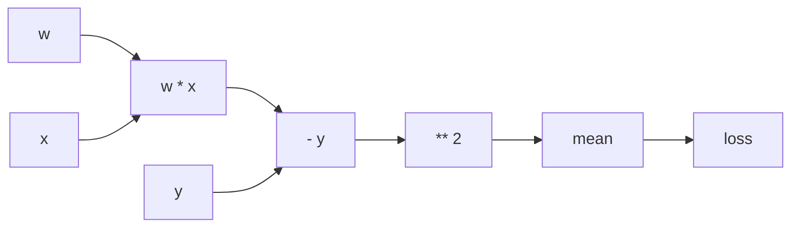

Every neural network — from an image classifier to a large language model — is built out of tensors multiplied together. In the math bridge lesson, you estimated slopes numerically one tiny `h` step at a time. **PyTorch** gives you two superpowers on top of that: array math just like NumPy, and **autograd**, which computes every gradient for you automatically.

## 1. Tensors are PyTorch's arrays

A **tensor** is PyTorch's multi-dimensional array for numbers, much like a NumPy `ndarray`. You create one with `torch.tensor([...])`, check its dimensions with `tuple(t.shape)` (since `t.shape` returns a `torch.Size` object), and check its element type with `t.dtype`.

```text
           col 0   col 1   col 2
row 0  [ [  1.0,    2.0,    3.0 ],
row 1    [  4.0,    5.0,    6.0 ] ]   shape: (2, 3)
```

Unlike NumPy, whose default floating-point type is `float64`, PyTorch defaults to `float32` because deep learning models run faster and use half the memory at 32-bit precision. You also have `torch.zeros`, `torch.ones`, `torch.arange`, `torch.rand` (always pair random ops with `torch.manual_seed(0)` for repeatable results), plus `torch.from_numpy(a)` and `t.numpy()` to convert back and forth with NumPy.

```python
import numpy as np
import torch

torch.manual_seed(0)

t = torch.tensor([[1.0, 2.0, 3.0], [4.0, 5.0, 6.0]])
print(tuple(t.shape), t.dtype)  # (2, 3) torch.float32

zeros = torch.zeros((2, 3))
ones = torch.ones(3)
seq = torch.arange(0, 6, 2)
rand = torch.rand((2, 2))
print([round(v, 3) for v in ones.tolist()])                    # [1.0, 1.0, 1.0]
print(seq.tolist())                                           # [0, 2, 4]
print([[round(v, 3) for v in row] for row in rand.tolist()])  # [[0.496, 0.768], [0.088, 0.132]]
print(tuple(zeros.shape))                                     # (2, 3)

arr = np.array([1.5, 2.5, 3.5], dtype="float32")
from_np = torch.from_numpy(arr)
back_np = from_np.numpy()
print([round(v, 3) for v in from_np.tolist()], back_np.tolist())  # [1.5, 2.5, 3.5] [1.5, 2.5, 3.5]
```

Notice that `torch.from_numpy(arr)` keeps the NumPy array's dtype, so passing `dtype="float32"` in NumPy keeps everything in `float32`.

## 2. Operations like NumPy

Element-wise math (`+`, `*`, `**`), broadcasting, and matrix multiplication with `@` work just like in NumPy. The main naming difference is reductions like `.sum()` and `.mean()`, which take `dim=` instead of NumPy's `axis=`.

| NumPy | PyTorch |
|---|---|
| `np.array([1.0, 2.0])` | `torch.tensor([1.0, 2.0])` |
| `a.shape` | `t.shape` |
| `a.sum(axis=0)` | `t.sum(dim=0)` |
| `a @ b` | `t @ u` |
| `float(a.sum())` | `t.sum().item()` |

Just as you scored individual requests in `p5-01-math-bridge`, a single `@` expression can score a whole batch of 3 requests × 4 features against a shared weights vector at once.

```python
import torch

a = torch.tensor([2.0, 4.0, 6.0])
b = torch.tensor([1.0, 2.0, 3.0])
print([round(v, 3) for v in (a + b).tolist()])  # [3.0, 6.0, 9.0]
print([round(v, 3) for v in (a * 0.5).tolist()])  # [1.0, 2.0, 3.0]

grid = torch.tensor([[1.0, 2.0, 3.0], [4.0, 5.0, 6.0]])
print([round(v, 3) for v in grid.sum(dim=0).tolist()])   # [5.0, 7.0, 9.0]
print([round(v, 3) for v in grid.mean(dim=1).tolist()])  # [2.0, 5.0]

# Batch of 3 requests x 4 features scored against 4 weights
requests = torch.tensor([
    [1.2, 0.4, 0.0, 3.0],
    [4.5, 2.1, 2.0, 8.0],
    [2.0, 0.8, 1.0, 4.0],
])
weights = torch.tensor([0.4, 1.1, 0.8, 0.1])
scores = requests @ weights
print([round(v, 3) for v in scores.tolist()])  # [1.22, 6.51, 2.88]
```

Notice how `dim=0` collapses the rows into column sums (`[5.0, 7.0, 9.0]`), while `dim=1` collapses the columns into row means (`[2.0, 5.0]`).

## 3. Printing tensors cleanly

Printing a raw tensor displays extra metadata — its wrapper, `requires_grad`, and `grad_fn` — and the last decimal digits of `float32` can differ slightly across PyTorch versions or machines, so rounding keeps outputs consistent. Instead, pull out a single-element tensor with `.item()` or convert a multi-element tensor with `.tolist()`, and `round(..., 3)` before printing.

```python
import torch

scalar = torch.tensor(3.14159)
vec = torch.tensor([0.12345, 0.67891, 1.23456])

# Raw print(vec) outputs: tensor([0.1235, 0.6789, 1.2346]) with extra grad metadata when tracked
print(round(scalar.item(), 3))                  # 3.142
print([round(v, 3) for v in vec.tolist()])      # [0.123, 0.679, 1.235]
```

Keep in mind that `.item()` only works when a tensor holds **exactly one element**; calling it on a vector or matrix raises a `RuntimeError`.

## 4. Autograd: automatic gradients

Setting `requires_grad=True` tells PyTorch to watch every operation on a parameter (called a **leaf tensor**) and build a **computation graph** on the fly. When you call `loss.backward()`, PyTorch walks backward through that graph to fill `w.grad` with the exact slope — no `h = 0.001` nudging required.



Calling `loss.backward()` walks backward from `loss` along the arrows above to compute the gradient for every tensor with `requires_grad=True`. Let us check that autograd matches the numerical slope from `p5-01-math-bridge` on the same MSE loss for `y = w * x`.

```python
import torch

xs = torch.tensor([1.0, 2.0, 3.0, 4.0])
ys = torch.tensor([2.0, 4.0, 6.0, 8.0])

w = torch.tensor(1.0, requires_grad=True)
loss = ((w * xs - ys) ** 2).mean()
loss.backward()
auto_slope = round(w.grad.item(), 3)


def loss_at(w_val: float) -> float:
    return ((w_val * xs - ys) ** 2).mean().item()


h = 0.001
num_slope = round((loss_at(1.0 + h) - loss_at(1.0 - h)) / (2 * h), 3)
print(f"autograd={auto_slope}, numeric={num_slope}")  # autograd=-15.0, numeric=-15.0
```

Both methods produce `-15.0`, but autograd computes the exact slope in one backward pass even when a model has millions of weights.

## 5. Gradient descent with autograd

A training step with autograd follows four moves in order: compute the prediction and `loss` (forward pass), call `loss.backward()`, update `w` inside `with torch.no_grad():`, and reset the gradient with `w.grad.zero_()`.

- `with torch.no_grad():` turns off graph recording during `w -= lr * w.grad`, because the update step is not part of the model's math.
- `w.grad.zero_()` clears the previous gradient, because PyTorch **accumulates** (adds) new gradients onto `w.grad` on each `backward()` call instead of overwriting it.

Press **Visualize** on this block and watch `w`, `loss`, and `w.grad` update step by step.

```python
import torch

xs = torch.tensor([1.0, 2.0, 3.0, 4.0])
ys = torch.tensor([3.0, 5.0, 7.0, 9.0])
w = torch.tensor(0.0, requires_grad=True)
lr = 0.05

for step in range(4):
    pred = w * xs + 1.0
    loss = ((pred - ys) ** 2).mean()
    loss.backward()
    print(f"step={step}  w={round(w.item(), 3)}  loss={round(loss.item(), 3)}  w.grad={round(w.grad.item(), 3)}")
    with torch.no_grad():
        w -= lr * w.grad
    w.grad.zero_()
# step=0  w=0.0  loss=30.0  w.grad=-30.0
# step=1  w=1.5  loss=1.875  w.grad=-7.5
# step=2  w=1.875  loss=0.117  w.grad=-1.875
# step=3  w=1.969  loss=0.007  w.grad=-0.469
```

Here is the exact trace across those four steps as `w` approaches `2.0`:

| `step` | `w` | `loss` | `w.grad` |
|---|---|---|---|
| `0` | `0.0` | `30.0` | `-30.0` |
| `1` | `1.5` | `1.875` | `-7.5` |
| `2` | `1.875` | `0.117` | `-1.875` |
| `3` | `1.969` | `0.007` | `-0.469` |

> [!NOTE]
> In the next lesson, `torch.optim` handles both the `torch.no_grad()` update and `.grad.zero_()` for you. PyTorch can also move tensors onto a GPU to speed up big models, though every lesson in this course runs cleanly on CPU.

## 6. Common mistakes

**1. Forgetting `w.grad.zero_()` between steps**

PyTorch adds each new gradient onto `w.grad` rather than replacing it, so forgetting to zero it doubles the gradient on the second pass.

```python
import torch

w = torch.tensor(1.0, requires_grad=True)
for _ in range(2):
    loss = (w * 3.0 - 9.0) ** 2
    loss.backward()
    print("w.grad =", round(w.grad.item(), 3))
# w.grad = -36.0
# w.grad = -72.0

# Wrong: accumulated; fix: call w.grad.zero_() after each update
```

**2. Updating `w` in place outside `torch.no_grad()`**

Modifying a leaf tensor that has `requires_grad=True` while autograd is watching raises a `RuntimeError` immediately.

```python
import torch

w = torch.tensor(1.0, requires_grad=True)
loss = (w * 3.0 - 9.0) ** 2
loss.backward()

try:
    w -= 0.05 * w.grad
except RuntimeError as err:
    print(err)
# a leaf Variable that requires grad is being used in an in-place operation.
```

Fix: wrap `w -= 0.05 * w.grad` inside `with torch.no_grad():`.

**3. Calling `.item()` on a tensor with more than one element**

`.item()` only converts a single-value tensor into a Python number; multi-element tensors raise a `RuntimeError`.

```python
import torch

t = torch.tensor([1.0, 2.0, 3.0])

try:
    t.item()
except RuntimeError as err:
    print(err)
# a Tensor with 3 elements cannot be converted to Scalar
```

Fix: use `[round(v, 3) for v in t.tolist()]` for tensors with multiple numbers.

**4. Matrix multiplication with mismatched shapes**

For `a @ b` with a 2D matrix and a 1D vector, the matrix's column count must equal the vector's length.

```python
import torch

a = torch.ones((3, 4))
b = torch.ones(3)

try:
    a @ b
except RuntimeError as err:
    print(err)
# size mismatch, got input (3), mat (3x4), vec (3)
```

Fix: print `tuple(a.shape)` and `tuple(b.shape)` first so you catch shape mismatches early (`b` needs length `4` here).

## Recap

- A **tensor** is PyTorch's array; check `tuple(t.shape)` and `t.dtype` (floats default to `float32` for speed and memory), and convert with `torch.from_numpy()` / `.numpy()`.
- Element-wise math, broadcasting, and `@` mirror NumPy, while reductions use `dim=` instead of `axis=`.
- Extract numbers cleanly with `round(t.item(), 3)` for scalars or `[round(v, 3) for v in t.tolist()]` for vectors instead of printing raw tensors.
- Setting `requires_grad=True` lets `loss.backward()` walk the **computation graph** and fill `.grad` automatically.
- In a gradient descent loop, always update parameters inside `with torch.no_grad():` and clear gradients with `.grad.zero_()` after each step.
