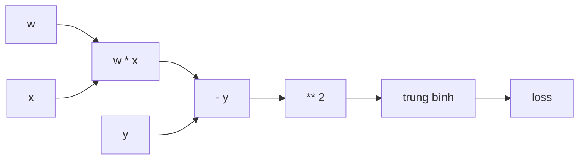

Mọi mạng neural — từ mô hình nhận diện ảnh cho tới LLM — đều được xây từ các tensor nhân với nhau. Ở bài cầu nối toán (`p5-01-math-bridge`), bạn đã tự ước lượng độ dốc bằng số qua từng bước nhỏ `h`. **PyTorch** làm hai việc giúp bạn: tính toán trên mảng giống hệt NumPy, và dùng **autograd** (bộ tính đạo hàm tự động) để tự tính mọi gradient.

## 1. Tensor là array của PyTorch

**Tensor** (mảng nhiều chiều của PyTorch) là cấu trúc lưu trữ số tương tự `ndarray` trong NumPy. Bạn tạo tensor bằng `torch.tensor([...])`, đọc kích thước bằng `tuple(t.shape)` (vì `t.shape` trả về một đối tượng `torch.Size`) và kiểm tra kiểu phần tử bằng `t.dtype`.

```text
           col 0   col 1   col 2
row 0  [ [  1.0,    2.0,    3.0 ],
row 1    [  4.0,    5.0,    6.0 ] ]   shape: (2, 3)
```

Khác với NumPy mặc định dùng số thực `float64`, PyTorch mặc định chọn `float32` vì mô hình deep learning chạy nhanh hơn và chỉ tốn một nửa bộ nhớ ở độ chính xác 32-bit. Bạn cũng có `torch.zeros`, `torch.ones`, `torch.arange`, `torch.rand` (luôn gọi `torch.manual_seed(0)` ở đầu khối có ngẫu nhiên để kết quả lặp lại được), cùng `torch.from_numpy(a)` và `t.numpy()` để chuyển qua lại với NumPy.

```python
import numpy as np
import torch

torch.manual_seed(0)

t = torch.tensor([[1.0, 2.0, 3.0], [4.0, 5.0, 6.0]])
print(tuple(t.shape), t.dtype)  # (2, 3) torch.float32

zeros = torch.zeros((2, 3))
ones = torch.ones(3)
seq = torch.arange(0, 6, 2)
rand = torch.rand((2, 2))
print([round(v, 3) for v in ones.tolist()])                    # [1.0, 1.0, 1.0]
print(seq.tolist())                                           # [0, 2, 4]
print([[round(v, 3) for v in row] for row in rand.tolist()])  # [[0.496, 0.768], [0.088, 0.132]]
print(tuple(zeros.shape))                                     # (2, 3)

arr = np.array([1.5, 2.5, 3.5], dtype="float32")
from_np = torch.from_numpy(arr)
back_np = from_np.numpy()
print([round(v, 3) for v in from_np.tolist()], back_np.tolist())  # [1.5, 2.5, 3.5] [1.5, 2.5, 3.5]
```

Để ý rằng `torch.from_numpy(arr)` giữ nguyên `dtype` của mảng NumPy, nên đặt `dtype="float32"` bên NumPy sẽ giúp cả hai phía đồng nhất ở `float32`.

## 2. Phép tính giống NumPy

Các phép tính từng phần tử (`+`, `*`, `**`), broadcasting và nhân ma trận bằng `@` đều hoạt động như trong NumPy. Điểm khác chính về tên gọi là các hàm gộp như `.sum()` và `.mean()` dùng `dim=` thay cho `axis=` của NumPy.

| NumPy | PyTorch |
|---|---|
| `np.array([1.0, 2.0])` | `torch.tensor([1.0, 2.0])` |
| `a.shape` | `t.shape` |
| `a.sum(axis=0)` | `t.sum(dim=0)` |
| `a @ b` | `t @ u` |
| `float(a.sum())` | `t.sum().item()` |

Giống cách bạn chấm điểm từng request ở bài `p5-01-math-bridge`, một biểu thức `@` duy nhất có thể chấm điểm cả batch 3 request × 4 feature cùng lúc với một vector trọng số.

```python
import torch

a = torch.tensor([2.0, 4.0, 6.0])
b = torch.tensor([1.0, 2.0, 3.0])
print([round(v, 3) for v in (a + b).tolist()])  # [3.0, 6.0, 9.0]
print([round(v, 3) for v in (a * 0.5).tolist()])  # [1.0, 2.0, 3.0]

grid = torch.tensor([[1.0, 2.0, 3.0], [4.0, 5.0, 6.0]])
print([round(v, 3) for v in grid.sum(dim=0).tolist()])   # [5.0, 7.0, 9.0]
print([round(v, 3) for v in grid.mean(dim=1).tolist()])  # [2.0, 5.0]

# Batch 3 request x 4 feature nhân với 4 trọng số
requests = torch.tensor([
    [1.2, 0.4, 0.0, 3.0],
    [4.5, 2.1, 2.0, 8.0],
    [2.0, 0.8, 1.0, 4.0],
])
weights = torch.tensor([0.4, 1.1, 0.8, 0.1])
scores = requests @ weights
print([round(v, 3) for v in scores.tolist()])  # [1.22, 6.51, 2.88]
```

Hãy chú ý `dim=0` gộp theo các hàng để ra tổng từng cột (`[5.0, 7.0, 9.0]`), còn `dim=1` gộp theo các cột để ra trung bình từng hàng (`[2.0, 5.0]`).

## 3. In tensor cho dễ đọc

Khi in trực tiếp một tensor thô, kết quả thường kèm nhiều thông tin phụ — phần bọc `tensor(...)`, `requires_grad`, `grad_fn` — rất rối mắt, đồng thời chữ số thập phân cuối của `float32` có thể khác nhau giữa các phiên bản PyTorch hoặc các máy, nên làm tròn để output luôn ổn định. Thay vào đó, hãy rút một số đơn bằng `.item()` hoặc đổi nhiều số thành list bằng `.tolist()`, rồi gọi `round(..., 3)` trước khi in.

```python
import torch

scalar = torch.tensor(3.14159)
vec = torch.tensor([0.12345, 0.67891, 1.23456])

# Nếu in thô print(vec) sẽ ra: tensor([0.1235, 0.6789, 1.2346]) kèm metadata khi có grad
print(round(scalar.item(), 3))                  # 3.142
print([round(v, 3) for v in vec.tolist()])      # [0.123, 0.679, 1.235]
```

Nhớ rằng `.item()` chỉ dùng được khi tensor có **đúng một phần tử**; gọi trên vector hay ma trận sẽ gây `RuntimeError`.

## 4. Autograd: gradient tự động

Khi bật `requires_grad=True`, bạn đánh dấu một tham số (gọi là **leaf tensor** — tensor lá) để PyTorch theo dõi mọi phép tính đi qua nó và dựng sẵn một **computation graph** (đồ thị tính toán). Lúc bạn gọi `loss.backward()`, PyTorch thực hiện **backward pass** (lượt truyền ngược) đi ngược đồ thị để điền độ dốc chính xác vào `w.grad`, không cần nhích tay `h = 0.001` nữa.



Lệnh `loss.backward()` đi ngược từ `loss` theo các mũi tên trên để tính gradient cho từng tensor có `requires_grad=True`. Hãy kiểm chứng rằng autograd cho đúng độ dốc giống cách ước lượng bằng số ở bài `p5-01-math-bridge` trên cùng hàm loss MSE của `y = w * x`.

```python
import torch

xs = torch.tensor([1.0, 2.0, 3.0, 4.0])
ys = torch.tensor([2.0, 4.0, 6.0, 8.0])

w = torch.tensor(1.0, requires_grad=True)
loss = ((w * xs - ys) ** 2).mean()
loss.backward()
auto_slope = round(w.grad.item(), 3)


def loss_at(w_val: float) -> float:
    return ((w_val * xs - ys) ** 2).mean().item()


h = 0.001
num_slope = round((loss_at(1.0 + h) - loss_at(1.0 - h)) / (2 * h), 3)
print(f"autograd={auto_slope}, numeric={num_slope}")  # autograd=-15.0, numeric=-15.0
```

Cả hai cách đều ra `-15.0`, nhưng autograd tính xong toàn bộ gradient chỉ trong một lượt truyền ngược ngay cả khi mô hình có hàng triệu trọng số.

## 5. Gradient descent với autograd

Một bước huấn luyện bằng autograd đi theo bốn thao tác theo thứ tự: tính dự đoán và `loss` (lượt tính xuôi), gọi `loss.backward()`, cập nhật `w` bên trong `with torch.no_grad():`, rồi xóa gradient bằng `w.grad.zero_()`.

- `with torch.no_grad():` tạm tắt việc ghi đồ thị khi chạy `w -= lr * w.grad`, vì bước cập nhật trọng số không nằm trong công thức của mô hình.
- `w.grad.zero_()` đặt lại gradient về 0, bởi vì PyTorch **cộng dồn** gradient mới vào `w.grad` sau mỗi lần gọi `backward()` chứ không tự ghi đè.

Bấm **Visualize** ở khối code này để xem `w`, `loss` và `w.grad` cập nhật qua từng bước.

```python
import torch

xs = torch.tensor([1.0, 2.0, 3.0, 4.0])
ys = torch.tensor([3.0, 5.0, 7.0, 9.0])
w = torch.tensor(0.0, requires_grad=True)
lr = 0.05

for step in range(4):
    pred = w * xs + 1.0
    loss = ((pred - ys) ** 2).mean()
    loss.backward()
    print(f"step={step}  w={round(w.item(), 3)}  loss={round(loss.item(), 3)}  w.grad={round(w.grad.item(), 3)}")
    with torch.no_grad():
        w -= lr * w.grad
    w.grad.zero_()
# step=0  w=0.0  loss=30.0  w.grad=-30.0
# step=1  w=1.5  loss=1.875  w.grad=-7.5
# step=2  w=1.875  loss=0.117  w.grad=-1.875
# step=3  w=1.969  loss=0.007  w.grad=-0.469
```

Đây là bảng theo dõi đúng từng giá trị qua 4 bước khi `w` tiến dần về `2.0`:

| `step` | `w` | `loss` | `w.grad` |
|---|---|---|---|
| `0` | `0.0` | `30.0` | `-30.0` |
| `1` | `1.5` | `1.875` | `-7.5` |
| `2` | `1.875` | `0.117` | `-1.875` |
| `3` | `1.969` | `0.007` | `-0.469` |

> [!NOTE]
> Ở bài sau, `torch.optim` sẽ làm sẵn hai dòng cập nhật trong `torch.no_grad()` và `.grad.zero_()` này giúp bạn. PyTorch cũng có thể đưa tensor lên GPU để tăng tốc cho mô hình lớn, nhưng toàn bộ bài học ở đây đều chạy gọn trên CPU.

## 6. Lỗi thường gặp

**1. Quên gọi `w.grad.zero_()` giữa các bước**

PyTorch cộng thêm gradient mới vào `w.grad` thay vì thay thế giá trị cũ, nên quên xóa sẽ làm gradient bị nhân đôi ngay ở lần gọi `backward()` thứ hai.

```python
import torch

w = torch.tensor(1.0, requires_grad=True)
for _ in range(2):
    loss = (w * 3.0 - 9.0) ** 2
    loss.backward()
    print("w.grad =", round(w.grad.item(), 3))
# w.grad = -36.0
# w.grad = -72.0  (sai: bị cộng dồn; sửa: gọi w.grad.zero_() sau mỗi lần cập nhật)
```

**2. Cập nhật `w` tại chỗ bên ngoài `torch.no_grad()`**

Sửa trực tiếp một leaf tensor đang bật `requires_grad=True` trong khi autograd vẫn theo dõi sẽ gây `RuntimeError` ngay lập tức.

```python
import torch

w = torch.tensor(1.0, requires_grad=True)
loss = (w * 3.0 - 9.0) ** 2
loss.backward()

try:
    w -= 0.05 * w.grad
except RuntimeError as err:
    print(err)
# a leaf Variable that requires grad is being used in an in-place operation.
```

Cách sửa: bọc dòng `w -= 0.05 * w.grad` bên trong `with torch.no_grad():`.

**3. Gọi `.item()` trên tensor có nhiều hơn một phần tử**

`.item()` chỉ chuyển được tensor đúng một giá trị sang số Python; tensor nhiều phần tử sẽ báo `RuntimeError`.

```python
import torch

t = torch.tensor([1.0, 2.0, 3.0])

try:
    t.item()
except RuntimeError as err:
    print(err)
# a Tensor with 3 elements cannot be converted to Scalar
```

Cách sửa: dùng `[round(v, 3) for v in t.tolist()]` cho tensor có nhiều con số.

**4. Nhân ma trận bị lệch shape**

Khi tính `a @ b` giữa ma trận 2D và vector 1D, số cột của ma trận phải bằng đúng độ dài của vector.

```python
import torch

a = torch.ones((3, 4))
b = torch.ones(3)

try:
    a @ b
except RuntimeError as err:
    print(err)
# size mismatch, got input (3), mat (3x4), vec (3)
```

Cách sửa: in `tuple(a.shape)` và `tuple(b.shape)` trước khi nhân để phát hiện sớm chỗ lệch (ở đây `b` cần dài `4`).

## Tóm tắt

- **Tensor** là mảng của PyTorch; kiểm tra kích thước bằng `tuple(t.shape)` và kiểu bằng `t.dtype` (số thực mặc định là `float32` để nhanh và nhẹ), chuyển qua lại với NumPy bằng `torch.from_numpy()` và `.numpy()`.
- Phép tính từng phần tử, broadcasting và `@` giống NumPy, còn các hàm gộp dùng `dim=` thay cho `axis=`.
- Rút số cho dễ đọc bằng `round(t.item(), 3)` cho một số hoặc `[round(v, 3) for v in t.tolist()]` cho nhiều số thay vì in tensor thô.
- Bật `requires_grad=True` giúp `loss.backward()` đi ngược **computation graph** và tự động điền gradient vào `.grad`.
- Trong vòng lặp gradient descent, luôn cập nhật tham số bên trong `with torch.no_grad():` và xóa gradient bằng `.grad.zero_()` sau mỗi bước.
