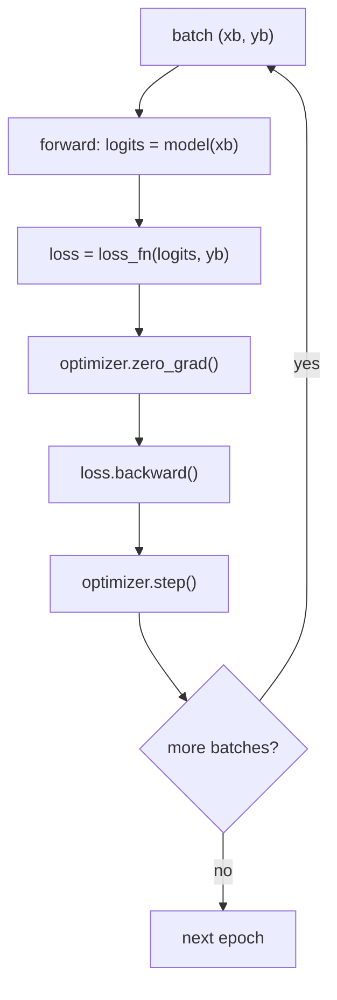

Every deep learning model — from the tiny classifier in this lesson to a large language model — is trained with the same five-line loop. In `p6-01-tensors`, you wrote those steps by hand for a single parameter `w`. This lesson shows how PyTorch packages each piece so that exact same loop scales to models with thousands of parameters.

## 1. A model is an `nn.Module`

`nn.Linear(in_features, out_features)` computes `x @ W.T + b`, automatically creating its weight matrix and bias vector with `requires_grad=True` already enabled. To combine multiple layers into one model, you subclass `nn.Module` — using the same class inheritance you learned in phase 2 — so PyTorch automatically tracks every parameter inside.

Between two linear layers, we place `nn.ReLU()`, which keeps positive numbers unchanged and turns negative numbers into `0` so the model can learn curved decision boundaries instead of only straight lines.

```text
(N, 2) → Linear(2, 8) → (N, 8) → ReLU → (N, 8) → Linear(8, 2) → (N, 2)
```

Because `nn.Linear` initialises its weights randomly, always call `torch.manual_seed(0)` before creating a model. Never print `model` or `model.state_dict()` raw (that dumps raw tensors); inspect `(name, tuple(p.shape))` instead.

```python
import torch
import torch.nn as nn

torch.manual_seed(0)


class TinyNet(nn.Module):
    def __init__(self) -> None:
        super().__init__()
        self.hidden = nn.Linear(2, 8)
        self.relu = nn.ReLU()
        self.out = nn.Linear(8, 2)

    def forward(self, x: torch.Tensor) -> torch.Tensor:
        x = self.relu(self.hidden(x))
        return self.out(x)


model = TinyNet()
print([(name, tuple(p.shape)) for name, p in model.named_parameters()])
# [('hidden.weight', (8, 2)), ('hidden.bias', (8,)), ('out.weight', (2, 8)), ('out.bias', (2,))]
print("total params:", sum(p.numel() for p in model.parameters()))  # total params: 42

sample = torch.tensor([[0.5, -0.5], [1.0, 1.5]])
logits = model(sample)
print("output shape:", tuple(logits.shape))  # output shape: (2, 2)
```

Notice that you call `model(sample)` directly — PyTorch invokes your `forward` method behind the scenes and passes the `(2, 2)` batch through all 42 parameters.

## 2. Built-in losses and optimizers

For classification, `nn.CrossEntropyLoss()` takes **logits** (raw, unnormalised scores straight from the final linear layer, before any softmax) of shape `(N, C)` and `int64` class labels of shape `(N,)`. The model returns logits, and the predicted class label for each row is `logits.argmax(dim=1)`.

To update weights without writing `with torch.no_grad():` and `.zero_()` by hand, wrap `model.parameters()` in `torch.optim.SGD(model.parameters(), lr=...)`. `optimizer.zero_grad()` clears old gradients, and `optimizer.step()` updates every parameter in one call.

| `p6-01` (by hand) | PyTorch way |
|---|---|
| `w.grad.zero_()` | `optimizer.zero_grad()` |
| `with torch.no_grad(): w -= lr * w.grad` | `optimizer.step()` |
| Hand-written MSE formula | `nn.MSELoss()` or `nn.CrossEntropyLoss()` |
| `w * x + b` | `model(x)` |

PyTorch also ships `torch.optim.Adam`, an adaptive optimizer that often converges faster on real tasks and that you will use when fine-tuning in `p6-04-fine-tune`.

```python
import torch
import torch.nn as nn

torch.manual_seed(0)


class TinyNet(nn.Module):
    def __init__(self) -> None:
        super().__init__()
        self.hidden = nn.Linear(2, 8)
        self.relu = nn.ReLU()
        self.out = nn.Linear(8, 2)

    def forward(self, x: torch.Tensor) -> torch.Tensor:
        return self.out(self.relu(self.hidden(x)))


model = TinyNet()
loss_fn = nn.CrossEntropyLoss()
optimizer = torch.optim.SGD(model.parameters(), lr=0.1)

x = torch.tensor([[-1.0, -1.0], [1.0, 1.0], [-0.8, -1.2]])
y = torch.tensor([0, 1, 0])  # int64 class labels

logits = model(x)
loss = loss_fn(logits, y)
preds = logits.argmax(dim=1)
print("loss:", round(loss.item(), 3))     # loss: 0.755
print("preds:", preds.tolist())           # preds: [1, 0, 1]

optimizer.zero_grad()
loss.backward()
optimizer.step()
new_loss = loss_fn(model(x), y)
print("after 1 step:", round(new_loss.item(), 3))  # after 1 step: 0.643
```

Notice how a single `zero_grad` -> `backward` -> `step` sequence drops the loss from `0.755` to `0.643`.

## 3. The training loop

Every PyTorch training step repeats the same five lines in order:

1. `logits = model(xb)` — run the forward pass.
2. `loss = loss_fn(logits, yb)` — measure how wrong the predictions are.
3. `optimizer.zero_grad()` — clear old gradients before computing new ones.
4. `loss.backward()` — compute gradients for every parameter via autograd.
5. `optimizer.step()` — nudge every parameter downhill.



Let us run that five-line loop on all 200 points at once (two 2D clouds: class `0` around `(-1, -1)` and class `1` around `(1, 1)`) for 30 passes.

```python
import torch
import torch.nn as nn

torch.manual_seed(0)

c0 = torch.randn(100, 2) * 0.5 + torch.tensor([-1.0, -1.0])
c1 = torch.randn(100, 2) * 0.5 + torch.tensor([1.0, 1.0])
X = torch.cat([c0, c1], dim=0)
y = torch.cat([torch.zeros(100, dtype=torch.int64), torch.ones(100, dtype=torch.int64)])


class TinyNet(nn.Module):
    def __init__(self) -> None:
        super().__init__()
        self.hidden = nn.Linear(2, 8)
        self.relu = nn.ReLU()
        self.out = nn.Linear(8, 2)

    def forward(self, x: torch.Tensor) -> torch.Tensor:
        return self.out(self.relu(self.hidden(x)))


model = TinyNet()
loss_fn = nn.CrossEntropyLoss()
optimizer = torch.optim.SGD(model.parameters(), lr=0.2)

for epoch in range(1, 31):
    logits = model(X)
    loss = loss_fn(logits, y)
    optimizer.zero_grad()
    loss.backward()
    optimizer.step()

    if epoch in (1, 10, 20, 30):
        acc = (logits.argmax(dim=1) == y).to(torch.float32).mean().item()
        print(f"epoch={epoch:2d}  loss={round(loss.item(), 3)}  acc={round(acc, 3)}")
# epoch= 1  loss=0.805  acc=0.5
# epoch=10  loss=0.167  acc=0.985
# epoch=20  loss=0.08  acc=0.995
# epoch=30  loss=0.054  acc=0.995
```

Here is the trace of `loss` and `accuracy` across those four checkpoints:

| `epoch` | `loss` | `accuracy` |
|---|---|---|
| `1` | `0.805` | `0.5` |
| `10` | `0.167` | `0.985` |
| `20` | `0.08` | `0.995` |
| `30` | `0.054` | `0.995` |

To see the five-line loop execute line by line, press **Visualize** on this short `nn.Linear(1, 1)` block and watch `loss` drop across 3 epochs.

```python
import torch
import torch.nn as nn

torch.manual_seed(0)
xs = torch.tensor([[1.0], [2.0], [3.0], [4.0]])
ys = torch.tensor([[3.0], [5.0], [7.0], [9.0]])

model = nn.Linear(1, 1)
loss_fn = nn.MSELoss()
optimizer = torch.optim.SGD(model.parameters(), lr=0.05)

for epoch in range(1, 4):
    pred = model(xs)
    loss = loss_fn(pred, ys)
    optimizer.zero_grad()
    loss.backward()
    optimizer.step()
    print(f"epoch={epoch}  loss={round(loss.item(), 3)}")
# epoch=1  loss=35.093
# epoch=2  loss=0.961
# epoch=3  loss=0.032
```

Notice how `loss` plunges from `35.093` to `0.032` in just three updates.

## 4. Epochs, batches, and `DataLoader`

An **epoch** is one full pass over the entire training dataset, while a **batch** is a small slice of samples used for one optimizer update. Real datasets rarely fit in one forward pass, so PyTorch pairs `TensorDataset(X, y)` with `DataLoader` to slice and shuffle batches for you.

Pass `num_workers=0` so data stays in the current process, and pass `generator=torch.Generator().manual_seed(0)` whenever `shuffle=True` so batch order is reproducible.

```python
import torch
from torch.utils.data import DataLoader, TensorDataset

torch.manual_seed(0)
X = torch.randn(50, 2)
y = (X[:, 0] + X[:, 1] > 0).to(torch.int64)

dataset = TensorDataset(X, y)
gen = torch.Generator().manual_seed(0)
loader = DataLoader(dataset, batch_size=16, shuffle=True, num_workers=0, generator=gen)

print("batches per epoch:", len(loader))  # batches per epoch: 4
for xb, yb in loader:
    print("first batch:", tuple(xb.shape), tuple(yb.shape))  # first batch: (16, 2) (16,)
    break
```

Notice that 50 examples split into batches of `16` gives `4` batches per epoch (three batches of 16 and one last batch of 2).

> [!TIP]
> Setting `num_workers=0` keeps data loading in a single process, which is simple, fast for small in-memory tensors, and much easier to debug. Only large datasets streamed from disk benefit from multiple worker processes.

## 5. Evaluating: `model.eval()` and `torch.no_grad()`

Just as in phase 5, split your data into **train**, **validation**, and **test** sets up front (for example 60/20/20 with `torch.randperm`). Use validation accuracy during training to pick hyperparameters like learning rate or epoch count, and touch the **test** set **only once** at the very end.

When computing validation or test accuracy, wrap the code with `model.eval()` and `with torch.no_grad():`. `torch.no_grad()` skips building the computation graph so evaluation is faster and uses less memory, while `model.eval()` switches layers such as dropout into evaluation mode (this tiny network has no dropout yet, but building the habit now prevents bugs later). Always switch back with `model.train()` before training another epoch.

```python
import torch
import torch.nn as nn
from torch.utils.data import DataLoader, TensorDataset

torch.manual_seed(0)

c0 = torch.randn(100, 2) * 1.1 + torch.tensor([-1.0, -1.0])
c1 = torch.randn(100, 2) * 1.1 + torch.tensor([1.0, 1.0])
X = torch.cat([c0, c1], dim=0)
y = torch.cat([torch.zeros(100, dtype=torch.int64), torch.ones(100, dtype=torch.int64)])

perm = torch.randperm(len(X))
X, y = X[perm], y[perm]
X_train, y_train = X[:120], y[:120]
X_val, y_val = X[120:160], y[120:160]
X_test, y_test = X[160:], y[160:]

loader = DataLoader(
    TensorDataset(X_train, y_train),
    batch_size=32,
    shuffle=True,
    num_workers=0,
    generator=torch.Generator().manual_seed(0),
)


class TinyNet(nn.Module):
    def __init__(self) -> None:
        super().__init__()
        self.hidden = nn.Linear(2, 8)
        self.relu = nn.ReLU()
        self.out = nn.Linear(8, 2)

    def forward(self, x: torch.Tensor) -> torch.Tensor:
        return self.out(self.relu(self.hidden(x)))


def eval_accuracy(m: nn.Module, xs: torch.Tensor, ys: torch.Tensor) -> float:
    m.eval()
    with torch.no_grad():
        preds = m(xs).argmax(dim=1)
        return round((preds == ys).to(torch.float32).mean().item(), 3)


model = TinyNet()
loss_fn = nn.CrossEntropyLoss()
optimizer = torch.optim.SGD(model.parameters(), lr=0.02)

for epoch in range(1, 21):
    model.train()
    last_loss = 0.0
    for xb, yb in loader:
        loss = loss_fn(model(xb), yb)
        optimizer.zero_grad()
        loss.backward()
        optimizer.step()
        last_loss = loss.item()
    if epoch in (1, 5, 10, 15, 20):
        val_acc = eval_accuracy(model, X_val, y_val)
        print(f"epoch={epoch:2d}  train_loss={round(last_loss, 3)}  val_acc={val_acc}")

print("test_acc:", eval_accuracy(model, X_test, y_test))
# epoch= 1  train_loss=0.806  val_acc=0.1
# epoch= 5  train_loss=0.676  val_acc=0.825
# epoch=10  train_loss=0.627  val_acc=0.9
# epoch=15  train_loss=0.573  val_acc=0.925
# epoch=20  train_loss=0.432  val_acc=0.925
# test_acc: 0.975
```

Notice that validation accuracy plateaus at `0.925` by epoch 15, and we only evaluate `X_test` once at the very end (`0.975`).

## 6. Saving and loading a model

To save a trained model, write `model.state_dict()` to disk with `torch.save(..., path)`. A `state_dict` stores only the learned numbers (weights and biases), not the Python class code, so to reload it you first create a fresh `TinyNet()`, call `load_state_dict(torch.load(path, weights_only=True))`, and put it in `eval()` mode.

```python
import tempfile
from pathlib import Path
import torch
import torch.nn as nn

torch.manual_seed(0)


class TinyNet(nn.Module):
    def __init__(self) -> None:
        super().__init__()
        self.hidden = nn.Linear(2, 8)
        self.relu = nn.ReLU()
        self.out = nn.Linear(8, 2)

    def forward(self, x: torch.Tensor) -> torch.Tensor:
        return self.out(self.relu(self.hidden(x)))


c0 = torch.randn(40, 2) * 0.7 + torch.tensor([-1.0, -1.0])
c1 = torch.randn(40, 2) * 0.7 + torch.tensor([1.0, 1.0])
X_train = torch.cat([c0, c1], dim=0)
y_train = torch.cat([torch.zeros(40, dtype=torch.int64), torch.ones(40, dtype=torch.int64)])

model = TinyNet()
loss_fn = nn.CrossEntropyLoss()
optimizer = torch.optim.SGD(model.parameters(), lr=0.2)
for _ in range(20):
    loss = loss_fn(model(X_train), y_train)
    optimizer.zero_grad()
    loss.backward()
    optimizer.step()

model.eval()
with torch.no_grad():
    pred_a = model(X_train).argmax(dim=1)
    acc_a = round((pred_a == y_train).to(torch.float32).mean().item(), 3)

with tempfile.TemporaryDirectory() as tmp:
    path = Path(tmp) / "tinynet.pt"
    torch.save(model.state_dict(), path)

    reloaded = TinyNet()
    reloaded.load_state_dict(torch.load(path, weights_only=True))
    reloaded.eval()
    with torch.no_grad():
        pred_b = reloaded(X_train).argmax(dim=1)
        acc_b = round((pred_b == y_train).to(torch.float32).mean().item(), 3)

print("acc original:", acc_a, "reloaded:", acc_b)  # acc original: 0.962 reloaded: 0.962
print("same predictions:", torch.equal(pred_a, pred_b))  # same predictions: True
```

Notice that `weights_only=True` loads tensor weights safely without executing arbitrary code, and `torch.equal(pred_a, pred_b)` confirms identical predictions (`True`). Here we measure accuracy on `X_train` only to verify that the original and reloaded models behave identically; to measure how well the model generalizes, still use validation and test splits as in §5.

## 7. Common mistakes

**1. Forgetting `optimizer.zero_grad()`**

Without `optimizer.zero_grad()`, gradients accumulate across steps, causing the loss to bounce back up instead of converging cleanly.

```python
import torch
import torch.nn as nn


def run_demo(zero_grad: bool) -> list[float]:
    torch.manual_seed(0)
    xs = torch.tensor([[1.0], [2.0], [3.0]])
    ys = torch.tensor([[3.0], [5.0], [7.0]])
    model = nn.Linear(1, 1)
    opt = torch.optim.SGD(model.parameters(), lr=0.05)
    loss_fn = nn.MSELoss()
    losses = []
    for _ in range(5):
        loss = loss_fn(model(xs), ys)
        if zero_grad:
            opt.zero_grad()
        loss.backward()
        opt.step()
        losses.append(round(loss.item(), 3))
    return losses


print("no zero_grad:", run_demo(False))   # no zero_grad: [22.744, 4.525, 2.902, 20.975, 24.205]
print("with zero_grad:", run_demo(True))  # with zero_grad: [22.744, 4.525, 0.911, 0.194, 0.051]
```

Fix: always call `optimizer.zero_grad()` before `loss.backward()` on every batch and epoch.

**2. Passing wrong label dtype or shape to `CrossEntropyLoss`**

`nn.CrossEntropyLoss()` requires a 1D `(N,)` tensor of `int64` (`Long`) class indices; passing `float32` labels or a 2D `(N, 1)` column raises a `RuntimeError`.

```python
import torch
import torch.nn as nn

logits = torch.tensor([[1.0, 0.2], [0.1, 1.5]])
loss_fn = nn.CrossEntropyLoss()

try:
    loss_fn(logits, torch.tensor([0.0, 1.0]))
except RuntimeError as err:
    print("float y:", err)
# float y: expected target dtype to be Long or Byte, but got Float

try:
    loss_fn(logits, torch.tensor([[0], [1]]))
except RuntimeError as err:
    print("2d y:", err)
# 2d y: 0D or 1D target tensor expected, multi-target not supported
```

Fix: store classification targets as 1D `torch.int64` tensors (`y.to(torch.int64)` with shape `(N,)`).

**3. Evaluating without `torch.no_grad()`**

Skipping `with torch.no_grad():` during evaluation does not change the predicted numbers, so it looks harmless — until a large validation pass runs out of memory because PyTorch keeps building a computation graph (`requires_grad=True`).

```python
import torch
import torch.nn as nn

torch.manual_seed(0)
model = nn.Linear(2, 2)
x = torch.randn(4, 2)

preds_tracked = model(x)
print("without no_grad:", preds_tracked.requires_grad)  # without no_grad: True

model.eval()
with torch.no_grad():
    preds_eval = model(x)
print("with no_grad:", preds_eval.requires_grad)        # with no_grad: False
```

Fix: always wrap validation and test inference in `model.eval()` and `with torch.no_grad():`.

**4. Using the test set to choose the number of epochs**

No Python error is raised if you look at test accuracy after each epoch and stop where test accuracy peaks — that is a methodology bug (data leakage) from phase 5 (`p5-02-supervised`, `p5-04-evaluation`). Once you tune epochs or learning rate against the test set, the test score is no longer an honest measure of unseen performance; always tune on validation and run test once at the end.

## Recap

- Subclass `nn.Module` (calling `super().__init__()` and defining `forward`), combining `nn.Linear` layers with `nn.ReLU()` so models can learn non-linear patterns.
- `nn.CrossEntropyLoss()` expects raw **logits** of shape `(N, C)` and `int64` labels of shape `(N,)`; predicted classes come from `logits.argmax(dim=1)`.
- Every training step follows five lines: `logits = model(xb)` -> `loss = loss_fn(logits, yb)` -> `optimizer.zero_grad()` -> `loss.backward()` -> `optimizer.step()`.
- Wrap tensors in `TensorDataset` and `DataLoader(..., num_workers=0, generator=...)` to iterate over shuffled mini-batches across **epochs**.
- Use `model.eval()` and `with torch.no_grad():` when evaluating, switch back with `model.train()` before more training, save weights with `torch.save(model.state_dict(), path)`, and touch the test set only once at the end.
