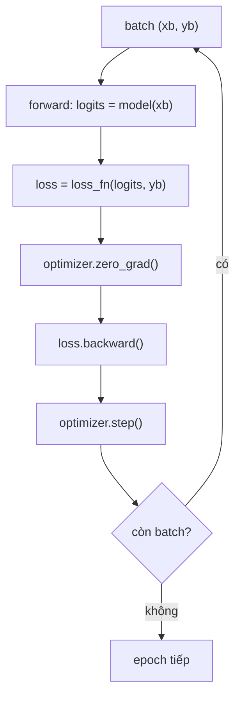

Mọi mô hình deep learning — từ mạng nhỏ trong bài này cho tới một LLM — đều được huấn luyện bằng cùng một vòng lặp năm dòng. Ở bài `p6-01-tensors`, bạn đã viết tay từng bước cho một tham số `w` duy nhất. Bài này dạy cách PyTorch đóng gói từng phần để vòng lặp đó chạy gọn cho mô hình có hàng nghìn tham số.

## 1. Model là một `nn.Module`

`nn.Linear(in_features, out_features)` tính `x @ W.T + b`, tự tạo ma trận trọng số và vector bias với `requires_grad=True` đã bật sẵn. Để ghép nhiều tầng thành một mô hình, bạn viết class kế thừa `nn.Module` — đúng kiểu OOP (lập trình hướng đối tượng) bạn đã học ở phase 2 — nhờ đó PyTorch tự động theo dõi mọi tham số bên trong.

Giữa hai tầng tuyến tính, bạn đặt `nn.ReLU()`, một lớp giữ nguyên số dương và biến số âm thành `0`, giúp mô hình học được đường ranh giới cong thay vì chỉ đường thẳng.

```text
(N, 2) → Linear(2, 8) → (N, 8) → ReLU → (N, 8) → Linear(8, 2) → (N, 2)
```

Vì `nn.Linear` khởi tạo trọng số ngẫu nhiên, hãy luôn gọi `torch.manual_seed(0)` trước khi tạo mô hình. Không in trực tiếp `model` hay `model.state_dict()` (vì sẽ xuất ra tensor thô); thay vào đó hãy kiểm tra `(name, tuple(p.shape))`.

```python
import torch
import torch.nn as nn

torch.manual_seed(0)


class TinyNet(nn.Module):
    def __init__(self) -> None:
        super().__init__()
        self.hidden = nn.Linear(2, 8)
        self.relu = nn.ReLU()
        self.out = nn.Linear(8, 2)

    def forward(self, x: torch.Tensor) -> torch.Tensor:
        x = self.relu(self.hidden(x))
        return self.out(x)


model = TinyNet()
print([(name, tuple(p.shape)) for name, p in model.named_parameters()])
# [('hidden.weight', (8, 2)), ('hidden.bias', (8,)), ('out.weight', (2, 8)), ('out.bias', (2,))]
print("total params:", sum(p.numel() for p in model.parameters()))  # total params: 42

sample = torch.tensor([[0.5, -0.5], [1.0, 1.5]])
logits = model(sample)
print("output shape:", tuple(logits.shape))  # output shape: (2, 2)
```

Để ý rằng bạn gọi thẳng `model(sample)` — PyTorch sẽ tự gọi hàm `forward` bên dưới và đưa batch `(2, 2)` đi qua toàn bộ 42 tham số.

## 2. Loss và optimizer có sẵn

Với bài toán phân loại, `nn.CrossEntropyLoss()` nhận **logits** (điểm số thô chưa chuẩn hóa, lấy thẳng từ tầng tuyến tính cuối trước khi qua softmax) có shape `(N, C)` và nhãn lớp kiểu `int64` có shape `(N,)`. Mô hình trả về logits, còn nhãn dự đoán cho từng dòng là `logits.argmax(dim=1)`.

Để cập nhật trọng số mà không phải viết tay `with torch.no_grad():` và `.zero_()`, bạn đưa `model.parameters()` vào một **optimizer** (bộ tối ưu) như `torch.optim.SGD(model.parameters(), lr=...)`. `optimizer.zero_grad()` xóa gradient cũ, còn `optimizer.step()` cập nhật toàn bộ tham số chỉ trong một lệnh.

| `p6-01` (viết tay) | Cách PyTorch |
|---|---|
| `w.grad.zero_()` | `optimizer.zero_grad()` |
| `with torch.no_grad(): w -= lr * w.grad` | `optimizer.step()` |
| Tự viết công thức MSE | `nn.MSELoss()` hoặc `nn.CrossEntropyLoss()` |
| `w * x + b` | `model(x)` |

PyTorch cũng cung cấp `torch.optim.Adam`, một optimizer thích nghi thường hội tụ nhanh hơn trên bài toán thực tế — và bạn sẽ dùng biến thể tách rời weight decay của nó là `AdamW` khi fine-tune ở bài `p6-04-fine-tune`.

```python
import torch
import torch.nn as nn

torch.manual_seed(0)


class TinyNet(nn.Module):
    def __init__(self) -> None:
        super().__init__()
        self.hidden = nn.Linear(2, 8)
        self.relu = nn.ReLU()
        self.out = nn.Linear(8, 2)

    def forward(self, x: torch.Tensor) -> torch.Tensor:
        return self.out(self.relu(self.hidden(x)))


model = TinyNet()
loss_fn = nn.CrossEntropyLoss()
optimizer = torch.optim.SGD(model.parameters(), lr=0.1)

x = torch.tensor([[-1.0, -1.0], [1.0, 1.0], [-0.8, -1.2]])
y = torch.tensor([0, 1, 0])  # nhãn lớp kiểu int64

logits = model(x)
loss = loss_fn(logits, y)
preds = logits.argmax(dim=1)
print("loss:", round(loss.item(), 3))     # loss: 0.755
print("preds:", preds.tolist())           # preds: [1, 0, 1]

optimizer.zero_grad()
loss.backward()
optimizer.step()
new_loss = loss_fn(model(x), y)
print("after 1 step:", round(new_loss.item(), 3))  # after 1 step: 0.643
```

Hãy để ý chỉ một lượt `zero_grad` -> `backward` -> `step` đã kéo loss giảm từ `0.755` xuống `0.643`.

## 3. Vòng lặp training

Mỗi bước huấn luyện trong PyTorch lặp lại đúng năm dòng theo thứ tự sau:

1. `logits = model(xb)` — chạy lượt tính xuôi (forward).
2. `loss = loss_fn(logits, yb)` — đo mức sai lệch của dự đoán.
3. `optimizer.zero_grad()` — xóa gradient cũ trước khi tính gradient mới.
4. `loss.backward()` — tính gradient cho mọi tham số bằng autograd.
5. `optimizer.step()` — đẩy toàn bộ tham số xuống dốc một bước.



Hãy chạy vòng lặp năm dòng này trên toàn bộ 200 điểm cùng lúc (hai đám điểm 2D: lớp `0` quanh `(-1, -1)` và lớp `1` quanh `(1, 1)`) qua 30 lượt.

```python
import torch
import torch.nn as nn

torch.manual_seed(0)

c0 = torch.randn(100, 2) * 0.5 + torch.tensor([-1.0, -1.0])
c1 = torch.randn(100, 2) * 0.5 + torch.tensor([1.0, 1.0])
X = torch.cat([c0, c1], dim=0)
y = torch.cat([torch.zeros(100, dtype=torch.int64), torch.ones(100, dtype=torch.int64)])


class TinyNet(nn.Module):
    def __init__(self) -> None:
        super().__init__()
        self.hidden = nn.Linear(2, 8)
        self.relu = nn.ReLU()
        self.out = nn.Linear(8, 2)

    def forward(self, x: torch.Tensor) -> torch.Tensor:
        return self.out(self.relu(self.hidden(x)))


model = TinyNet()
loss_fn = nn.CrossEntropyLoss()
optimizer = torch.optim.SGD(model.parameters(), lr=0.2)

for epoch in range(1, 31):
    logits = model(X)
    loss = loss_fn(logits, y)
    optimizer.zero_grad()
    loss.backward()
    optimizer.step()

    if epoch in (1, 10, 20, 30):
        acc = (logits.argmax(dim=1) == y).to(torch.float32).mean().item()
        print(f"epoch={epoch:2d}  loss={round(loss.item(), 3)}  acc={round(acc, 3)}")
# epoch= 1  loss=0.805  acc=0.5
# epoch=10  loss=0.167  acc=0.985
# epoch=20  loss=0.08  acc=0.995
# epoch=30  loss=0.054  acc=0.995
```

Đây là bảng theo dõi `loss` và tỉ lệ đoán đúng (`accuracy`) qua bốn mốc:

| `epoch` | `loss` | `accuracy` |
|---|---|---|
| `1` | `0.805` | `0.5` |
| `10` | `0.167` | `0.985` |
| `20` | `0.08` | `0.995` |
| `30` | `0.054` | `0.995` |

Để quan sát vòng lặp năm dòng chạy từng bước, hãy bấm **Visualize** ở khối `nn.Linear(1, 1)` ngắn gọn dưới đây và xem `loss` giảm qua 3 epoch.

```python
import torch
import torch.nn as nn

torch.manual_seed(0)
xs = torch.tensor([[1.0], [2.0], [3.0], [4.0]])
ys = torch.tensor([[3.0], [5.0], [7.0], [9.0]])

model = nn.Linear(1, 1)
loss_fn = nn.MSELoss()
optimizer = torch.optim.SGD(model.parameters(), lr=0.05)

for epoch in range(1, 4):
    pred = model(xs)
    loss = loss_fn(pred, ys)
    optimizer.zero_grad()
    loss.backward()
    optimizer.step()
    print(f"epoch={epoch}  loss={round(loss.item(), 3)}")
# epoch=1  loss=35.093
# epoch=2  loss=0.961
# epoch=3  loss=0.032
```

Hãy chú ý `loss` tụt mạnh từ `35.093` xuống `0.032` chỉ sau ba bước cập nhật.

## 4. Epoch, batch và `DataLoader`

**Epoch** là một lượt đi qua trọn vẹn toàn bộ tập dữ liệu, còn **batch** là một nhóm nhỏ các mẫu dùng cho một bước cập nhật trọng số. Dữ liệu thực tế thường không thể đưa hết vào một lượt tính xuôi, nên PyTorch ghép `TensorDataset(X, y)` với `DataLoader` để tự động cắt batch và xáo trộn dữ liệu.

Luôn truyền `num_workers=0` để giữ mọi thứ trong cùng một process, và truyền `generator=torch.Generator().manual_seed(0)` khi `shuffle=True` để thứ tự batch lặp lại được y hệt giữa các lần chạy.

```python
import torch
from torch.utils.data import DataLoader, TensorDataset

torch.manual_seed(0)
X = torch.randn(50, 2)
y = (X[:, 0] + X[:, 1] > 0).to(torch.int64)

dataset = TensorDataset(X, y)
gen = torch.Generator().manual_seed(0)
loader = DataLoader(dataset, batch_size=16, shuffle=True, num_workers=0, generator=gen)

print("batches per epoch:", len(loader))  # batches per epoch: 4
for xb, yb in loader:
    print("first batch:", tuple(xb.shape), tuple(yb.shape))  # first batch: (16, 2) (16,)
    break
```

Để ý 50 mẫu chia theo `batch_size=16` tạo ra `4` batch mỗi epoch (ba batch 16 mẫu và một batch cuối 2 mẫu).

> [!TIP]
> Giữ `num_workers=0` giúp việc nạp dữ liệu chạy gọn trong một process duy nhất, đơn giản và rất dễ debug. Chỉ những bộ dữ liệu lớn đọc từ ổ đĩa mới cần nhiều worker.

## 5. Đánh giá: `model.eval()` và `torch.no_grad()`

Giống như ở phase 5, bạn chia dữ liệu từ đầu thành ba phần **train**, **validation** và **test** (ví dụ tỉ lệ 60/20/20 bằng `torch.randperm` có seed). Hãy dùng tỉ lệ đoán đúng (accuracy) trên validation trong lúc train để chọn learning rate hay số epoch, và chỉ dùng tập **test** **đúng một lần** ở cuối.

Khi đo tỉ lệ đoán đúng (accuracy) trên validation hay test, hãy bật `model.eval()` và bọc trong `with torch.no_grad():`. `torch.no_grad()` tắt việc dựng computation graph nên đánh giá nhanh và nhẹ bộ nhớ hơn, còn `model.eval()` chuyển các tầng điều chuẩn như dropout sang chế độ đánh giá. Dropout tắt ngẫu nhiên một tỉ lệ activation trong lúc train để chống overfitting, và tự tắt khi bật `eval()` (mạng nhỏ này chưa có dropout nhưng bạn nên tập thói quen ngay từ đầu). Nhớ gọi `model.train()` trước khi quay lại train tiếp.

```python
import torch
import torch.nn as nn
from torch.utils.data import DataLoader, TensorDataset

torch.manual_seed(0)

c0 = torch.randn(100, 2) * 1.1 + torch.tensor([-1.0, -1.0])
c1 = torch.randn(100, 2) * 1.1 + torch.tensor([1.0, 1.0])
X = torch.cat([c0, c1], dim=0)
y = torch.cat([torch.zeros(100, dtype=torch.int64), torch.ones(100, dtype=torch.int64)])

perm = torch.randperm(len(X))
X, y = X[perm], y[perm]
X_train, y_train = X[:120], y[:120]
X_val, y_val = X[120:160], y[120:160]
X_test, y_test = X[160:], y[160:]

loader = DataLoader(
    TensorDataset(X_train, y_train),
    batch_size=32,
    shuffle=True,
    num_workers=0,
    generator=torch.Generator().manual_seed(0),
)


class TinyNet(nn.Module):
    def __init__(self) -> None:
        super().__init__()
        self.hidden = nn.Linear(2, 8)
        self.relu = nn.ReLU()
        self.out = nn.Linear(8, 2)

    def forward(self, x: torch.Tensor) -> torch.Tensor:
        return self.out(self.relu(self.hidden(x)))


def eval_accuracy(m: nn.Module, xs: torch.Tensor, ys: torch.Tensor) -> float:
    m.eval()
    with torch.no_grad():
        preds = m(xs).argmax(dim=1)
        return round((preds == ys).to(torch.float32).mean().item(), 3)


model = TinyNet()
loss_fn = nn.CrossEntropyLoss()
optimizer = torch.optim.SGD(model.parameters(), lr=0.02)

for epoch in range(1, 21):
    model.train()
    total_loss = 0.0
    for xb, yb in loader:
        loss = loss_fn(model(xb), yb)
        optimizer.zero_grad()
        loss.backward()
        optimizer.step()
        total_loss += loss.item()
    if epoch in (1, 5, 10, 15, 20):
        val_acc = eval_accuracy(model, X_val, y_val)
        print(f"epoch={epoch:2d}  train_loss={round(total_loss / len(loader), 3)}  val_acc={val_acc}")

print("test_acc:", eval_accuracy(model, X_test, y_test))
# epoch= 1  train_loss=0.8  val_acc=0.1
# epoch= 5  train_loss=0.68  val_acc=0.825
# epoch=10  train_loss=0.586  val_acc=0.9
# epoch=15  train_loss=0.519  val_acc=0.925
# epoch=20  train_loss=0.465  val_acc=0.925
# test_acc: 0.975
```

Ở epoch 1, `val_acc` mới là `0.1` (thấp hơn cả đoán bừa 50/50) vì trọng số khởi tạo ngẫu nhiên và SGD mới đi được vài bước mini-batch trước khi xoay được ranh giới phân loại. Từ epoch 15, tỉ lệ đoán đúng trên validation chững lại ở `0.925`, và bạn chỉ đo `X_test` đúng một lần ở cuối cùng (`0.975`).

## 6. Lưu và nạp model

Để lưu model đã train, bạn ghi `model.state_dict()` xuống đĩa bằng `torch.save(..., path)`. `state_dict` (từ điển trọng số) chỉ lưu các con số (trọng số và bias) chứ không lưu code của class, nên muốn nạp lại bạn phải khởi tạo một `TinyNet()` mới trước, gọi `load_state_dict(torch.load(path, weights_only=True))`, rồi bật `eval()`.

```python
import tempfile
from pathlib import Path
import torch
import torch.nn as nn

torch.manual_seed(0)


class TinyNet(nn.Module):
    def __init__(self) -> None:
        super().__init__()
        self.hidden = nn.Linear(2, 8)
        self.relu = nn.ReLU()
        self.out = nn.Linear(8, 2)

    def forward(self, x: torch.Tensor) -> torch.Tensor:
        return self.out(self.relu(self.hidden(x)))


c0 = torch.randn(40, 2) * 0.7 + torch.tensor([-1.0, -1.0])
c1 = torch.randn(40, 2) * 0.7 + torch.tensor([1.0, 1.0])
X_train = torch.cat([c0, c1], dim=0)
y_train = torch.cat([torch.zeros(40, dtype=torch.int64), torch.ones(40, dtype=torch.int64)])

model = TinyNet()
loss_fn = nn.CrossEntropyLoss()
optimizer = torch.optim.SGD(model.parameters(), lr=0.2)
for _ in range(20):
    loss = loss_fn(model(X_train), y_train)
    optimizer.zero_grad()
    loss.backward()
    optimizer.step()

model.eval()
with torch.no_grad():
    pred_a = model(X_train).argmax(dim=1)
    acc_a = round((pred_a == y_train).to(torch.float32).mean().item(), 3)

with tempfile.TemporaryDirectory() as tmp:
    path = Path(tmp) / "tinynet.pt"
    torch.save(model.state_dict(), path)

    reloaded = TinyNet()
    reloaded.load_state_dict(torch.load(path, weights_only=True))
    reloaded.eval()
    with torch.no_grad():
        pred_b = reloaded(X_train).argmax(dim=1)
        acc_b = round((pred_b == y_train).to(torch.float32).mean().item(), 3)

print("acc original:", acc_a, "reloaded:", acc_b)  # acc original: 0.962 reloaded: 0.962
print("same predictions:", torch.equal(pred_a, pred_b))  # same predictions: True
```

Hãy chú ý `weights_only=True` giúp nạp các tensor trọng số an toàn, và `torch.equal(pred_a, pred_b)` xác nhận hai model dự đoán giống hệt nhau (`True`). Ở đây chỉ đo tỉ lệ đoán đúng trên `X_train` để đối chiếu model gốc với model nạp lại; muốn biết model tốt đến đâu thì vẫn phải dùng tập validation và test như ở §5.

## 7. Lỗi thường gặp

**1. Quên `optimizer.zero_grad()`**

Nếu thiếu `optimizer.zero_grad()`, gradient sẽ cộng dồn qua các bước khiến loss dao động vọt lên thay vì giảm đều.

```python
import torch
import torch.nn as nn


def run_demo(zero_grad: bool) -> list[float]:
    torch.manual_seed(0)
    xs = torch.tensor([[1.0], [2.0], [3.0]])
    ys = torch.tensor([[3.0], [5.0], [7.0]])
    model = nn.Linear(1, 1)
    opt = torch.optim.SGD(model.parameters(), lr=0.05)
    loss_fn = nn.MSELoss()
    losses = []
    for _ in range(5):
        loss = loss_fn(model(xs), ys)
        if zero_grad:
            opt.zero_grad()
        loss.backward()
        opt.step()
        losses.append(round(loss.item(), 3))
    return losses


print("no zero_grad:", run_demo(False))   # no zero_grad: [22.744, 4.525, 2.902, 20.975, 24.205]
print("with zero_grad:", run_demo(True))  # with zero_grad: [22.744, 4.525, 0.911, 0.194, 0.051]
```

Cách sửa: luôn gọi `optimizer.zero_grad()` trước `loss.backward()` ở mỗi batch và mỗi epoch.

**2. Truyền nhãn sai kiểu hoặc sai shape cho `CrossEntropyLoss`**

`nn.CrossEntropyLoss()` đòi hỏi tensor 1D `(N,)` kiểu `int64` (`Long`); truyền nhãn `float32` có shape `(N,)` hoặc tensor 2D `(N, 1)` đều gây `RuntimeError`.

```python
import torch
import torch.nn as nn

logits = torch.tensor([[1.0, 0.2], [0.1, 1.5]])
loss_fn = nn.CrossEntropyLoss()

try:
    loss_fn(logits, torch.tensor([0.0, 1.0]))
except RuntimeError as err:
    print("float y:", err)
# float y: expected target dtype to be Long or Byte, but got Float

try:
    loss_fn(logits, torch.tensor([[0], [1]]))
except RuntimeError as err:
    print("2d y:", err)
# 2d y: 0D or 1D target tensor expected, multi-target not supported
```

Cách sửa: lưu nhãn phân loại dưới dạng tensor 1D `torch.int64` (`y.to(torch.int64)` với shape `(N,)`).

**3. Đánh giá mà quên `torch.no_grad()`**

Quên `with torch.no_grad():` khi đánh giá không làm đổi các con số dự đoán nên thoạt nhìn tưởng vô hại — cho tới khi một lượt validation lớn bị hết bộ nhớ vì PyTorch vẫn âm thầm dựng computation graph (`requires_grad=True`).

```python
import torch
import torch.nn as nn

torch.manual_seed(0)
model = nn.Linear(2, 2)
x = torch.randn(4, 2)

preds_tracked = model(x)
print("without no_grad:", preds_tracked.requires_grad)  # without no_grad: True

model.eval()
with torch.no_grad():
    preds_eval = model(x)
print("with no_grad:", preds_eval.requires_grad)        # with no_grad: False
```

Cách sửa: luôn bọc phần đánh giá trên validation và test bằng `model.eval()` và `with torch.no_grad():`.

**4. Dùng test set để chọn số epoch**

Python không hề báo lỗi nếu bạn xem tỉ lệ đoán đúng trên tập test sau mỗi epoch rồi dừng ở epoch có điểm test cao nhất — nhưng đây là lỗi tư duy (rò rỉ dữ liệu) đã học ở phase 5 (`p5-02-supervised`, `p5-04-evaluation`). Khi đã dùng test set để chỉnh số epoch hay learning rate, điểm test không còn phản ánh trung thực hiệu năng trên dữ liệu mới; hãy luôn chọn tham số bằng validation và chỉ chấm test một lần ở cuối.

## Tóm tắt

- Kế thừa `nn.Module` (gọi `super().__init__()` và viết `forward`), kết hợp `nn.Linear` với `nn.ReLU()` để mô hình học được ranh giới phi tuyến.
- `nn.CrossEntropyLoss()` nhận **logits** thô shape `(N, C)` và nhãn `int64` shape `(N,)`; nhãn dự đoán lấy bằng `logits.argmax(dim=1)`.
- Mọi bước train đều đi theo năm dòng: `logits = model(xb)` -> `loss = loss_fn(logits, yb)` -> `optimizer.zero_grad()` -> `loss.backward()` -> `optimizer.step()`.
- Bọc dữ liệu trong `TensorDataset` và `DataLoader(..., num_workers=0, generator=...)` để lặp qua từng mini-batch đã xáo trộn qua mỗi **epoch**.
- Dùng `model.eval()` và `with torch.no_grad():` khi đánh giá, gọi `model.train()` trước khi train tiếp, lưu trọng số bằng `torch.save(model.state_dict(), path)`, và chỉ đụng tới test set đúng một lần ở cuối.
