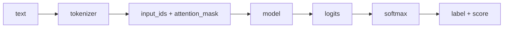

Most models for sentiment analysis, translation, or summarization are already trained by someone else. The **Hugging Face Hub** is the public library where those pretrained models live, and as an AI engineer you rarely train from scratch — you pick a model, run it properly, and check whether it fits your data. This lesson starts with a three-line `pipeline()` call and unpacks every step underneath: tokenizer, model, logits, and labels.

## 1. Pipeline: a pretrained model in a few lines

`transformers.pipeline()` wraps tokenization, model inference, and score formatting into a single callable object. Pass the task name (`"sentiment-analysis"`), the pinned model repository, the exact `revision` commit hash, and `local_files_only=True` so it reads strictly from your local cache without touching the network.

The model used in this lesson was downloaded once into the local cache using `fetch_models.py`, so every code block here runs offline and makes zero network calls:

```bash
uv run python tools/localrunner/fetch_models.py
```

Pinning `revision` to a full commit hash matters because model weights or configs on the Hub can be updated at any time, so pinning guarantees your code produces the same outputs months later.

```python
from transformers import pipeline

REPO = "distilbert/distilbert-base-uncased-finetuned-sst-2-english"
REV = "714eb0fa89d2f80546fda750413ed43d93601a13"

classifier = pipeline("sentiment-analysis", model=REPO, revision=REV, local_files_only=True)
texts = [
    "Fast and helpful answer, solved my bug!",
    "The bot kept repeating the wrong link.",
    "Thanks, that worked after I restarted.",
]
for text, res in zip(texts, classifier(texts)):
    print(f"{res['label']}  {round(res['score'], 3)}  {text}")
# POSITIVE  0.991  Fast and helpful answer, solved my bug!
# NEGATIVE  0.999  The bot kept repeating the wrong link.
# POSITIVE  0.998  Thanks, that worked after I restarted.
```

Notice how `classifier(texts)` classifies all three chatbot feedback replies and returns a dictionary with `'label'` and `'score'` for each one.

## 2. Tokenizer: text into numbers

A neural network only multiplies numbers, never raw strings, so each pretrained model comes paired with a **tokenizer** that splits text into vocabulary pieces (tokens) and maps them to integer IDs. Load it with `AutoTokenizer.from_pretrained(REPO, revision=REV, local_files_only=True)`.

Uncommon or compound words are split into subword pieces starting with `##` (such as `"Chatbot"` -> `'chat'`, `'##bot'`), and because this model is **uncased**, uppercase letters are lowercased automatically. Calling `tokenizer(text)` wraps the sequence with two special boundary tokens: `[CLS]` at the start and `[SEP]` at the end.

```text
text:    "Chatbot logs!"
tokens:  [CLS]   chat   ##bot   logs    !    [SEP]
ids:      101   11834   18384  15664   999    102
```

Press **Visualize** on this short tokenizer block to watch `pieces`, `tokens`, and `ids` appear step by step.

```python
from transformers import AutoTokenizer

REPO = "distilbert/distilbert-base-uncased-finetuned-sst-2-english"
REV = "714eb0fa89d2f80546fda750413ed43d93601a13"

tokenizer = AutoTokenizer.from_pretrained(REPO, revision=REV, local_files_only=True)
text = "Chatbot logs!"
print("pieces:", tokenizer.tokenize(text))
# pieces: ['chat', '##bot', 'logs', '!']

ids = tokenizer(text)["input_ids"]
tokens = tokenizer.convert_ids_to_tokens(ids)
print("tokens:", tokens)
# tokens: ['[CLS]', 'chat', '##bot', 'logs', '!', '[SEP]']
print("ids:", ids)
# ids: [101, 11834, 18384, 15664, 999, 102]
```

When you pass a list of sentences with different lengths, PyTorch tensors require every row in the matrix to have the same width. Pass `padding=True`, `truncation=True`, and `return_tensors="pt"` so the tokenizer pads shorter rows with `0`s and returns an `attention_mask` where `1` marks a real token and `0` marks padding.

```python
from transformers import AutoTokenizer

REPO = "distilbert/distilbert-base-uncased-finetuned-sst-2-english"
REV = "714eb0fa89d2f80546fda750413ed43d93601a13"

tokenizer = AutoTokenizer.from_pretrained(REPO, revision=REV, local_files_only=True)
texts = ["Great!", "The bot repeated the wrong link."]
batch = tokenizer(texts, padding=True, truncation=True, return_tensors="pt")
print("shape:", tuple(batch["input_ids"].shape))
# shape: (2, 9)
print("attention_mask:", batch["attention_mask"].tolist())
# attention_mask: [[1, 1, 1, 1, 0, 0, 0, 0, 0], [1, 1, 1, 1, 1, 1, 1, 1, 1]]
```

Notice that `"Great!"` has only 4 real tokens (`[CLS]`, `great`, `!`, `[SEP]`), so its `attention_mask` row has four `1`s followed by five `0`s to match the 9-token second sentence.

## 3. Model: from ids to logits to labels

To run the neural network yourself, load `AutoModelForSequenceClassification.from_pretrained(...)`, switch to `model.eval()`, and run `out = model(**batch)` inside `with torch.no_grad():`. Just as in phase 1–2, `**batch` unpacks the dictionary keys (`input_ids` and `attention_mask`) as named keyword arguments to `model`.

The model outputs raw `out.logits` of shape `(N, 2)` — two unnormalised scores per sentence, one for index `0` and one for index `1`. Applying `torch.softmax(out.logits, dim=1)` turns each row of logits into positive probabilities that add up to `1.0`, `argmax(dim=1)` picks the winning class index, and `model.config.id2label` translates that index into `"NEGATIVE"` or `"POSITIVE"`.



Let us run those steps on the exact same three sentences from §1 and compare the output.

```python
import torch
from transformers import AutoModelForSequenceClassification, AutoTokenizer

REPO = "distilbert/distilbert-base-uncased-finetuned-sst-2-english"
REV = "714eb0fa89d2f80546fda750413ed43d93601a13"

tokenizer = AutoTokenizer.from_pretrained(REPO, revision=REV, local_files_only=True)
model = AutoModelForSequenceClassification.from_pretrained(
    REPO, revision=REV, local_files_only=True
)
model.eval()

texts = [
    "Fast and helpful answer, solved my bug!",
    "The bot kept repeating the wrong link.",
    "Thanks, that worked after I restarted.",
]
batch = tokenizer(texts, padding=True, truncation=True, return_tensors="pt")
with torch.no_grad():
    out = model(**batch)

print("logits shape:", tuple(out.logits.shape))
# logits shape: (3, 2)
probs = torch.softmax(out.logits, dim=1)
pred_ids = out.logits.argmax(dim=1)
for text, logit_row, prob_row, idx in zip(
    texts, out.logits.tolist(), probs.tolist(), pred_ids.tolist()
):
    label = model.config.id2label[idx]
    score = round(prob_row[idx], 3)
    neg_l, pos_l = round(logit_row[0], 3), round(logit_row[1], 3)
    print(f"{label}  {score}  logits=[{neg_l}, {pos_l}]  P(POS)={round(prob_row[1], 3)}  {text}")
# POSITIVE  0.991  logits=[-2.307, 2.376]  P(POS)=0.991  Fast and helpful answer, solved my bug!
# NEGATIVE  0.999  logits=[3.99, -3.259]  P(POS)=0.001  The bot kept repeating the wrong link.
# POSITIVE  0.998  logits=[-2.937, 3.154]  P(POS)=0.998  Thanks, that worked after I restarted.
```

Every label and rounded score (`0.991`, `0.999`, `0.998`) matches `pipeline()` from §1 identically:

| text | logit NEG | logit POS | P(POS) | label |
|---|---|---|---|---|
| `Fast and helpful answer, solved my bug!` | `-2.307` | `2.376` | `0.991` | `POSITIVE` |
| `The bot kept repeating the wrong link.` | `3.99` | `-3.259` | `0.001` | `NEGATIVE` |
| `Thanks, that worked after I restarted.` | `-2.937` | `3.154` | `0.998` | `POSITIVE` |

## 4. Pipeline or step by step?

Both approaches run the same underlying tokenizer and model, so choose the level of control your task needs:

| use `pipeline` | do it step by step |
|---|---|
| Quick prototypes, notebooks, and demos | You need raw **logits** (for custom thresholds or calibration) |
| Standard single-step text classification | Custom batching, padding, or `max_length` truncation |
| Short scripts where defaults are enough | Fine-tuning the model weights on your own data (`p6-04-fine-tune`) |
| One-off evaluation checks | Embedding inside a production API service (phase 8) |

> [!TIP]
> `pipeline()` and the manual steps in §2–§3 return the exact same predictions and scores because `pipeline` simply bundles those three steps — tokenizing, running the model, and applying `softmax` — under one roof.

## 5. A model does not know what it was never taught

This model was fine-tuned on English movie reviews (SST-2) with only two labels: `NEGATIVE` and `POSITIVE`. When you feed it neutral facts, sarcasm, technical error logs, or another language, it has no `"NEUTRAL"` or `"UNKNOWN"` class, so it forces every input into one of those two buckets — often with a high score.

Notice that here we load `tokenizer` and `model` separately with `local_files_only=True` and pass both objects into `pipeline("sentiment-analysis", model=model, tokenizer=tokenizer)` — the safest offline pattern whenever you already hold the loaded objects.

```python
from transformers import AutoModelForSequenceClassification, AutoTokenizer, pipeline

REPO = "distilbert/distilbert-base-uncased-finetuned-sst-2-english"
REV = "714eb0fa89d2f80546fda750413ed43d93601a13"

tokenizer = AutoTokenizer.from_pretrained(REPO, revision=REV, local_files_only=True)
model = AutoModelForSequenceClassification.from_pretrained(
    REPO, revision=REV, local_files_only=True
)
classifier = pipeline("sentiment-analysis", model=model, tokenizer=tokenizer)

edge_texts = [
    "The meeting starts at 3 PM.",
    "Oh wonderful, another crash right before the demo.",
    "TimeoutError: read timed out at port 8080",
    "san pham dung duoc nhung hoi cham",
]
for text, res in zip(edge_texts, classifier(edge_texts)):
    print(f"{res['label']}  {round(res['score'], 3)}  {text}")
# POSITIVE  0.972  The meeting starts at 3 PM.
# POSITIVE  0.996  Oh wonderful, another crash right before the demo.
# NEGATIVE  0.994  TimeoutError: read timed out at port 8080
# NEGATIVE  0.696  san pham dung duoc nhung hoi cham
```

Look at the second sentence: the model sees `"wonderful"` and outputs `POSITIVE  0.996` on an obvious bug complaint, and it assigns `0.972` `POSITIVE` to a completely neutral meeting reminder. A high softmax score only means one logit was much larger than the other — it does **not** mean the model is right on your domain. Before shipping any pretrained model, label a few dozen real examples from your own users and measure **precision** and **recall** (from phase 5); if it misses on your data, you need to fine-tune it (`p6-04-fine-tune`).

> [!WARNING]
> Never treat a high `score` from `pipeline()` as proof that a prediction is accurate. Always evaluate a pretrained model on a sample of your real domain data first.

## 6. Common mistakes

**1. Forgetting `return_tensors="pt"` before calling the model**

Without `return_tensors="pt"`, the tokenizer returns plain Python lists instead of PyTorch tensors, and the model raises a `TypeError`.

```python
from transformers import AutoModelForSequenceClassification, AutoTokenizer

REPO = "distilbert/distilbert-base-uncased-finetuned-sst-2-english"
REV = "714eb0fa89d2f80546fda750413ed43d93601a13"

tokenizer = AutoTokenizer.from_pretrained(REPO, revision=REV, local_files_only=True)
model = AutoModelForSequenceClassification.from_pretrained(
    REPO, revision=REV, local_files_only=True
)

try:
    bad = tokenizer(["Hello"])
    model(**bad)
except TypeError as err:
    print(f"{type(err).__name__}: {err}")
# TypeError: embedding(): argument 'indices' (position 2) must be Tensor, not list
```

Fix: pass `return_tensors="pt"` when tokenizing inputs for a PyTorch model.

**2. Batching sentences of different lengths without `padding=True`**

PyTorch tensors must be rectangular, so passing unequal-length sentences with `return_tensors="pt"` and no `padding=True` raises a `ValueError`.

```python
from transformers import AutoTokenizer

REPO = "distilbert/distilbert-base-uncased-finetuned-sst-2-english"
REV = "714eb0fa89d2f80546fda750413ed43d93601a13"

tokenizer = AutoTokenizer.from_pretrained(REPO, revision=REV, local_files_only=True)
try:
    tokenizer(["Short", "A much longer sentence here"], return_tensors="pt")
except ValueError as err:
    print(f"{type(err).__name__}: {str(err).split('.')[0]}")
# ValueError: Unable to create tensor, you should probably activate truncation and/or padding with 'padding=True' 'truncation=True' to have batched tensors with the same length
```

Fix: always pass `padding=True, truncation=True, return_tensors="pt"` when tokenizing a batch.

**3. Calling `model(batch)` instead of `model(**batch)`**

`batch` is a dictionary-like `BatchEncoding` object, so passing it without `**` sends the whole mapping as the first positional argument (`input_ids`) instead of unpacking `input_ids=...` and `attention_mask=...`.

```python
from transformers import AutoModelForSequenceClassification, AutoTokenizer

REPO = "distilbert/distilbert-base-uncased-finetuned-sst-2-english"
REV = "714eb0fa89d2f80546fda750413ed43d93601a13"

tokenizer = AutoTokenizer.from_pretrained(REPO, revision=REV, local_files_only=True)
model = AutoModelForSequenceClassification.from_pretrained(
    REPO, revision=REV, local_files_only=True
)

batch = tokenizer(["Hello"], return_tensors="pt")
try:
    model(batch)
except TypeError as err:
    print(f"{type(err).__name__}: {err}")
# TypeError: embedding(): argument 'indices' (position 2) must be Tensor, not BatchEncoding
```

Fix: unpack the dictionary with `model(**batch)`.

**4. Treating `score` as real-world accuracy**

Python raises no error when you trust `score=0.996` on sarcasm or out-of-domain logs — that is an evaluation mistake. Revisit §5 and test every pretrained model against a small labelled sample of your own data before relying on its scores.

## Recap

- Load cached Hugging Face models offline with `revision=REV, local_files_only=True`; pinning the commit `revision` keeps model behaviour reproducible over time.
- A **tokenizer** splits text into subword tokens (`##` for word continuations), wraps sequences with `[CLS]` and `[SEP]`, and produces `input_ids` plus `attention_mask` (`1` for real tokens, `0` for padding).
- Under `model.eval()` and `with torch.no_grad():`, `out = model(**batch)` returns raw `logits` of shape `(N, num_labels)`.
- `torch.softmax(out.logits, dim=1)` converts logits into probabilities that sum to `1`, `argmax(dim=1)` picks the predicted class index, and `model.config.id2label` maps that index to a text label.
- `pipeline()` is great for quick experiments, while step-by-step code gives you logits, custom batching, and fine-tuning control (`p6-04-fine-tune`); either way, high scores do not mean right answers, so always evaluate on your own data first.
