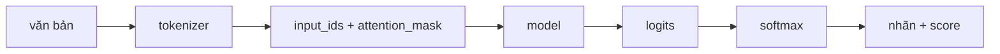

Các model phân tích cảm xúc, dịch máy hay tóm tắt văn bản phần lớn đã có người huấn luyện sẵn. **Hugging Face Hub** là "thư viện" công khai chứa những **pretrained model** (mô hình đã train sẵn) đó, và kỹ sư AI hiếm khi train lại từ đầu — bạn chọn model phù hợp, chạy nó đúng cách, rồi kiểm tra xem nó có hoạt động tốt trên dữ liệu của mình hay không. Bài học này đi từ ba dòng gọi `pipeline()` tới từng bước hoạt động bên dưới: tokenizer, model, logits và nhãn dự đoán.

## 1. Pipeline: model đã train sẵn trong vài dòng

`transformers.pipeline()` đóng gói bước tách token, chạy model và định dạng điểm số vào một đối tượng gọi được duy nhất. Bạn truyền tên tác vụ (`"sentiment-analysis"`), tên repo đã ghim, mã commit `revision` chính xác và `local_files_only=True` để code chỉ đọc từ bộ nhớ cache cục bộ mà không gọi mạng.

Model dùng trong bài đã được tải sẵn **một lần** vào cache bằng `fetch_models.py`, nên bài học này chạy hoàn toàn offline và không gọi mạng:

```bash
uv run python tools/localrunner/fetch_models.py
```

Việc ghim `revision` vào một mã commit cụ thể rất quan trọng vì trọng số hoặc cấu hình model trên Hub có thể thay đổi theo thời gian; ghim commit đảm bảo code của bạn cho ra cùng một kết quả qua thời gian.

```python
from transformers import pipeline

REPO = "distilbert/distilbert-base-uncased-finetuned-sst-2-english"
REV = "714eb0fa89d2f80546fda750413ed43d93601a13"

classifier = pipeline("sentiment-analysis", model=REPO, revision=REV, local_files_only=True)
texts = [
    "Fast and helpful answer, solved my bug!",
    "The bot kept repeating the wrong link.",
    "Thanks, that worked after I restarted.",
]
for text, res in zip(texts, classifier(texts)):
    print(f"{res['label']}  {round(res['score'], 3)}  {text}")
# POSITIVE  0.991  Fast and helpful answer, solved my bug!
# NEGATIVE  0.999  The bot kept repeating the wrong link.
# POSITIVE  0.998  Thanks, that worked after I restarted.
```

Để ý rằng `classifier(texts)` phân loại cả ba phản hồi của người dùng chatbot và trả về một dict chứa `'label'` cùng `'score'` cho từng câu.

## 2. Tokenizer: chữ thành số

Mạng neural chỉ nhân các con số chứ không đọc được chuỗi thô, nên mỗi pretrained model luôn đi kèm một **tokenizer** (bộ tách chữ thành token) để cắt văn bản thành các mảnh từ vựng (**token**) rồi đổi sang các số nguyên ID (`input_ids`). Bạn nạp nó bằng `AutoTokenizer.from_pretrained(REPO, revision=REV, local_files_only=True)`.

Những từ hiếm hoặc từ ghép bị tách thành các mảnh con bắt đầu bằng `##` (như `"Chatbot"` -> `'chat'`, `'##bot'`), và vì đây là bản **uncased** nên chữ hoa được tự động chuyển thành chữ thường. Khi gọi `tokenizer(text)`, bộ tách chữ còn bọc hai đầu câu bằng hai token đặc biệt là `[CLS]` ở đầu và `[SEP]` ở cuối.

```text
text:    "Chatbot logs!"
tokens:  [CLS]   chat   ##bot   logs    !    [SEP]
ids:      101   11834   18384  15664   999    102
```

Bấm **Visualize** ở khối code tokenizer ngắn này để xem `pieces`, `tokens` và `ids` hiện ra từng bước.

```python
from transformers import AutoTokenizer

REPO = "distilbert/distilbert-base-uncased-finetuned-sst-2-english"
REV = "714eb0fa89d2f80546fda750413ed43d93601a13"

tokenizer = AutoTokenizer.from_pretrained(REPO, revision=REV, local_files_only=True)
text = "Chatbot logs!"
print("pieces:", tokenizer.tokenize(text))
# pieces: ['chat', '##bot', 'logs', '!']

ids = tokenizer(text)["input_ids"]
tokens = tokenizer.convert_ids_to_tokens(ids)
print("tokens:", tokens)
# tokens: ['[CLS]', 'chat', '##bot', 'logs', '!', '[SEP]']
print("ids:", ids)
# ids: [101, 11834, 18384, 15664, 999, 102]
```

Khi đưa vào một danh sách nhiều câu dài ngắn khác nhau, tensor của PyTorch đòi hỏi mọi hàng trong ma trận phải có cùng độ rộng. Bạn truyền `padding=True`, `truncation=True` và `return_tensors="pt"` để tokenizer đệm thêm số `0` vào các câu ngắn hơn và tạo `attention_mask` (mặt nạ đánh dấu token thật), trong đó `1` là token thật và `0` là phần đệm padding.

```python
from transformers import AutoTokenizer

REPO = "distilbert/distilbert-base-uncased-finetuned-sst-2-english"
REV = "714eb0fa89d2f80546fda750413ed43d93601a13"

tokenizer = AutoTokenizer.from_pretrained(REPO, revision=REV, local_files_only=True)
texts = ["Great!", "The bot repeated the wrong link."]
batch = tokenizer(texts, padding=True, truncation=True, return_tensors="pt")
print("shape:", tuple(batch["input_ids"].shape))
# shape: (2, 9)
print("attention_mask:", batch["attention_mask"].tolist())
# attention_mask: [[1, 1, 1, 1, 0, 0, 0, 0, 0], [1, 1, 1, 1, 1, 1, 1, 1, 1]]
```

Hãy để ý `"Great!"` chỉ có 4 token thật (`[CLS]`, `great`, `!`, `[SEP]`), nên hàng `attention_mask` của nó gồm bốn số `1` theo sau bởi năm số `0` cho bằng độ dài 9 token của câu thứ hai.

## 3. Model: từ ids tới logits tới nhãn

Để tự chạy mạng neural từng bước, bạn nạp `AutoModelForSequenceClassification.from_pretrained(...)`, bật `model.eval()` và chạy `out = model(**batch)` bên trong `with torch.no_grad():`. Giống như đã học ở phase 1–2, `**batch` bung các khóa của dictionary (`input_ids` và `attention_mask`) thành tham số có tên truyền vào `model`.

Model trả về `out.logits` có shape `(N, 2)` — hai điểm số thô cho mỗi câu, một điểm ứng với chỉ số `0` và một điểm ứng với chỉ số `1`. Hàm `torch.softmax(out.logits, dim=1)` (**softmax**) biến từng hàng logits thành các số dương có tổng bằng `1`, `argmax(dim=1)` lấy chỉ số lớp có điểm cao nhất, còn `model.config.id2label` đổi chỉ số đó thành nhãn `"NEGATIVE"` hoặc `"POSITIVE"`.



Hãy chạy các bước đó trên đúng ba câu ở §1 và đối chiếu kết quả thu được.

```python
import torch
from transformers import AutoModelForSequenceClassification, AutoTokenizer

REPO = "distilbert/distilbert-base-uncased-finetuned-sst-2-english"
REV = "714eb0fa89d2f80546fda750413ed43d93601a13"

tokenizer = AutoTokenizer.from_pretrained(REPO, revision=REV, local_files_only=True)
model = AutoModelForSequenceClassification.from_pretrained(
    REPO, revision=REV, local_files_only=True
)
model.eval()

texts = [
    "Fast and helpful answer, solved my bug!",
    "The bot kept repeating the wrong link.",
    "Thanks, that worked after I restarted.",
]
batch = tokenizer(texts, padding=True, truncation=True, return_tensors="pt")
with torch.no_grad():
    out = model(**batch)

print("logits shape:", tuple(out.logits.shape))
# logits shape: (3, 2)
probs = torch.softmax(out.logits, dim=1)
pred_ids = out.logits.argmax(dim=1)
for text, logit_row, prob_row, idx in zip(
    texts, out.logits.tolist(), probs.tolist(), pred_ids.tolist()
):
    label = model.config.id2label[idx]
    score = round(prob_row[idx], 3)
    neg_l, pos_l = round(logit_row[0], 3), round(logit_row[1], 3)
    print(f"{label}  {score}  logits=[{neg_l}, {pos_l}]  P(POS)={round(prob_row[1], 3)}  {text}")
# POSITIVE  0.991  logits=[-2.307, 2.376]  P(POS)=0.991  Fast and helpful answer, solved my bug!
# NEGATIVE  0.999  logits=[3.99, -3.259]  P(POS)=0.001  The bot kept repeating the wrong link.
# POSITIVE  0.998  logits=[-2.937, 3.154]  P(POS)=0.998  Thanks, that worked after I restarted.
```

Từng nhãn và từng score làm tròn (`0.991`, `0.999`, `0.998`) khớp hoàn toàn với `pipeline()` ở §1:

| text | logit NEG | logit POS | P(POS) | label |
|---|---|---|---|---|
| `Fast and helpful answer, solved my bug!` | `-2.307` | `2.376` | `0.991` | `POSITIVE` |
| `The bot kept repeating the wrong link.` | `3.99` | `-3.259` | `0.001` | `NEGATIVE` |
| `Thanks, that worked after I restarted.` | `-2.937` | `3.154` | `0.998` | `POSITIVE` |

## 4. Pipeline hay tự làm từng bước?

Cả hai cách đều chạy cùng một tokenizer và model ở bên dưới, nên bạn chọn theo mức kiểm soát mà công việc yêu cầu:

| dùng `pipeline` | tự làm từng bước |
|---|---|
| Thử nghiệm nhanh, notebook, demo | Cần **logits** thô (để đặt ngưỡng riêng hoặc hiệu chỉnh) |
| Phân loại văn bản đơn giản theo mặc định | Tự kiểm soát batch, padding hoặc độ dài `truncation` |
| Script ngắn không cần tùy biến sâu | Fine-tune trọng số model trên dữ liệu riêng (`p6-04-fine-tune`) |
| Kiểm tra nhanh một lần | Đưa vào service API thực tế (phase 8) |

> [!TIP]
> `pipeline()` và cách tự làm ở §2–§3 cho ra kết quả giống hệt nhau, vì `pipeline` chỉ gói gọn đúng ba bước đó — tokenize, chạy model và tính `softmax` — vào một hàm duy nhất.

## 5. Model không biết điều nó chưa được dạy

Model này được fine-tune trên đánh giá phim tiếng Anh (SST-2) với duy nhất hai nhãn: `NEGATIVE` và `POSITIVE`. Khi bạn đưa vào một câu trung tính, câu mỉa mai, dòng log lỗi kỹ thuật hay một ngôn ngữ khác, model không có nhãn `"NEUTRAL"` hay `"UNKNOWN"`, nên nó vẫn ép mọi đầu vào vào một trong hai lớp có sẵn — và thường kèm theo score rất cao.

Hãy để ý trong ví dụ dưới đây ta nạp riêng `tokenizer` và `model` bằng `local_files_only=True` rồi truyền cả hai object vào `pipeline("sentiment-analysis", model=model, tokenizer=tokenizer)` — đây là cách chắc chắn nhất để chạy offline khi bạn đã nạp sẵn object.

```python
from transformers import AutoModelForSequenceClassification, AutoTokenizer, pipeline

REPO = "distilbert/distilbert-base-uncased-finetuned-sst-2-english"
REV = "714eb0fa89d2f80546fda750413ed43d93601a13"

tokenizer = AutoTokenizer.from_pretrained(REPO, revision=REV, local_files_only=True)
model = AutoModelForSequenceClassification.from_pretrained(
    REPO, revision=REV, local_files_only=True
)
classifier = pipeline("sentiment-analysis", model=model, tokenizer=tokenizer)

edge_texts = [
    "The meeting starts at 3 PM.",
    "Oh wonderful, another crash right before the demo.",
    "TimeoutError: read timed out at port 8080",
    "san pham dung duoc nhung hoi cham",
]
for text, res in zip(edge_texts, classifier(edge_texts)):
    print(f"{res['label']}  {round(res['score'], 3)}  {text}")
# POSITIVE  0.972  The meeting starts at 3 PM.
# POSITIVE  0.996  Oh wonderful, another crash right before the demo.
# NEGATIVE  0.994  TimeoutError: read timed out at port 8080
# NEGATIVE  0.696  san pham dung duoc nhung hoi cham
```

Hãy nhìn câu thứ hai: model thấy chữ `"wonderful"` nên chấm `POSITIVE  0.996` cho một câu phàn nàn sập app rõ mồn một, và còn chấm `0.972` `POSITIVE` cho câu thông báo giờ họp hoàn toàn trung tính. Điểm softmax cao chỉ có nghĩa là một logit lớn hơn logit kia nhiều — nó **không** có nghĩa model đang dự đoán đúng trên dữ liệu của bạn. Trước khi đưa bất kỳ pretrained model nào vào dùng, hãy gán nhãn vài chục mẫu dữ liệu thật của chính bạn rồi đo **độ chuẩn khi báo dương (precision)** và **độ nhạy (recall)** (như ở phase 5); nếu model chưa hợp dữ liệu, bạn cần fine-tune nó ở bài `p6-04-fine-tune`.

> [!WARNING]
> Đừng bao giờ coi `score` cao từ `pipeline()` là bằng chứng model trả lời đúng. Luôn đánh giá pretrained model trên một tập mẫu dữ liệu thật của bạn trước khi tin dùng.

## 6. Lỗi thường gặp

**1. Quên `return_tensors="pt"` rồi đưa vào model**

Nếu thiếu `return_tensors="pt"`, tokenizer trả về list Python thuần thay vì tensor PyTorch, và model sẽ báo lỗi `TypeError`.

```python
from transformers import AutoModelForSequenceClassification, AutoTokenizer

REPO = "distilbert/distilbert-base-uncased-finetuned-sst-2-english"
REV = "714eb0fa89d2f80546fda750413ed43d93601a13"

tokenizer = AutoTokenizer.from_pretrained(REPO, revision=REV, local_files_only=True)
model = AutoModelForSequenceClassification.from_pretrained(
    REPO, revision=REV, local_files_only=True
)

try:
    bad = tokenizer(["Hello"])
    model(**bad)
except TypeError as err:
    print(f"{type(err).__name__}: {err}")
# TypeError: embedding(): argument 'indices' (position 2) must be Tensor, not list
```

Cách sửa: luôn truyền `return_tensors="pt"` khi tokenize dữ liệu cho model PyTorch.

**2. Batch nhiều câu dài ngắn khác nhau mà không có `padding=True`**

Tensor PyTorch bắt buộc phải là bảng chữ nhật đều hàng, nên truyền các câu có độ dài khác nhau cùng `return_tensors="pt"` mà thiếu `padding=True` sẽ gây `ValueError`.

```python
from transformers import AutoTokenizer

REPO = "distilbert/distilbert-base-uncased-finetuned-sst-2-english"
REV = "714eb0fa89d2f80546fda750413ed43d93601a13"

tokenizer = AutoTokenizer.from_pretrained(REPO, revision=REV, local_files_only=True)
try:
    tokenizer(["Short", "A much longer sentence here"], return_tensors="pt")
except ValueError as err:
    print(f"{type(err).__name__}: {str(err).split('.')[0]}")
# ValueError: Unable to create tensor, you should probably activate truncation and/or padding with 'padding=True' 'truncation=True' to have batched tensors with the same length
```

Cách sửa: luôn truyền `padding=True, truncation=True, return_tensors="pt"` khi tokenize một batch nhiều câu.

**3. Gọi `model(batch)` thay cho `model(**batch)`**

`batch` là một đối tượng `BatchEncoding` giống dict, nên nếu không có dấu `**`, Python sẽ truyền cả dict đó vào tham số vị trí đầu tiên (`input_ids`) thay vì bung thành `input_ids=...` và `attention_mask=...`.

```python
from transformers import AutoModelForSequenceClassification, AutoTokenizer

REPO = "distilbert/distilbert-base-uncased-finetuned-sst-2-english"
REV = "714eb0fa89d2f80546fda750413ed43d93601a13"

tokenizer = AutoTokenizer.from_pretrained(REPO, revision=REV, local_files_only=True)
model = AutoModelForSequenceClassification.from_pretrained(
    REPO, revision=REV, local_files_only=True
)

batch = tokenizer(["Hello"], return_tensors="pt")
try:
    model(batch)
except TypeError as err:
    print(f"{type(err).__name__}: {err}")
# TypeError: embedding(): argument 'indices' (position 2) must be Tensor, not BatchEncoding
```

Cách sửa: bung dictionary bằng `model(**batch)`.

**4. Coi `score` là độ tin cậy thật**

Python không báo lỗi gì nếu bạn tin vào `score=0.996` trên câu mỉa mai hay log lỗi kỹ thuật — đó là sai lầm về đánh giá mô hình. Hãy xem lại §5 và luôn kiểm thử mọi pretrained model trên một tập mẫu có nhãn thuộc dữ liệu của bạn trước khi tin vào điểm số của nó.

## Tóm tắt

- Nạp model Hugging Face từ cache ở chế độ offline bằng `revision=REV, local_files_only=True`; ghim mã commit `revision` giúp kết quả không đổi theo thời gian.
- **Tokenizer** tách văn bản thành các token con (`##` cho phần nối tiếp của từ), bọc câu bằng `[CLS]` và `[SEP]`, rồi tạo ra `input_ids` cùng `attention_mask` (`1` cho token thật, `0` cho phần padding).
- Trong chế độ `model.eval()` và `with torch.no_grad():`, lệnh `out = model(**batch)` trả về `logits` thô có shape `(N, num_labels)`.
- `torch.softmax(out.logits, dim=1)` đổi logits thành các xác suất cộng lại bằng `1`, `argmax(dim=1)` chọn chỉ số lớp cao nhất, và `model.config.id2label` ánh xạ chỉ số đó sang tên nhãn.
- `pipeline()` tiện cho thử nghiệm nhanh, còn tự làm từng bước cho bạn logits, kiểm soát batching và khả năng fine-tune (`p6-04-fine-tune`); dù dùng cách nào, score cao không đồng nghĩa dự đoán đúng nên phải luôn đánh giá trên dữ liệu thật của mình trước.
