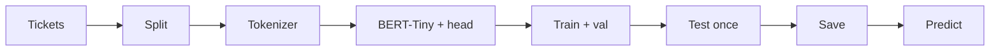

In `p6-03-huggingface`, a pretrained sentiment model misread your support tickets because it was trained on movie reviews, not product support. Your support team wants to route incoming tickets automatically between **engineering** (`bug`) and **billing** (`billing`). In this mini-project, you will teach a 4.4-million-parameter base model (`BERT-Tiny`) to do that job on CPU in just a few seconds — almost nothing here is new, because you are assembling everything from `p6-01` through `p6-03`.

## 1. The plan

Follow the full end-to-end workflow from raw tickets to a saved, ready-to-serve classifier:



Each stage reuses a piece you already learned, plus a few small fine-tuning additions:

| step | tool | from lesson |
|---|---|---|
| Build & split tickets | Python + `torch.randperm` | `p6-01`, `p6-02` |
| Tokenize into batches | `AutoTokenizer(..., padding=True, truncation=True)` | `p6-03` |
| Load base model + new head | `AutoModelForSequenceClassification` (`num_labels=2`, `id2label`) | `p6-03` + new |
| Fine-tune weights | `AdamW` + `out = model(**batch, labels=y)` | `p6-02` + new |
| Pick epochs & check once | `model.eval()` + `torch.no_grad()` | `p6-02` |
| Save, reload, & predict | `save_pretrained()` + `pipeline()` | `p6-03` + new |

## 2. Ticket data

Our dataset generator `make_tickets()` combines subjects and problems to produce `80` short English tickets (`40` `bug`, `40` `billing`), including a few ambiguous mixed-keyword tickets (such as `"App crashed during checkout and charged me"`) and rare billing synonyms so the split is not trivially separable. We split `48 / 16 / 16` into train, validation, and test using `torch.randperm` with a fixed generator seed.

```python
import torch


def make_tickets():
    bug_s = ["Login page", "Export tool", "Search API", "Mobile app", "File upload", "Dashboard"]
    bug_v = ["crashes with 500", "freezes on click", "returns blank data",
             "throws a timeout", "loops forever", "drops the session"]
    bill_s = ["Credit card", "Monthly invoice", "Annual plan",
              "Team seat", "Pro renewal", "Tax receipt"]
    bill_v = ["was charged twice", "shows wrong total", "failed to refund",
              "billed after cancel", "pending too long", "expired too early"]
    extra_bug = ["App crashed during checkout and charged me", "Screen went blank after payment click",
                 "Timeout right when submitting receipt", "UI froze while updating billing info"]
    extra_bill = ["Duplicate deduction on corporate card", "Overcharged for inactive workspace seats",
                  "Coupon ignored on final statement", "Paid for upgrade but fee doubled"]
    bugs = [f"{s} {v}" for s in bug_s for v in bug_v] + extra_bug
    bills = [f"{s} {v}" for s in bill_s for v in bill_v] + extra_bill
    return bugs + bills, [0] * len(bugs) + [1] * len(bills)


texts, labels = make_tickets()
print("total:", len(texts), "bug:", labels.count(0), "billing:", labels.count(1))
# total: 80 bug: 40 billing: 40
for i in (0, 36, 40, 76):
    tag = "bug" if labels[i] == 0 else "billing"
    print(f"  [{tag:7s}] {texts[i]}")
#   [bug    ] Login page crashes with 500
#   [bug    ] App crashed during checkout and charged me
#   [billing] Credit card was charged twice
#   [billing] Duplicate deduction on corporate card

gen = torch.Generator().manual_seed(27)
idx = torch.randperm(len(texts), generator=gen).tolist()
train_x, val_x, test_x = idx[:48], idx[48:64], idx[64:]
print("split sizes:", len(train_x), len(val_x), len(test_x))
# split sizes: 48 16 16
```

Just like in `p6-03`, every ticket is turned into subword tokens, padded into integer `input_ids`, fed through BERT-Tiny and its classifier layer, and mapped to a human-readable label:

```text
text:    "Login page crashes with 500"
tokens:  [CLS]  log   ##in  page  crashes  with  500  [SEP]
ids:      101  8833   2378  3931   19119   2007  3156  102
            \___________________  _____________________/
                                v
                    BERT-Tiny + classifier
                                v
                      logits -> id 0 ("bug")
```

## 3. Base model and new classification head

Here we load `google/bert_uncased_L-2_H-128_A-2` (`BERT-Tiny`), which was pretrained on English text to predict masked words — not support tickets. Passing `num_labels=2` replaces its pretraining head with a brand-new linear **classification head** (`classifier.weight` and `classifier.bias`), while `id2label` and `label2id` tell the config that class `0` is `"bug"` and class `1` is `"billing"`.

When you load a pretrained base model with `num_labels=2`, `transformers` normally prints a LOAD REPORT (abridged below) showing the unused pretraining layers (`UNEXPECTED`) and the freshly created `classifier` layer (`MISSING`):

```text
BertForSequenceClassification LOAD REPORT from: google/bert_uncased_L-2_H-128_A-2
Key                                        | Status
-------------------------------------------+-----------
cls.predictions.bias                       | UNEXPECTED
cls.seq_relationship.weight                | UNEXPECTED
classifier.bias                            | MISSING
classifier.weight                          | MISSING
```

That report explains why we must **fine-tune**: the transformer body (`encoder`) already understands English words, while the new `classifier` head starts with random weights. Once you understand the report, call `hf_logging.set_verbosity_error()` before loading so stderr stays clean, and call `torch.manual_seed(0)` right before `from_pretrained()` so those random `classifier` weights are reproducible.

```python
import torch
from transformers import AutoModelForSequenceClassification, AutoTokenizer
from transformers import logging as hf_logging

hf_logging.set_verbosity_error()  # hide the expected LOAD REPORT on stderr
hf_logging.disable_progress_bar()
REPO = "google/bert_uncased_L-2_H-128_A-2"
REV = "30b0a37ccaaa32f332884b96992754e246e48c5f"


def make_tickets():
    bug_s = ["Login page", "Export tool", "Search API", "Mobile app", "File upload", "Dashboard"]
    bug_v = ["crashes with 500", "freezes on click", "returns blank data",
             "throws a timeout", "loops forever", "drops the session"]
    bill_s = ["Credit card", "Monthly invoice", "Annual plan",
              "Team seat", "Pro renewal", "Tax receipt"]
    bill_v = ["was charged twice", "shows wrong total", "failed to refund",
              "billed after cancel", "pending too long", "expired too early"]
    extra_bug = ["App crashed during checkout and charged me", "Screen went blank after payment click",
                 "Timeout right when submitting receipt", "UI froze while updating billing info"]
    extra_bill = ["Duplicate deduction on corporate card", "Overcharged for inactive workspace seats",
                  "Coupon ignored on final statement", "Paid for upgrade but fee doubled"]
    bugs = [f"{s} {v}" for s in bug_s for v in bug_v] + extra_bug
    bills = [f"{s} {v}" for s in bill_s for v in bill_v] + extra_bill
    return bugs + bills, [0] * len(bugs) + [1] * len(bills)


texts, labels = make_tickets()
gen = torch.Generator().manual_seed(27)
idx = torch.randperm(len(texts), generator=gen).tolist()
val_x = [texts[i] for i in idx[48:64]]
val_y = torch.tensor([labels[i] for i in idx[48:64]], dtype=torch.int64)

tokenizer = AutoTokenizer.from_pretrained(REPO, revision=REV, local_files_only=True)
torch.manual_seed(0)
model = AutoModelForSequenceClassification.from_pretrained(
    REPO,
    revision=REV,
    local_files_only=True,
    num_labels=2,
    id2label={0: "bug", 1: "billing"},
    label2id={"bug": 0, "billing": 1},
)
print("parameters:", sum(p.numel() for p in model.parameters()))
# parameters: 4386178

model.eval()
val_batch = tokenizer(val_x, padding=True, truncation=True, return_tensors="pt")
with torch.no_grad():
    preds = model(**val_batch).logits.argmax(dim=1)
val_acc = round((preds == val_y).to(torch.float32).mean().item(), 3)
print("val accuracy before:", val_acc)
# val accuracy before: 0.5
```

Before fine-tuning, the model gets `0.5` accuracy on the 16 validation tickets — literally the same as flipping a coin.

## 4. Fine-tuning

Our training loop matches `p6-02`, with two small updates for Hugging Face models:
1. Pass `labels=train_y` directly into `model(**train_batch, labels=train_y)` — the model computes cross-entropy internally and returns `out.loss`.
2. Use `torch.optim.AdamW` with a small learning rate (`lr=5e-4`), because large steps would overwrite the pretrained English weights instead of gently steering them toward tickets.

`AdamW` = Adam + weight decay (decoupled), the common default for fine-tuning transformers. Here we sweep epochs `1–10` and record both validation accuracy and validation loss at each checkpoint:

```python
import torch
from transformers import AutoModelForSequenceClassification, AutoTokenizer
from transformers import logging as hf_logging

hf_logging.set_verbosity_error()  # hide the expected LOAD REPORT on stderr
hf_logging.disable_progress_bar()
REPO = "google/bert_uncased_L-2_H-128_A-2"
REV = "30b0a37ccaaa32f332884b96992754e246e48c5f"


def make_tickets():
    bug_s = ["Login page", "Export tool", "Search API", "Mobile app", "File upload", "Dashboard"]
    bug_v = ["crashes with 500", "freezes on click", "returns blank data",
             "throws a timeout", "loops forever", "drops the session"]
    bill_s = ["Credit card", "Monthly invoice", "Annual plan",
              "Team seat", "Pro renewal", "Tax receipt"]
    bill_v = ["was charged twice", "shows wrong total", "failed to refund",
              "billed after cancel", "pending too long", "expired too early"]
    extra_bug = ["App crashed during checkout and charged me", "Screen went blank after payment click",
                 "Timeout right when submitting receipt", "UI froze while updating billing info"]
    extra_bill = ["Duplicate deduction on corporate card", "Overcharged for inactive workspace seats",
                  "Coupon ignored on final statement", "Paid for upgrade but fee doubled"]
    bugs = [f"{s} {v}" for s in bug_s for v in bug_v] + extra_bug
    bills = [f"{s} {v}" for s in bill_s for v in bill_v] + extra_bill
    return bugs + bills, [0] * len(bugs) + [1] * len(bills)


texts, labels = make_tickets()
gen = torch.Generator().manual_seed(27)
idx = torch.randperm(len(texts), generator=gen).tolist()
train_x = [texts[i] for i in idx[:48]]
train_y = torch.tensor([labels[i] for i in idx[:48]], dtype=torch.int64)
val_x = [texts[i] for i in idx[48:64]]
val_y = torch.tensor([labels[i] for i in idx[48:64]], dtype=torch.int64)

tokenizer = AutoTokenizer.from_pretrained(REPO, revision=REV, local_files_only=True)
torch.manual_seed(0)
model = AutoModelForSequenceClassification.from_pretrained(
    REPO,
    revision=REV,
    local_files_only=True,
    num_labels=2,
    id2label={0: "bug", 1: "billing"},
    label2id={"bug": 0, "billing": 1},
)

optimizer = torch.optim.AdamW(model.parameters(), lr=5e-4)
train_batch = tokenizer(train_x, padding=True, truncation=True, return_tensors="pt")
val_batch = tokenizer(val_x, padding=True, truncation=True, return_tensors="pt")

for epoch in range(1, 11):
    model.train()
    optimizer.zero_grad()
    out = model(**train_batch, labels=train_y)
    out.loss.backward()
    optimizer.step()

    model.eval()
    with torch.no_grad():
        val_out = model(**val_batch, labels=val_y)
        val_preds = val_out.logits.argmax(dim=1)
        val_loss = round(val_out.loss.item(), 3)
    val_acc = round((val_preds == val_y).to(torch.float32).mean().item(), 3)
    if epoch == 1 or epoch % 2 == 0:
        print(f"epoch {epoch:2d}: loss={round(out.loss.item(), 3)}  val_loss={val_loss}  val_acc={val_acc}")
# epoch  1: loss=0.712  val_loss=0.667  val_acc=0.5
# epoch  2: loss=0.665  val_loss=0.654  val_acc=0.438
# epoch  4: loss=0.584  val_loss=0.537  val_acc=0.938
# epoch  6: loss=0.477  val_loss=0.387  val_acc=1.0
# epoch  8: loss=0.366  val_loss=0.28  val_acc=1.0
# epoch 10: loss=0.254  val_loss=0.211  val_acc=1.0
```

Watch how training loss and validation loss fall steadily over epochs `1–10` while validation accuracy climbs from `0.5` to `1.0`:

| epoch | train loss | val loss | val accuracy |
|---|---|---|---|
| `1` | `0.712` | `0.667` | `0.500` |
| `2` | `0.665` | `0.654` | `0.438` |
| `4` | `0.584` | `0.537` | `0.938` |
| `6` | `0.477` | `0.387` | `1.000` |
| `8` | `0.366` | `0.280` | `1.000` |
| `10` | `0.254` | `0.211` | `1.000` |

Press **Visualize** on this short block to watch `best_epoch`, `best_val`, and `best_loss` update as you pick the best checkpoint strictly from `(epoch, val_acc, val_loss)` validation tuples (highest `val_acc`, breaking ties by lower `val_loss`):

```python
history = [
    (1, 0.500, 0.667),
    (2, 0.438, 0.654),
    (4, 0.938, 0.537),
    (6, 1.000, 0.387),
    (8, 1.000, 0.280),
    (10, 1.000, 0.211),
]
best_epoch, best_val, best_loss = 0, -1.0, 999.0
for epoch, val_acc, val_loss in history:
    if val_acc > best_val or (val_acc == best_val and val_loss < best_loss):
        best_epoch, best_val, best_loss = epoch, val_acc, val_loss
print(f"best epoch: {best_epoch} (val_acc={best_val}, val_loss={best_loss})")
# best epoch: 10 (val_acc=1.0, val_loss=0.211)
```

Notice that `val_acc` reaches `1.000` by epoch `6` and holds steady while `val_loss` continues dropping to `0.211` at epoch `10`. Because we only swept epochs `1–10`, we lock in `10` epochs on validation alone before touching the test set.

## 5. Final evaluation on test

With the `10`-epoch choice already locked in by validation, we use the 16 held-out test tickets strictly for our final report — comparing the untuned baseline (`0.562`, recorded for reference only and never used to pick hyperparameters) against the fine-tuned model (`0.938`), and printing any misclassified ticket to see where it still struggled:

```python
import torch
from transformers import AutoModelForSequenceClassification, AutoTokenizer
from transformers import logging as hf_logging

hf_logging.set_verbosity_error()  # hide the expected LOAD REPORT on stderr
hf_logging.disable_progress_bar()
REPO = "google/bert_uncased_L-2_H-128_A-2"
REV = "30b0a37ccaaa32f332884b96992754e246e48c5f"


def make_tickets():
    bug_s = ["Login page", "Export tool", "Search API", "Mobile app", "File upload", "Dashboard"]
    bug_v = ["crashes with 500", "freezes on click", "returns blank data",
             "throws a timeout", "loops forever", "drops the session"]
    bill_s = ["Credit card", "Monthly invoice", "Annual plan",
              "Team seat", "Pro renewal", "Tax receipt"]
    bill_v = ["was charged twice", "shows wrong total", "failed to refund",
              "billed after cancel", "pending too long", "expired too early"]
    extra_bug = ["App crashed during checkout and charged me", "Screen went blank after payment click",
                 "Timeout right when submitting receipt", "UI froze while updating billing info"]
    extra_bill = ["Duplicate deduction on corporate card", "Overcharged for inactive workspace seats",
                  "Coupon ignored on final statement", "Paid for upgrade but fee doubled"]
    bugs = [f"{s} {v}" for s in bug_s for v in bug_v] + extra_bug
    bills = [f"{s} {v}" for s in bill_s for v in bill_v] + extra_bill
    return bugs + bills, [0] * len(bugs) + [1] * len(bills)


def accuracy(model, batch, y_t):
    model.eval()
    with torch.no_grad():
        preds = model(**batch).logits.argmax(dim=1)
    return round((preds == y_t).to(torch.float32).mean().item(), 3), preds


texts, labels = make_tickets()
gen = torch.Generator().manual_seed(27)
idx = torch.randperm(len(texts), generator=gen).tolist()
train_x = [texts[i] for i in idx[:48]]
train_y = torch.tensor([labels[i] for i in idx[:48]], dtype=torch.int64)
test_x = [texts[i] for i in idx[64:]]
test_y = torch.tensor([labels[i] for i in idx[64:]], dtype=torch.int64)

tokenizer = AutoTokenizer.from_pretrained(REPO, revision=REV, local_files_only=True)
torch.manual_seed(0)
model = AutoModelForSequenceClassification.from_pretrained(
    REPO,
    revision=REV,
    local_files_only=True,
    num_labels=2,
    id2label={0: "bug", 1: "billing"},
    label2id={"bug": 0, "billing": 1},
)

train_batch = tokenizer(train_x, padding=True, truncation=True, return_tensors="pt")
test_batch = tokenizer(test_x, padding=True, truncation=True, return_tensors="pt")

before_acc, _ = accuracy(model, test_batch, test_y)
print("test accuracy before:", before_acc)
# test accuracy before: 0.562

optimizer = torch.optim.AdamW(model.parameters(), lr=5e-4)
for _ in range(10):
    model.train()
    optimizer.zero_grad()
    out = model(**train_batch, labels=train_y)
    out.loss.backward()
    optimizer.step()

after_acc, test_preds = accuracy(model, test_batch, test_y)
print("test accuracy after: ", after_acc)
# test accuracy after:  0.938
for text, yt, yp in zip(test_x, test_y.tolist(), test_preds.tolist(), strict=True):
    if yp != yt:
        print(f"wrong: {text} (true={model.config.id2label[yt]}, pred={model.config.id2label[yp]})")
# wrong: Timeout right when submitting receipt (true=bug, pred=billing)
```

Notice that the model got `15` of `16` test tickets right (including the unseen synonym `"Coupon ignored on final statement"`), and missed only one ambiguous ticket (`"Timeout right when submitting receipt"`, which mentions `"receipt"`):

| metric | before fine-tune | after fine-tune |
|---|---|---|
| test accuracy | `0.562` | `0.938` |
| misclassified (of 16) | `7` | `1` |

> [!WARNING]
> With a small test split of 15–20 tickets, each single mistake shifts accuracy by 5–7 percentage points (`6.25` points here for `16` items). Report the exact sample size alongside accuracy, and never boast about `"100%"` on a tiny synthetic test set.

## 6. Save, reload, and predict new tickets

In Hugging Face, `model.save_pretrained(folder)` saves both the learned weights and the config (`id2label`), and `tokenizer.save_pretrained(folder)` saves the matching vocabulary in the same folder. Here we save into a `tempfile.TemporaryDirectory()`, reload both objects with `from_pretrained(tmp)`, and classify four brand-new tickets using `pipeline("text-classification", model=..., tokenizer=...)`:

```python
import tempfile

import torch
from transformers import AutoModelForSequenceClassification, AutoTokenizer, pipeline
from transformers import logging as hf_logging

hf_logging.set_verbosity_error()  # hide the expected LOAD REPORT on stderr
hf_logging.disable_progress_bar()
REPO = "google/bert_uncased_L-2_H-128_A-2"
REV = "30b0a37ccaaa32f332884b96992754e246e48c5f"


def make_tickets():
    bug_s = ["Login page", "Export tool", "Search API", "Mobile app", "File upload", "Dashboard"]
    bug_v = ["crashes with 500", "freezes on click", "returns blank data",
             "throws a timeout", "loops forever", "drops the session"]
    bill_s = ["Credit card", "Monthly invoice", "Annual plan",
              "Team seat", "Pro renewal", "Tax receipt"]
    bill_v = ["was charged twice", "shows wrong total", "failed to refund",
              "billed after cancel", "pending too long", "expired too early"]
    extra_bug = ["App crashed during checkout and charged me", "Screen went blank after payment click",
                 "Timeout right when submitting receipt", "UI froze while updating billing info"]
    extra_bill = ["Duplicate deduction on corporate card", "Overcharged for inactive workspace seats",
                  "Coupon ignored on final statement", "Paid for upgrade but fee doubled"]
    bugs = [f"{s} {v}" for s in bug_s for v in bug_v] + extra_bug
    bills = [f"{s} {v}" for s in bill_s for v in bill_v] + extra_bill
    return bugs + bills, [0] * len(bugs) + [1] * len(bills)


texts, labels = make_tickets()
gen = torch.Generator().manual_seed(27)
idx = torch.randperm(len(texts), generator=gen).tolist()
train_x = [texts[i] for i in idx[:48]]
train_y = torch.tensor([labels[i] for i in idx[:48]], dtype=torch.int64)

tokenizer = AutoTokenizer.from_pretrained(REPO, revision=REV, local_files_only=True)
torch.manual_seed(0)
model = AutoModelForSequenceClassification.from_pretrained(
    REPO,
    revision=REV,
    local_files_only=True,
    num_labels=2,
    id2label={0: "bug", 1: "billing"},
    label2id={"bug": 0, "billing": 1},
)

optimizer = torch.optim.AdamW(model.parameters(), lr=5e-4)
train_batch = tokenizer(train_x, padding=True, truncation=True, return_tensors="pt")
for _ in range(10):
    model.train()
    optimizer.zero_grad()
    out = model(**train_batch, labels=train_y)
    out.loss.backward()
    optimizer.step()

new_tickets = [
    "Settings page throws a 500 error",
    "Invoice shows duplicate card charge",
    "Dashboard freezes when loading report",
    "Need a refund for double billing",
]
with tempfile.TemporaryDirectory() as tmp:
    model.save_pretrained(tmp)
    tokenizer.save_pretrained(tmp)
    reloaded_model = AutoModelForSequenceClassification.from_pretrained(tmp)
    reloaded_tokenizer = AutoTokenizer.from_pretrained(tmp)
    clf = pipeline("text-classification", model=reloaded_model, tokenizer=reloaded_tokenizer)
    for text, res in zip(new_tickets, clf(new_tickets), strict=True):
        print(f"{res['label']:7s}  {round(res['score'], 3)}  {text}")
# bug      0.807  Settings page throws a 500 error
# billing  0.749  Invoice shows duplicate card charge
# bug      0.787  Dashboard freezes when loading report
# billing  0.776  Need a refund for double billing
```

Because `id2label` was saved in `config.json`, `pipeline` prints `"bug"` and `"billing"` instead of raw numbers — and that saved folder is the exact artifact you will deploy inside a web service in phase 8.

## 7. Common mistakes

**1. Forgetting `torch.manual_seed(0)` before loading the model**

Because the new classification head starts with random weights, skipping or changing the seed alters your baseline accuracy on every run.

```python
import torch
from transformers import AutoModelForSequenceClassification, AutoTokenizer
from transformers import logging as hf_logging

hf_logging.set_verbosity_error()  # hide the expected LOAD REPORT on stderr
hf_logging.disable_progress_bar()
REPO = "google/bert_uncased_L-2_H-128_A-2"
REV = "30b0a37ccaaa32f332884b96992754e246e48c5f"

tokenizer = AutoTokenizer.from_pretrained(REPO, revision=REV, local_files_only=True)
val_x = [
    "Login page crashes with 500",
    "Credit card was charged twice",
    "Export tool freezes on click",
    "Monthly invoice shows wrong total",
    "Search API returns blank data",
    "Annual plan failed to refund",
]
val_y = torch.tensor([0, 1, 0, 1, 0, 1], dtype=torch.int64)
batch = tokenizer(val_x, padding=True, truncation=True, return_tensors="pt")

for seed in (0, 1):
    torch.manual_seed(seed)
    model = AutoModelForSequenceClassification.from_pretrained(
        REPO, revision=REV, local_files_only=True, num_labels=2
    )
    model.eval()
    with torch.no_grad():
        preds = model(**batch).logits.argmax(dim=1)
    acc = round((preds == val_y).to(torch.float32).mean().item(), 3)
    print(f"seed={seed}: val_acc={acc}")
# seed=0: val_acc=0.333
# seed=1: val_acc=0.5
```

Fix: place `torch.manual_seed(0)` right before `from_pretrained()`.

**2. Using a learning rate that is too large (`lr=1e-1`)**

A huge learning rate overshoots the loss landscape, breaks the pretrained weights, and collapses every prediction onto a single class.

```python
import torch
from transformers import AutoModelForSequenceClassification, AutoTokenizer
from transformers import logging as hf_logging

hf_logging.set_verbosity_error()  # hide the expected LOAD REPORT on stderr
hf_logging.disable_progress_bar()
REPO = "google/bert_uncased_L-2_H-128_A-2"
REV = "30b0a37ccaaa32f332884b96992754e246e48c5f"

tokenizer = AutoTokenizer.from_pretrained(REPO, revision=REV, local_files_only=True)
train_x = [
    "Login page crashes with 500",
    "Export tool freezes on click",
    "Credit card was charged twice",
    "Monthly invoice shows wrong total",
]
train_y = torch.tensor([0, 0, 1, 1], dtype=torch.int64)
batch = tokenizer(train_x, padding=True, truncation=True, return_tensors="pt")

torch.manual_seed(0)
model = AutoModelForSequenceClassification.from_pretrained(
    REPO, revision=REV, local_files_only=True, num_labels=2
)
optimizer = torch.optim.AdamW(model.parameters(), lr=1e-1)
for epoch in range(1, 5):
    model.train()
    optimizer.zero_grad()
    out = model(**batch, labels=train_y)
    out.loss.backward()
    optimizer.step()
    model.eval()
    with torch.no_grad():
        preds = model(**batch).logits.argmax(dim=1).tolist()
    print(f"epoch {epoch}: loss={round(out.loss.item(), 3)}  preds={preds}")
# epoch 1: loss=0.682  preds=[1, 1, 1, 1]
# epoch 2: loss=3.288  preds=[0, 0, 0, 0]
# epoch 3: loss=6.721  preds=[0, 0, 0, 0]
# epoch 4: loss=3.255  preds=[1, 1, 1, 1]
```

Fix: use a small fine-tuning learning rate such as `5e-4` (or `2e-5`–`5e-5` on larger models).

**3. Evaluating without calling `model.eval()`**

Transformer models contain dropout layers (`nn.Dropout`) that stay active during `model.train()`, so two identical evaluation passes return different logits.

```python
import torch
import torch.nn as nn

torch.manual_seed(0)
net = nn.Sequential(nn.Linear(4, 8), nn.Dropout(0.5), nn.Linear(8, 2))
x = torch.randn(3, 4)

net.train()  # dropout stays active
with torch.no_grad():
    out_a = net(x)
    out_b = net(x)
print("train mode equal:", torch.equal(out_a, out_b))
# train mode equal: False

net.eval()  # dropout turns off for deterministic evaluation
with torch.no_grad():
    out_c = net(x)
    out_d = net(x)
print("eval mode equal: ", torch.equal(out_c, out_d))
# eval mode equal:  True
```

Fix: always call `model.eval()` before evaluating or predicting, and switch back to `model.train()` before the next training step.

**4. Picking the number of epochs on the test set**

Python prints no error if you choose `epochs` by peeking at test accuracy, yet doing so leaks test information into your design choice and invalidates the final score. Always select `epochs` and `lr` on validation (`p6-02` §5), and score the test set once at the very end.

## 8. Going further

- Notice `val_loss` is still decreasing at epoch `10` (`0.211`), so you could sweep longer than `1–10` epochs to see where validation loss bottoms out.
- Add a third category such as `"feature request"` by setting `num_labels=3` and updating `id2label` / `label2id`.
- Collect several hundred real tickets and evaluate per-class **precision** and **recall** (from `p5-04`) instead of relying on accuracy alone.
- Scale up to a larger pretrained model or move training onto a GPU when your dataset grows beyond a few hundred sentences.
- Explore **LoRA** (Low-Rank Adaptation) when fine-tuning much larger models so you only update tiny adapter weights instead of the entire network (see Further reading).

## Recap

- Loading a base transformer with `num_labels=2` keeps its pretrained language encoder and attaches a randomly initialised **classification head** (`classifier`), which starts near `0.5` accuracy until fine-tuned.
- Place `torch.manual_seed(0)` right before `from_pretrained()` for reproducible head weights and dropout, and use `hf_logging.set_verbosity_error()` once you understand the LOAD REPORT.
- Pass `labels=y` into `model(**batch, labels=y)` to get `out.loss`, and update weights with `torch.optim.AdamW` at a small learning rate (`5e-4`).
- Select epochs strictly on the validation split while switching between `model.train()` and `model.eval()` + `torch.no_grad()`, then score the test set once.
- Save both model and tokenizer with `save_pretrained(folder)` so you can reload the exact classifier offline or deploy it in a service later.
