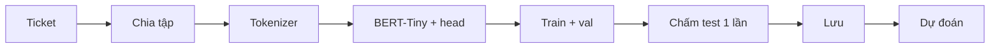

Ở bài `p6-03-huggingface`, model phân tích cảm xúc có sẵn đã đọc nhầm ticket hỗ trợ của bạn vì nó được huấn luyện trên đánh giá phim, chứ không phải ticket sản phẩm. Team hỗ trợ muốn tự động chuyển ticket đến đúng nhóm: **kỹ thuật** (`bug`) hay **thanh toán** (`billing`). Trong mini-project này, bạn sẽ dạy một model nền nhỏ `4,4` triệu tham số (`BERT-Tiny`) làm việc đó trên CPU chỉ trong vài giây — gần như không có kiến thức nào quá mới, bạn chỉ ghép lại mọi mảnh từ `p6-01` tới `p6-03`.

## 1. Kế hoạch

Nhìn toàn bộ luồng xử lý từ tập ticket thô cho đến khi lưu lại model sẵn sàng dự đoán:



Mỗi bước tận dụng lại một công cụ bạn đã học, cộng thêm vài mảnh nhỏ dành riêng cho **fine-tune** (huấn luyện tiếp trên dữ liệu của bạn):

| bước | công cụ | từ bài |
|---|---|---|
| Tạo & chia ticket | Python + `torch.randperm` | `p6-01`, `p6-02` |
| Tokenize theo batch | `AutoTokenizer(..., padding=True, truncation=True)` | `p6-03` |
| Nạp model nền + head mới | `AutoModelForSequenceClassification` (`num_labels=2`, `id2label`) | `p6-03` + mới |
| Fine-tune trọng số | `AdamW` + `out = model(**batch, labels=y)` | `p6-02` + mới |
| Chọn epoch & chấm một lần | `model.eval()` + `torch.no_grad()` | `p6-02` |
| Lưu, nạp lại & dự đoán | `save_pretrained()` + `pipeline()` | `p6-03` + mới |

## 2. Dữ liệu ticket

Hàm `make_tickets()` ghép chủ ngữ với vấn đề để sinh `80` ticket tiếng Anh ngắn (`40` câu `bug`, `40` câu `billing`), có xen vài câu mơ hồ chứa từ khóa của cả hai lớp (như `"App crashed during checkout and charged me"`) và vài từ đồng nghĩa hiếm gặp để bài toán không quá dễ. Bạn chia thành `48 / 16 / 16` câu cho train, validation và test bằng `torch.randperm` với generator có seed cố định.

```python
import torch


def make_tickets():
    bug_s = ["Login page", "Export tool", "Search API", "Mobile app", "File upload", "Dashboard"]
    bug_v = ["crashes with 500", "freezes on click", "returns blank data",
             "throws a timeout", "loops forever", "drops the session"]
    bill_s = ["Credit card", "Monthly invoice", "Annual plan",
              "Team seat", "Pro renewal", "Tax receipt"]
    bill_v = ["was charged twice", "shows wrong total", "failed to refund",
              "billed after cancel", "pending too long", "expired too early"]
    extra_bug = ["App crashed during checkout and charged me", "Screen went blank after payment click",
                 "Timeout right when submitting receipt", "UI froze while updating billing info"]
    extra_bill = ["Duplicate deduction on corporate card", "Overcharged for inactive workspace seats",
                  "Coupon ignored on final statement", "Paid for upgrade but fee doubled"]
    bugs = [f"{s} {v}" for s in bug_s for v in bug_v] + extra_bug
    bills = [f"{s} {v}" for s in bill_s for v in bill_v] + extra_bill
    return bugs + bills, [0] * len(bugs) + [1] * len(bills)


texts, labels = make_tickets()
print("total:", len(texts), "bug:", labels.count(0), "billing:", labels.count(1))
# total: 80 bug: 40 billing: 40
for i in (0, 36, 40, 76):
    tag = "bug" if labels[i] == 0 else "billing"
    print(f"  [{tag:7s}] {texts[i]}")
#   [bug    ] Login page crashes with 500
#   [bug    ] App crashed during checkout and charged me
#   [billing] Credit card was charged twice
#   [billing] Duplicate deduction on corporate card

gen = torch.Generator().manual_seed(27)
idx = torch.randperm(len(texts), generator=gen).tolist()
train_x, val_x, test_x = idx[:48], idx[48:64], idx[64:]
print("split sizes:", len(train_x), len(val_x), len(test_x))
# split sizes: 48 16 16
```

Giống như ở `p6-03`, mỗi ticket đi qua tokenizer thành các mã số nguyên `input_ids`, đi qua BERT-Tiny cùng lớp phân loại rồi cho ra nhãn:

```text
text:    "Login page crashes with 500"
tokens:  [CLS]  log   ##in  page  crashes  with  500  [SEP]
ids:      101  8833   2378  3931   19119   2007  3156  102
            \___________________  _____________________/
                                v
                    BERT-Tiny + classifier
                                v
                      logits -> id 0 ("bug")
```

## 3. Model nền và head mới

Ở đây bạn nạp `google/bert_uncased_L-2_H-128_A-2` (`BERT-Tiny`), một model đã học tiếng Anh từ tác vụ đoán từ bị che, chưa hề biết phân loại ticket. Khi truyền `num_labels=2`, `transformers` gắn thêm một **classification head** (đầu phân loại tuyến tính mới gồm `classifier.weight` và `classifier.bias`), đồng thời `id2label` và `label2id` quy ước lớp `0` là `"bug"` và lớp `1` là `"billing"`.

Lúc nạp model nền kèm `num_labels=2`, `transformers` mặc định in ra stderr một bảng LOAD REPORT (rút gọn bên dưới) báo các tầng cũ không dùng tới (`UNEXPECTED`) và tầng `classifier` mới tạo (`MISSING`):

```text
BertForSequenceClassification LOAD REPORT from: google/bert_uncased_L-2_H-128_A-2
Key                                        | Status
-------------------------------------------+-----------
cls.predictions.bias                       | UNEXPECTED
cls.seq_relationship.weight                | UNEXPECTED
classifier.bias                            | MISSING
classifier.weight                          | MISSING
```

Bảng này nói rõ vì sao bạn buộc phải fine-tune: phần thân (`encoder`) đã biết ngữ pháp và từ vựng tiếng Anh, còn phần head `classifier` vừa được tạo ngẫu nhiên nên chưa biết gì về `bug` hay `billing`. Sau khi hiểu bảng này, bạn gọi `hf_logging.set_verbosity_error()` trước khi nạp để giữ stderr sạch hoàn toàn, và đặt `torch.manual_seed(0)` ngay trước `from_pretrained()` để trọng số ngẫu nhiên của `classifier` lặp lại được.

```python
import torch
from transformers import AutoModelForSequenceClassification, AutoTokenizer
from transformers import logging as hf_logging

hf_logging.set_verbosity_error()  # ẩn bảng LOAD REPORT mặc định trên stderr
hf_logging.disable_progress_bar()
REPO = "google/bert_uncased_L-2_H-128_A-2"
REV = "30b0a37ccaaa32f332884b96992754e246e48c5f"


def make_tickets():
    bug_s = ["Login page", "Export tool", "Search API", "Mobile app", "File upload", "Dashboard"]
    bug_v = ["crashes with 500", "freezes on click", "returns blank data",
             "throws a timeout", "loops forever", "drops the session"]
    bill_s = ["Credit card", "Monthly invoice", "Annual plan",
              "Team seat", "Pro renewal", "Tax receipt"]
    bill_v = ["was charged twice", "shows wrong total", "failed to refund",
              "billed after cancel", "pending too long", "expired too early"]
    extra_bug = ["App crashed during checkout and charged me", "Screen went blank after payment click",
                 "Timeout right when submitting receipt", "UI froze while updating billing info"]
    extra_bill = ["Duplicate deduction on corporate card", "Overcharged for inactive workspace seats",
                  "Coupon ignored on final statement", "Paid for upgrade but fee doubled"]
    bugs = [f"{s} {v}" for s in bug_s for v in bug_v] + extra_bug
    bills = [f"{s} {v}" for s in bill_s for v in bill_v] + extra_bill
    return bugs + bills, [0] * len(bugs) + [1] * len(bills)


texts, labels = make_tickets()
gen = torch.Generator().manual_seed(27)
idx = torch.randperm(len(texts), generator=gen).tolist()
val_x = [texts[i] for i in idx[48:64]]
val_y = torch.tensor([labels[i] for i in idx[48:64]], dtype=torch.int64)

tokenizer = AutoTokenizer.from_pretrained(REPO, revision=REV, local_files_only=True)
torch.manual_seed(0)
model = AutoModelForSequenceClassification.from_pretrained(
    REPO,
    revision=REV,
    local_files_only=True,
    num_labels=2,
    id2label={0: "bug", 1: "billing"},
    label2id={"bug": 0, "billing": 1},
)
print("parameters:", sum(p.numel() for p in model.parameters()))
# parameters: 4386178

model.eval()
val_batch = tokenizer(val_x, padding=True, truncation=True, return_tensors="pt")
with torch.no_grad():
    preds = model(**val_batch).logits.argmax(dim=1)
val_acc = round((preds == val_y).to(torch.float32).mean().item(), 3)
print("val accuracy before:", val_acc)
# val accuracy before: 0.5
```

Trước khi fine-tune, tỉ lệ đoán đúng trên `16` ticket validation là `0.5` — đúng bằng đoán mò ngẫu nhiên.

## 4. Fine-tune

Vòng lặp training giữ nguyên khung của `p6-02`, chỉ khác ở hai điểm dành cho model Hugging Face:
1. Truyền `labels=train_y` thẳng vào `model(**train_batch, labels=train_y)`: model tự tính cross-entropy loss và trả sẵn trong `out.loss`.
2. Dùng `torch.optim.AdamW` với learning rate nhỏ (`lr=5e-4`), để đầu phân loại học nhanh mà không phá hỏng kiến thức tiếng Anh sẵn có trong phần thân model.

`AdamW` = Adam + weight decay (tách rời), lựa chọn mặc định phổ biến khi fine-tune các model transformer. Ở đây bạn quét từ epoch `1–10` và ghi lại cả tỉ lệ đoán đúng (accuracy) trên validation lẫn validation loss ở từng mốc:

```python
import torch
from transformers import AutoModelForSequenceClassification, AutoTokenizer
from transformers import logging as hf_logging

hf_logging.set_verbosity_error()  # ẩn bảng LOAD REPORT mặc định trên stderr
hf_logging.disable_progress_bar()
REPO = "google/bert_uncased_L-2_H-128_A-2"
REV = "30b0a37ccaaa32f332884b96992754e246e48c5f"


def make_tickets():
    bug_s = ["Login page", "Export tool", "Search API", "Mobile app", "File upload", "Dashboard"]
    bug_v = ["crashes with 500", "freezes on click", "returns blank data",
             "throws a timeout", "loops forever", "drops the session"]
    bill_s = ["Credit card", "Monthly invoice", "Annual plan",
              "Team seat", "Pro renewal", "Tax receipt"]
    bill_v = ["was charged twice", "shows wrong total", "failed to refund",
              "billed after cancel", "pending too long", "expired too early"]
    extra_bug = ["App crashed during checkout and charged me", "Screen went blank after payment click",
                 "Timeout right when submitting receipt", "UI froze while updating billing info"]
    extra_bill = ["Duplicate deduction on corporate card", "Overcharged for inactive workspace seats",
                  "Coupon ignored on final statement", "Paid for upgrade but fee doubled"]
    bugs = [f"{s} {v}" for s in bug_s for v in bug_v] + extra_bug
    bills = [f"{s} {v}" for s in bill_s for v in bill_v] + extra_bill
    return bugs + bills, [0] * len(bugs) + [1] * len(bills)


texts, labels = make_tickets()
gen = torch.Generator().manual_seed(27)
idx = torch.randperm(len(texts), generator=gen).tolist()
train_x = [texts[i] for i in idx[:48]]
train_y = torch.tensor([labels[i] for i in idx[:48]], dtype=torch.int64)
val_x = [texts[i] for i in idx[48:64]]
val_y = torch.tensor([labels[i] for i in idx[48:64]], dtype=torch.int64)

tokenizer = AutoTokenizer.from_pretrained(REPO, revision=REV, local_files_only=True)
torch.manual_seed(0)
model = AutoModelForSequenceClassification.from_pretrained(
    REPO,
    revision=REV,
    local_files_only=True,
    num_labels=2,
    id2label={0: "bug", 1: "billing"},
    label2id={"bug": 0, "billing": 1},
)

optimizer = torch.optim.AdamW(model.parameters(), lr=5e-4)
train_batch = tokenizer(train_x, padding=True, truncation=True, return_tensors="pt")
val_batch = tokenizer(val_x, padding=True, truncation=True, return_tensors="pt")

for epoch in range(1, 11):
    model.train()
    optimizer.zero_grad()
    out = model(**train_batch, labels=train_y)
    out.loss.backward()
    optimizer.step()

    model.eval()
    with torch.no_grad():
        val_out = model(**val_batch, labels=val_y)
        val_preds = val_out.logits.argmax(dim=1)
        val_loss = round(val_out.loss.item(), 3)
    val_acc = round((val_preds == val_y).to(torch.float32).mean().item(), 3)
    if epoch == 1 or epoch % 2 == 0:
        print(f"epoch {epoch:2d}: loss={round(out.loss.item(), 3)}  val_loss={val_loss}  val_acc={val_acc}")
# epoch  1: loss=0.712  val_loss=0.667  val_acc=0.5
# epoch  2: loss=0.665  val_loss=0.654  val_acc=0.438
# epoch  4: loss=0.584  val_loss=0.537  val_acc=0.938
# epoch  6: loss=0.477  val_loss=0.387  val_acc=1.0
# epoch  8: loss=0.366  val_loss=0.28  val_acc=1.0
# epoch 10: loss=0.254  val_loss=0.211  val_acc=1.0
```

Theo dõi train loss và validation loss giảm đều trong khoảng epoch `1–10`, còn tỉ lệ đoán đúng trên validation vọt từ `0.5` lên `1.0`:

| epoch | train loss | val loss | tỉ lệ đoán đúng (val) |
|---|---|---|---|
| `1` | `0.712` | `0.667` | `0.500` |
| `2` | `0.665` | `0.654` | `0.438` |
| `4` | `0.584` | `0.537` | `0.938` |
| `6` | `0.477` | `0.387` | `1.000` |
| `8` | `0.366` | `0.280` | `1.000` |
| `10` | `0.254` | `0.211` | `1.000` |

Bấm **Visualize** ở khối code ngắn này để xem `best_epoch`, `best_val` và `best_loss` cập nhật từng bước khi chọn số epoch tốt nhất hoàn toàn từ các bộ `(epoch, val_acc, val_loss)` trên tập validation (`val_acc` cao nhất, hòa thì chọn `val_loss` thấp hơn):

```python
history = [
    (1, 0.500, 0.667),
    (2, 0.438, 0.654),
    (4, 0.938, 0.537),
    (6, 1.000, 0.387),
    (8, 1.000, 0.280),
    (10, 1.000, 0.211),
]
best_epoch, best_val, best_loss = 0, -1.0, 999.0
for epoch, val_acc, val_loss in history:
    if val_acc > best_val or (val_acc == best_val and val_loss < best_loss):
        best_epoch, best_val, best_loss = epoch, val_acc, val_loss
print(f"best epoch: {best_epoch} (val_acc={best_val}, val_loss={best_loss})")
# best epoch: 10 (val_acc=1.0, val_loss=0.211)
```

Lưu ý `val_acc` đạt `1.000` từ epoch `6` và giữ vững trong khi `val_loss` tiếp tục giảm xuống `0.211` ở epoch `10`. Vì ở đây chỉ quét khoảng `1–10` epoch, bạn chốt `10` epoch dựa hoàn toàn trên validation trước khi đụng vào tập test.

## 5. Đánh giá cuối cùng trên tập test

Khi đã chốt `10` epoch trên tập validation xong xuôi, bạn mới dùng `16` ticket test giữ kín chỉ cho báo cáo kết quả cuối cùng — so sánh mốc trước khi fine-tune (`0.562`, chỉ dùng để tham khảo chứ không dùng ra bất kỳ quyết định nào) với kết quả sau khi fine-tune (`0.938`), đồng thời in ra những ticket bị đoán sai để xem model vấp ở đâu:

```python
import torch
from transformers import AutoModelForSequenceClassification, AutoTokenizer
from transformers import logging as hf_logging

hf_logging.set_verbosity_error()  # ẩn bảng LOAD REPORT mặc định trên stderr
hf_logging.disable_progress_bar()
REPO = "google/bert_uncased_L-2_H-128_A-2"
REV = "30b0a37ccaaa32f332884b96992754e246e48c5f"


def make_tickets():
    bug_s = ["Login page", "Export tool", "Search API", "Mobile app", "File upload", "Dashboard"]
    bug_v = ["crashes with 500", "freezes on click", "returns blank data",
             "throws a timeout", "loops forever", "drops the session"]
    bill_s = ["Credit card", "Monthly invoice", "Annual plan",
              "Team seat", "Pro renewal", "Tax receipt"]
    bill_v = ["was charged twice", "shows wrong total", "failed to refund",
              "billed after cancel", "pending too long", "expired too early"]
    extra_bug = ["App crashed during checkout and charged me", "Screen went blank after payment click",
                 "Timeout right when submitting receipt", "UI froze while updating billing info"]
    extra_bill = ["Duplicate deduction on corporate card", "Overcharged for inactive workspace seats",
                  "Coupon ignored on final statement", "Paid for upgrade but fee doubled"]
    bugs = [f"{s} {v}" for s in bug_s for v in bug_v] + extra_bug
    bills = [f"{s} {v}" for s in bill_s for v in bill_v] + extra_bill
    return bugs + bills, [0] * len(bugs) + [1] * len(bills)


def accuracy(model, batch, y_t):
    model.eval()
    with torch.no_grad():
        preds = model(**batch).logits.argmax(dim=1)
    return round((preds == y_t).to(torch.float32).mean().item(), 3), preds


texts, labels = make_tickets()
gen = torch.Generator().manual_seed(27)
idx = torch.randperm(len(texts), generator=gen).tolist()
train_x = [texts[i] for i in idx[:48]]
train_y = torch.tensor([labels[i] for i in idx[:48]], dtype=torch.int64)
test_x = [texts[i] for i in idx[64:]]
test_y = torch.tensor([labels[i] for i in idx[64:]], dtype=torch.int64)

tokenizer = AutoTokenizer.from_pretrained(REPO, revision=REV, local_files_only=True)
torch.manual_seed(0)
model = AutoModelForSequenceClassification.from_pretrained(
    REPO,
    revision=REV,
    local_files_only=True,
    num_labels=2,
    id2label={0: "bug", 1: "billing"},
    label2id={"bug": 0, "billing": 1},
)

train_batch = tokenizer(train_x, padding=True, truncation=True, return_tensors="pt")
test_batch = tokenizer(test_x, padding=True, truncation=True, return_tensors="pt")

before_acc, _ = accuracy(model, test_batch, test_y)
print("test accuracy before:", before_acc)
# test accuracy before: 0.562

optimizer = torch.optim.AdamW(model.parameters(), lr=5e-4)
for _ in range(10):
    model.train()
    optimizer.zero_grad()
    out = model(**train_batch, labels=train_y)
    out.loss.backward()
    optimizer.step()

after_acc, test_preds = accuracy(model, test_batch, test_y)
print("test accuracy after: ", after_acc)
# test accuracy after:  0.938
for text, yt, yp in zip(test_x, test_y.tolist(), test_preds.tolist(), strict=True):
    if yp != yt:
        print(f"wrong: {text} (true={model.config.id2label[yt]}, pred={model.config.id2label[yp]})")
# wrong: Timeout right when submitting receipt (true=bug, pred=billing)
```

Model đoán đúng `15/16` ticket test (bao gồm cả câu dùng từ đồng nghĩa chưa từng gặp khi train là `"Coupon ignored on final statement"`), chỉ sai đúng một câu mơ hồ có chữ `"receipt"`:

| chỉ số | trước fine-tune | sau fine-tune |
|---|---|---|
| tỉ lệ đoán đúng (test accuracy) | `0.562` | `0.938` |
| số câu sai (trên 16) | `7` | `1` |

> [!WARNING]
> Khi tập test chỉ có 15–20 câu, mỗi câu đoán sai kéo tỉ lệ đoán đúng tụt tới 5–7 điểm phần trăm (`6,25` điểm với `16` câu ở đây). Luôn báo kèm kích thước tập test và đừng khoe `"100%"` trên một tập test nhỏ.

## 6. Lưu, nạp lại và dự đoán ticket mới

Trong Hugging Face, `model.save_pretrained(folder)` lưu cả trọng số đã học lẫn cấu hình `id2label`, còn `tokenizer.save_pretrained(folder)` lưu bảng từ vựng đi kèm vào cùng thư mục. Ở đây bạn lưu vào một `tempfile.TemporaryDirectory()`, nạp lại bằng `from_pretrained(tmp)` rồi dùng `pipeline("text-classification", model=..., tokenizer=...)` để phân loại bốn ticket hoàn toàn mới viết tay:

```python
import tempfile

import torch
from transformers import AutoModelForSequenceClassification, AutoTokenizer, pipeline
from transformers import logging as hf_logging

hf_logging.set_verbosity_error()  # ẩn bảng LOAD REPORT mặc định trên stderr
hf_logging.disable_progress_bar()
REPO = "google/bert_uncased_L-2_H-128_A-2"
REV = "30b0a37ccaaa32f332884b96992754e246e48c5f"


def make_tickets():
    bug_s = ["Login page", "Export tool", "Search API", "Mobile app", "File upload", "Dashboard"]
    bug_v = ["crashes with 500", "freezes on click", "returns blank data",
             "throws a timeout", "loops forever", "drops the session"]
    bill_s = ["Credit card", "Monthly invoice", "Annual plan",
              "Team seat", "Pro renewal", "Tax receipt"]
    bill_v = ["was charged twice", "shows wrong total", "failed to refund",
              "billed after cancel", "pending too long", "expired too early"]
    extra_bug = ["App crashed during checkout and charged me", "Screen went blank after payment click",
                 "Timeout right when submitting receipt", "UI froze while updating billing info"]
    extra_bill = ["Duplicate deduction on corporate card", "Overcharged for inactive workspace seats",
                  "Coupon ignored on final statement", "Paid for upgrade but fee doubled"]
    bugs = [f"{s} {v}" for s in bug_s for v in bug_v] + extra_bug
    bills = [f"{s} {v}" for s in bill_s for v in bill_v] + extra_bill
    return bugs + bills, [0] * len(bugs) + [1] * len(bills)


texts, labels = make_tickets()
gen = torch.Generator().manual_seed(27)
idx = torch.randperm(len(texts), generator=gen).tolist()
train_x = [texts[i] for i in idx[:48]]
train_y = torch.tensor([labels[i] for i in idx[:48]], dtype=torch.int64)

tokenizer = AutoTokenizer.from_pretrained(REPO, revision=REV, local_files_only=True)
torch.manual_seed(0)
model = AutoModelForSequenceClassification.from_pretrained(
    REPO,
    revision=REV,
    local_files_only=True,
    num_labels=2,
    id2label={0: "bug", 1: "billing"},
    label2id={"bug": 0, "billing": 1},
)

optimizer = torch.optim.AdamW(model.parameters(), lr=5e-4)
train_batch = tokenizer(train_x, padding=True, truncation=True, return_tensors="pt")
for _ in range(10):
    model.train()
    optimizer.zero_grad()
    out = model(**train_batch, labels=train_y)
    out.loss.backward()
    optimizer.step()

new_tickets = [
    "Settings page throws a 500 error",
    "Invoice shows duplicate card charge",
    "Dashboard freezes when loading report",
    "Need a refund for double billing",
]
with tempfile.TemporaryDirectory() as tmp:
    model.save_pretrained(tmp)
    tokenizer.save_pretrained(tmp)
    reloaded_model = AutoModelForSequenceClassification.from_pretrained(tmp)
    reloaded_tokenizer = AutoTokenizer.from_pretrained(tmp)
    clf = pipeline("text-classification", model=reloaded_model, tokenizer=reloaded_tokenizer)
    for text, res in zip(new_tickets, clf(new_tickets), strict=True):
        print(f"{res['label']:7s}  {round(res['score'], 3)}  {text}")
# bug      0.807  Settings page throws a 500 error
# billing  0.749  Invoice shows duplicate card charge
# bug      0.787  Dashboard freezes when loading report
# billing  0.776  Need a refund for double billing
```

Nhờ `id2label` đã lưu trong `config.json`, `pipeline` in ra nhãn chữ `"bug"` và `"billing"` thay cho số nguyên — và thư mục vừa lưu chính là thứ bạn sẽ đưa vào API service ở phase 8.

## 7. Lỗi thường gặp

**1. Quên `torch.manual_seed(0)` trước khi nạp model**

Vì classification head mới được khởi tạo ngẫu nhiên, bỏ qua hoặc đổi seed sẽ làm tỉ lệ đoán đúng trước fine-tune nhảy sang con số khác mỗi lần chạy.

```python
import torch
from transformers import AutoModelForSequenceClassification, AutoTokenizer
from transformers import logging as hf_logging

hf_logging.set_verbosity_error()  # ẩn bảng LOAD REPORT mặc định trên stderr
hf_logging.disable_progress_bar()
REPO = "google/bert_uncased_L-2_H-128_A-2"
REV = "30b0a37ccaaa32f332884b96992754e246e48c5f"

tokenizer = AutoTokenizer.from_pretrained(REPO, revision=REV, local_files_only=True)
val_x = [
    "Login page crashes with 500",
    "Credit card was charged twice",
    "Export tool freezes on click",
    "Monthly invoice shows wrong total",
    "Search API returns blank data",
    "Annual plan failed to refund",
]
val_y = torch.tensor([0, 1, 0, 1, 0, 1], dtype=torch.int64)
batch = tokenizer(val_x, padding=True, truncation=True, return_tensors="pt")

for seed in (0, 1):
    torch.manual_seed(seed)
    model = AutoModelForSequenceClassification.from_pretrained(
        REPO, revision=REV, local_files_only=True, num_labels=2
    )
    model.eval()
    with torch.no_grad():
        preds = model(**batch).logits.argmax(dim=1)
    acc = round((preds == val_y).to(torch.float32).mean().item(), 3)
    print(f"seed={seed}: val_acc={acc}")
# seed=0: val_acc=0.333
# seed=1: val_acc=0.5
```

Cách sửa: đặt `torch.manual_seed(0)` ngay trước `from_pretrained()`.

**2. Đặt learning rate quá lớn (`lr=1e-1`)**

Learning rate quá lớn khiến bước cập nhật nhảy vọt, phá hỏng trọng số đã học sẵn và làm model kẹt cứng ở việc đoán toàn một lớp.

```python
import torch
from transformers import AutoModelForSequenceClassification, AutoTokenizer
from transformers import logging as hf_logging

hf_logging.set_verbosity_error()  # ẩn bảng LOAD REPORT mặc định trên stderr
hf_logging.disable_progress_bar()
REPO = "google/bert_uncased_L-2_H-128_A-2"
REV = "30b0a37ccaaa32f332884b96992754e246e48c5f"

tokenizer = AutoTokenizer.from_pretrained(REPO, revision=REV, local_files_only=True)
train_x = [
    "Login page crashes with 500",
    "Export tool freezes on click",
    "Credit card was charged twice",
    "Monthly invoice shows wrong total",
]
train_y = torch.tensor([0, 0, 1, 1], dtype=torch.int64)
batch = tokenizer(train_x, padding=True, truncation=True, return_tensors="pt")

torch.manual_seed(0)
model = AutoModelForSequenceClassification.from_pretrained(
    REPO, revision=REV, local_files_only=True, num_labels=2
)
optimizer = torch.optim.AdamW(model.parameters(), lr=1e-1)
for epoch in range(1, 5):
    model.train()
    optimizer.zero_grad()
    out = model(**batch, labels=train_y)
    out.loss.backward()
    optimizer.step()
    model.eval()
    with torch.no_grad():
        preds = model(**batch).logits.argmax(dim=1).tolist()
    print(f"epoch {epoch}: loss={round(out.loss.item(), 3)}  preds={preds}")
# epoch 1: loss=0.682  preds=[1, 1, 1, 1]
# epoch 2: loss=3.288  preds=[0, 0, 0, 0]
# epoch 3: loss=6.721  preds=[0, 0, 0, 0]
# epoch 4: loss=3.255  preds=[1, 1, 1, 1]
```

Cách sửa: giữ learning rate nhỏ khi fine-tune, như `5e-4` (hoặc `2e-5`–`5e-5` với model lớn hơn).

**3. Đánh giá mà quên gọi `model.eval()`**

Các model transformer có tầng dropout (`nn.Dropout`) vẫn bật trong chế độ `model.train()`, khiến hai lần đánh giá cùng một dữ liệu cho ra logits khác nhau.

```python
import torch
import torch.nn as nn

torch.manual_seed(0)
net = nn.Sequential(nn.Linear(4, 8), nn.Dropout(0.5), nn.Linear(8, 2))
x = torch.randn(3, 4)

net.train()  # dropout vẫn bật
with torch.no_grad():
    out_a = net(x)
    out_b = net(x)
print("train mode equal:", torch.equal(out_a, out_b))
# train mode equal: False

net.eval()  # tắt dropout để đánh giá ổn định
with torch.no_grad():
    out_c = net(x)
    out_d = net(x)
print("eval mode equal: ", torch.equal(out_c, out_d))
# eval mode equal:  True
```

Cách sửa: luôn gọi `model.eval()` trước khi chấm điểm hoặc dự đoán, và chuyển lại `model.train()` trước bước huấn luyện kế tiếp.

**4. Chọn số epoch bằng tập test**

Python không báo lỗi nếu bạn nhìn điểm test để chọn `epochs`, nhưng đó là lỗi tư duy: thông tin tập test đã rò rỉ vào lựa chọn của bạn. Hãy luôn chọn `epochs` và `lr` trên tập validation (`p6-02` §5), rồi chấm tập test đúng một lần ở cuối.

## 8. Đi xa hơn

- Để ý `val_loss` vẫn đang giảm ở epoch `10` (`0.211`), nên bạn có thể quét dài hơn khoảng `1–10` epoch để xem validation loss chạm đáy ở đâu.
- Thêm lớp thứ ba như `"feature request"` bằng cách đặt `num_labels=3` và cập nhật `id2label` / `label2id`.
- Thu thập thêm vài trăm ticket thật và đo **precision** (độ chuẩn khi báo dương) cùng **recall** (độ nhạy, tức tỉ lệ bắt được) cho từng lớp (bài `p5-04`) thay vì chỉ nhìn mỗi tỉ lệ đoán đúng (accuracy).
- Thử model nền lớn hơn hoặc chuyển sang GPU khi tập dữ liệu vượt quá vài trăm câu.
- Tìm hiểu kỹ thuật **LoRA** (Low-Rank Adaptation) khi fine-tune các model lớn hơn nhiều để chỉ phải cập nhật một phần nhỏ trọng số (xem mục Đọc thêm).

## Tóm tắt

- Nạp model nền với `num_labels=2` giữ lại phần thân đã học tiếng Anh và gắn thêm một **classification head** (`classifier`) khởi tạo ngẫu nhiên, nên trước khi fine-tune tỉ lệ đoán đúng chỉ quanh mức `0.5`.
- Đặt `torch.manual_seed(0)` ngay trước `from_pretrained()` để kết quả lặp lại được, và gọi `hf_logging.set_verbosity_error()` sau khi đã hiểu bảng LOAD REPORT.
- Truyền `labels=y` vào `model(**batch, labels=y)` để lấy `out.loss`, rồi cập nhật trọng số bằng `torch.optim.AdamW` với learning rate nhỏ (`5e-4`).
- Chọn số epoch dựa trên tập validation khi chuyển qua lại giữa `model.train()` và `model.eval()` + `torch.no_grad()`, rồi đánh giá tập test đúng một lần.
- Lưu cả model và tokenizer bằng `save_pretrained(folder)` để nạp lại offline hoặc đóng gói thành service ở giai đoạn sau.
