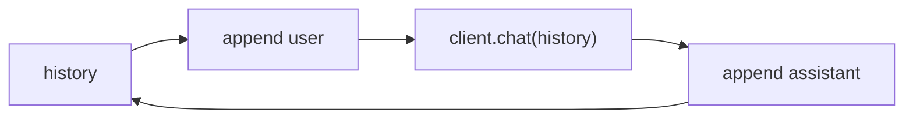
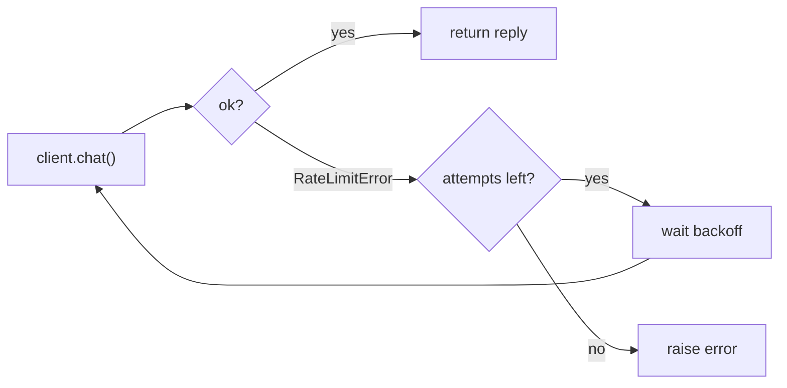

Every AI chatbot, code assistant, and RAG app works the same way under the hood: your Python program sends a list of messages to a Large Language Model (LLM) over an HTTP API and reads back the reply. In this phase, you will practice against a deterministic fake client (`pyai_llm`) that runs offline in your browser for free with no API key, and at the end of the lesson you will see how to switch the same pattern to a real API.

## 1. Your first call: messages in, reply out

To talk to an LLM, you pass a list of message dictionaries to `client.chat(messages)` and read the returned `ChatResponse`. Each message is a `dict` with two keys: `"role"` (who is speaking) and `"content"` (the text).

```python
from pyai_llm import FakeLLM

client = FakeLLM()
resp = client.chat([{"role": "user", "content": "What is RAG?"}])

print(resp.content)
# RAG (Retrieval-Augmented Generation) retrieves relevant documents and adds them to the prompt before generating an answer.
print("finish_reason:", resp.finish_reason)  # finish_reason: stop
print("usage:", resp.usage)                  # usage: Usage(prompt_tokens=8, completion_tokens=21, total_tokens=29)
```

`ChatResponse` is a dataclass with four fields: `content` (the reply text, or `None` when calling a tool), `tool_calls` (a list of structured tool requests, covered later in `p7-06-tool-use`), `finish_reason` (why generation stopped, usually `"stop"`), and `usage` (token counts for the call).

> [!NOTE]
> `FakeLLM` is a deterministic stand-in with pre-written answers for a few AI topics and an echo fallback for everything else. It teaches the exact **shape** of an LLM API call, not how smart a real model is.

## 2. System message: setting the rules up front

A **system message** (`"role": "system"`) sits at the start of `messages` and gives the model standing instructions—its persona, tone, or rules—for the whole conversation. Putting `"pirate"` in the system message switches `FakeLLM` into pirate style, while leaving it out gives the neutral reply.

```python
from pyai_llm import FakeLLM

client = FakeLLM()
plain = client.chat([{"role": "user", "content": "What is RAG?"}])
pirate = client.chat([
    {"role": "system", "content": "You are a helpful pirate."},
    {"role": "user", "content": "What is RAG?"},
])

print("plain: ", plain.content)
# plain:  RAG (Retrieval-Augmented Generation) retrieves relevant documents and adds them to the prompt before generating an answer.
print("pirate:", pirate.content)
# pirate: Arr! RAG (Retrieval-Augmented Generation) retrieves relevant documents and adds them to the prompt before generating an answer.
```

Three roles cover normal chat conversations:

| role | who writes it | purpose |
|---|---|---|
| `system` | your application | sets the assistant's role, tone, and rules |
| `user` | the end user | sends the question or task for this turn |
| `assistant` | the model (saved by your app) | represents previous model replies in the history |

## 3. Models have no memory: resend the history

An LLM API is **stateless**: each `chat()` call starts from scratch and remembers nothing from earlier calls unless you send the conversation history again. After every reply, your program appends the `"assistant"` message to `history`, then appends the next `"user"` message before calling `chat()` again.



Press **Visualize** on this block and watch `history` grow across all three turns.

```python
from pyai_llm import FakeLLM

client = FakeLLM()
history = [{"role": "system", "content": "Be concise."}]
questions = ["What is RAG?", "What is temperature?", "What is a token?"]

for turn, q in enumerate(questions, 1):
    history.append({"role": "user", "content": q})
    resp = client.chat(history)
    print(f"turn={turn}  msgs={len(history)}  prompt_tokens={resp.usage.prompt_tokens}")
    history.append({"role": "assistant", "content": resp.content})
# turn=1  msgs=2  prompt_tokens=15
# turn=2  msgs=4  prompt_tokens=48
# turn=3  msgs=6  prompt_tokens=76
```

Look at how both `messages sent` and `prompt_tokens` climb on every turn because the entire `history` is re-sent each time:

| turn | messages sent | prompt_tokens |
|---|---|---|
| `1` | `2` | `15` |
| `2` | `4` | `48` |
| `3` | `6` | `76` |

## 4. Temperature and reproducibility

`temperature` controls how predictable or varied the reply is. At `temperature=0.0` (the default), the model always picks the same output regardless of `seed`; raising `temperature` (such as `0.8`) adds variety, and passing `seed` to `FakeLLM(seed=...)` keeps that variety reproducible across test runs.

```python
from pyai_llm import FakeLLM

prompt = [{"role": "user", "content": "What is RAG?"}]

for seed in (0, 3, 5):
    reply = FakeLLM(seed=seed).chat(prompt, temperature=0.0).content
    print(f"temp=0.0 seed={seed}: {reply[:35]}...")
# temp=0.0 seed=0: RAG (Retrieval-Augmented Generation...
# temp=0.0 seed=3: RAG (Retrieval-Augmented Generation...
# temp=0.0 seed=5: RAG (Retrieval-Augmented Generation...

for seed in (0, 3, 5):
    reply = FakeLLM(seed=seed).chat(prompt, temperature=0.8).content
    print(f"temp=0.8 seed={seed}: {reply[:35]}...")
# temp=0.8 seed=0: Sure. RAG (Retrieval-Augmented Gene...
# temp=0.8 seed=3: Here is what I know: RAG (Retrieval...
# temp=0.8 seed=5: RAG (Retrieval-Augmented Generation...

again = FakeLLM(seed=3).chat(prompt, temperature=0.8).content
print("repeat seed=3:", again[:35] + "...")
# repeat seed=3: Here is what I know: RAG (Retrieval...
```

| temperature | use it for |
|---|---|
| `0.0` | extracting structured fields, classification, automated tests |
| `0.2 – 0.5` | general Q&A and summaries with slight phrasing variety |
| `0.7 – 1.0` | brainstorming, creative writing, generating diverse examples |

> [!TIP]
> Real hosted LLMs with `temperature > 0` are often still non-deterministic even when you pass a `seed` (because of hardware floating-point differences). In production test suites, lock `temperature=0` or inject a deterministic fake/mock client like `FakeLLM`.

## 5. Tokens: what you pay for

API providers charge per **token**, not per character or per call, and every request counts both input (`prompt_tokens`) and output (`completion_tokens`) in `resp.usage`. In `pyai_llm`, `count_tokens()` splits text into word and punctuation tokens like this:

```text
text:   "Hello, AI world!"
tokens:  Hello   ,   AI   world   !
index:     1     2    3     4     5   (count_tokens = 5)
```

Real LLMs use subword tokenizers (like the DistilBERT tokenizer you saw in `p6-03-huggingface`), so they split rare or non-English words into smaller pieces and count differently—but the billing principle is identical.

Suppose a provider charges **hypothetical example prices** of `$0.50` per 1M input tokens and `$1.50` per 1M output tokens. Here is what the 3-turn conversation from §3 costs when you add up all turns:

```python
from pyai_llm import FakeLLM, count_tokens

print("count_tokens('Hello, AI world!'):", count_tokens("Hello, AI world!"))
# count_tokens('Hello, AI world!'): 5

client = FakeLLM()
history = [{"role": "system", "content": "Be concise."}]
total_in = 0
total_out = 0

for q in ["What is RAG?", "What is temperature?", "What is a token?"]:
    history.append({"role": "user", "content": q})
    resp = client.chat(history)
    total_in += resp.usage.prompt_tokens
    total_out += resp.usage.completion_tokens
    history.append({"role": "assistant", "content": resp.content})

# Hypothetical example prices: $0.50 / 1M input tokens, $1.50 / 1M output tokens
cost_usd = (total_in / 1_000_000) * 0.50 + (total_out / 1_000_000) * 1.50
print(f"in={total_in} out={total_out} total={total_in + total_out}")
# in=139 out=57 total=196
print(f"example cost: ${cost_usd:.6f}")
# example cost: $0.000155
```

Notice why long chat histories get expensive fast: Turn 3 alone paid `76` input tokens for a 4-word question because all previous turns were re-sent. You can also cap reply length with `max_tokens`, and you should always inspect `resp.finish_reason` so you catch answers cut off early (`"length"` instead of `"stop"`):

```python
from pyai_llm import FakeLLM

client = FakeLLM()
short = client.chat([{"role": "user", "content": "What is RAG?"}], max_tokens=5)

print("content:", repr(short.content))        # content: 'RAG (Retrieval-Augmented'
print("finish_reason:", short.finish_reason)  # finish_reason: length
```

## 6. Temporary errors and retries

Real LLM APIs occasionally return temporary errors such as HTTP `429` (**rate limit**—too many requests too fast) or network timeouts. Instead of failing immediately or hammering the server in a tight loop, wrap the call in `try` / `except RateLimitError` and wait with **exponential backoff** (doubling the delay on each failure: `0.5s`, `1.0s`, `2.0s`…).



In our browser sandbox we never call `time.sleep()`, so the loop below prints the backoff delay instead of pausing. `FakeLLM(fail_times=2)` fails twice and succeeds on attempt 3; `FakeLLM(fail_times=3)` exhausts all 3 attempts and re-raises `RateLimitError`:

```python
from pyai_llm import FakeLLM, RateLimitError


def chat_with_retry(client: FakeLLM, messages: list[dict[str, str]], max_attempts: int = 3) -> str:
    for attempt in range(1, max_attempts + 1):
        try:
            resp = client.chat(messages)
            print(f"attempt {attempt}: ok")
            return resp.content or ""
        except RateLimitError as err:
            wait = 0.5 * 2 ** (attempt - 1)
            print(f"attempt {attempt}: {err}; wait {wait}s")
            if attempt == max_attempts:
                raise
    raise RuntimeError("unreachable")


msgs = [{"role": "user", "content": "What is RAG?"}]
reply = chat_with_retry(FakeLLM(fail_times=2), msgs, max_attempts=3)
# attempt 1: rate limit exceeded, retry later; wait 0.5s
# attempt 2: rate limit exceeded, retry later; wait 1.0s
# attempt 3: ok
print("reply:", reply[:36] + "...")
# reply: RAG (Retrieval-Augmented Generation)...

try:
    chat_with_retry(FakeLLM(fail_times=3), msgs, max_attempts=3)
except RateLimitError as err:
    print("gave up:", err)
# attempt 1: rate limit exceeded, retry later; wait 0.5s
# attempt 2: rate limit exceeded, retry later; wait 1.0s
# attempt 3: rate limit exceeded, retry later; wait 2.0s
# gave up: rate limit exceeded, retry later
```

> [!WARNING]
> Only retry **transient** failures such as rate limits or timeouts. Never retry bad-request errors (`ValueError`, invalid roles, missing fields, or invalid API keys)—retrying a broken request will fail identically every time and waste your retry budget.

## 7. Calling a real API (read only, do not run in the app)

When you move from `FakeLLM` to a real provider on your laptop, you store your **API key** in a `.env` file, make sure Git ignores `.env`, and read the key from `os.environ` when sending an HTTP POST request (for example with `httpx`):

```bash
# 1. Create a .env file (never commit this file)
echo 'LLM_API_KEY=your-secret-key-here' > .env
echo '.env' >> .gitignore

# 2. Write a small script that reads the key from the environment
cat > call_llm.py <<'EOF'
import os
import httpx

api_key = os.environ["LLM_API_KEY"]
response = httpx.post(
    "https://api.example-llm.com/v1/chat",
    headers={"Authorization": f"Bearer {api_key}"},
    json={
        "model": "example-chat-model",
        "messages": [{"role": "user", "content": "What is RAG?"}],
        "temperature": 0.0,
        "max_tokens": 100,
    },
    timeout=30.0,
)
response.raise_for_status()
data = response.json()
print(data)
EOF

# 3. Load .env into your shell and run with uv
set -a && source .env && set +a
uv run python call_llm.py
```

Every LLM provider uses its own endpoint URL and slightly different JSON field names—always check their official docs—but the core structure (`messages`, `temperature`, `max_tokens`, and `usage` in the response) matches what you learned in this lesson.

Treat an API key just like a bank password: anyone who gets it can spend your money. Keep keys inside `.env` only, never print them in logs, never paste them directly into `.py` files, and never commit `.env` to Git.

> [!WARNING]
> Bots continuously scan public GitHub repositories for leaked API keys and can rack up huge charges within minutes. Always add `.env` to `.gitignore` before writing any key.

## 8. Common mistakes

**1. Passing a plain string instead of a list of message dicts**

`client.chat("What is RAG?")` fails immediately because the API requires a non-empty list of `{"role": ..., "content": ...}` dictionaries.

```python
from pyai_llm import FakeLLM

client = FakeLLM()
try:
    client.chat("What is RAG?")
except ValueError as err:
    print("error:", err)
# error: messages must be a non-empty list of message dicts
```

Fix: wrap the prompt in a list of message dicts: `client.chat([{"role": "user", "content": "What is RAG?"}])`.

**2. Using an invalid role name**

Inventing roles like `"bot"` or `"ai"` raises a `ValueError`; chat APIs accept only `"system"`, `"user"`, `"assistant"`, and `"tool"`.

```python
from pyai_llm import FakeLLM

client = FakeLLM()
try:
    client.chat([{"role": "bot", "content": "Hello"}])
except ValueError as err:
    print("error:", err)
# error: invalid role at index 0: 'bot'; expected 'system', 'user', 'assistant', or 'tool'
```

Fix: use `"assistant"` for model replies and `"user"` for user inputs.

**3. Forgetting to resend the conversation history**

If you send only the newest user message on turn 2, the model loses the system rules and every previous turn—notice how `prompt_tokens` drops from `53` back to `9` and the pirate persona disappears.

```python
from pyai_llm import FakeLLM

client = FakeLLM()
r1 = client.chat([
    {"role": "system", "content": "You are a pirate."},
    {"role": "user", "content": "What is RAG?"},
])

# Bug: only the new message is sent, so earlier rules and turns are forgotten
r2_forgot = client.chat([{"role": "user", "content": "What is a token?"}])
print("forgot:", r2_forgot.usage.prompt_tokens, "|", r2_forgot.content[:35])
# forgot: 9 | Tokens are the small text pieces (w

# Fix: append the assistant reply and resend the full history
history = [
    {"role": "system", "content": "You are a pirate."},
    {"role": "user", "content": "What is RAG?"},
    {"role": "assistant", "content": r1.content},
    {"role": "user", "content": "What is a token?"},
]
r2_kept = client.chat(history)
print("kept:  ", r2_kept.usage.prompt_tokens, "|", r2_kept.content[:35])
# kept:   53 | Arr! Tokens are the small text piec
```

Fix: maintain one `history` list, append each `"assistant"` reply and `"user"` prompt, and pass the whole `history` every time. (On a real LLM, forgetting history also makes the model forget facts and questions from earlier turns.)

**4. Ignoring `finish_reason == "length"`**

If `max_tokens` is too small, the model stops mid-sentence and sets `finish_reason` to `"length"`. Using `resp.content` blindly can pass broken text or incomplete JSON downstream.

```python
from pyai_llm import FakeLLM

resp = FakeLLM().chat([{"role": "user", "content": "What is RAG?"}], max_tokens=5)
if resp.finish_reason == "length":
    print("Warning: reply was cut off ->", repr(resp.content))
# Warning: reply was cut off -> 'RAG (Retrieval-Augmented'
```

Fix: always check `resp.finish_reason == "stop"` before trusting `resp.content`, and raise `max_tokens` if truncation happens.

## Recap

- Chat LLM APIs take a list of `{"role": ..., "content": ...}` dicts (`system`, `user`, `assistant`) and return a `ChatResponse` with `content`, `finish_reason`, and `usage`.
- LLMs are stateless: your code must append each reply and resend `history` on every turn, which makes `prompt_tokens` (and cost) grow over a conversation.
- Use `temperature=0.0` for repeatable outputs in extraction and tests; higher values add variety (made repeatable in `FakeLLM` via `seed`).
- Always inspect `resp.usage` and `resp.finish_reason` (especially `"length"` when capped by `max_tokens`).
- Retry only transient failures like `RateLimitError` with exponential backoff, and keep real API keys in `.env` (listed in `.gitignore`), never printed or committed.
