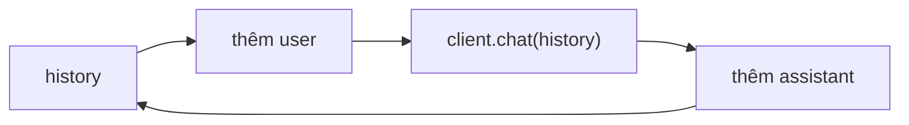
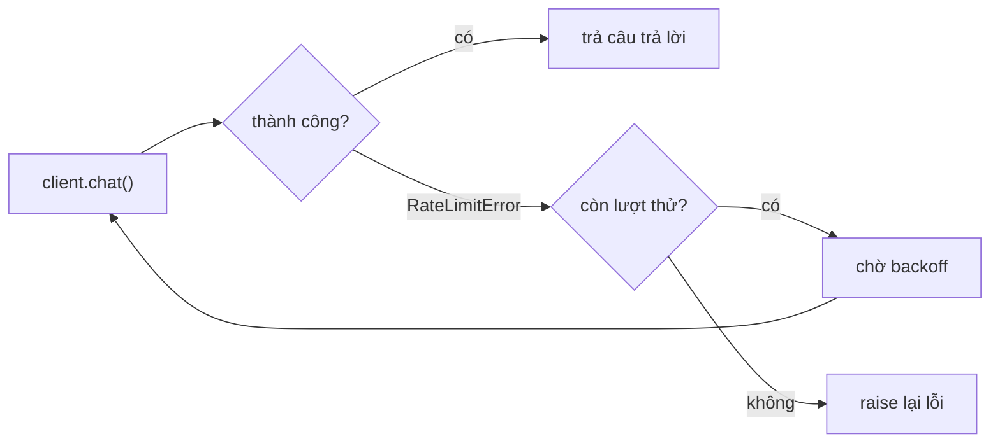

Mọi chatbot AI, trợ lý lập trình hay ứng dụng RAG đều vận hành theo cùng một nguyên lý: chương trình Python của bạn gửi một danh sách tin nhắn tới Large Language Model (LLM — mô hình ngôn ngữ lớn) qua HTTP API rồi đọc câu trả lời trả về. Trong phase này, bạn sẽ thực hành với một fake client tất định (`pyai_llm`) chạy ngay trong trình duyệt, hoàn toàn miễn phí và không cần API key; cuối bài bạn sẽ thấy cách đổi đúng mẫu code đó sang gọi API thật.

## 1. Lời gọi đầu tiên: messages vào, câu trả lời ra

Để nói chuyện với LLM, bạn truyền một danh sách các dictionary tin nhắn vào `client.chat(messages)` và đọc đối tượng `ChatResponse` trả về. Mỗi message là một `dict` gồm hai khóa: `"role"` (ai đang nói) và `"content"` (nội dung văn bản).

```python
from pyai_llm import FakeLLM

client = FakeLLM()
resp = client.chat([{"role": "user", "content": "What is RAG?"}])

print(resp.content)
# RAG (Retrieval-Augmented Generation) retrieves relevant documents and adds them to the prompt before generating an answer.
print("finish_reason:", resp.finish_reason)  # finish_reason: stop
print("usage:", resp.usage)                  # usage: Usage(prompt_tokens=8, completion_tokens=21, total_tokens=29)
```

`ChatResponse` là một dataclass có bốn trường: `content` (chuỗi trả lời, hoặc `None` khi gọi tool), `tool_calls` (danh sách yêu cầu gọi hàm có cấu trúc, sẽ học ở bài `p7-06-tool-use`), `finish_reason` (lý do model dừng sinh chữ, thường là `"stop"`), và `usage` (thống kê số token của lượt gọi).

> [!NOTE]
> `FakeLLM` là mô hình giả lập tất định với các câu trả lời viết sẵn cho một vài chủ đề AI và phản hồi lặp lại cho câu hỏi khác. Nó giúp bạn học chính xác **hình dạng** của API, không phản ánh độ thông minh của model thật.

## 2. System message: dặn model trước

Một **system message** (`"role": "system"`) nằm ở đầu danh sách `messages` để đặt luật chung — như vai trò, giọng điệu hay giới hạn — cho suốt cuộc hội thoại. Khi có từ `"pirate"` trong system message, `FakeLLM` đổi sang giọng cướp biển, còn bỏ qua thì trả lời bình thường.

```python
from pyai_llm import FakeLLM

client = FakeLLM()
plain = client.chat([{"role": "user", "content": "What is RAG?"}])
pirate = client.chat([
    {"role": "system", "content": "You are a helpful pirate."},
    {"role": "user", "content": "What is RAG?"},
])

print("plain: ", plain.content)
# plain:  RAG (Retrieval-Augmented Generation) retrieves relevant documents and adds them to the prompt before generating an answer.
print("pirate:", pirate.content)
# pirate: Arr! RAG (Retrieval-Augmented Generation) retrieves relevant documents and adds them to the prompt before generating an answer.
```

Ba vai trò sau bao quát các cuộc hội thoại chat thông thường:

| role | ai viết | mục đích |
|---|---|---|
| `system` | ứng dụng của bạn | đặt vai trò, giọng điệu và quy tắc cho trợ lý |
| `user` | người dùng cuối | gửi câu hỏi hoặc yêu cầu ở lượt hiện tại |
| `assistant` | model (app lưu lại) | đại diện cho các câu trả lời trước đó trong lịch sử |

## 3. Model không có trí nhớ: tự gửi lại lịch sử

API của LLM không lưu trạng thái (**stateless**): mỗi lần gọi `chat()` đều bắt đầu lại từ đầu và không nhớ gì về các lần gọi trước, trừ khi bạn tự gửi kèm lại toàn bộ lịch sử. Sau mỗi câu trả lời, chương trình của bạn thêm message `"assistant"` vào `history`, rồi thêm câu hỏi `"user"` tiếp theo trước khi gọi `chat()` lần nữa.



Hãy bấm **Visualize** ở khối code này để xem danh sách `history` lớn dần qua ba lượt hỏi đáp.

```python
from pyai_llm import FakeLLM

client = FakeLLM()
history = [{"role": "system", "content": "Be concise."}]
questions = ["What is RAG?", "What is temperature?", "What is a token?"]

for turn, q in enumerate(questions, 1):
    history.append({"role": "user", "content": q})
    resp = client.chat(history)
    print(f"turn={turn}  msgs={len(history)}  prompt_tokens={resp.usage.prompt_tokens}")
    history.append({"role": "assistant", "content": resp.content})
# turn=1  msgs=2  prompt_tokens=15
# turn=2  msgs=4  prompt_tokens=48
# turn=3  msgs=6  prompt_tokens=76
```

Hãy để ý cả số lượng message gửi đi lẫn `prompt_tokens` đều tăng dần sau mỗi lượt vì toàn bộ `history` được gửi lại:

| lượt | số message gửi | prompt_tokens |
|---|---|---|
| `1` | `2` | `15` |
| `2` | `4` | `48` |
| `3` | `6` | `76` |

## 4. Temperature và tính lặp lại được

Tham số `temperature` (độ ngẫu nhiên) điều khiển câu trả lời ổn định hay đa dạng. Khi `temperature=0.0` (mặc định), model luôn ra đúng một câu bất kể `seed`; tăng `temperature` (ví dụ `0.8`) tạo ra các cách mở đầu khác nhau, và truyền `seed` vào `FakeLLM(seed=...)` giúp giữ kết quả lặp lại y hệt để viết test tin cậy.

```python
from pyai_llm import FakeLLM

prompt = [{"role": "user", "content": "What is RAG?"}]

for seed in (0, 3, 5):
    reply = FakeLLM(seed=seed).chat(prompt, temperature=0.0).content
    print(f"temp=0.0 seed={seed}: {reply[:35]}...")
# temp=0.0 seed=0: RAG (Retrieval-Augmented Generation...
# temp=0.0 seed=3: RAG (Retrieval-Augmented Generation...
# temp=0.0 seed=5: RAG (Retrieval-Augmented Generation...

for seed in (0, 3, 5):
    reply = FakeLLM(seed=seed).chat(prompt, temperature=0.8).content
    print(f"temp=0.8 seed={seed}: {reply[:35]}...")
# temp=0.8 seed=0: Sure. RAG (Retrieval-Augmented Gene...
# temp=0.8 seed=3: Here is what I know: RAG (Retrieval...
# temp=0.8 seed=5: RAG (Retrieval-Augmented Generation...

again = FakeLLM(seed=3).chat(prompt, temperature=0.8).content
print("repeat seed=3:", again[:35] + "...")
# repeat seed=3: Here is what I know: RAG (Retrieval...
```

| temperature | dùng cho việc gì |
|---|---|
| `0.0` | trích xuất thông tin, phân loại, chạy test tự động |
| `0.2 – 0.5` | hỏi đáp và tóm tắt thông thường với chút biến hóa câu chữ |
| `0.7 – 1.0` | brainstorm ý tưởng, viết sáng tạo, sinh mẫu đa dạng |

> [!TIP]
> Với model thật chạy trên server, ngay cả khi truyền `seed`, `temperature > 0` thường vẫn không lặp lại y hệt do sai khác tính toán phần cứng. Vì vậy khi viết test thật, người ta thường khóa `temperature=0` hoặc dùng fake/mock client như ở đây.

## 5. Token: thứ bạn trả tiền

Nhà cung cấp API tính tiền theo **token** (mẩu văn bản nhỏ) chứ không theo ký tự hay số lượt gọi, và mỗi request đều tính cả đầu vào (`prompt_tokens`) lẫn đầu ra (`completion_tokens`) trong `resp.usage`. Trong `pyai_llm`, hàm `count_tokens()` tách câu thành từng token từ và dấu câu như sau:

```text
text:   "Hello, AI world!"
tokens:  Hello   ,   AI   world   !
index:     1     2    3     4     5   (count_tokens = 5)
```

Các LLM thật dùng tokenizer dạng subword (như tokenizer của DistilBERT bạn đã gặp ở bài `p6-03-huggingface`), nên chúng tách từ hiếm hoặc tiếng Việt theo cách khác — nhưng ý tưởng đếm và tính phí hoàn toàn giống nhau.

Giả sử một nhà cung cấp có **đơn giá ví dụ** (giả định) là `$0.50` cho 1 triệu token đầu vào và `$1.50` cho 1 triệu token đầu ra. Hãy tính chi phí cho cuộc hội thoại 3 lượt ở §3:

```python
from pyai_llm import FakeLLM, count_tokens

print("count_tokens('Hello, AI world!'):", count_tokens("Hello, AI world!"))
# count_tokens('Hello, AI world!'): 5

client = FakeLLM()
history = [{"role": "system", "content": "Be concise."}]
total_in = 0
total_out = 0

for q in ["What is RAG?", "What is temperature?", "What is a token?"]:
    history.append({"role": "user", "content": q})
    resp = client.chat(history)
    total_in += resp.usage.prompt_tokens
    total_out += resp.usage.completion_tokens
    history.append({"role": "assistant", "content": resp.content})

# Đơn giá ví dụ giả định: $0.50 / 1M input token, $1.50 / 1M output token
cost_usd = (total_in / 1_000_000) * 0.50 + (total_out / 1_000_000) * 1.50
print(f"in={total_in} out={total_out} total={total_in + total_out}")
# in=139 out=57 total=196
print(f"example cost: ${cost_usd:.6f}")
# example cost: $0.000155
```

Bạn thấy lý do lịch sử dài làm tiền tăng nhanh: riêng lượt 3 đã tốn `76` input token chỉ cho một câu hỏi bốn từ vì toàn bộ lượt trước phải gửi lại. Bạn cũng có thể giới hạn độ dài trả lời bằng `max_tokens`, và luôn kiểm tra `resp.finish_reason` để biết câu có bị cắt ngang (`"length"`) hay kết thúc tự nhiên (`"stop"`):

```python
from pyai_llm import FakeLLM

client = FakeLLM()
short = client.chat([{"role": "user", "content": "What is RAG?"}], max_tokens=5)

print("content:", repr(short.content))        # content: 'RAG (Retrieval-Augmented'
print("finish_reason:", short.finish_reason)  # finish_reason: length
```

## 6. Lỗi tạm thời và retry

API thật đôi lúc gặp lỗi tạm thời như HTTP `429` (**rate limit** — vượt giới hạn tốc độ) hoặc timeout mạng. Thay vì bỏ cuộc ngay hay gửi dồn dập làm server quá tải thêm, hãy bọc lời gọi trong `try` / `except RateLimitError` và chờ theo **exponential backoff** (thời gian nghỉ tăng gấp đôi sau mỗi lần lỗi: `0.5s`, `1.0s`, `2.0s`…).



Trong môi trường trình duyệt ta không dùng `time.sleep()`, nên đoạn code dưới đây chỉ in ra thời gian chờ thay vì ngủ thật. `FakeLLM(fail_times=2)` lỗi 2 lần đầu rồi thành công ở lần 3; `FakeLLM(fail_times=3)` dùng hết 3 lượt nên `RateLimitError` được raise lại ra ngoài:

```python
from pyai_llm import FakeLLM, RateLimitError


def chat_with_retry(client: FakeLLM, messages: list[dict[str, str]], max_attempts: int = 3) -> str:
    for attempt in range(1, max_attempts + 1):
        try:
            resp = client.chat(messages)
            print(f"attempt {attempt}: ok")
            return resp.content or ""
        except RateLimitError as err:
            wait = 0.5 * 2 ** (attempt - 1)
            print(f"attempt {attempt}: {err}; wait {wait}s")
            if attempt == max_attempts:
                raise
    raise RuntimeError("unreachable")


msgs = [{"role": "user", "content": "What is RAG?"}]
reply = chat_with_retry(FakeLLM(fail_times=2), msgs, max_attempts=3)
# attempt 1: rate limit exceeded, retry later; wait 0.5s
# attempt 2: rate limit exceeded, retry later; wait 1.0s
# attempt 3: ok
print("reply:", reply[:36] + "...")
# reply: RAG (Retrieval-Augmented Generation)...

try:
    chat_with_retry(FakeLLM(fail_times=3), msgs, max_attempts=3)
except RateLimitError as err:
    print("gave up:", err)
# attempt 1: rate limit exceeded, retry later; wait 0.5s
# attempt 2: rate limit exceeded, retry later; wait 1.0s
# attempt 3: rate limit exceeded, retry later; wait 2.0s
# gave up: rate limit exceeded, retry later
```

> [!WARNING]
> Chỉ retry các lỗi **tạm thời** như rate limit hoặc timeout. Đừng bao giờ retry lỗi do request sai (`ValueError`, sai tên role, thiếu trường hoặc sai API key)—gửi lại một request hỏng chỉ thất bại y hệt và tốn thêm lượt thử.

## 7. Gọi API thật (đọc, không chạy trong app)

Khi chạy trên máy tính cá nhân với API thật, bạn đặt **API key** trong file `.env`, thêm `.env` vào `.gitignore` để Git bỏ qua, rồi đọc key từ `os.environ` khi gửi HTTP POST (ví dụ bằng `httpx`):

```bash
# 1. Create a .env file (never commit this file)
echo 'LLM_API_KEY=your-secret-key-here' > .env
echo '.env' >> .gitignore

# 2. Write a small script that reads the key from the environment
cat > call_llm.py <<'EOF'
import os
import httpx

api_key = os.environ["LLM_API_KEY"]
response = httpx.post(
    "https://api.example-llm.com/v1/chat",
    headers={"Authorization": f"Bearer {api_key}"},
    json={
        "model": "example-chat-model",
        "messages": [{"role": "user", "content": "What is RAG?"}],
        "temperature": 0.0,
        "max_tokens": 100,
    },
    timeout=30.0,
)
response.raise_for_status()
data = response.json()
print(data)
EOF

# 3. Load .env into your shell and run with uv
set -a && source .env && set +a
uv run python call_llm.py
```

Mỗi nhà cung cấp LLM có địa chỉ URL và tên trường JSON riêng—hãy đọc tài liệu của họ—nhưng hình dạng tổng thể (`messages`, `temperature`, `max_tokens` và `usage` trả về) đều giống bài học này.

Hãy coi API key như mật khẩu tài khoản ngân hàng: ai có nó đều dùng tiền của bạn được. Chỉ lưu key trong file `.env`, không bao giờ in ra màn hình hay log, không dán trực tiếp vào file `.py`, và không commit `.env` lên Git.

> [!WARNING]
> Các bot quét tự động liên tục rà soát repository công khai trên GitHub để tìm API key bị lộ và có thể đốt sạch hạn mức chỉ trong vài phút. Luôn thêm `.env` vào `.gitignore` trước khi tạo key.

## 8. Lỗi thường gặp

**1. Truyền chuỗi thay cho danh sách message**

Gọi `client.chat("What is RAG?")` sẽ báo lỗi ngay lập tức vì API đòi hỏi một `list` không rỗng chứa các dict `{"role": ..., "content": ...}`.

```python
from pyai_llm import FakeLLM

client = FakeLLM()
try:
    client.chat("What is RAG?")
except ValueError as err:
    print("error:", err)
# error: messages must be a non-empty list of message dicts
```

Cách sửa: bọc câu hỏi vào danh sách dict: `client.chat([{"role": "user", "content": "What is RAG?"}])`.

**2. Đặt sai tên role**

Tự đặt role như `"bot"` hay `"ai"` sẽ gây `ValueError`; API chat chỉ chấp nhận `"system"`, `"user"`, `"assistant"` và `"tool"`.

```python
from pyai_llm import FakeLLM

client = FakeLLM()
try:
    client.chat([{"role": "bot", "content": "Hello"}])
except ValueError as err:
    print("error:", err)
# error: invalid role at index 0: 'bot'; expected 'system', 'user', 'assistant', or 'tool'
```

Cách sửa: dùng `"assistant"` cho câu trả lời của model và `"user"` cho tin nhắn người dùng.

**3. Quên gửi lại lịch sử hội thoại**

Nếu ở lượt 2 bạn chỉ gửi mỗi câu hỏi mới, model sẽ "quên" sạch luật hệ thống lẫn các lượt trước—để ý `prompt_tokens` tụt từ `53` về `9` và giọng cướp biển biến mất.

```python
from pyai_llm import FakeLLM

client = FakeLLM()
r1 = client.chat([
    {"role": "system", "content": "You are a pirate."},
    {"role": "user", "content": "What is RAG?"},
])

# Lỗi: chỉ gửi tin nhắn mới nhất nên model quên luật và lượt trước
r2_forgot = client.chat([{"role": "user", "content": "What is a token?"}])
print("forgot:", r2_forgot.usage.prompt_tokens, "|", r2_forgot.content[:35])
# forgot: 9 | Tokens are the small text pieces (w

# Cách sửa: lưu câu trả lời assistant vào history rồi gửi lại toàn bộ
history = [
    {"role": "system", "content": "You are a pirate."},
    {"role": "user", "content": "What is RAG?"},
    {"role": "assistant", "content": r1.content},
    {"role": "user", "content": "What is a token?"},
]
r2_kept = client.chat(history)
print("kept:  ", r2_kept.usage.prompt_tokens, "|", r2_kept.content[:35])
# kept:   53 | Arr! Tokens are the small text piec
```

Cách sửa: giữ một biến `history` chung, nối thêm từng câu trả lời `"assistant"` và câu hỏi `"user"`, rồi luôn gửi lại toàn bộ `history`. (Với LLM thật, quên gửi lịch sử cũng khiến model quên mọi thông tin bạn đã cung cấp ở lượt 1.)

**4. Bỏ qua `finish_reason == "length"`**

Nếu `max_tokens` quá nhỏ, câu trả lời sẽ bị cắt ngang giữa chừng với `finish_reason == "length"`. Dùng thẳng `resp.content` mà không kiểm tra dễ làm hỏng dữ liệu hoặc JSON đầu ra.

```python
from pyai_llm import FakeLLM

resp = FakeLLM().chat([{"role": "user", "content": "What is RAG?"}], max_tokens=5)
if resp.finish_reason == "length":
    print("Warning: reply was cut off ->", repr(resp.content))
# Warning: reply was cut off -> 'RAG (Retrieval-Augmented'
```

Cách sửa: luôn kiểm tra `resp.finish_reason == "stop"` trước khi sử dụng `resp.content`, và tăng `max_tokens` nếu bị cắt.

## Tóm tắt

- API chat LLM nhận một list các dict `{"role": ..., "content": ...}` (`system`, `user`, `assistant`) và trả về `ChatResponse` gồm `content`, `finish_reason` và `usage`.
- Model không có trí nhớ giữa các lần gọi: bạn phải tự lưu và gửi lại `history`, khiến `prompt_tokens` (và chi phí) tăng dần theo độ dài cuộc trò chuyện.
- Đặt `temperature=0.0` khi cần đầu ra lặp lại y hệt để trích xuất dữ liệu hoặc chạy test; giá trị cao hơn tạo đa dạng (tái lập được trong `FakeLLM` nhờ `seed`).
- Luôn kiểm tra `resp.usage` để theo dõi token và kiểm tra `resp.finish_reason` để phát hiện câu bị cắt (`"length"`).
- Chỉ retry các lỗi tạm thời như `RateLimitError` với exponential backoff, và cất API key thật trong `.env` (đã thêm vào `.gitignore`), tuyệt đối không in ra hay commit.
