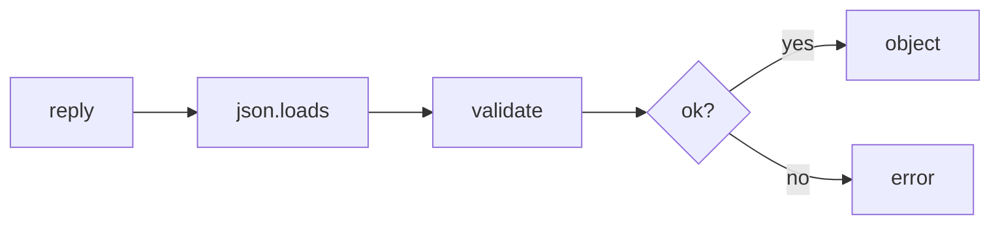

Imagine your app reads customer support emails and creates a ticket with `name`, `order_id`, and `urgent`. A friendly paragraph from an LLM looks great to a human reader, but your Python code cannot pass a paragraph into a database or an `if` statement. In this lesson, you will ask the model for JSON matching a schema, distrust and validate what comes back, convert it into typed objects, and retry or fall back when the model slips up.

## 1. Prose is not data

When you call `client.chat(messages)` normally, you get back free-form prose inside `resp.content`. Trying to slice fields out with `.split()` works only until the phrasing changes by a single word, and then your parser breaks.

```python
import json
from pyai_llm import FakeLLM

client = FakeLLM()
msgs = [{"role": "user", "content": "name is Lan, order_id is 1042, urgent true"}]

# 1. Plain prose reply: fragile to parse with split()
prose = client.chat(msgs).content or ""
print("prose:", prose)
# prose: (fake model) I received: name is Lan, order_id is 1042, urgent true
print("split name:", prose.split("name is ")[1].split(",")[0])  # split name: Lan

# 2. Structured JSON reply: parseable with json.loads()
schema = {
    "type": "object",
    "properties": {
        "name": {"type": "string"},
        "order_id": {"type": "integer"},
        "urgent": {"type": "boolean"},
    },
    "required": ["name", "order_id", "urgent"],
}
json_resp = client.chat(msgs, response_format={"type": "json", "schema": schema})
print("raw json:", json_resp.content)
# raw json: {"name": "Lan", "order_id": 1042, "urgent": true}
data = json.loads(json_resp.content or "{}")
print("parsed:", data, type(data).__name__)
# parsed: {'name': 'Lan', 'order_id': 1042, 'urgent': True} dict
```

Passing `response_format={"type": "json", "schema": schema}` tells `FakeLLM` to reply with a JSON string instead of a sentence. Calling `json.loads()` turns that string into a Python `dict` whose keys you can read directly.

> [!NOTE]
> `response_format={"type": "json", "schema": ...}` is `FakeLLM`'s convention. Real providers name these fields differently (such as `json_schema` or `strict`), so always check your provider's docs.

## 2. Schema: describing the shape you want

A **JSON schema** is a plain Python `dict` that acts as a blueprint for your data: `"type": "object"` says the root is a key-value mapping, `"properties"` lists each field and its type, and `"required"` names the fields that must not be missing.

```python
from pyai_llm import FakeLLM

ticket_schema = {
    "type": "object",
    "properties": {
        "name": {"type": "string"},
        "order_id": {"type": "integer"},
        "urgent": {"type": "boolean"},
    },
    "required": ["name", "order_id", "urgent"],
}

client = FakeLLM()
resp = client.chat(
    [{"role": "user", "content": "name: Minh, order_id: 205, urgent: yes"}],
    response_format={"type": "json", "schema": ticket_schema},
)
print("required:", ticket_schema["required"])  # required: ['name', 'order_id', 'urgent']
print("reply:", resp.content)                  # reply: {"name": "Minh", "order_id": 205, "urgent": true}
```

JSON uses slightly different type names than Python, so keep this mapping handy when designing schemas:

| JSON type | Python type |
|---|---|
| `string` | `str` |
| `integer` | `int` |
| `number` | `float` |
| `boolean` | `bool` |
| `array` | `list` |
| `object` | `dict` |

> [!NOTE]
> Hosted LLM APIs often support a "JSON mode" or schema-enforced structured outputs on the server side. Even then, always **validate** the parsed result in your own Python code—networks truncate replies, schemas evolve, and models still occasionally return empty or nonsensical values.

## 3. Parse and validate: never trust the model

Treat every LLM reply like untrusted user input and pass it through a strict pipeline before using it.



Your `validate(data, schema)` function should return a list of clear error strings instead of silently letting broken shapes slip through. Watch out for one classic Python trap: `bool` is a subclass of `int`, so `isinstance(True, int)` evaluates to `True`—you must reject `bool` before checking `int` or `(int, float)`.

Press **Visualize** on this block and watch `errors` grow as each broken reply from `FakeLLM(script=[...])` is checked.

```python
import json
from pyai_llm import FakeLLM

schema = {
    "type": "object",
    "properties": {
        "name": {"type": "string"},
        "order_id": {"type": "integer"},
        "urgent": {"type": "boolean"},
    },
    "required": ["name", "order_id", "urgent"],
}


def validate(data: dict, schema: dict) -> list[str]:
    type_map = {"string": str, "integer": int, "number": (int, float), "boolean": bool}
    errors: list[str] = []
    for key in schema.get("required", []):
        if key not in data:
            errors.append(f"missing: {key}")
    for key, spec in schema.get("properties", {}).items():
        if key not in data:
            continue
        expected_type = spec.get("type", "")
        value = data[key]
        # Check bool before int because bool is a subclass of int in Python
        if expected_type in ("integer", "number") and isinstance(value, bool):
            errors.append(f"wrong type: {key}")
            continue
        expected = type_map.get(expected_type)
        if expected is not None and not isinstance(value, expected):
            errors.append(f"wrong type: {key}")
    return errors


fence = "`" * 3
client = FakeLLM(script=[
    f'{fence}json\n{{"name": "Lan"}}\n{fence}',
    '{"name": "Lan", "order_id": "abc", "urgent": true}',
    '{"name": "Lan", "order_id": true}',
])

for i in range(1, 4):
    raw = client.chat([{"role": "user", "content": "ticket"}]).content or ""
    try:
        data = json.loads(raw)
    except json.JSONDecodeError as err:
        print(f"reply {i}: bad JSON ({err.msg})")
        continue
    errs = validate(data, schema)
    print(f"reply {i}: errors={errs}")
# reply 1: bad JSON (Expecting value)
# reply 2: errors=['wrong type: order_id']
# reply 3: errors=['missing: urgent', 'wrong type: order_id']
```

Notice how `reply 1` fails right at `json.loads()` because of the markdown code fence, `reply 2` fails because `"abc"` is a string instead of an integer, and `reply 3` catches both the missing `"urgent"` key and `True` pretending to be an `order_id`.

## 4. From dict to dataclass

Once `data` passes `validate()`, unpack it into a `@dataclass` with `Ticket(**data)`. Working with a typed object gives your editor autocomplete, catches field-name typos immediately as `AttributeError` instead of silent bugs, and lets you attach business checks inside `__post_init__` (which a dataclass calls automatically right after its generated `__init__` finishes).

```python
import json
from dataclasses import dataclass
from pyai_llm import FakeLLM


@dataclass
class Ticket:
    name: str
    order_id: int
    urgent: bool

    def __post_init__(self) -> None:
        if not self.name.strip():
            raise ValueError("name must not be empty")
        if self.order_id <= 0:
            raise ValueError("order_id must be positive")


good = Ticket(**{"name": "Lan", "order_id": 1042, "urgent": True})
print("ticket:", good)
# ticket: Ticket(name='Lan', order_id=1042, urgent=True)

schema = {
    "type": "object",
    "properties": {
        "name": {"type": "string"},
        "order_id": {"type": "integer"},
        "urgent": {"type": "boolean"},
    },
    "required": ["name", "order_id", "urgent"],
}
# Trap: "hello there" produces valid JSON and valid types, but fake empty values
empty_raw = FakeLLM().chat(
    [{"role": "user", "content": "hello there"}],
    response_format={"type": "json", "schema": schema},
).content or "{}"
print("fake empty json:", empty_raw)
# fake empty json: {"name": "", "order_id": 0, "urgent": false}

try:
    Ticket(**json.loads(empty_raw))
except ValueError as err:
    print("rejected:", err)
# rejected: name must not be empty
```

Look closely at `"hello there"`: `FakeLLM` still returned valid JSON with the right Python types (`str`, `int`, `bool`), yet `name` is `""` and `order_id` is `0`. Those **fake empty values** mean the information was missing from the email, so your `__post_init__` business check must reject them.

## 5. Pydantic: the library people use in production

In real AI engineering projects, teams usually replace hand-written `validate()` loops with **Pydantic**. Subclassing `BaseModel` lets `model_validate_json()` parse the JSON string, verify types, and construct the typed object in a single call—raising `ValidationError` if anything is wrong.

```python
from pydantic import BaseModel, ValidationError


class Ticket(BaseModel):
    name: str
    order_id: int
    urgent: bool


good = '{"name": "Lan", "order_id": 1042, "urgent": true}'
ticket = Ticket.model_validate_json(good)
print("valid:", ticket.model_dump())
# valid: {'name': 'Lan', 'order_id': 1042, 'urgent': True}

bad = '{"name": "Lan", "order_id": "abc", "urgent": true}'
try:
    Ticket.model_validate_json(bad)
except ValidationError as e:
    print("error count:", len(e.errors()))
    # error count: 1
    print("loc:", e.errors()[0]["loc"])
    # loc: ('order_id',)
    print("type:", e.errors()[0]["type"])
    # type: int_parsing
```

Pydantic packs everything from §3 and §4 into a few lines, plus extras like `.model_dump()` and `.model_json_schema()`. By default, Pydantic runs in lax mode and coerces `"1042"` into `1042`, whereas a manual `validate()` rejects strings for integers; pass `strict=True` when you want strict type matching. The exercises in this lesson stick to the Python standard library so you understand the mechanics underneath before relying on a framework.

| approach | good for |
|---|---|
| `dict` + manual `validate()` | zero dependencies, full control over custom rules and error strings |
| `@dataclass` + `__post_init__` | standard-library typed objects with business checks and editor support |
| `pydantic.BaseModel` | production APIs and LLM apps needing fast parsing, coercion, and schema export |

## 6. When the model gets it wrong: retry then fallback

In `p7-01-llm-api`, you learned that LLMs are stateless—to fix a broken reply, you must append the assistant's invalid reply and a new user message explaining the exact error to a **copy** of `messages`, then call `client.chat()` again. If all `max_attempts` fail, return a safe **fallback** (such as `None` or a default dict with `needs_review=True`) instead of crashing your pipeline.

```python
import json
from pyai_llm import FakeLLM

schema = {
    "type": "object",
    "properties": {
        "name": {"type": "string"},
        "order_id": {"type": "integer"},
        "urgent": {"type": "boolean"},
    },
    "required": ["name", "order_id", "urgent"],
}


def validate(data: dict, schema: dict) -> list[str]:
    type_map = {"string": str, "integer": int, "number": (int, float), "boolean": bool}
    errors: list[str] = []
    for key in schema.get("required", []):
        if key not in data:
            errors.append(f"missing: {key}")
    for key, spec in schema.get("properties", {}).items():
        if key not in data:
            continue
        expected_type = spec.get("type", "")
        value = data[key]
        if expected_type in ("integer", "number") and isinstance(value, bool):
            errors.append(f"wrong type: {key}")
            continue
        expected = type_map.get(expected_type)
        if expected is not None and not isinstance(value, expected):
            errors.append(f"wrong type: {key}")
    return errors


def fetch_ticket(
    client: FakeLLM,
    messages: list[dict[str, str]],
    schema: dict,
    max_attempts: int = 3,
) -> dict:
    history = [dict(m) for m in messages]
    for attempt in range(1, max_attempts + 1):
        reply = client.chat(history, response_format={"type": "json", "schema": schema}).content or ""
        try:
            data = json.loads(reply)
            errors = validate(data, schema) if isinstance(data, dict) else ["expected JSON object"]
        except json.JSONDecodeError as err:
            errors = [err.msg]
            data = {}
        if not errors:
            print(f"attempt {attempt}: ok")
            return data
        print(f"attempt {attempt}: errors={errors}")
        history.append({"role": "assistant", "content": reply})
        history.append({
            "role": "user",
            "content": f"Your JSON was invalid: {'; '.join(errors)}. Return only JSON.",
        })
    return {"name": "unknown", "order_id": 0, "urgent": False, "needs_review": True}


msgs = [{"role": "user", "content": "name is Lan, order_id is 1042, urgent yes"}]

c1 = FakeLLM(script=[
    '{"name": "Lan", "order_id": "abc", "urgent": true}',
    '{"name": "Lan", "order_id": 1042, "urgent": true}',
])
print("result 1:", fetch_ticket(c1, msgs, schema))
# attempt 1: errors=['wrong type: order_id']
# attempt 2: ok
# result 1: {'name': 'Lan', 'order_id': 1042, 'urgent': True}

c2 = FakeLLM(script=["not json", '{"name": "Lan"}', '{"order_id": "bad"}'])
print("result 2:", fetch_ticket(c2, msgs, schema))
# attempt 1: errors=['Expecting value']
# attempt 2: errors=['missing: order_id', 'missing: urgent']
# attempt 3: errors=['missing: name', 'missing: urgent', 'wrong type: order_id']
# result 2: {'name': 'unknown', 'order_id': 0, 'urgent': False, 'needs_review': True}
```

Tracing `c2` across all 3 attempts shows how every failure feeds back into `history` until the fallback kicks in:

| attempt | reply | errors | action |
|---|---|---|---|
| `1` | `"not json"` | `["Expecting value"]` | append reply + error feedback, retry |
| `2` | `'{"name": "Lan"}'` | `["missing: order_id", "missing: urgent"]` | append reply + error feedback, retry |
| `3` | `'{"order_id": "bad"}'` | `["missing: name", "missing: urgent", "wrong type: order_id"]` | return fallback with `needs_review=True` |

> [!WARNING]
> Never call `eval()` to "parse" model output into a Python dict. `eval()` executes arbitrary Python code from untrusted text—if a prompt injection slips into the reply, your program runs whatever code the attacker wrote. Always use `json.loads()`.

## 7. Common mistakes

**1. Calling `json.loads()` directly on fenced or chatty replies**

LLMs love wrapping JSON in markdown code fences (`json` triple backticks) or adding `"Sure! Here is the JSON:"` in front, which makes `json.loads()` crash immediately.

```python
import json

fence = "`" * 3
raw = f'Sure! Here is the JSON:\n{fence}json\n{{"name": "Lan"}}\n{fence}'
try:
    json.loads(raw)
except json.JSONDecodeError as err:
    print("error:", err)
# error: Expecting value: line 1 column 1 (char 0)

# Fix: slice from the first '{' to the last '}' before calling json.loads()
sliced = raw[raw.index("{") : raw.rindex("}") + 1]
print("sliced:", json.loads(sliced))
# sliced: {'name': 'Lan'}
```

Fix: extract the slice from the first `{` to the last `}` (or instruct the model to return only JSON) before parsing.

**2. Checking `isinstance(x, int)` without ruling out `bool`**

Because `bool` inherits from `int` in Python, `True` passes `isinstance(x, int)` unless you check for `bool` first.

```python
value = True
print("isinstance(True, int):", isinstance(value, int))
# isinstance(True, int): True

# Fix: reject bool before checking int
is_real_int = not isinstance(value, bool) and isinstance(value, int)
print("is_real_int:", is_real_int)
# is_real_int: False
```

Fix: always test `isinstance(value, bool)` before `isinstance(value, int)` or `isinstance(value, (int, float))`.

**3. Reading `data["order_id"]` before validating required keys**

Indexing a dict directly when the model dropped a field raises `KeyError` and aborts your program.

```python
partial = {"name": "Lan"}
try:
    print(partial["order_id"])
except KeyError as err:
    print("KeyError:", err)
# KeyError: 'order_id'

# Fix: validate required keys first, or read safely with .get()
print("safe get:", partial.get("order_id", 0))
# safe get: 0
```

Fix: run your schema validator first so missing keys are caught cleanly, or use `.get(key, default)`.

**4. Trusting fake empty values (`""`, `0`, `False`)**

A reply like `'{"name": "", "order_id": 0, "urgent": false}'` is valid JSON and passes every type check, yet carries zero useful information.

Fix: add business validation (for example checking `name.strip()` is non-empty and `order_id > 0` in `__post_init__`) so empty defaults trigger a retry or fallback instead of creating garbage records.

## Recap

- Free-form prose is brittle to split; pass `response_format={"type": "json", "schema": schema}` and parse replies with `json.loads()` (never `eval()`).
- Describe expected fields, types, and `"required"` keys with a JSON schema, and remember to reject `bool` when checking `integer` or `number` in Python.
- Never trust a model's output: slice out markdown fences if needed, validate keys and types, and enforce business rules against fake empty values (`""`, `0`, `False`).
- Convert validated dicts into `@dataclass` objects (for clean standard-library code) or `pydantic.BaseModel` classes (for production validation and `.model_dump()`).
- When parsing or validation fails, append the bad reply and error message to a copied message history and retry; if retries run out, return a safe fallback instead of crashing.
