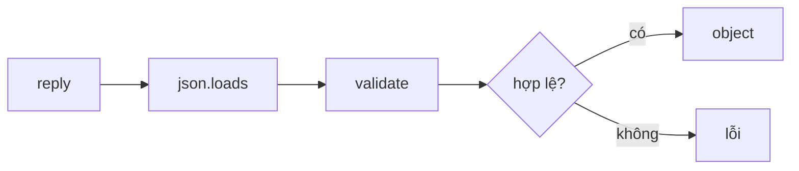

Hãy tưởng tượng ứng dụng của bạn đọc email hỗ trợ khách hàng rồi tạo ticket gồm `name`, `order_id` và `urgent`. Một đoạn văn xuôi lịch sự từ LLM rất dễ đọc với con người, nhưng code Python của bạn không thể truyền thẳng văn xuôi vào database hay câu lệnh `if`. Trong bài này, bạn sẽ yêu cầu model trả về JSON theo một schema, kiểm tra kỹ kết quả thay vì tin mù quáng, biến nó thành object có kiểu rõ ràng, và retry hoặc dùng fallback khi model làm sai.

## 1. Văn xuôi không phải dữ liệu

Khi gọi `client.chat(messages)` bình thường, bạn nhận lại văn bản tự do trong `resp.content`. Thử tách lấy từng trường bằng `.split()` chỉ chạy được khi câu chữ giữ nguyên y hệt—chỉ cần đổi một từ là code gãy ngay.

```python
import json
from pyai_llm import FakeLLM

client = FakeLLM()
msgs = [{"role": "user", "content": "name is Lan, order_id is 1042, urgent true"}]

# 1. Trả lời dạng văn xuôi: tách bằng split() rất mong manh
prose = client.chat(msgs).content or ""
print("prose:", prose)
# prose: (fake model) I received: name is Lan, order_id is 1042, urgent true
print("split name:", prose.split("name is ")[1].split(",")[0])  # split name: Lan

# 2. Trả lời dạng JSON có cấu trúc: parse bằng json.loads()
schema = {
    "type": "object",
    "properties": {
        "name": {"type": "string"},
        "order_id": {"type": "integer"},
        "urgent": {"type": "boolean"},
    },
    "required": ["name", "order_id", "urgent"],
}
json_resp = client.chat(msgs, response_format={"type": "json", "schema": schema})
print("raw json:", json_resp.content)
# raw json: {"name": "Lan", "order_id": 1042, "urgent": true}
data = json.loads(json_resp.content or "{}")
print("parsed:", data, type(data).__name__)
# parsed: {'name': 'Lan', 'order_id': 1042, 'urgent': True} dict
```

Truyền `response_format={"type": "json", "schema": schema}` báo cho `FakeLLM` trả về chuỗi JSON thay vì một câu văn. Gọi `json.loads()` sẽ **parse** (phân tích cú pháp) chuỗi đó thành `dict` Python để bạn truy cập từng khóa trực tiếp.

> [!NOTE]
> Cú pháp `response_format={"type": "json", "schema": ...}` là dạng riêng của `FakeLLM`. Các nhà cung cấp thật đặt tên trường khác nhau (ví dụ `json_schema` hay `strict`), nên hãy đọc tài liệu của từng provider.

## 2. Schema: mô tả hình dạng bạn muốn

Một **JSON schema** (lược đồ JSON) là một `dict` Python đóng vai trò bản thiết kế cho dữ liệu: `"type": "object"` nói gốc là bảng key-value, `"properties"` liệt kê từng trường cùng kiểu của nó, còn `"required"` ghi tên các trường bắt buộc phải có.

```python
from pyai_llm import FakeLLM

ticket_schema = {
    "type": "object",
    "properties": {
        "name": {"type": "string"},
        "order_id": {"type": "integer"},
        "urgent": {"type": "boolean"},
    },
    "required": ["name", "order_id", "urgent"],
}

client = FakeLLM()
resp = client.chat(
    [{"role": "user", "content": "name: Minh, order_id: 205, urgent: yes"}],
    response_format={"type": "json", "schema": ticket_schema},
)
print("required:", ticket_schema["required"])  # required: ['name', 'order_id', 'urgent']
print("reply:", resp.content)                  # reply: {"name": "Minh", "order_id": 205, "urgent": true}
```

Tên kiểu dữ liệu trong JSON hơi khác với Python một chút, nên bạn giữ bảng đối chiếu này khi viết schema:

| kiểu JSON | kiểu Python |
|---|---|
| `string` | `str` |
| `integer` | `int` |
| `number` | `float` |
| `boolean` | `bool` |
| `array` | `list` |
| `object` | `dict` |

> [!NOTE]
> Các API LLM thật thường hỗ trợ "JSON mode" hoặc **structured output** (đầu ra có cấu trúc) bám theo schema ngay từ phía server. Dù vậy, bạn vẫn phải luôn **validate** (kiểm tra tính hợp lệ) phía code của mình—kết nối mạng có thể cắt dở phản hồi, schema thay đổi, và model vẫn có lúc trả về giá trị rỗng hoặc vô nghĩa.

## 3. Parse và kiểm tra: không bao giờ tin model

Hãy coi mọi phản hồi từ LLM như đầu vào chưa đáng tin và cho đi qua một quy trình kiểm tra chặt trước khi dùng.



Hàm `validate(data, schema)` nên trả về danh sách các chuỗi lỗi rõ ràng thay vì để dữ liệu sai lọt vào sâu trong chương trình. Hãy để ý một cái bẫy kinh điển của Python: `bool` là lớp con của `int`, nên `isinstance(True, int)` cho ra `True`—bạn phải kiểm tra `bool` trước khi kiểm tra `int` hay `(int, float)`.

Hãy bấm **Visualize** ở khối code này để xem danh sách `errors` được thêm dần khi kiểm tra từng phản hồi hỏng từ `FakeLLM(script=[...])`.

```python
import json
from pyai_llm import FakeLLM

schema = {
    "type": "object",
    "properties": {
        "name": {"type": "string"},
        "order_id": {"type": "integer"},
        "urgent": {"type": "boolean"},
    },
    "required": ["name", "order_id", "urgent"],
}


def validate(data: dict, schema: dict) -> list[str]:
    type_map = {"string": str, "integer": int, "number": (int, float), "boolean": bool}
    errors: list[str] = []
    for key in schema.get("required", []):
        if key not in data:
            errors.append(f"missing: {key}")
    for key, spec in schema.get("properties", {}).items():
        if key not in data:
            continue
        expected_type = spec.get("type", "")
        value = data[key]
        # Kiểm bool trước int vì trong Python bool là lớp con của int
        if expected_type in ("integer", "number") and isinstance(value, bool):
            errors.append(f"wrong type: {key}")
            continue
        expected = type_map.get(expected_type)
        if expected is not None and not isinstance(value, expected):
            errors.append(f"wrong type: {key}")
    return errors


fence = "`" * 3
client = FakeLLM(script=[
    f'{fence}json\n{{"name": "Lan"}}\n{fence}',
    '{"name": "Lan", "order_id": "abc", "urgent": true}',
    '{"name": "Lan", "order_id": true}',
])

for i in range(1, 4):
    raw = client.chat([{"role": "user", "content": "ticket"}]).content or ""
    try:
        data = json.loads(raw)
    except json.JSONDecodeError as err:
        print(f"reply {i}: bad JSON ({err.msg})")
        continue
    errs = validate(data, schema)
    print(f"reply {i}: errors={errs}")
# reply 1: bad JSON (Expecting value)
# reply 2: errors=['wrong type: order_id']
# reply 3: errors=['missing: urgent', 'wrong type: order_id']
```

Để ý `reply 1` gãy ngay tại `json.loads()` vì bị bọc trong fence markdown, `reply 2` lỗi vì `"abc"` là chuỗi thay vì số nguyên, còn `reply 3` bắt được cả việc thiếu khóa `"urgent"` lẫn `True` giả làm `order_id`.

## 4. Từ dict sang dataclass

Khi `data` đã qua được `validate()`, bạn giải nén nó vào một `@dataclass` bằng `Ticket(**data)`. Dùng object có kiểu giúp IDE gợi ý tên trường, làm lộ ngay lỗi gõ nhầm tên thuộc tính qua `AttributeError` thay vì âm thầm chạy sai, và cho phép gắn kiểm tra dữ liệu ngay trong `__post_init__` (phương thức mà dataclass tự gọi ngay sau `__init__` được sinh tự động).

```python
import json
from dataclasses import dataclass
from pyai_llm import FakeLLM


@dataclass
class Ticket:
    name: str
    order_id: int
    urgent: bool

    def __post_init__(self) -> None:
        if not self.name.strip():
            raise ValueError("name must not be empty")
        if self.order_id <= 0:
            raise ValueError("order_id must be positive")


good = Ticket(**{"name": "Lan", "order_id": 1042, "urgent": True})
print("ticket:", good)
# ticket: Ticket(name='Lan', order_id=1042, urgent=True)

schema = {
    "type": "object",
    "properties": {
        "name": {"type": "string"},
        "order_id": {"type": "integer"},
        "urgent": {"type": "boolean"},
    },
    "required": ["name", "order_id", "urgent"],
}
# Bẫy: "hello there" cho JSON hợp lệ và đúng kiểu, nhưng toàn giá trị rỗng giả
empty_raw = FakeLLM().chat(
    [{"role": "user", "content": "hello there"}],
    response_format={"type": "json", "schema": schema},
).content or "{}"
print("fake empty json:", empty_raw)
# fake empty json: {"name": "", "order_id": 0, "urgent": false}

try:
    Ticket(**json.loads(empty_raw))
except ValueError as err:
    print("rejected:", err)
# rejected: name must not be empty
```

Hãy nhìn kỹ trường hợp `"hello there"`: `FakeLLM` vẫn trả JSON hợp lệ với đúng kiểu Python (`str`, `int`, `bool`), nhưng `name` là `""` còn `order_id` là `0`. Những **giá trị rỗng giả** này cho thấy email vốn thiếu thông tin, nên kiểm tra nghiệp vụ trong `__post_init__` phải chặn lại ngay.

## 5. Pydantic: thư viện người ta dùng thật

Trong các dự án AI thực tế, người ta thường thay vòng lặp `validate()` viết tay bằng **Pydantic**. Khi kế thừa `BaseModel`, hàm `model_validate_json()` làm luôn cả ba việc trong một dòng—parse chuỗi JSON, kiểm tra kiểu, và tạo object—hoặc ném `ValidationError` nếu dữ liệu sai.

```python
from pydantic import BaseModel, ValidationError


class Ticket(BaseModel):
    name: str
    order_id: int
    urgent: bool


good = '{"name": "Lan", "order_id": 1042, "urgent": true}'
ticket = Ticket.model_validate_json(good)
print("valid:", ticket.model_dump())
# valid: {'name': 'Lan', 'order_id': 1042, 'urgent': True}

bad = '{"name": "Lan", "order_id": "abc", "urgent": true}'
try:
    Ticket.model_validate_json(bad)
except ValidationError as e:
    print("error count:", len(e.errors()))
    # error count: 1
    print("loc:", e.errors()[0]["loc"])
    # loc: ('order_id',)
    print("type:", e.errors()[0]["type"])
    # type: int_parsing
```

Pydantic gom gọn toàn bộ §3 và §4 chỉ trong vài dòng, kèm tiện ích như `.model_dump()` hay xuất schema tự động. Mặc định Pydantic chạy ở chế độ lỏng (lax mode) nên tự đổi `"1042"` thành `1042`, còn `validate()` tự viết thì từ chối; nếu muốn chặt chẽ hãy dùng `strict=True`. Phần bài tập của bài này chỉ dùng thư viện chuẩn để bạn hiểu rõ cơ chế bên trong trước khi dùng framework.

| cách làm | phù hợp khi |
|---|---|
| `dict` + kiểm tra tay | không muốn thêm thư viện ngoài, cần toàn quyền tùy biến luật và chuỗi lỗi |
| `@dataclass` + `__post_init__` | muốn object có kiểu bằng thư viện chuẩn, kiểm tra nghiệp vụ và IDE hỗ trợ |
| `pydantic.BaseModel` | làm API và ứng dụng LLM production cần parse nhanh, ép kiểu và xuất schema |

## 6. Khi model trả sai: retry rồi fallback

Ở bài `p7-01-llm-api`, bạn đã biết LLM không có trí nhớ giữa các lần gọi—muốn model sửa một câu trả lời hỏng, bạn phải nối thêm câu trả lời `assistant` cũ cùng tin nhắn `user` chỉ rõ lỗi vào một **bản sao** của `messages` rồi gọi lại `client.chat()`. Nếu hết `max_attempts` mà vẫn hỏng, hãy trả về **fallback** (phương án dự phòng, như `None` hoặc dict mặc định có `needs_review=True`) thay vì làm sập cả chương trình.

```python
import json
from pyai_llm import FakeLLM

schema = {
    "type": "object",
    "properties": {
        "name": {"type": "string"},
        "order_id": {"type": "integer"},
        "urgent": {"type": "boolean"},
    },
    "required": ["name", "order_id", "urgent"],
}


def validate(data: dict, schema: dict) -> list[str]:
    type_map = {"string": str, "integer": int, "number": (int, float), "boolean": bool}
    errors: list[str] = []
    for key in schema.get("required", []):
        if key not in data:
            errors.append(f"missing: {key}")
    for key, spec in schema.get("properties", {}).items():
        if key not in data:
            continue
        expected_type = spec.get("type", "")
        value = data[key]
        if expected_type in ("integer", "number") and isinstance(value, bool):
            errors.append(f"wrong type: {key}")
            continue
        expected = type_map.get(expected_type)
        if expected is not None and not isinstance(value, expected):
            errors.append(f"wrong type: {key}")
    return errors


def fetch_ticket(
    client: FakeLLM,
    messages: list[dict[str, str]],
    schema: dict,
    max_attempts: int = 3,
) -> dict:
    history = [dict(m) for m in messages]
    for attempt in range(1, max_attempts + 1):
        reply = client.chat(history, response_format={"type": "json", "schema": schema}).content or ""
        try:
            data = json.loads(reply)
            errors = validate(data, schema) if isinstance(data, dict) else ["expected JSON object"]
        except json.JSONDecodeError as err:
            errors = [err.msg]
            data = {}
        if not errors:
            print(f"attempt {attempt}: ok")
            return data
        print(f"attempt {attempt}: errors={errors}")
        history.append({"role": "assistant", "content": reply})
        history.append({
            "role": "user",
            "content": f"Your JSON was invalid: {'; '.join(errors)}. Return only JSON.",
        })
    return {"name": "unknown", "order_id": 0, "urgent": False, "needs_review": True}


msgs = [{"role": "user", "content": "name is Lan, order_id is 1042, urgent yes"}]

c1 = FakeLLM(script=[
    '{"name": "Lan", "order_id": "abc", "urgent": true}',
    '{"name": "Lan", "order_id": 1042, "urgent": true}',
])
print("result 1:", fetch_ticket(c1, msgs, schema))
# attempt 1: errors=['wrong type: order_id']
# attempt 2: ok
# result 1: {'name': 'Lan', 'order_id': 1042, 'urgent': True}

c2 = FakeLLM(script=["not json", '{"name": "Lan"}', '{"order_id": "bad"}'])
print("result 2:", fetch_ticket(c2, msgs, schema))
# attempt 1: errors=['Expecting value']
# attempt 2: errors=['missing: order_id', 'missing: urgent']
# attempt 3: errors=['missing: name', 'missing: urgent', 'wrong type: order_id']
# result 2: {'name': 'unknown', 'order_id': 0, 'urgent': False, 'needs_review': True}
```

Bảng theo dõi dưới đây cho thấy từng bước của `c2` từ lúc lỗi tới khi chuyển sang fallback:

| lượt thử | reply | errors | hành động |
|---|---|---|---|
| `1` | `"not json"` | `["Expecting value"]` | nối reply + phản hồi lỗi, thử lại |
| `2` | `'{"name": "Lan"}'` | `["missing: order_id", "missing: urgent"]` | nối reply + phản hồi lỗi, thử lại |
| `3` | `'{"order_id": "bad"}'` | `["missing: name", "missing: urgent", "wrong type: order_id"]` | trả về fallback có `needs_review=True` |

> [!WARNING]
> Đừng bao giờ dùng `eval()` để "parse" đầu ra của model thành dict Python. `eval()` thực thi bất kỳ đoạn code Python nào nằm trong chuỗi không đáng tin—nếu có chuỗi độc hại lọt vào câu trả lời, chương trình sẽ chạy thẳng code lạ đó. Luôn dùng `json.loads()`.

## 7. Lỗi thường gặp

**1. Gọi `json.loads()` thẳng lên phản hồi có fence hoặc câu dẫn**

LLM hay bọc JSON trong fence markdown (cặp ba dấu nháy ngược) hoặc thêm câu mở đầu `"Sure! Here is the JSON:"`, làm `json.loads()` báo lỗi ngay lập tức.

```python
import json

fence = "`" * 3
raw = f'Sure! Here is the JSON:\n{fence}json\n{{"name": "Lan"}}\n{fence}'
try:
    json.loads(raw)
except json.JSONDecodeError as err:
    print("error:", err)
# error: Expecting value: line 1 column 1 (char 0)

# Cách sửa: cắt phần từ '{' đầu tiên tới '}' cuối cùng trước khi gọi json.loads()
sliced = raw[raw.index("{") : raw.rindex("}") + 1]
print("sliced:", json.loads(sliced))
# sliced: {'name': 'Lan'}
```

Cách sửa: cắt phần nằm giữa dấu `{` đầu tiên và dấu `}` cuối cùng (hoặc nhắc model chỉ trả về JSON) trước khi parse.

**2. Kiểm tra `isinstance(x, int)` mà quên loại `bool` trước**

Vì `bool` kế thừa từ `int` trong Python, giá trị `True` sẽ lọt qua `isinstance(x, int)` nếu bạn không kiểm tra `bool` trước.

```python
value = True
print("isinstance(True, int):", isinstance(value, int))
# isinstance(True, int): True

# Cách sửa: loại bool trước khi kiểm tra int
is_real_int = not isinstance(value, bool) and isinstance(value, int)
print("is_real_int:", is_real_int)
# is_real_int: False
```

Cách sửa: luôn kiểm tra `isinstance(value, bool)` trước khi kiểm tra `isinstance(value, int)` hay `isinstance(value, (int, float))`.

**3. Đọc `data["order_id"]` khi chưa kiểm tra khóa bắt buộc**

Truy cập thẳng vào dict khi model làm thiếu trường sẽ ném `KeyError` và làm dừng chương trình.

```python
partial = {"name": "Lan"}
try:
    print(partial["order_id"])
except KeyError as err:
    print("KeyError:", err)
# KeyError: 'order_id'

# Cách sửa: kiểm tra khóa bắt buộc trước, hoặc đọc an toàn bằng .get()
print("safe get:", partial.get("order_id", 0))
# safe get: 0
```

Cách sửa: chạy hàm validate trước để bắt các khóa bị thiếu, hoặc dùng `.get(key, default)`.

**4. Tin vào giá trị rỗng giả (`""`, `0`, `False`)**

Chuỗi `'{"name": "", "order_id": 0, "urgent": false}'` vẫn là JSON hợp lệ và qua mọi bước kiểm kiểu, nhưng lại không chứa thông tin thật.

Cách sửa: thêm kiểm tra nghiệp vụ (ví dụ kiểm tra `name.strip()` không rỗng và `order_id > 0` trong `__post_init__`) để giá trị rỗng mặc định kích hoạt retry hoặc fallback thay vì tạo bản ghi rác.

## Tóm tắt

- Văn xuôi tự do rất dễ gãy khi tách chuỗi; hãy truyền `response_format={"type": "json", "schema": schema}` rồi parse bằng `json.loads()` (tuyệt đối không dùng `eval()`).
- Mô tả các trường, kiểu dữ liệu và khóa `"required"` bằng JSON schema, và nhớ loại `bool` trước khi kiểm tra `integer` hoặc `number` trong Python.
- Không bao giờ tin hoàn toàn vào model: cắt bỏ fence markdown nếu cần, kiểm tra khóa và kiểu, rồi kiểm tra thêm quy tắc nghiệp vụ để chặn giá trị rỗng giả (`""`, `0`, `False`).
- Chuyển dict đã kiểm tra sang `@dataclass` (nếu dùng thư viện chuẩn) hoặc `pydantic.BaseModel` (trong production để parse và dùng `.model_dump()`).
- Khi parse hoặc kiểm tra thất bại, nối thêm câu trả lời sai và thông báo lỗi vào bản sao lịch sử `messages` để retry; nếu hết lượt thì trả về fallback an toàn thay vì crash.
