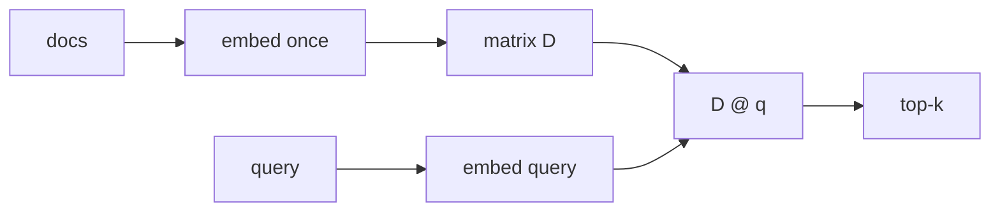

Suppose a customer writes `"I can't sign in"`, while your help center article is titled `"reset your password"`. Simple keyword matching looks for exact shared words and comes up empty. **Embeddings** solve this by turning text into lists of numbers so you can search by **meaning** — the foundation of semantic search, recommendations, and the `"R"` (Retrieval) in RAG (`p7-05-rag`), right after we store those vectors in a vector database (`p7-04-vector-db`).

## 1. Text into vectors

An **embedding** maps a piece of text to a **vector** — an ordered list of numbers — such that texts with similar meanings land near each other in space. Calling `client.embed(texts)` takes a `list` of strings and returns a list of float vectors, one per input string.

```text
   ^  "an affordable automobile"
   |   /
   |  /  "a cheap car"  (small angle -> high cosine)
   | /
   +------------------> "a fast kitten" (large angle -> low cosine)
```

Let's inspect what `FakeLLM().embed(...)` returns: how many vectors come back, how many dimensions each one has, and what the first five rounded numbers look like.

```python
from pyai_llm import FakeLLM

client = FakeLLM()
texts = ["a cheap car", "an affordable automobile", "a fast kitten"]
vectors = client.embed(texts)

print("count:", len(vectors), "dim:", len(vectors[0]))
# count: 3 dim: 64
print("first 5:", [round(x, 3) for x in vectors[0][:5]])
# first 5: [0.0, 0.0, 0.0, 0.577, 0.0]
```

Notice that each vector has `64` numbers (most of them `0.0` here), and `embed()` always expects a **list** (or sequence) of strings—passing a single string raises `TypeError`, which we will trigger in §7.

> [!NOTE]
> Be honest about what our offline client is doing under the hood: `FakeLLM().embed()` uses a deterministic bag-of-words counter with a small synonym table (`car`/`automobile`, `cheap`/`affordable`, `refund`/`"money back"`, `laptop`/`notebook`, `error`/`bug`, and a few others), hashes words into `embed_dim` buckets, and normalizes the vector. Real neural embeddings (like the transformer models you saw in `p6-03-huggingface`) learn meaning from massive text datasets so they understand broad paraphrases, grammar, and context — yet the vector geometry and the NumPy code you write are identical.

## 2. Cosine similarity: measuring closeness

From `p5-01-math-bridge`, **cosine similarity** measures the angle between two vectors `a` and `b` using `(a @ b) / (norm(a) * norm(b))`, ignoring how long the arrows are. Let's first compute it by hand on tiny 3-D Python lists so you can watch every intermediate value update.

Press **Visualize** on this block and watch `dot`, `norm_a_sq`, and `norm_b_sq` grow step by step.

```python
a = [3.0, 4.0, 0.0]
b = [4.0, 3.0, 0.0]

dot = 0.0
norm_a_sq = 0.0
norm_b_sq = 0.0
for x, y in zip(a, b):
    dot += x * y
    norm_a_sq += x * x
    norm_b_sq += y * y

cosine_ab = dot / ((norm_a_sq ** 0.5) * (norm_b_sq ** 0.5))
print("cosine:", round(cosine_ab, 3))
# cosine: 0.96
```

Now here is the best shortcut in retrieval: when vectors are **L2-normalized** (scaled so `np.linalg.norm(v) == 1.0`), the denominator `|a| * |b|` is `1.0 * 1.0 = 1.0`, so cosine similarity collapses into a plain dot product `a @ b`. Let's verify that `FakeLLM` already normalizes its vectors and that NumPy's `a @ b` matches `cosine()` from `pyai_llm`.

```python
import numpy as np
from pyai_llm import FakeLLM, cosine

client = FakeLLM()
vecs = client.embed(["cheap car", "affordable automobile", "fast kitten"])
v1, v2, v3 = np.array(vecs[0]), np.array(vecs[1]), np.array(vecs[2])

print("norm(v1):", round(float(np.linalg.norm(v1)), 3))
# norm(v1): 1.0
print("similar -> cosine:", round(cosine(vecs[0], vecs[1]), 3), "dot:", round(float(v1 @ v2), 3))
# similar -> cosine: 1.0 dot: 1.0
print("different -> cosine:", round(cosine(vecs[0], vecs[2]), 3), "dot:", round(float(v1 @ v3), 3))
# different -> cosine: 0.0 dot: 0.0
```

Keep this quick scale in mind whenever you read similarity scores:

| cosine | meaning |
|---|---|
| near `1.0` | vectors point in the same direction (very similar meaning) |
| near `0.0` | perpendicular directions (unrelated topics) |
| `-1.0` | opposite directions (real neural models can produce negatives; `FakeLLM` stays in `[0, 1]`) |

## 3. Keyword search vs. semantic search

A plain keyword matcher counts how many exact words two texts share, so synonyms score `0`. Let's pit a simple keyword counter against embeddings on the query `"affordable automobile"` across four short documents.

Notice we switch to `FakeLLM(embed_dim=256)` here: with only `64` buckets, two unrelated words can collide into the same bucket (a **hash collision**) and add false similarity, whereas `256` buckets keep rankings clean (real embedding models use hundreds to thousands of dimensions).

```python
import numpy as np
from pyai_llm import FakeLLM


def keyword_score(query: str, doc: str) -> int:
    return len(set(query.lower().split()) & set(doc.lower().split()))


docs = [
    "cheap car rental in Hanoi",
    "fast laptop repair service",
    "local physician clinic hours",
    "quick refund for broken notebook",
]
query = "affordable automobile"

client = FakeLLM(embed_dim=256)
doc_matrix = np.array(client.embed(docs))
query_vec = np.array(client.embed([query])[0])
sem_scores = doc_matrix @ query_vec

for i, doc in enumerate(docs):
    kw = keyword_score(query, doc)
    sem = round(float(sem_scores[i]), 3)
    print(f"doc {i}: kw={kw}  sem={sem}  | {doc}")
# doc 0: kw=0  sem=0.802  | cheap car rental in Hanoi
# doc 1: kw=0  sem=0.0  | fast laptop repair service
# doc 2: kw=0  sem=0.0  | local physician clinic hours
# doc 3: kw=0  sem=0.0  | quick refund for broken notebook
```

Keyword search gave every document `0`, while semantic search scored `"cheap car rental in Hanoi"` at `0.802` even with zero shared words.

| approach | finds | misses |
|---|---|---|
| keyword search | exact shared words, product codes, error IDs | synonyms and rephrased questions |
| semantic search | paraphrases and related concepts | exact part numbers or rare IDs not in training/synonym data |

## 4. Ranking documents: top-k

To search a knowledge base quickly, embed all documents **once** into a 2-D matrix `D` of shape `(n, dim)`, then for each incoming query vector `q` compute all similarities in a single vectorized line `scores = D @ q` instead of writing a Python loop.



To pick the **top-k** highest-scoring documents deterministically when two documents tie on score, sort negated scores with `np.argsort(-scores, kind="stable")[:k]` (stable sort preserves smaller index first).

```python
import numpy as np
from pyai_llm import FakeLLM

docs = [
    "Request a full refund within 30 days",
    "Get money back for a damaged laptop",
    "Book a clinic visit with a physician",
    "Cheap car rental near the airport",
    "Fix a login error on your computer",
]

client = FakeLLM(embed_dim=256)
D = np.array(client.embed(docs))
print("D shape:", D.shape)
# D shape: (5, 256)

query = "fast refund for broken notebook"
q = np.array(client.embed([query])[0])
scores = D @ q

top_indices = np.argsort(-scores, kind="stable")[:3]
for rank, idx in enumerate(top_indices, 1):
    print(f"rank {rank}: doc[{int(idx)}] score={round(float(scores[idx]), 3)} | {docs[int(idx)]}")
# rank 1: doc[1] score=0.548 | Get money back for a damaged laptop
# rank 2: doc[0] score=0.169 | Request a full refund within 30 days
# rank 3: doc[4] score=0.169 | Fix a login error on your computer
```

Look at ranks 2 and 3: both `doc[0]` and `doc[4]` tied at `0.169`, and `kind="stable"` guaranteed `doc[0]` came before `doc[4]` every single run.

| rank | doc | score |
|---|---|---|
| `1` | `"Get money back for a damaged laptop"` | `0.548` |
| `2` | `"Request a full refund within 30 days"` | `0.169` |
| `3` | `"Fix a login error on your computer"` | `0.169` |

You embed the document matrix `D` once and reuse it across every query; in `p7-04-vector-db`, you will wrap this matrix with metadata and filtering inside a lightweight vector store.

## 5. Thresholds and "not found"

Ranking always produces a `#1` result—even when the user asks a completely unrelated question. If the highest similarity score falls below a minimum threshold (for example `min_score = 0.3`), returning `"no good match"` is much safer than feeding irrelevant context into an LLM prompt.

```python
import numpy as np
from pyai_llm import FakeLLM

docs = [
    "Request a full refund within 30 days",
    "Get money back for a damaged laptop",
    "Book a clinic visit with a physician",
    "Cheap car rental near the airport",
    "Fix a login error on your computer",
]

client = FakeLLM(embed_dim=256)
D = np.array(client.embed(docs))
min_score = 0.3

for query in ["fast refund for broken notebook", "spicy noodle soup recipe"]:
    q = np.array(client.embed([query])[0])
    scores = D @ q
    best_idx = int(np.argsort(-scores, kind="stable")[0])
    best_score = round(float(scores[best_idx]), 3)
    if best_score < min_score:
        print(f"{query!r} -> no good match (best={best_score})")
    else:
        print(f"{query!r} -> {docs[best_idx]} ({best_score})")
# 'fast refund for broken notebook' -> Get money back for a damaged laptop (0.548)
# 'spicy noodle soup recipe' -> no good match (best=0.0)
```

In production, pick `min_score` by measuring accuracy on a small set of labeled test queries rather than guessing—we will build systematic retrieval evaluations in `p7-08-evals`.

## 6. Cost and batching

Embedding APIs bill by **token** just like `chat()`, so you can estimate token volume beforehand with `count_tokens` from `pyai_llm`. Always pass all texts together in a single `client.embed(docs)` batch rather than calling `client.embed([doc])` one by one in a loop, which wastes network round-trips and hits rate limits faster.

```python
from pyai_llm import FakeLLM, count_tokens

docs = ["cheap car", "fast laptop", "full refund"]
estimated_tokens = sum(count_tokens(text) for text in docs)

client = FakeLLM(embed_dim=256)
vectors = client.embed(docs)
print("embedded:", len(vectors), "estimated tokens:", estimated_tokens)
# embedded: 3 estimated tokens: 6
```

> [!TIP]
> Embed your documents once and cache or save the resulting matrix on disk or in a vector database. Only embed new queries (or newly added documents) at request time.

## 7. Common mistakes

**1. Passing a single string to `embed()` instead of a list**

`client.embed()` iterates over a sequence of strings; giving it `"one string"` raises `TypeError` immediately.

```python
from pyai_llm import FakeLLM

client = FakeLLM()
try:
    client.embed("one string")
except TypeError as err:
    print("error:", err)
# error: texts must be a sequence of strings, not a single str

# Fix: wrap a single text in a one-element list
vecs = client.embed(["one string"])
print("ok count:", len(vecs))
# ok count: 1
```

Fix: always pass a list such as `client.embed(["one string"])` and unpack `[0]` if you only need one vector.

**2. Comparing vectors from different `embed_dim` or models**

Mixing vectors of length `64` and `256` (or embeddings from two different models) makes NumPy crash with a shape mismatch `ValueError`.

```python
import numpy as np
from pyai_llm import FakeLLM

v64 = np.array(FakeLLM(embed_dim=64).embed(["cheap car"])[0])
v256 = np.array(FakeLLM(embed_dim=256).embed(["cheap car"])[0])
try:
    _ = v64 @ v256
except ValueError as err:
    print("error:", type(err).__name__, "- shapes", v64.shape, v256.shape)
# error: ValueError - shapes (64,) (256,)

# Fix: embed both documents and queries with the same client and embed_dim
shared = FakeLLM(embed_dim=256)
a, b = shared.embed(["cheap car", "affordable automobile"])
print("dot:", round(float(np.array(a) @ np.array(b)), 3))
# dot: 1.0
```

Fix: use the exact same embedding model and `embed_dim` when building the document matrix and when embedding queries.

**3. Using raw dot product on unnormalized vectors**

When vectors are not normalized to unit length, a longer vector with bigger numbers gets a larger dot product even when it points in a worse direction.

```python
import numpy as np

q = np.array([1.0, 0.0])
aligned = np.array([0.8, 0.6])    # length 1.0, close direction to q
longer = np.array([1.0, 2.0])     # length 2.236, mostly off-axis

print("raw dot -> aligned:", round(float(q @ aligned), 3), "longer:", round(float(q @ longer), 3))
# raw dot -> aligned: 0.8 longer: 1.0

# Fix: divide by norms (full cosine similarity) so length cannot bias the score
cos_aligned = (q @ aligned) / (np.linalg.norm(q) * np.linalg.norm(aligned))
cos_longer = (q @ longer) / (np.linalg.norm(q) * np.linalg.norm(longer))
print("cosine  -> aligned:", round(float(cos_aligned), 3), "longer:", round(float(cos_longer), 3))
# cosine  -> aligned: 0.8 longer: 0.447
```

Fix: always use full cosine similarity (or normalize every vector first) so vector length never distorts ranking.

**4. Forgetting that `np.argsort` sorts ascending**

`np.argsort(scores)` puts the **lowest** score first, so taking `[:2]` returns the worst matches instead of the best ones.

```python
import numpy as np

scores = np.array([0.1, 0.9, 0.4])
print("wrong (ascending):", np.argsort(scores)[:2].tolist())
# wrong (ascending): [0, 2]

# Fix: negate scores and use kind="stable" for descending top-k
print("fixed (descending):", np.argsort(-scores, kind="stable")[:2].tolist())
# fixed (descending): [1, 2]
```

Fix: pass `-scores` to `np.argsort(-scores, kind="stable")[:k]` so highest scores come first.

## Recap

- An **embedding** turns text into a numeric vector where similar meanings point in similar directions; `FakeLLM().embed()` simulates this offline with bag-of-words plus synonyms, while real neural embeddings learn rich meaning from data.
- **Cosine similarity** measures direction closeness in `[-1, 1]`; when vectors are L2-normalized (`norm == 1.0`), cosine simplifies to the dot product `a @ b`.
- Embedding documents **once** into matrix `D` lets you score all documents in one vectorized operation `D @ q`, then pick top-k via `np.argsort(-scores, kind="stable")[:k]`.
- Guard retrieval with a similarity threshold (`min_score`) so out-of-scope queries return `"no good match"` instead of misleading documents.
- Batch documents in a single `client.embed(docs)` call, estimate volume with `count_tokens()`, and never mix vectors from different models or dimensions.
