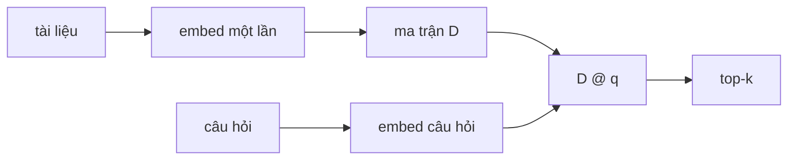

Giả sử khách hàng nhắn `"I can't sign in"`, trong khi bài hướng dẫn của bạn lại viết `"reset your password"`. Tìm kiếm theo từ khóa thông thường chỉ soi từng chữ trùng nhau nên sẽ trượt hoàn toàn. **Embedding** giải quyết chuyện này bằng cách biến văn bản thành dãy số để tìm theo **ý nghĩa** — đây là nền tảng của **semantic search** (tìm kiếm ngữ nghĩa), hệ thống gợi ý và chữ `"R"` (Retrieval — truy xuất) trong RAG (`p7-05-rag`), ngay sau khi bạn lưu các vector này vào vector database ở bài `p7-04-vector-db`.

## 1. Văn bản thành vector

Một **embedding** (biểu diễn vector của văn bản) ánh xạ đoạn chữ thành một **vector** — danh sách số có thứ tự — sao cho những câu có nghĩa gần nhau nằm gần nhau trong không gian. Khi gọi `client.embed(texts)` với một `list` chuỗi, bạn nhận về danh sách các vector số thực tương ứng từng chuỗi.

```text
   ^  "an affordable automobile"
   |   /
   |  /  "a cheap car"  (small angle -> high cosine)
   | /
   +------------------> "a fast kitten" (large angle -> low cosine)
```

Hãy xem `FakeLLM().embed(...)` trả về gì: bao nhiêu vector, mỗi vector có bao nhiêu chiều, và năm phần tử đầu tiên (đã làm tròn) trông như thế nào.

```python
from pyai_llm import FakeLLM

client = FakeLLM()
texts = ["a cheap car", "an affordable automobile", "a fast kitten"]
vectors = client.embed(texts)

print("count:", len(vectors), "dim:", len(vectors[0]))
# count: 3 dim: 64
print("first 5:", [round(x, 3) for x in vectors[0][:5]])
# first 5: [0.0, 0.0, 0.0, 0.577, 0.0]
```

Để ý mỗi vector có `64` con số (đa số bằng `0.0`), và `embed()` luôn đòi hỏi một **list** (hoặc dãy) chuỗi—nếu truyền nhầm một chuỗi đơn sẽ bị lỗi `TypeError` như bạn sẽ thử ở §7.

> [!NOTE]
> Cần nói rõ về cách client offline hoạt động bên trong: `FakeLLM().embed()` dùng bộ đếm bag-of-words tất định kèm một bảng từ đồng nghĩa nhỏ (`car`/`automobile`, `cheap`/`affordable`, `refund`/`"money back"`, `laptop`/`notebook`, `error`/`bug`, v.v.), băm từng từ vào `embed_dim` ô rồi **normalize** (chuẩn hóa độ dài). Embedding neural thật (như các model transformer bạn đã gặp ở `p6-03-huggingface`) học ngữ nghĩa từ lượng dữ liệu khổng lồ nên hiểu được cách diễn đạt, ngữ pháp và ngữ cảnh rộng hơn rất nhiều — nhưng hình học vector và code NumPy bạn viết thì giống hệt nhau.

## 2. Cosine similarity: đo độ gần

Từ bài `p5-01-math-bridge`, **cosine similarity** (độ tương đồng cosine) đo góc giữa hai vector `a` và `b` bằng `(a @ b) / (norm(a) * norm(b))`, không bị ảnh hưởng bởi độ dài mũi tên. Trước tiên hãy tính tay trên hai list Python 3 chiều nhỏ để bạn quan sát từng biến thay đổi.

Hãy bấm **Visualize** ở khối code này để xem `dot`, `norm_a_sq` và `norm_b_sq` tăng dần qua từng bước.

```python
a = [3.0, 4.0, 0.0]
b = [4.0, 3.0, 0.0]

dot = 0.0
norm_a_sq = 0.0
norm_b_sq = 0.0
for x, y in zip(a, b):
    dot += x * y
    norm_a_sq += x * x
    norm_b_sq += y * y

cosine_ab = dot / ((norm_a_sq ** 0.5) * (norm_b_sq ** 0.5))
print("cosine:", round(cosine_ab, 3))
# cosine: 0.96
```

Và đây là mẹo tăng tốc cực hay trong truy xuất: khi các vector đã được chuẩn hóa L2 (`np.linalg.norm(v) == 1.0`), mẫu số `|a| * |b|` bằng `1.0 * 1.0 = 1.0`, nên cosine similarity rút gọn thành phép **tích vô hướng** `a @ b`. Hãy kiểm chứng rằng `FakeLLM` đã tự chuẩn hóa vector sẵn và `a @ b` của NumPy cho kết quả đúng bằng hàm `cosine()` của `pyai_llm`.

```python
import numpy as np
from pyai_llm import FakeLLM, cosine

client = FakeLLM()
vecs = client.embed(["cheap car", "affordable automobile", "fast kitten"])
v1, v2, v3 = np.array(vecs[0]), np.array(vecs[1]), np.array(vecs[2])

print("norm(v1):", round(float(np.linalg.norm(v1)), 3))
# norm(v1): 1.0
print("similar -> cosine:", round(cosine(vecs[0], vecs[1]), 3), "dot:", round(float(v1 @ v2), 3))
# similar -> cosine: 1.0 dot: 1.0
print("different -> cosine:", round(cosine(vecs[0], vecs[2]), 3), "dot:", round(float(v1 @ v3), 3))
# different -> cosine: 0.0 dot: 0.0
```

Hãy nhớ thang đo nhanh này khi đọc điểm tương đồng:

| cosine | ý nghĩa |
|---|---|
| gần `1.0` | hai vector chỉ gần cùng một hướng (ý nghĩa rất giống nhau) |
| gần `0.0` | hai hướng vuông góc (chủ đề không liên quan) |
| `-1.0` | hướng ngược hẳn nhau (embedding thật có thể ra số âm; `FakeLLM` chỉ nằm trong `[0, 1]`) |

Với model thật, hai văn bản không liên quan vẫn thường có cosine > 0 rõ rệt, nên ngưỡng lọc phải đo lại cho từng model.

## 3. Keyword search và semantic search

Hàm tìm kiếm theo từ khóa đơn thuần chỉ đếm số từ trùng chính xác giữa câu hỏi và tài liệu, nên khi gặp từ đồng nghĩa nó cho `0` điểm. Hãy so sánh bộ đếm từ khóa với embedding trên câu truy vấn `"affordable automobile"` qua bốn tài liệu ngắn.

Chú ý ở đây chuyển sang `FakeLLM(embed_dim=256)`: với `64` ô, hai từ khác hẳn nhau vẫn có thể rơi chung vào một ô (**va chạm băm** — hash collision) và tạo điểm giả, còn `256` ô giúp bảng xếp hạng sạch và hợp lý hơn (model embedding thật dùng vài trăm tới vài nghìn chiều).

```python
import numpy as np
from pyai_llm import FakeLLM


def keyword_score(query: str, doc: str) -> int:
    return len(set(query.lower().split()) & set(doc.lower().split()))


docs = [
    "cheap car rental in Hanoi",
    "fast laptop repair service",
    "local physician clinic hours",
    "quick refund for broken notebook",
]
query = "affordable automobile"

client = FakeLLM(embed_dim=256)
doc_matrix = np.array(client.embed(docs))
query_vec = np.array(client.embed([query])[0])
sem_scores = doc_matrix @ query_vec

for i, doc in enumerate(docs):
    kw = keyword_score(query, doc)
    sem = round(float(sem_scores[i]), 3)
    print(f"doc {i}: kw={kw}  sem={sem}  | {doc}")
# doc 0: kw=0  sem=0.802  | cheap car rental in Hanoi
# doc 1: kw=0  sem=0.0  | fast laptop repair service
# doc 2: kw=0  sem=0.0  | local physician clinic hours
# doc 3: kw=0  sem=0.0  | quick refund for broken notebook
```

Tìm theo từ khóa chấm mọi tài liệu `0` điểm, còn tìm theo ngữ nghĩa bắt ngay được `"cheap car rental in Hanoi"` với điểm `0.802` dù hai câu không chung một từ nào.

| cách tìm | tìm được | bỏ sót |
|---|---|---|
| keyword search | từ khớp chính xác, mã sản phẩm, mã lỗi | từ đồng nghĩa và cách diễn đạt khác |
| semantic search | câu đồng nghĩa, khái niệm liên quan | mã linh kiện chính xác hoặc ID hiếm không có trong dữ liệu huấn luyện / bảng từ đồng nghĩa |

## 4. Xếp hạng tài liệu: top-k

Để tìm nhanh trên một kho tài liệu, bạn embed toàn bộ tài liệu **một lần** thành ma trận 2 chiều `D` có shape `(n, dim)`, rồi với mỗi câu hỏi `q`, tính điểm cho tất cả tài liệu chỉ bằng một dòng `scores = D @ q` thay cho vòng lặp Python.



Để lấy **top-k** (k kết quả điểm cao nhất) một cách tất định khi có hai tài liệu bằng điểm nhau, hãy sắp xếp điểm đảo dấu `-scores` bằng `np.argsort(-scores, kind="stable")[:k]` (kiểu sắp xếp ổn định `stable` giữ chỉ số nhỏ hơn đứng trước).

```python
import numpy as np
from pyai_llm import FakeLLM

docs = [
    "Request a full refund within 30 days",
    "Get money back for a damaged laptop",
    "Book a clinic visit with a physician",
    "Cheap car rental near the airport",
    "Fix a login error on your computer",
]

client = FakeLLM(embed_dim=256)
D = np.array(client.embed(docs))
print("D shape:", D.shape)
# D shape: (5, 256)

query = "fast refund for broken notebook"
q = np.array(client.embed([query])[0])
scores = D @ q

top_indices = np.argsort(-scores, kind="stable")[:3]
for rank, idx in enumerate(top_indices, 1):
    print(f"rank {rank}: doc[{int(idx)}] score={round(float(scores[idx]), 3)} | {docs[int(idx)]}")
# rank 1: doc[1] score=0.548 | Get money back for a damaged laptop
# rank 2: doc[0] score=0.169 | Request a full refund within 30 days
# rank 3: doc[4] score=0.169 | Fix a login error on your computer
```

Hãy nhìn hạng 2 và hạng 3: cả `doc[0]` và `doc[4]` đều đạt `0.169`, và `kind="stable"` bảo đảm `doc[0]` luôn đứng trước `doc[4]` ở mọi lần chạy.

| hạng | tài liệu | điểm |
|---|---|---|
| `1` | `"Get money back for a damaged laptop"` | `0.548` |
| `2` | `"Request a full refund within 30 days"` | `0.169` |
| `3` | `"Fix a login error on your computer"` | `0.169` |

Bạn chỉ embed ma trận tài liệu `D` một lần rồi tái sử dụng cho mọi câu hỏi; sang bài `p7-04-vector-db`, bạn sẽ gói ma trận này kèm metadata và bộ lọc thành một kho vector hoàn chỉnh.

## 5. Ngưỡng và "không tìm thấy"

Xếp hạng lúc nào cũng trả ra một kết quả hạng `#1`—kể cả khi người dùng hỏi một câu hoàn toàn không ăn nhập gì. Nếu điểm cao nhất vẫn thấp hơn một ngưỡng tối thiểu (ví dụ `min_score = 0.3`), trả về `"no good match"` (không tìm thấy) an toàn hơn nhiều so với việc nhét tài liệu lạc đề vào prompt của LLM.

```python
import numpy as np
from pyai_llm import FakeLLM

docs = [
    "Request a full refund within 30 days",
    "Get money back for a damaged laptop",
    "Book a clinic visit with a physician",
    "Cheap car rental near the airport",
    "Fix a login error on your computer",
]

client = FakeLLM(embed_dim=256)
D = np.array(client.embed(docs))
min_score = 0.3

for query in ["fast refund for broken notebook", "spicy noodle soup recipe"]:
    q = np.array(client.embed([query])[0])
    scores = D @ q
    best_idx = int(np.argsort(-scores, kind="stable")[0])
    best_score = round(float(scores[best_idx]), 3)
    if best_score < min_score:
        print(f"{query!r} -> no good match (best={best_score})")
    else:
        print(f"{query!r} -> {docs[best_idx]} ({best_score})")
# 'fast refund for broken notebook' -> Get money back for a damaged laptop (0.548)
# 'spicy noodle soup recipe' -> no good match (best=0.0)
```

Khi làm thật, hãy chọn `min_score` bằng cách thử trên vài câu hỏi mẫu có gắn nhãn đúng/sai chứ đừng đoán mò—bạn sẽ đo đạc phần truy xuất bài bản hơn ở bài `p7-08-evals`.

## 6. Chi phí và batch

API embedding cũng tính phí theo **token** y như `chat()`, nên bạn có thể ước lượng trước bằng `count_tokens` của `pyai_llm`. Hãy gom cả danh sách vào một lần gọi `client.embed(docs)` theo lô (batch) thay vì gọi `client.embed([doc])` từng câu một trong vòng lặp để tránh tốn nhiều lượt gửi nhận qua mạng và chạm giới hạn tốc độ (rate limit) nhanh hơn.

```python
from pyai_llm import FakeLLM, count_tokens

docs = ["cheap car", "fast laptop", "full refund"]
estimated_tokens = sum(count_tokens(text) for text in docs)

client = FakeLLM(embed_dim=256)
vectors = client.embed(docs)
print("embedded:", len(vectors), "estimated tokens:", estimated_tokens)
# embedded: 3 estimated tokens: 6
```

> [!TIP]
> Hãy embed tài liệu một lần rồi lưu lại vào file hoặc vector database để tái sử dụng, đừng tính lại toàn bộ embedding mỗi lần chương trình chạy.

## 7. Lỗi thường gặp

**1. Truyền một chuỗi đơn vào `embed()` thay vì list**

`client.embed()` nhận một dãy các chuỗi; nếu bạn truyền thẳng `"one string"`, hàm sẽ ném `TypeError` ngay lập tức.

```python
from pyai_llm import FakeLLM

client = FakeLLM()
try:
    client.embed("one string")
except TypeError as err:
    print("error:", err)
# error: texts must be a sequence of strings, not a single str

# Cách sửa: bọc chuỗi đơn vào list một phần tử
vecs = client.embed(["one string"])
print("ok count:", len(vecs))
# ok count: 1
```

Cách sửa: luôn truyền một list như `client.embed(["one string"])`, rồi lấy `[0]` nếu bạn chỉ cần một vector.

**2. So sánh hai vector khác `embed_dim` hoặc khác model**

Trộn vector dài `64` chiều với vector dài `256` chiều (hoặc embedding từ hai model khác nhau) khiến NumPy báo lỗi lệch kích thước `ValueError`.

```python
import numpy as np
from pyai_llm import FakeLLM

v64 = np.array(FakeLLM(embed_dim=64).embed(["cheap car"])[0])
v256 = np.array(FakeLLM(embed_dim=256).embed(["cheap car"])[0])
try:
    _ = v64 @ v256
except ValueError as err:
    print("error:", type(err).__name__, "- shapes", v64.shape, v256.shape)
# error: ValueError - shapes (64,) (256,)

# Cách sửa: dùng cùng một client và embed_dim cho cả tài liệu lẫn câu hỏi
shared = FakeLLM(embed_dim=256)
a, b = shared.embed(["cheap car", "affordable automobile"])
print("dot:", round(float(np.array(a) @ np.array(b)), 3))
# dot: 1.0
```

Cách sửa: luôn dùng đúng một model và cùng `embed_dim` khi tạo ma trận tài liệu và khi embed câu hỏi.

**3. Dùng tích vô hướng thô trên vector chưa chuẩn hóa**

Nếu vector chưa được chuẩn hóa về độ dài `1.0`, vector dài hơn với các phần tử lớn hơn sẽ cho tích vô hướng cao hơn dù hướng của nó lệch hơn.

```python
import numpy as np

q = np.array([1.0, 0.0])
aligned = np.array([0.8, 0.6])    # độ dài 1.0, hướng rất gần q
longer = np.array([1.0, 2.0])     # độ dài 2.236, lệch hướng nhiều hơn

print("raw dot -> aligned:", round(float(q @ aligned), 3), "longer:", round(float(q @ longer), 3))
# raw dot -> aligned: 0.8 longer: 1.0

# Cách sửa: chia cho độ dài (tính cosine đầy đủ) để độ dài vector không làm lệch điểm
cos_aligned = (q @ aligned) / (np.linalg.norm(q) * np.linalg.norm(aligned))
cos_longer = (q @ longer) / (np.linalg.norm(q) * np.linalg.norm(longer))
print("cosine  -> aligned:", round(float(cos_aligned), 3), "longer:", round(float(cos_longer), 3))
# cosine  -> aligned: 0.8 longer: 0.447
```

Cách sửa: luôn tính cosine similarity đầy đủ (hoặc chuẩn hóa mọi vector trước) để độ dài vector không làm méo bảng xếp hạng.

**4. Quên rằng `np.argsort` sắp xếp tăng dần**

`np.argsort(scores)` đặt điểm **nhỏ nhất** lên đầu, nên cắt `[:2]` sẽ lấy nhầm những tài liệu ít liên quan nhất.

```python
import numpy as np

scores = np.array([0.1, 0.9, 0.4])
print("wrong (ascending):", np.argsort(scores)[:2].tolist())
# wrong (ascending): [0, 2]

# Cách sửa: đảo dấu điểm và dùng kind="stable" để lấy top-k giảm dần
print("fixed (descending):", np.argsort(-scores, kind="stable")[:2].tolist())
# fixed (descending): [1, 2]
```

Cách sửa: truyền `-scores` vào `np.argsort(-scores, kind="stable")[:k]` để điểm cao nhất đứng đầu.

## Tóm tắt

- **Embedding** biến văn bản thành vector số để câu cùng nghĩa chỉ về hướng gần nhau; `FakeLLM().embed()` mô phỏng offline bằng bag-of-words và bảng từ đồng nghĩa, còn model neural thật học nghĩa rộng từ dữ liệu lớn.
- **Cosine similarity** đo độ gần theo hướng trong đoạn `[-1, 1]`; khi vector đã được chuẩn hóa L2 (`norm == 1.0`), cosine rút gọn đúng bằng tích vô hướng `a @ b`.
- Embed tài liệu **một lần** thành ma trận `D` giúp chấm điểm mọi tài liệu chỉ với `D @ q`, rồi lấy top-k bằng `np.argsort(-scores, kind="stable")[:k]`.
- Đặt ngưỡng `min_score` để các câu hỏi lạc đề trả về `"no good match"` thay vì đưa tài liệu sai vào prompt.
- Gọi `client.embed(docs)` một lần theo lô, ước lượng token bằng `count_tokens()` và không bao giờ trộn vector từ các model hoặc số chiều khác nhau.
