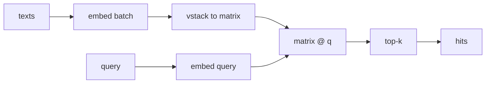

In `p7-03-embeddings`, you kept all document vectors in a 2-D NumPy matrix `D` and the original strings in a parallel Python `list`. Once you have thousands of document **chunks**, need to add or delete items, track which file and page each chunk came from, or search only Vietnamese articles, two loose lists quickly break out of sync. A **vector database** keeps embeddings, source text, IDs, and structured **metadata** together in one place.

## 1. From two parallel lists to one store

When vectors live in a matrix and texts live in a separate list, any edit to one that forgets the other silently corrupts every index after it. Watch what happens when you remove one document from `texts` without deleting row `0` from `matrix`.

```python
import numpy as np
from pyai_llm import FakeLLM

texts = ["Full refund within 30 days.", "Cheap car rental.", "Fast laptop repair."]
client = FakeLLM(embed_dim=256)
matrix = np.array(client.embed(texts), dtype=float)

# Bug: deleted item 0 from texts, forgot to delete row 0 from matrix
texts.pop(0)
q = np.array(client.embed(["affordable vehicle"])[0], dtype=float)
scores = matrix @ q
best_idx = int(np.argsort(-scores, kind="stable")[0])
print("best_idx:", best_idx, "text:", texts[best_idx])
# best_idx: 1 text: Fast laptop repair.
```

Row `1` of `matrix` still belongs to `"Cheap car rental."`, yet `texts[1]` is now `"Fast laptop repair."` because the list shifted left. Binding each record's `id`, `text`, `metadata`, and `vector` together prevents index drift and prepares chunks for RAG (`p7-05-rag`):

```text
id    | text                          | metadata                           | vector[...]
------+-------------------------------+------------------------------------+----------------
"c1"  | "Full refund within 30 days." | {"topic": "billing", "lang": "en"} | [0.0, 0.35, ...]
"c2"  | "Hoan tien trong 30 ngay."    | {"topic": "billing", "lang": "vi"} | [0.0, 0.29, ...]
"c3"  | "Cheap car rental."           | {"topic": "travel", "lang": "en"}  | [0.41, 0.0, ...]
```

Notice that `metadata` is just a plain dictionary holding fields like `source`, `page`, `topic`, or `lang` right next to the vector.

## 2. Building a minimal VectorStore

We can model one search hit with a `@dataclass` (`Hit`) and wrap the records plus NumPy matrix inside a `VectorStore` class. Calling `add()` embeds an entire batch in one `client.embed(texts)` call, rejects duplicate IDs with `ValueError`, and appends new rows via `np.vstack`.



Like in `p7-03-embeddings`, all embedding examples below use `FakeLLM(embed_dim=256)` so runs stay offline, deterministic, and low on hash collisions. Let's build `VectorStore` and query 6 FAQ chunks.

```python
from dataclasses import dataclass
import numpy as np
from pyai_llm import FakeLLM


@dataclass
class Hit:
    id: str
    score: float
    text: str
    metadata: dict


class VectorStore:
    def __init__(self, client) -> None:
        self._client = client
        self._ids: list[str] = []
        self._texts: list[str] = []
        self._metadatas: list[dict] = []
        self._id_set: set[str] = set()
        self._matrix: np.ndarray | None = None

    def __len__(self) -> int:
        return len(self._ids)

    def add(self, ids: list[str], texts: list[str], metadatas: list[dict] | None = None) -> None:
        if len(ids) != len(texts):
            raise ValueError("ids and texts must have the same length")
        if len(set(ids)) != len(ids) or any(cid in self._id_set for cid in ids):
            raise ValueError("duplicate id")
        if not ids:
            return
        metas = [{} for _ in ids] if metadatas is None else [dict(m) for m in metadatas]
        vecs = np.array(self._client.embed(texts), dtype=float)
        self._matrix = vecs if self._matrix is None else np.vstack([self._matrix, vecs])
        self._ids.extend(ids)
        self._texts.extend(texts)
        self._metadatas.extend(metas)
        self._id_set.update(ids)

    def search(self, query: str, k: int = 3) -> list[Hit]:
        if self._matrix is None or k <= 0:
            return []
        q = np.array(self._client.embed([query])[0], dtype=float)
        scores = self._matrix @ q
        order = np.argsort(-scores, kind="stable")[:k]
        return [
            Hit(self._ids[int(i)], round(float(scores[int(i)]), 3), self._texts[int(i)], self._metadatas[int(i)])
            for i in order
        ]


store = VectorStore(FakeLLM(embed_dim=256))
store.add(
    ids=["c1", "c2", "c3", "c4", "c5", "c6"],
    texts=[
        "Full refund for broken laptop.",
        "Fast money back for notebook.",
        "Computer reimbursement policy.",
        "Hoan tien refund cho laptop.",
        "Bao hanh computer trong 7 ngay.",
        "Thue xe cheap car theo ngay.",
    ],
    metadatas=[
        {"lang": "en", "topic": "billing"},
        {"lang": "en", "topic": "billing"},
        {"lang": "en", "topic": "billing"},
        {"lang": "vi", "topic": "billing"},
        {"lang": "vi", "topic": "support"},
        {"lang": "vi", "topic": "travel"},
    ],
)
print("count:", len(store))
# count: 6
for hit in store.search("money back for laptop", k=2):
    print(hit.id, hit.score, hit.metadata["lang"], "|", hit.text)
# c2 0.866 en | Fast money back for notebook.
# c1 0.775 en | Full refund for broken laptop.
```

Notice that `len(store)` works via `__len__`, ties stay deterministic thanks to `kind="stable"`, and every `Hit` carries the original `text` and `metadata` right back to your caller.

## 3. Metadata and filtering

A **metadata filter** like `where={"lang": "vi"}` keeps only records where every key/value pair in `where` matches. Crucially, you must **pre-filter** before taking top-k: if you run **post-filter** (take global top-k first, then discard non-matching hits), strong matches in other languages can crowd out all `k` slots and leave you with fewer than `k` hits—or even `0`.

```python
import numpy as np
from pyai_llm import FakeLLM

records = [
    ("c1", "Full refund for broken laptop.", {"lang": "en"}),
    ("c2", "Fast money back for notebook.", {"lang": "en"}),
    ("c3", "Computer reimbursement policy.", {"lang": "en"}),
    ("c4", "Hoan tien refund cho laptop.", {"lang": "vi"}),
    ("c5", "Bao hanh computer trong 7 ngay.", {"lang": "vi"}),
    ("c6", "Thue xe cheap car theo ngay.", {"lang": "vi"}),
]
client = FakeLLM(embed_dim=256)
matrix = np.array(client.embed([r[1] for r in records]), dtype=float)
q = np.array(client.embed(["money back for laptop"])[0], dtype=float)
k, where = 2, {"lang": "vi"}

# Post-filter: top-2 globally, then keep lang == "vi"
all_scores = matrix @ q
post_idx = np.argsort(-all_scores, kind="stable")[:k]
post_hits = [(records[int(i)][0], round(float(all_scores[int(i)]), 3)) for i in post_idx if records[int(i)][2].get("lang") == where["lang"]]

# Pre-filter: keep lang == "vi" first, then take top-2
kept = [i for i, r in enumerate(records) if all(r[2].get(key) == val for key, val in where.items())]
sub_scores = matrix[kept] @ q
pre_idx = np.argsort(-sub_scores, kind="stable")[:k]
pre_hits = [(records[kept[int(j)]][0], round(float(sub_scores[int(j)]), 3)) for j in pre_idx]

print("post-filter:", post_hits)
# post-filter: []
print("pre-filter :", pre_hits)
# pre-filter : [('c4', 0.516), ('c5', 0.236)]
```

Look at why post-filter returned `[]` while pre-filter returned the full `k = 2` Vietnamese hits:

| id | lang | score | kept? |
|---|---|---|---|
| `c2` | `en` | `0.866` | no |
| `c1` | `en` | `0.775` | no |
| `c3` | `en` | `0.667` | no |
| `c4` | `vi` | `0.516` | yes |
| `c5` | `vi` | `0.236` | yes |
| `c6` | `vi` | `0.0` | yes |

Press **Visualize** on this block and watch `mask` build item by item before computing `scores` on the toy 2-D store.

```python
import numpy as np

ids = ["d1", "d2", "d3", "d4"]
metadatas = [
    {"lang": "en"},
    {"lang": "en"},
    {"lang": "vi"},
    {"lang": "vi"},
]
matrix = np.array([
    [1.0, 0.0],
    [0.8, 0.6],
    [0.6, 0.8],
    [0.0, 1.0],
])
q = np.array([1.0, 0.0])
where = {"lang": "vi"}

mask = []
for meta in metadatas:
    ok = all(meta.get(k) == v for k, v in where.items())
    mask.append(ok)

kept_ids = [cid for cid, keep in zip(ids, mask) if keep]
scores = matrix[mask] @ q
order = np.argsort(-scores, kind="stable")[:2]
hits = [(kept_ids[int(j)], round(float(scores[int(j)]), 3)) for j in order]
print("mask:", mask)
# mask: [False, False, True, True]
print("hits:", hits)
# hits: [('d3', 0.6), ('d4', 0.0)]
```

Notice how `matrix[mask]` slices only the rows where `mask` is `True`, so scoring and top-k run strictly over eligible records.

## 4. Updating and deleting

Deleting a record means removing it from `ids`, `texts`, `metadatas`, **and** deleting its row from the NumPy matrix with `np.delete(matrix, idx, axis=0)`. To **upsert** (insert a new ID or overwrite an existing one), delete the old ID if present and add the updated version.

```python
import numpy as np
from pyai_llm import FakeLLM


class Store:
    def __init__(self, client) -> None:
        self._client = client
        self._ids: list[str] = []
        self._texts: list[str] = []
        self._metadatas: list[dict] = []
        self._matrix: np.ndarray | None = None

    def add(self, ids: list[str], texts: list[str], metadatas: list[dict] | None = None) -> None:
        metas = [{} for _ in ids] if metadatas is None else [dict(m) for m in metadatas]
        vecs = np.array(self._client.embed(texts), dtype=float)
        self._matrix = vecs if self._matrix is None else np.vstack([self._matrix, vecs])
        self._ids.extend(ids)
        self._texts.extend(texts)
        self._metadatas.extend(metas)

    def delete(self, doc_id: str) -> None:
        if doc_id not in self._ids:
            raise KeyError(doc_id)
        idx = self._ids.index(doc_id)
        self._ids.pop(idx)
        self._texts.pop(idx)
        self._metadatas.pop(idx)
        self._matrix = None if not self._ids else np.delete(self._matrix, idx, axis=0)

    def upsert(self, doc_id: str, text: str, metadata: dict | None = None) -> None:
        if doc_id in self._ids:
            self.delete(doc_id)
        self.add([doc_id], [text], [metadata or {}])

    def search(self, query: str, k: int = 2) -> list[tuple[str, float, str]]:
        if self._matrix is None:
            return []
        q = np.array(self._client.embed([query])[0], dtype=float)
        scores = self._matrix @ q
        order = np.argsort(-scores, kind="stable")[:k]
        return [(self._ids[int(i)], round(float(scores[int(i)]), 3), self._texts[int(i)]) for i in order]


store = Store(FakeLLM(embed_dim=256))
store.add(["c1", "c2", "c3"], ["Full refund for laptop.", "Fast money back for notebook.", "Cheap car rental."])
store.delete("c2")
store.upsert("c3", "Affordable vehicle rental with insurance.")
print("after delete + upsert:", store.search("money back for laptop", k=2))
# after delete + upsert: [('c1', 0.866, 'Full refund for laptop.'), ('c3', 0.0, 'Affordable vehicle rental with insurance.')]
print("car search:", store.search("cheap car", k=1))
# car search: [('c3', 0.802, 'Affordable vehicle rental with insurance.')]
```

After deleting `"c2"`, it never appears in search results again, and `"c3"` still points to its own updated text because row `1` of `_matrix` was deleted right alongside `_texts[1]`.

## 5. Saving and reloading

Instead of calling `client.embed()` every time your app restarts, serialize `ids`, `texts`, `metadatas`, and `vectors` (`matrix.tolist()`) with `json.dumps()`, then rebuild the store with `json.loads()` without re-embedding. In real applications that JSON (or binary) payload is written to disk, and production vector databases handle persistence automatically.

```python
import json
import numpy as np
from pyai_llm import FakeLLM


class CountingClient:
    def __init__(self, inner) -> None:
        self._inner = inner
        self.embed_calls = 0

    def embed(self, texts: list[str]) -> list[list[float]]:
        self.embed_calls += 1
        return self._inner.embed(texts)


class SavedStore:
    def __init__(self, client) -> None:
        self._client = client
        self._ids: list[str] = []
        self._texts: list[str] = []
        self._metadatas: list[dict] = []
        self._matrix: np.ndarray | None = None

    def add(self, ids: list[str], texts: list[str], metadatas: list[dict]) -> None:
        vecs = np.array(self._client.embed(texts), dtype=float)
        self._matrix = vecs if self._matrix is None else np.vstack([self._matrix, vecs])
        self._ids.extend(ids)
        self._texts.extend(texts)
        self._metadatas.extend(metadatas)

    def search(self, query: str, k: int = 2) -> list[tuple[str, float]]:
        q = np.array(self._client.embed([query])[0], dtype=float)
        scores = self._matrix @ q
        order = np.argsort(-scores, kind="stable")[:k]
        return [(self._ids[int(i)], round(float(scores[int(i)]), 3)) for i in order]

    def to_json(self) -> str:
        return json.dumps({
            "ids": self._ids,
            "texts": self._texts,
            "metadatas": self._metadatas,
            "vectors": [] if self._matrix is None else self._matrix.tolist(),
        })

    @classmethod
    def from_json(cls, raw: str, client) -> "SavedStore":
        data = json.loads(raw)
        obj = cls(client)
        obj._ids = list(data["ids"])
        obj._texts = list(data["texts"])
        obj._metadatas = [dict(m) for m in data["metadatas"]]
        obj._matrix = np.array(data["vectors"], dtype=float) if data["vectors"] else None
        return obj


c1 = CountingClient(FakeLLM(embed_dim=256))
store = SavedStore(c1)
store.add(["c1", "c2"], ["Full refund policy.", "Cheap car rental."], [{"t": "bill"}, {"t": "car"}])
snapshot = store.to_json()

c2 = CountingClient(FakeLLM(embed_dim=256))
reloaded = SavedStore.from_json(snapshot, c2)
print("embed calls on reload:", c2.embed_calls)
# embed calls on reload: 0
print("same results:", store.search("money back", 1) == reloaded.search("money back", 1))
# same results: True
```

Reloading performed `0` embedding calls and returned identical search scores.

> [!TIP]
> Embedding documents costs both time and API money, so always save computed vectors instead of re-embedding on startup. However, if you ever switch to a different embedding model (or change `embed_dim`), you must re-embed the entire collection—as you saw in `p7-03-embeddings`, vectors from different models live in incompatible spaces and cannot be compared.

## 6. Scaling up: indexes and ANN

Our `matrix @ q` search is **brute force**: it compares the query against **every** stored vector (`O(n · dim)` multiplies per query). Up to a few thousand chunks, NumPy handles that in milliseconds; at millions of vectors, real databases build an **approximate nearest neighbor (ANN)** **index** (such as HNSW or IVF) to search only promising neighborhoods—much faster, while occasionally missing a true nearest neighbor.

```python
dim = 1536
for n in (1_000, 100_000, 10_000_000):
    print(f"n={n:,} -> {n * dim:,} multiplies per query")
# n=1,000 -> 1,536,000 multiplies per query
# n=100,000 -> 153,600,000 multiplies per query
# n=10,000,000 -> 15,360,000,000 multiplies per query
```

With `dim = 1536`, scaling from 1,000 to 10 million vectors multiplies the brute-force work per query by 10,000×:

| stored vectors (`n`) | `dim` | multiplies per brute-force query (`n × dim`) |
|---|---|---|
| `1,000` | `1536` | `1,536,000` |
| `100,000` | `1536` | `153,600,000` |
| `10,000,000` | `1536` | `15,360,000,000` |

When you outgrow an in-memory NumPy store, several widely used tools cover different needs:

| tool | what it is | good for |
|---|---|---|
| NumPy store (this lesson) | In-memory 2-D array plus Python lists | Learning, unit tests, small datasets under ~10k chunks |
| FAISS | C++ similarity search library with Python bindings | Fast local ANN indexes (IVF, HNSW, PQ) in memory |
| Chroma | Lightweight embedded or client-server vector DB | Local prototypes and small apps needing persistence |
| pgvector | Vector column and index extension for PostgreSQL | Keeping vectors, SQL joins, and filters in one DB |
| Qdrant | Dedicated vector search engine (service or embedded) | Production services needing fast filtered ANN at scale |

> [!NOTE]
> Every product above uses its own API syntax, yet underneath they all expose the same core operations you built here: add vectors with metadata, pre-filter and search top-k, update/delete by ID, and persist the index.

## 7. Common mistakes

**1. Adding a duplicate ID**

Allowing duplicate IDs makes deletes ambiguous and returns duplicate hits; validate IDs before modifying state.

```python
existing_ids = {"c1", "c2"}
new_id = "c1"
try:
    if new_id in existing_ids:
        raise ValueError(f"duplicate id: {new_id}")
except ValueError as err:
    print("error:", type(err).__name__, "-", err)
# error: ValueError - duplicate id: c1
```

Fix: check both duplicates inside the incoming batch and collisions with existing IDs before mutating the store, or call `upsert()` when overwriting is intentional.

**2. Post-filtering after top-k instead of pre-filtering**

If you take top-2 globally and then filter for `{"lang": "vi"}`, English docs can fill both slots and leave `0` Vietnamese hits.

```python
top_hits = [("c2", "en", 0.866), ("c1", "en", 0.775)]
post_filtered = [h for h in top_hits if h[1] == "vi"]
print("post_filtered:", post_filtered)
# post_filtered: []

# Fix: filter candidates first, then rank top-k
all_hits = [("c2", "en", 0.866), ("c1", "en", 0.775), ("c4", "vi", 0.516), ("c5", "vi", 0.236)]
pre_filtered = [h for h in all_hits if h[1] == "vi"][:2]
print("pre_filtered:", pre_filtered)
# pre_filtered: [('c4', 'vi', 0.516), ('c5', 'vi', 0.236)]
```

Fix: apply the `where` filter to select eligible records first, then score and sort only those rows.

**3. Querying with a mismatched embedding dimension**

Using a `64`-dim client to query a `256`-dim store crashes `matrix @ q` with a shape `ValueError`.

```python
import numpy as np
from pyai_llm import FakeLLM

doc_matrix = np.array(FakeLLM(embed_dim=256).embed(["Full refund", "Cheap car"]), dtype=float)
q_wrong = np.array(FakeLLM(embed_dim=64).embed(["refund"])[0], dtype=float)
try:
    _ = doc_matrix @ q_wrong
except ValueError as err:
    print("error:", type(err).__name__, "- matrix", doc_matrix.shape, "query", q_wrong.shape)
# error: ValueError - matrix (2, 256) query (64,)
```

Fix: store and query with the exact same embedding model and `embed_dim`—and re-embed the store whenever the model changes.

**4. Searching an empty store without an early return**

When no documents have been added yet (`matrix is None`), calling `matrix @ q` fails immediately with `ValueError`.

```python
import numpy as np
from pyai_llm import FakeLLM

matrix = None
q = np.array(FakeLLM(embed_dim=256).embed(["refund"])[0], dtype=float)
try:
    _ = matrix @ q
except ValueError as err:
    print("error:", type(err).__name__, "-", str(err).split(" (")[0])
# error: ValueError - matmul: Input operand 0 does not have enough dimensions

# Fix: return [] early when the store is empty
hits = [] if matrix is None else (matrix @ q).tolist()
print("safe hits:", hits)
# safe hits: []
```

Fix: check `if self._matrix is None or k <= 0: return []` at the top of `search()`.

## Recap

- A **vector database** keeps each **chunk**'s `id`, `text`, `metadata`, and `vector` together so adds and deletes never drift out of sync.
- Batch-embed documents once with `client.embed(texts)`, stack rows with `np.vstack`, and return structured `Hit` records ranked via `np.argsort(-scores, kind="stable")[:k]`.
- Always **pre-filter** metadata before top-k ranking so non-matching records never crowd out valid results.
- Keep vectors and records aligned on `delete()` (`np.delete(..., axis=0)`) and `upsert()`, and serialize state (`to_json()` / `from_json()`) so you do not pay to re-embed on restart.
- Brute-force `matrix @ q` (`O(n · dim)`) works up to thousands of vectors; larger systems use **ANN** indexes (FAISS, Chroma, pgvector, Qdrant) to trade a tiny bit of accuracy for millisecond queries.
