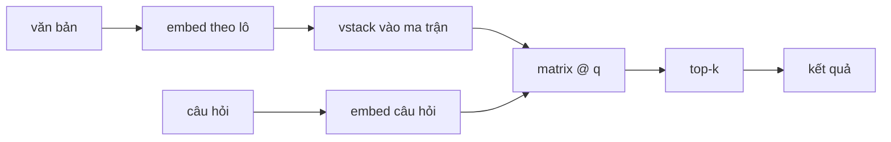

Ở bài `p7-03-embeddings`, bạn giữ toàn bộ vector tài liệu trong một ma trận NumPy 2 chiều `D` và các chuỗi gốc trong một `list` song song. Khi kho dữ liệu có hàng nghìn **chunk** (đoạn văn bản), cần thêm hoặc xóa mục, biết mỗi vector đến từ file hay trang nào, hoặc chỉ tìm trong tài liệu tiếng Việt, hai list rời rạc sẽ nhanh chóng lệch pha nhau. Một **vector database** (cơ sở dữ liệu vector) gom embedding, văn bản gốc, ID và **metadata** (siêu dữ liệu) vào cùng một chỗ.

## 1. Từ hai list rời rạc tới một store

Khi vector nằm trong ma trận còn văn bản nằm trong một list riêng, chỉ cần sửa một bên mà quên bên kia là mọi chỉ số phía sau bị lệch ngầm. Hãy xem điều gì xảy ra khi bạn xóa một văn bản khỏi `texts` mà quên xóa dòng `0` tương ứng trong `matrix`.

```python
import numpy as np
from pyai_llm import FakeLLM

texts = ["Full refund within 30 days.", "Cheap car rental.", "Fast laptop repair."]
client = FakeLLM(embed_dim=256)
matrix = np.array(client.embed(texts), dtype=float)

# Lỗi: xóa phần tử 0 khỏi texts nhưng quên xóa dòng 0 trong matrix
texts.pop(0)
q = np.array(client.embed(["affordable vehicle"])[0], dtype=float)
scores = matrix @ q
best_idx = int(np.argsort(-scores, kind="stable")[0])
print("best_idx:", best_idx, "text:", texts[best_idx])
# best_idx: 1 text: Fast laptop repair.
```

Dòng `1` của `matrix` vẫn thuộc về `"Cheap car rental."`, nhưng `texts[1]` lúc này đã dồn sang `"Fast laptop repair."`. Gắn liền `id`, `text`, `metadata` và `vector` trong từng bản ghi giúp không bao giờ lệch chỉ số và chuẩn bị sẵn các chunk cho RAG (`p7-05-rag`):

```text
id    | text                          | metadata                           | vector[...]
------+-------------------------------+------------------------------------+----------------
"c1"  | "Full refund within 30 days." | {"topic": "billing", "lang": "en"} | [0.0, 0.35, ...]
"c2"  | "Hoan tien trong 30 ngay."    | {"topic": "billing", "lang": "vi"} | [0.0, 0.29, ...]
"c3"  | "Cheap car rental."           | {"topic": "travel", "lang": "en"}  | [0.41, 0.0, ...]
```

Để ý rằng `metadata` chỉ là một dictionary bình thường lưu các trường như `source`, `page`, `topic` hay `lang` ngay bên cạnh vector.

## 2. Xây VectorStore tối giản

Ta có thể biểu diễn một kết quả tìm kiếm bằng `@dataclass` (`Hit`) rồi gói các bản ghi cùng ma trận NumPy vào class `VectorStore`. Phương thức `add()` embed cả lô một lần qua `client.embed(texts)`, báo `ValueError` nếu trùng ID và nối thêm các dòng mới bằng `np.vstack`.



Giống bài `p7-03-embeddings`, mọi ví dụ có embedding dưới đây đều dùng `FakeLLM(embed_dim=256)` để chạy offline, tất định và ít va chạm băm. Hãy dựng `VectorStore` và truy vấn thử trên 6 chunk FAQ.

```python
from dataclasses import dataclass
import numpy as np
from pyai_llm import FakeLLM


@dataclass
class Hit:
    id: str
    score: float
    text: str
    metadata: dict


class VectorStore:
    def __init__(self, client) -> None:
        self._client = client
        self._ids: list[str] = []
        self._texts: list[str] = []
        self._metadatas: list[dict] = []
        self._id_set: set[str] = set()
        self._matrix: np.ndarray | None = None

    def __len__(self) -> int:
        return len(self._ids)

    def add(self, ids: list[str], texts: list[str], metadatas: list[dict] | None = None) -> None:
        if len(ids) != len(texts):
            raise ValueError("ids and texts must have the same length")
        if len(set(ids)) != len(ids) or any(cid in self._id_set for cid in ids):
            raise ValueError("duplicate id")
        if not ids:
            return
        metas = [{} for _ in ids] if metadatas is None else [dict(m) for m in metadatas]
        vecs = np.array(self._client.embed(texts), dtype=float)
        self._matrix = vecs if self._matrix is None else np.vstack([self._matrix, vecs])
        self._ids.extend(ids)
        self._texts.extend(texts)
        self._metadatas.extend(metas)
        self._id_set.update(ids)

    def search(self, query: str, k: int = 3) -> list[Hit]:
        if self._matrix is None or k <= 0:
            return []
        q = np.array(self._client.embed([query])[0], dtype=float)
        scores = self._matrix @ q
        order = np.argsort(-scores, kind="stable")[:k]
        return [
            Hit(self._ids[int(i)], round(float(scores[int(i)]), 3), self._texts[int(i)], self._metadatas[int(i)])
            for i in order
        ]


store = VectorStore(FakeLLM(embed_dim=256))
store.add(
    ids=["c1", "c2", "c3", "c4", "c5", "c6"],
    texts=[
        "Full refund for broken laptop.",
        "Fast money back for notebook.",
        "Computer reimbursement policy.",
        "Hoan tien refund cho laptop.",
        "Bao hanh computer trong 7 ngay.",
        "Thue xe cheap car theo ngay.",
    ],
    metadatas=[
        {"lang": "en", "topic": "billing"},
        {"lang": "en", "topic": "billing"},
        {"lang": "en", "topic": "billing"},
        {"lang": "vi", "topic": "billing"},
        {"lang": "vi", "topic": "support"},
        {"lang": "vi", "topic": "travel"},
    ],
)
print("count:", len(store))
# count: 6
for hit in store.search("money back for laptop", k=2):
    print(hit.id, hit.score, hit.metadata["lang"], "|", hit.text)
# c2 0.866 en | Fast money back for notebook.
# c1 0.775 en | Full refund for broken laptop.
```

Để ý `len(store)` chạy nhờ `__len__`, thứ tự hòa điểm luôn ổn định nhờ `kind="stable"`, và mỗi `Hit` trả kèm nguyên văn `text` cùng `metadata` cho nơi gọi.

## 3. Metadata và lọc

Một **metadata filter** (bộ lọc metadata) như `where={"lang": "vi"}` chỉ giữ lại các bản ghi khớp mọi cặp key/value trong `where`. Điều quan trọng là phải **lọc trước rồi mới lấy top-k** (**pre-filter**): nếu bạn **lọc sau** (**post-filter** — lấy top-k toàn cục trước rồi mới bỏ các mục không khớp), những tài liệu ngôn ngữ khác có điểm cao sẽ chiếm hết `k` chỗ, khiến bạn nhận về ít hơn `k` kết quả, thậm chí `0`.

```python
import numpy as np
from pyai_llm import FakeLLM

records = [
    ("c1", "Full refund for broken laptop.", {"lang": "en"}),
    ("c2", "Fast money back for notebook.", {"lang": "en"}),
    ("c3", "Computer reimbursement policy.", {"lang": "en"}),
    ("c4", "Hoan tien refund cho laptop.", {"lang": "vi"}),
    ("c5", "Bao hanh computer trong 7 ngay.", {"lang": "vi"}),
    ("c6", "Thue xe cheap car theo ngay.", {"lang": "vi"}),
]
client = FakeLLM(embed_dim=256)
matrix = np.array(client.embed([r[1] for r in records]), dtype=float)
q = np.array(client.embed(["money back for laptop"])[0], dtype=float)
k, where = 2, {"lang": "vi"}

# Lọc sau (post-filter): lấy top-2 toàn kho trước, rồi mới giữ lang == "vi"
all_scores = matrix @ q
post_idx = np.argsort(-all_scores, kind="stable")[:k]
post_hits = [(records[int(i)][0], round(float(all_scores[int(i)]), 3)) for i in post_idx if records[int(i)][2].get("lang") == where["lang"]]

# Lọc trước (pre-filter): giữ lang == "vi" trước, rồi mới lấy top-2
kept = [i for i, r in enumerate(records) if all(r[2].get(key) == val for key, val in where.items())]
sub_scores = matrix[kept] @ q
pre_idx = np.argsort(-sub_scores, kind="stable")[:k]
pre_hits = [(records[kept[int(j)]][0], round(float(sub_scores[int(j)]), 3)) for j in pre_idx]

print("post-filter:", post_hits)
# post-filter: []
print("pre-filter :", pre_hits)
# pre-filter : [('c4', 0.516), ('c5', 0.236)]
```

Bảng dưới đây cho thấy vì sao post-filter trả `[]` còn pre-filter trả đủ `k = 2` kết quả tiếng Việt:

| id | lang | score | kept? |
|---|---|---|---|
| `c2` | `en` | `0.866` | no |
| `c1` | `en` | `0.775` | no |
| `c3` | `en` | `0.667` | no |
| `c4` | `vi` | `0.516` | yes |
| `c5` | `vi` | `0.236` | yes |
| `c6` | `vi` | `0.0` | yes |

Hãy bấm **Visualize** ở khối code này trên store đồ chơi 2 chiều để xem `mask` được dựng từng phần tử trước khi tính `scores`.

```python
import numpy as np

ids = ["d1", "d2", "d3", "d4"]
metadatas = [
    {"lang": "en"},
    {"lang": "en"},
    {"lang": "vi"},
    {"lang": "vi"},
]
matrix = np.array([
    [1.0, 0.0],
    [0.8, 0.6],
    [0.6, 0.8],
    [0.0, 1.0],
])
q = np.array([1.0, 0.0])
where = {"lang": "vi"}

mask = []
for meta in metadatas:
    ok = all(meta.get(k) == v for k, v in where.items())
    mask.append(ok)

kept_ids = [cid for cid, keep in zip(ids, mask) if keep]
scores = matrix[mask] @ q
order = np.argsort(-scores, kind="stable")[:2]
hits = [(kept_ids[int(j)], round(float(scores[int(j)]), 3)) for j in order]
print("mask:", mask)
# mask: [False, False, True, True]
print("hits:", hits)
# hits: [('d3', 0.6), ('d4', 0.0)]
```

Để ý cách `matrix[mask]` chỉ cắt riêng các hàng có giá trị `True`, nên bước tính điểm và chọn top-k chỉ chạy trên các bản ghi hợp lệ.

## 4. Cập nhật và xóa

Xóa một bản ghi nghĩa là xóa nó khỏi `ids`, `texts`, `metadatas` **và** xóa luôn dòng tương ứng trong ma trận NumPy bằng `np.delete(matrix, idx, axis=0)`. Để **upsert** (thêm mới nếu ID chưa có, hoặc ghi đè nếu đã có), bạn xóa bản ghi cũ nếu tồn tại rồi thêm bản ghi mới vào.

```python
import numpy as np
from pyai_llm import FakeLLM


class Store:
    def __init__(self, client) -> None:
        self._client = client
        self._ids: list[str] = []
        self._texts: list[str] = []
        self._metadatas: list[dict] = []
        self._matrix: np.ndarray | None = None

    def add(self, ids: list[str], texts: list[str], metadatas: list[dict] | None = None) -> None:
        metas = [{} for _ in ids] if metadatas is None else [dict(m) for m in metadatas]
        vecs = np.array(self._client.embed(texts), dtype=float)
        self._matrix = vecs if self._matrix is None else np.vstack([self._matrix, vecs])
        self._ids.extend(ids)
        self._texts.extend(texts)
        self._metadatas.extend(metas)

    def delete(self, doc_id: str) -> None:
        if doc_id not in self._ids:
            raise KeyError(doc_id)
        idx = self._ids.index(doc_id)
        self._ids.pop(idx)
        self._texts.pop(idx)
        self._metadatas.pop(idx)
        self._matrix = None if not self._ids else np.delete(self._matrix, idx, axis=0)

    def upsert(self, doc_id: str, text: str, metadata: dict | None = None) -> None:
        if doc_id in self._ids:
            self.delete(doc_id)
        self.add([doc_id], [text], [metadata or {}])

    def search(self, query: str, k: int = 2) -> list[tuple[str, float, str]]:
        if self._matrix is None:
            return []
        q = np.array(self._client.embed([query])[0], dtype=float)
        scores = self._matrix @ q
        order = np.argsort(-scores, kind="stable")[:k]
        return [(self._ids[int(i)], round(float(scores[int(i)]), 3), self._texts[int(i)]) for i in order]


store = Store(FakeLLM(embed_dim=256))
store.add(["c1", "c2", "c3"], ["Full refund for laptop.", "Fast money back for notebook.", "Cheap car rental."])
store.delete("c2")
store.upsert("c3", "Affordable vehicle rental with insurance.")
print("after delete + upsert:", store.search("money back for laptop", k=2))
# after delete + upsert: [('c1', 0.866, 'Full refund for laptop.'), ('c3', 0.0, 'Affordable vehicle rental with insurance.')]
print("car search:", store.search("cheap car", k=1))
# car search: [('c3', 0.802, 'Affordable vehicle rental with insurance.')]
```

Sau khi xóa `"c2"`, kết quả tìm kiếm không còn trả về nó nữa, còn `"c3"` vẫn khớp đúng nội dung vừa cập nhật vì dòng `1` của `_matrix` đã được xóa đồng bộ với `_texts[1]`.

## 5. Lưu và nạp lại

Thay vì gọi `client.embed()` lại từ đầu mỗi lần khởi động ứng dụng, bạn tuần tự hóa `ids`, `texts`, `metadatas` và `vectors` (`matrix.tolist()`) thành chuỗi bằng `json.dumps()`, rồi dựng lại store qua `json.loads()` mà không cần embed lại. Ngoài đời, chuỗi JSON (hoặc định dạng nhị phân) này được ghi xuống đĩa, và các vector database thật tự lo phần lưu trữ bền vững cho bạn.

```python
import json
import numpy as np
from pyai_llm import FakeLLM


class CountingClient:
    def __init__(self, inner) -> None:
        self._inner = inner
        self.embed_calls = 0

    def embed(self, texts: list[str]) -> list[list[float]]:
        self.embed_calls += 1
        return self._inner.embed(texts)


class SavedStore:
    def __init__(self, client) -> None:
        self._client = client
        self._ids: list[str] = []
        self._texts: list[str] = []
        self._metadatas: list[dict] = []
        self._matrix: np.ndarray | None = None

    def add(self, ids: list[str], texts: list[str], metadatas: list[dict]) -> None:
        vecs = np.array(self._client.embed(texts), dtype=float)
        self._matrix = vecs if self._matrix is None else np.vstack([self._matrix, vecs])
        self._ids.extend(ids)
        self._texts.extend(texts)
        self._metadatas.extend(metadatas)

    def search(self, query: str, k: int = 2) -> list[tuple[str, float]]:
        q = np.array(self._client.embed([query])[0], dtype=float)
        scores = self._matrix @ q
        order = np.argsort(-scores, kind="stable")[:k]
        return [(self._ids[int(i)], round(float(scores[int(i)]), 3)) for i in order]

    def to_json(self) -> str:
        return json.dumps({
            "ids": self._ids,
            "texts": self._texts,
            "metadatas": self._metadatas,
            "vectors": [] if self._matrix is None else self._matrix.tolist(),
        })

    @classmethod
    def from_json(cls, raw: str, client) -> "SavedStore":
        data = json.loads(raw)
        obj = cls(client)
        obj._ids = list(data["ids"])
        obj._texts = list(data["texts"])
        obj._metadatas = [dict(m) for m in data["metadatas"]]
        obj._matrix = np.array(data["vectors"], dtype=float) if data["vectors"] else None
        return obj


c1 = CountingClient(FakeLLM(embed_dim=256))
store = SavedStore(c1)
store.add(["c1", "c2"], ["Full refund policy.", "Cheap car rental."], [{"t": "bill"}, {"t": "car"}])
snapshot = store.to_json()

c2 = CountingClient(FakeLLM(embed_dim=256))
reloaded = SavedStore.from_json(snapshot, c2)
print("embed calls on reload:", c2.embed_calls)
# embed calls on reload: 0
print("same results:", store.search("money back", 1) == reloaded.search("money back", 1))
# same results: True
```

Bước nạp lại tốn đúng `0` lần gọi embed mà vẫn trả kết quả tìm kiếm giống hệt ban đầu.

> [!TIP]
> Tính embedding tốn cả thời gian lẫn tiền API, nên hãy lưu vector lại thay vì embed lại mỗi lần chạy. Tuy nhiên, nếu bạn đổi sang model embedding khác (hoặc đổi `embed_dim`), bạn bắt buộc phải embed lại toàn bộ kho dữ liệu—như đã thấy ở bài `p7-03-embeddings`, số chiều và không gian vector giữa hai model khác nhau không thể đem so sánh với nhau.

## 6. Khi dữ liệu lớn: index và ANN

Phép `matrix @ q` là tìm kiếm **vét cạn** (brute force): nó so sánh câu hỏi với **mọi** vector đang lưu, tốn `O(n · dim)` phép tính mỗi truy vấn. Với vài nghìn chunk thì cách này vẫn rất nhanh; khi lên tới hàng triệu vector, các DB thật dùng **chỉ mục** (index) **approximate nearest neighbor (ANN)** (lân cận gần nhất xấp xỉ, như HNSW hay IVF) để chỉ dò ở những vùng lân cận tiềm năng—nhanh hơn rất nhiều nhưng đôi khi có thể bỏ sót một kết quả gần nhất thật sự.

```python
dim = 1536
for n in (1_000, 100_000, 10_000_000):
    print(f"n={n:,} -> {n * dim:,} multiplies per query")
# n=1,000 -> 1,536,000 multiplies per query
# n=100,000 -> 153,600,000 multiplies per query
# n=10,000,000 -> 15,360,000,000 multiplies per query
```

Với `dim = 1536`, tăng từ 1.000 lên 10 triệu vector làm khối lượng phép nhân vét cạn mỗi câu hỏi tăng gấp 10.000 lần:

| số vector (`n`) | `dim` | số phép nhân mỗi truy vấn vét cạn (`n × dim`) |
|---|---|---|
| `1,000` | `1536` | `1,536,000` |
| `100,000` | `1536` | `153,600,000` |
| `10,000,000` | `1536` | `15,360,000,000` |

Khi dữ liệu vượt quá phạm vi store NumPy trong RAM, dưới đây là các công cụ phổ biến và vai trò của từng công cụ:

| công cụ | nó là gì | phù hợp khi |
|---|---|---|
| NumPy store (bài này) | Mảng 2 chiều trong RAM kèm list Python | Học tập, unit test, dữ liệu nhỏ dưới ~10k chunk |
| FAISS | Thư viện tìm kiếm tương đồng viết bằng C++ có binding Python | Cần chỉ mục ANN cục bộ tốc độ cao (IVF, HNSW, PQ) trong RAM |
| Chroma | Vector DB gọn nhẹ chạy nhúng hoặc client-server | Prototype cục bộ và ứng dụng nhỏ cần lưu xuống đĩa |
| pgvector | Extension thêm cột vector và chỉ mục cho PostgreSQL | Cần lưu chung vector, dữ liệu SQL và filter trong một DB |
| Qdrant | Hệ quản trị tìm kiếm vector chuyên dụng (dịch vụ hoặc nhúng) | Dịch vụ production cần ANN có lọc nhanh ở quy mô lớn |

> [!NOTE]
> Cú pháp API của mỗi sản phẩm đều khác nhau, nhưng bên dưới chúng đều cung cấp đúng những thao tác cốt lõi như store bạn vừa tự viết: thêm vector kèm metadata, lọc trước rồi lấy top-k, cập nhật/xóa theo ID và lưu bền vững chỉ mục.

## 7. Lỗi thường gặp

**1. Thêm bản ghi bị trùng ID**

Cho phép trùng ID làm thao tác xóa mơ hồ và kết quả trả về bị lặp; hãy kiểm tra ID trước khi thay đổi dữ liệu.

```python
existing_ids = {"c1", "c2"}
new_id = "c1"
try:
    if new_id in existing_ids:
        raise ValueError(f"duplicate id: {new_id}")
except ValueError as err:
    print("error:", type(err).__name__, "-", err)
# error: ValueError - duplicate id: c1
```

Cách sửa: kiểm tra cả trùng lặp ngay trong lô đầu vào lẫn trùng với ID đang có trước khi sửa store, hoặc dùng `upsert()` khi muốn ghi đè.

**2. Lọc sau khi đã lấy top-k (post-filter)**

Nếu bạn lấy top-2 toàn kho trước rồi mới lọc `{"lang": "vi"}`, các tài liệu tiếng Anh có thể chiếm hết cả hai chỗ và trả về `0` kết quả tiếng Việt.

```python
top_hits = [("c2", "en", 0.866), ("c1", "en", 0.775)]
post_filtered = [h for h in top_hits if h[1] == "vi"]
print("post_filtered:", post_filtered)
# post_filtered: []

# Cách sửa: lọc ứng viên trước rồi mới xếp hạng top-k
all_hits = [("c2", "en", 0.866), ("c1", "en", 0.775), ("c4", "vi", 0.516), ("c5", "vi", 0.236)]
pre_filtered = [h for h in all_hits if h[1] == "vi"][:2]
print("pre_filtered:", pre_filtered)
# pre_filtered: [('c4', 'vi', 0.516), ('c5', 'vi', 0.236)]
```

Cách sửa: áp dụng bộ lọc `where` để chọn tập bản ghi hợp lệ trước, rồi mới nhân ma trận và sắp xếp trên tập con đó.

**3. Truy vấn bằng client khác số chiều `embed_dim`**

Dùng client 64 chiều để hỏi một store 256 chiều sẽ làm `matrix @ q` sập với lỗi kích thước `ValueError`.

```python
import numpy as np
from pyai_llm import FakeLLM

doc_matrix = np.array(FakeLLM(embed_dim=256).embed(["Full refund", "Cheap car"]), dtype=float)
q_wrong = np.array(FakeLLM(embed_dim=64).embed(["refund"])[0], dtype=float)
try:
    _ = doc_matrix @ q_wrong
except ValueError as err:
    print("error:", type(err).__name__, "- matrix", doc_matrix.shape, "query", q_wrong.shape)
# error: ValueError - matrix (2, 256) query (64,)
```

Cách sửa: luôn lưu và truy vấn bằng đúng cùng một model embedding và `embed_dim`—và embed lại toàn bộ kho khi đổi model.

**4. Tìm kiếm trên store rỗng mà không thoát sớm**

Khi chưa thêm tài liệu nào (`matrix is None`), gọi thẳng `matrix @ q` sẽ văng `ValueError` ngay lập tức.

```python
import numpy as np
from pyai_llm import FakeLLM

matrix = None
q = np.array(FakeLLM(embed_dim=256).embed(["refund"])[0], dtype=float)
try:
    _ = matrix @ q
except ValueError as err:
    print("error:", type(err).__name__, "-", str(err).split(" (")[0])
# error: ValueError - matmul: Input operand 0 does not have enough dimensions

# Cách sửa: trả về [] sớm khi store rỗng
hits = [] if matrix is None else (matrix @ q).tolist()
print("safe hits:", hits)
# safe hits: []
```

Cách sửa: kiểm tra `if self._matrix is None or k <= 0: return []` ngay đầu phương thức `search()`.

## Tóm tắt

- **Vector database** giữ `id`, `text`, `metadata` và `vector` của từng **chunk** đi cùng nhau để khi thêm hay xóa không bao giờ bị lệch chỉ số.
- Embed cả lô tài liệu một lần qua `client.embed(texts)`, nối hàng bằng `np.vstack`, rồi trả về các bản ghi `Hit` xếp hạng qua `np.argsort(-scores, kind="stable")[:k]`.
- Luôn **lọc trước (pre-filter)** theo metadata trước khi lấy top-k để bản ghi không khớp không chiếm mất suất kết quả hợp lệ.
- Giữ vector và danh sách bản ghi đồng bộ khi `delete()` (`np.delete(..., axis=0)`) và `upsert()`, đồng thời tuần tự hóa trạng thái (`to_json()` / `from_json()`) để không phải embed lại khi khởi động.
- Phép vét cạn `matrix @ q` (`O(n · dim)`) chạy ổn tới vài nghìn vector; ở quy mô lớn hơn, các DB thật dùng chỉ mục **ANN** (FAISS, Chroma, pgvector, Qdrant) đánh đổi một chút độ chính xác để truy vấn trong vài mili-giây.
