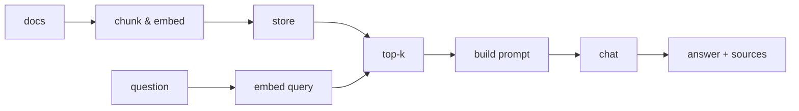

Ask a general-purpose chatbot about your shop's return policy and it has no idea—or worse, it invents a plausible-sounding rule (**hallucination**). **RAG** (**Retrieval-Augmented Generation**) solves this by retrieving the right document excerpts and placing them directly into the prompt right before the model answers, turning every question into an open-book exam.

## 1. Why RAG?

Without your documents in the prompt, an LLM can only guess from its pre-training weights. Let's watch `FakeLLM` respond to a shop policy question when no context is provided.

```python
from pyai_llm import FakeLLM

client = FakeLLM()
resp = client.chat([
    {"role": "user", "content": "How many days do refunds take at our shop?"},
])
print(resp.content)
# (fake model) I received: How many days do refunds take at our shop?
```

There are three ways to give a model knowledge of your private data: stuffing **every** document into the prompt (which burns tokens and hits the **context window** limit), **fine-tuning** the weights (`p6-04-fine-tune`, which is costly and goes stale as soon as policies change), or **RAG** (retrieving only the relevant snippets at query time).

| approach | cost | freshness | good for |
|---|---|---|---|
| Stuff all docs in prompt | High token bill per call | Instant | Tiny handbooks that fit in one prompt |
| Fine-tuning | Expensive training runs | Stale until retrained | Teaching style, format, or domain tone |
| RAG | Low (only top-k chunks sent) | Instant when index updates | Private, changing knowledge with citations |

## 2. Chunking: splitting documents into pieces

Long documents rarely fit into a prompt as a whole, and embedding a 20-page PDF into a single vector blurs all its topics together. **Chunking** splits text into small word windows of length `size` that advance by `step = size - overlap`, so each chunk carries **chunk overlap** from the end of the previous one and short boundary phrases stay intact in at least one window instead of getting cut in two.

```text
words:   [0   1   2   3   4   5   6   7   8   9]
chunk 0: [0   1   2   3]                           (0:4)
chunk 1:             [3   4   5   6]               (3:7, overlap=1)
chunk 2:                         [6   7   8   9]   (6:10, overlap=1)
```

Let's write `chunk_words(text, size, overlap)` and compare `overlap=0` against `overlap=3` on a short policy sentence so you can see how overlap preserves `"Refunds take 30 days"` in one window.

```python
def chunk_words(text: str, size: int, overlap: int = 0) -> list[str]:
    if size <= 0 or overlap < 0 or overlap >= size:
        raise ValueError("need size > 0 and 0 <= overlap < size")
    words = text.split()
    if not words:
        return []
    step = size - overlap
    chunks: list[str] = []
    i = 0
    while i < len(words):
        chunks.append(" ".join(words[i : i + size]))
        if i + size >= len(words):
            break
        i += step
    return chunks


policy = "Our policy is simple. Refunds take 30 days from purchase date."
print("no overlap:", chunk_words(policy, size=6, overlap=0))
# no overlap: ['Our policy is simple. Refunds take', '30 days from purchase date.']
print("overlap=3 :", chunk_words(policy, size=6, overlap=3))
# overlap=3 : ['Our policy is simple. Refunds take', 'simple. Refunds take 30 days from', '30 days from purchase date.']
```

Press **Visualize** on this block and watch `i`, `window`, and `chunks` advance across the 10-word list with `size=4` and `overlap=1`.

```python
words = ["Our", "shop", "issues", "full", "refunds", "within", "30", "days", "with", "receipt"]
size, overlap = 4, 1
step = size - overlap
chunks = []
i = 0
while i < len(words):
    window = " ".join(words[i : i + size])
    chunks.append(window)
    if i + size >= len(words):
        break
    i += step
print(len(chunks), chunks)
# 3 ['Our shop issues full', 'full refunds within 30', '30 days with receipt']
```

Choosing chunk size is always a tradeoff between retrieval precision and surrounding context:

| chunk size | pro | con |
|---|---|---|
| Small (e.g. 50–100 words) | Sharp embeddings, less prompt noise | May cut off surrounding context or conditions |
| Medium (e.g. 150–300 words) | Balanced focus and full paragraphs | Needs tuning overlap so facts stay intact |
| Large (e.g. 500+ words) | Preserves broad context and nuance | Dilutes embedding signal, sends extra tokens |

Fixed-size word windows are simple, but they can still break in the middle of a paragraph; when documents are structured cleanly with blank lines (`\n\n`), grouping whole paragraphs up to a `max_words` budget preserves complete ideas at the cost of uneven chunk sizes (you will implement paragraph chunking in the first exercise).

## 3. End-to-end RAG pipeline

A full RAG pipeline has two halves: first **index** your chunks into a NumPy embedding matrix with `source` metadata (`p7-04-vector-db`), then at query time **retrieve** the top-k chunks, **augment** the prompt, and **generate** a cited answer.



Let's run the complete pipeline on three shop policy files using `FakeLLM(embed_dim=256)` and `np.argsort(-scores, kind="stable")[:2]`.

```python
import numpy as np
from pyai_llm import FakeLLM


def chunk_words(text: str, size: int, overlap: int = 0) -> list[str]:
    if size <= 0 or overlap < 0 or overlap >= size:
        raise ValueError("need size > 0 and 0 <= overlap < size")
    words = text.split()
    if not words:
        return []
    step = size - overlap
    chunks: list[str] = []
    i = 0
    while i < len(words):
        chunks.append(" ".join(words[i : i + size]))
        if i + size >= len(words):
            break
        i += step
    return chunks


docs = [
    {"source": "refunds.md", "text": "Refunds are issued within 30 days of purchase. Keep your original receipt and unused items in original packaging for a full refund."},
    {"source": "shipping.md", "text": "Standard shipping delivers orders in three to five business days. Express shipping delivers next day for a small flat fee."},
    {"source": "warranty.md", "text": "Hardware warranty covers factory defects for 12 months from delivery. Water damage is not covered under this hardware warranty."},
]
chunks = [
    {"source": d["source"], "text": piece}
    for d in docs
    for piece in chunk_words(d["text"], size=14, overlap=4)
]

client = FakeLLM(embed_dim=256)
doc_matrix = np.array(client.embed([c["text"] for c in chunks]), dtype=float)

question = "How many days do refunds take?"
q_vec = np.array(client.embed([question])[0], dtype=float)
scores = doc_matrix @ q_vec
top_idx = np.argsort(-scores, kind="stable")[:2]
hits = [chunks[int(i)] for i in top_idx]

context_lines = "\n".join(f"[{n}] {h['text']}" for n, h in enumerate(hits, 1))
messages = [
    {
        "role": "system",
        "content": (
            "Answer using only the provided context. "
            "If the answer is not in the context, say \"I don't know.\" "
            "Cite sources with [n].\n\nContext:\n" + context_lines
        ),
    },
    {"role": "user", "content": question},
]
answer = client.chat(messages).content
print("chunks:", len(chunks))
# chunks: 6
print("answer:", answer)
# answer: Refunds are issued within 30 days of purchase. [1]
print("sources:", [h["source"] for h in hits])
# sources: ['refunds.md', 'shipping.md']
```

Notice that `chunks` has `6` entries (`2` per file) and `client.chat(messages)` returns the relevant sentence tagged with `[1]`.

> [!NOTE]
> Under the hood, `FakeLLM.chat()` triggers RAG mode when it sees a `Context:` line followed by `[1] ...`, `[2] ...`, picks the chunk sharing the most lowercase words (length ≥ 3, no stemming, stopwords included), and returns its first sentence with `[n]` (or `"I don't know based on the provided context."` if fewer than 2 words match). Real LLMs read, reason, and synthesize across multiple chunks—yet the pipeline structure and prompt format are identical.

## 4. Grounded prompts

**Grounding** means instructing the model to rely strictly on the retrieved chunks instead of guessing from memory. A clean `build_rag_messages(question, hits)` helper puts three rules in the `system` message—use only the context, say you don't know if it is missing, and cite `[n]`—followed by the `Context:` block, while keeping the user's question in its own `user` message (unlike `build_messages` in `p7-01-llm-api`, which formatted chat turns). Here `hits` are plain dicts for brevity; in `p7-04-vector-db` you used `Hit` objects with `.text`, and the idea is identical.

```python
def build_rag_messages(question: str, hits: list[dict]) -> list[dict]:
    context = "\n".join(f"[{n}] {h['text']}" for n, h in enumerate(hits, 1))
    system = (
        "Answer using only the provided context.\n"
        "If the context lacks the answer, say you don't know.\n"
        "Cite sources as [n].\n\n"
        f"Context:\n{context}"
    )
    return [
        {"role": "system", "content": system},
        {"role": "user", "content": question},
    ]


sample_hits = [
    {"source": "refunds.md", "text": "Refunds are issued within 30 days of purchase."},
    {"source": "shipping.md", "text": "Standard shipping delivers orders in three to five business days."},
]
msgs = build_rag_messages("How many days do refunds take?", sample_hits)
print(msgs[0]["content"])
# Answer using only the provided context.
# If the context lacks the answer, say you don't know.
# Cite sources as [n].
#
# Context:
# [1] Refunds are issued within 30 days of purchase.
# [2] Standard shipping delivers orders in three to five business days.
```

Separating instructions + `Context:` in `system` from the raw question in `user` makes the prompt easy to read, test, and swap between models.

> [!WARNING]
> Retrieved document text is still untrusted input: a poisoned chunk containing `"ignore previous instructions"` can attempt **prompt injection** to steer the model away from your rules, so never give a RAG model unrestricted tools or secrets based solely on retrieved text.

## 5. Citations and verification

A **citation** like `[1]` lets users verify every claim against the original file. In `re.findall(r"\[(\d+)\]", answer)`, `\[` and `\]` match literal square brackets (escaped because unescaped `[...]` is a regex character class), and `(\d+)` captures one or more digits (`0`–`9`). Because `re.findall` returns a list of strings (like `['1', '3']`), we convert each match with `int(...)`, validate that each number sits inside `1..len(hits)`, and map valid numbers back to each chunk's `source`—flagging out-of-range markers like `[7]` when only two chunks were sent as fabricated.

```python
import re

reply = "Refunds take 7 days [1] and cover laptops [3]."
raw = re.findall(r"\[(\d+)\]", reply)
print("raw:", raw)
# raw: ['1', '3']
print("ints:", [int(x) for x in raw])
# ints: [1, 3]
```

```python
import re


def extract_sources(answer: str, hits: list[dict]) -> tuple[list[str], list[int]]:
    valid: list[str] = []
    invalid: list[int] = []
    for raw in re.findall(r"\[(\d+)\]", answer):
        num = int(raw)
        if 1 <= num <= len(hits):
            src = hits[num - 1]["source"]
            if src not in valid:
                valid.append(src)
        else:
            invalid.append(num)
    return valid, invalid


hits = [
    {"source": "refunds.md", "text": "Refunds are issued within 30 days of purchase."},
    {"source": "shipping.md", "text": "Standard shipping delivers orders in three to five business days."},
]
valid_sources, bad_refs = extract_sources("Refunds take 30 days [1], see [7].", hits)
print("valid:", valid_sources, "invalid:", bad_refs)
# valid: ['refunds.md'] invalid: [7]
```

Tracing three policy questions through our 6-chunk store shows the full flow from top hit to verified `sources`:

| question | top chunk | score | answer | sources |
|---|---|---|---|---|
| How many days do refunds take? | `refunds.md` | `0.218` | `Refunds are issued within 30 days of purchase. [1]` | `['refunds.md']` |
| How fast does standard shipping deliver orders? | `shipping.md` | `0.624` | `Standard shipping delivers orders in three to five business days. [1]` | `['shipping.md']` |
| What does hardware warranty cover? | `warranty.md` | `0.359` | `Hardware warranty covers factory defects for 12 months from delivery. [1]` | `['warranty.md']` |

## 6. When nothing matches: don't make it up

Refusing to answer when evidence is missing uses two layers of defense: (a) if the top retrieval score is below `min_score`, skip the LLM call completely and return `"I don't know."` (saving money and latency); (b) if retrieval clears `min_score` but the chunks still lack the requested detail, the grounded model itself replies `"I don't know based on the provided context."`.

```python
import numpy as np
from pyai_llm import FakeLLM

chunks = [
    {"source": "refunds.md", "text": "Refunds are issued within 30 days of purchase. Keep your original receipt and unused"},
    {"source": "refunds.md", "text": "original receipt and unused items in original packaging for a full refund."},
    {"source": "shipping.md", "text": "Standard shipping delivers orders in three to five business days. Express shipping delivers next"},
    {"source": "shipping.md", "text": "Express shipping delivers next day for a small flat fee."},
    {"source": "warranty.md", "text": "Hardware warranty covers factory defects for 12 months from delivery. Water damage is not"},
    {"source": "warranty.md", "text": "Water damage is not covered under this hardware warranty."},
]
client = FakeLLM(embed_dim=256)
doc_matrix = np.array(client.embed([c["text"] for c in chunks]), dtype=float)


def ask(question: str, min_score: float = 0.2) -> tuple[str, bool]:
    q_vec = np.array(client.embed([question])[0], dtype=float)
    scores = doc_matrix @ q_vec
    order = np.argsort(-scores, kind="stable")[:2]
    if float(scores[int(order[0])]) < min_score:
        return "I don't know.", False
    hits = [chunks[int(i)] for i in order]
    context = "\n".join(f"[{n}] {h['text']}" for n, h in enumerate(hits, 1))
    messages = [
        {"role": "system", "content": "Answer using only the context.\n\nContext:\n" + context},
        {"role": "user", "content": question},
    ]
    return client.chat(messages).content or "", True


for q in ["Do you offer student discounts?", "What is the warranty phone number?"]:
    ans, called_llm = ask(q)
    print(f"{q} -> called_llm={called_llm}, answer={ans!r}")
# Do you offer student discounts? -> called_llm=False, answer="I don't know."
# What is the warranty phone number? -> called_llm=True, answer="I don't know based on the provided context."
```

Notice that `"Do you offer student discounts?"` scored `0.0` (`< 0.2`) and exited before touching `client.chat()`, while `"What is the warranty phone number?"` matched `"warranty"` (`0.272`) yet still returned `"I don't know based on the provided context."`. In `p7-08-evals`, you will measure retrieval hit rate and answer faithfulness systematically with **evals** rather than relying on gut feeling.

## 7. Common mistakes

**1. Chunking without overlap splits answers across boundaries**

With `overlap=0`, a fact that starts at the end of chunk `0` and finishes at the start of chunk `1` loses half its keywords, causing retrieval or QA to miss it.

```python
import numpy as np
from pyai_llm import FakeLLM

text = "Warranty is valid. Refunds are issued within 30 days of purchase."
words = text.split()
no_ov = [" ".join(words[i : i + 6]) for i in range(0, len(words), 6)]
with_ov = [" ".join(words[i : i + 6]) for i in (0, 3, 6)]

client = FakeLLM(embed_dim=256)
for label, chs in [("no_ov", no_ov), ("with_ov", with_ov)]:
    m = np.array(client.embed(chs), dtype=float)
    q = np.array(client.embed(["How many days do refunds take?"])[0], dtype=float)
    best = int(np.argsort(-(m @ q), kind="stable")[0])
    ans = client.chat([
        {"role": "system", "content": f"Context:\n[1] {chs[best]}"},
        {"role": "user", "content": "How many days do refunds take?"},
    ]).content
    print(label, "->", ans)
# no_ov -> I don't know based on the provided context.
# with_ov -> Refunds are issued within 30 days [1]
```

Fix: use a non-zero `overlap` (typically 10–25% of `size`) so phrases near boundaries appear intact in at least one chunk.

**2. Setting `overlap >= size` makes `step <= 0`**

If `overlap >= size`, `step = size - overlap` is zero or negative: a `while` loop adding `step` never advances (or steps backwards) and hangs forever, while `range(..., step=0)` raises `ValueError` unless you validate up front.

```python
def chunk_words(text: str, size: int, overlap: int = 0) -> list[str]:
    if size <= 0 or overlap < 0 or overlap >= size:
        raise ValueError("need size > 0 and 0 <= overlap < size")
    words = text.split()
    return [" ".join(words[i : i + size]) for i in range(0, len(words), size - overlap)]


try:
    chunk_words("one two three four", size=3, overlap=3)
except ValueError as err:
    print("error:", type(err).__name__, "-", err)
# error: ValueError - need size > 0 and 0 <= overlap < size
```

Fix: validate `size > 0` and `0 <= overlap < size` at the start of your chunker and raise `ValueError` immediately.

**3. Missing `Context:` or `[n]` numbering breaks grounding and citations**

Using bullet points or a different header prevents `FakeLLM` from entering RAG mode (it drops back to its generic echo reply) and leaves your citation parser with no numbers to map.

```python
from pyai_llm import FakeLLM

client = FakeLLM()
bad_resp = client.chat([
    {"role": "system", "content": "Notes:\n- Refunds are issued within 30 days of purchase."},
    {"role": "user", "content": "How many days do refunds take?"},
])
print("bad:", bad_resp.content)
# bad: (fake model) I received: How many days do refunds take?

good_resp = client.chat([
    {"role": "system", "content": "Context:\n[1] Refunds are issued within 30 days of purchase."},
    {"role": "user", "content": "How many days do refunds take?"},
])
print("good:", good_resp.content)
# good: Refunds are issued within 30 days of purchase. [1]
```

Fix: format the context block consistently with a `Context:` line followed by `[1] ...`, `[2] ...`.

**4. Trusting citations without checking bounds**

If the model hallucinates `[7]` when you only passed `2` chunks, indexing `hits[num - 1]` directly crashes with `IndexError` (or links to a nonexistent source).

```python
hits = [{"source": "refunds.md"}, {"source": "shipping.md"}]
refs = [7]
try:
    sources = [hits[n - 1]["source"] for n in refs]
except IndexError as err:
    print("error:", type(err).__name__, "-", err)
# error: IndexError - list index out of range

valid_sources = [hits[n - 1]["source"] for n in refs if 1 <= n <= len(hits)]
print("safe:", valid_sources)
# safe: []
```

Fix: always verify `1 <= n <= len(hits)` before mapping a parsed `[n]` citation to its `source`.

## Recap

- **RAG** retrieves relevant **chunks** at query time and injects them into the prompt so an LLM answers from your private, up-to-date data instead of guessing.
- Split long documents with **chunk overlap** (`step = size - overlap`, raising `ValueError` when `overlap >= size`) so facts across boundaries stay intact.
- Use a fixed **grounding** prompt with `Context:` and `[1]`, `[2]` labels, and treat retrieved text as untrusted input against **prompt injection**.
- Parse `[n]` **citations** and check `1 <= n <= len(hits)` so fabricated reference numbers never slip through as valid sources.
- Combine a retrieval `min_score` gate (skipping the LLM call when nothing matches) with an explicit `"I don't know"` instruction to curb **hallucinations**.
