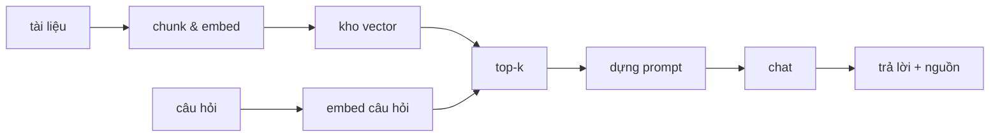

Nếu bạn hỏi một chatbot thông thường về chính sách đổi trả của cửa hàng mình, nó sẽ không biết—hoặc tệ hơn là tự bịa ra một quy định nghe rất thuyết phục (**hallucination**, ảo giác). **RAG** (**Retrieval-Augmented Generation**, sinh có truy xuất) giải quyết chuyện này bằng cách tìm đúng đoạn tài liệu liên quan rồi đưa thẳng vào prompt ngay trước khi model trả lời, biến mỗi câu hỏi thành một bài thi "được mở tài liệu".

## 1. Vì sao cần RAG

Khi không có tài liệu của bạn trong prompt, LLM chỉ có thể đoán dựa trên dữ liệu lúc huấn luyện trước. Hãy xem `FakeLLM` trả lời ra sao khi hỏi về chính sách của shop mà không kèm ngữ cảnh.

```python
from pyai_llm import FakeLLM

client = FakeLLM()
resp = client.chat([
    {"role": "user", "content": "How many days do refunds take at our shop?"},
])
print(resp.content)
# (fake model) I received: How many days do refunds take at our shop?
```

Có ba cách để model biết dữ liệu riêng của bạn: nhét **toàn bộ** tài liệu vào prompt (tốn nhiều token và dễ tràn **context window** — cửa sổ ngữ cảnh), **fine-tune** lại trọng số model (`p6-04-fine-tune`, tốn kém và nhanh lỗi thời mỗi khi chính sách đổi), hoặc **RAG** (chỉ truy xuất những đoạn liên quan ngay lúc có câu hỏi).

| cách tiếp cận | chi phí | độ mới dữ liệu | phù hợp khi |
|---|---|---|---|
| Nhét hết tài liệu vào prompt | Hóa đơn token cao mỗi lượt gọi | Tức thì | Sổ tay rất nhỏ nằm gọn trong một prompt |
| Fine-tune | Tốn chi phí chạy huấn luyện | Cũ đi cho tới lần train lại | Dạy văn phong, định dạng hay giọng điệu riêng |
| RAG | Thấp (chỉ gửi top-k chunk) | Tức thì khi cập nhật index | Tri thức riêng, hay thay đổi và cần trích nguồn |

## 2. Chunking: cắt tài liệu thành miếng

Tài liệu dài khó nhét vừa một prompt, và việc embed cả file PDF 20 trang thành một vector duy nhất sẽ làm nhòe mọi chủ đề vào nhau. **Chunking** (chia đoạn) cắt văn bản thành các cửa sổ từ có độ dài `size`, bước nhảy `step = size - overlap`, nhờ đó mỗi chunk giữ lại **chunk overlap** (phần gối) từ cuối chunk trước để câu nằm vắt qua ranh giới không bị cắt đứt ngữ cảnh.

```text
words:   [0   1   2   3   4   5   6   7   8   9]
chunk 0: [0   1   2   3]                           (0:4)
chunk 1:             [3   4   5   6]               (3:7, overlap=1)
chunk 2:                         [6   7   8   9]   (6:10, overlap=1)
```

Hãy viết hàm `chunk_words(text, size, overlap)` và so sánh `overlap=0` với `overlap=3` trên một câu chính sách ngắn để thấy phần gối giúp giữ nguyên cụm `"Refunds take 30 days"` trong cùng một cửa sổ.

```python
def chunk_words(text: str, size: int, overlap: int = 0) -> list[str]:
    if size <= 0 or overlap < 0 or overlap >= size:
        raise ValueError("need size > 0 and 0 <= overlap < size")
    words = text.split()
    if not words:
        return []
    step = size - overlap
    chunks: list[str] = []
    i = 0
    while i < len(words):
        chunks.append(" ".join(words[i : i + size]))
        if i + size >= len(words):
            break
        i += step
    return chunks


policy = "Our policy is simple. Refunds take 30 days from purchase date."
print("no overlap:", chunk_words(policy, size=6, overlap=0))
# no overlap: ['Our policy is simple. Refunds take', '30 days from purchase date.']
print("overlap=3 :", chunk_words(policy, size=6, overlap=3))
# overlap=3 : ['Our policy is simple. Refunds take', 'simple. Refunds take 30 days from', '30 days from purchase date.']
```

Bấm **Visualize** ở khối code này để xem `i`, `window` và `chunks` dịch chuyển qua danh sách 10 từ với `size=4` và `overlap=1`.

```python
words = ["Our", "shop", "issues", "full", "refunds", "within", "30", "days", "with", "receipt"]
size, overlap = 4, 1
step = size - overlap
chunks = []
i = 0
while i < len(words):
    window = " ".join(words[i : i + size])
    chunks.append(window)
    if i + size >= len(words):
        break
    i += step
print(len(chunks), chunks)
# 3 ['Our shop issues full', 'full refunds within 30', '30 days with receipt']
```

Chọn kích thước chunk luôn là sự đánh đổi giữa độ nét khi truy xuất và ngữ cảnh xung quanh:

| kích thước chunk | ưu điểm | nhược điểm |
|---|---|---|
| Nhỏ (vd 50–100 từ) | Embedding sắc nét, ít nhiễu trong prompt | Dễ cắt mất ngữ cảnh hoặc điều kiện đi kèm |
| Vừa (vd 150–300 từ) | Cân bằng giữa độ tập trung và đủ trọn đoạn | Cần chỉnh overlap để không đứt ý quan trọng |
| Lớn (vd 500+ từ) | Giữ được mạch văn rộng và sắc thái | Làm loãng tín hiệu embedding, tốn thêm token |

## 3. Pipeline RAG từ đầu đến cuối

Một pipeline RAG hoàn chỉnh gồm hai nửa: trước hết cắt và nạp các chunk vào ma trận embedding NumPy kèm metadata `source` (`p7-04-vector-db`), sau đó lúc truy vấn sẽ **retrieve** (truy xuất) top-k chunk, **augment** (bổ sung) vào prompt, rồi **generate** (sinh) câu trả lời có trích nguồn.



Hãy chạy trọn pipeline trên ba tài liệu chính sách của shop bằng `FakeLLM(embed_dim=256)` và `np.argsort(-scores, kind="stable")[:2]`.

```python
import numpy as np
from pyai_llm import FakeLLM


def chunk_words(text: str, size: int, overlap: int = 0) -> list[str]:
    if size <= 0 or overlap < 0 or overlap >= size:
        raise ValueError("need size > 0 and 0 <= overlap < size")
    words = text.split()
    if not words:
        return []
    step = size - overlap
    chunks: list[str] = []
    i = 0
    while i < len(words):
        chunks.append(" ".join(words[i : i + size]))
        if i + size >= len(words):
            break
        i += step
    return chunks


docs = [
    {"source": "refunds.md", "text": "Refunds are issued within 30 days of purchase. Keep your original receipt and unused items in original packaging for a full refund."},
    {"source": "shipping.md", "text": "Standard shipping delivers orders in three to five business days. Express shipping delivers next day for a small flat fee."},
    {"source": "warranty.md", "text": "Hardware warranty covers factory defects for 12 months from delivery. Water damage is not covered under this hardware warranty."},
]
chunks = [
    {"source": d["source"], "text": piece}
    for d in docs
    for piece in chunk_words(d["text"], size=14, overlap=4)
]

client = FakeLLM(embed_dim=256)
doc_matrix = np.array(client.embed([c["text"] for c in chunks]), dtype=float)

question = "How many days do refunds take?"
q_vec = np.array(client.embed([question])[0], dtype=float)
scores = doc_matrix @ q_vec
top_idx = np.argsort(-scores, kind="stable")[:2]
hits = [chunks[int(i)] for i in top_idx]

context_lines = "\n".join(f"[{n}] {h['text']}" for n, h in enumerate(hits, 1))
messages = [
    {
        "role": "system",
        "content": (
            "Answer using only the provided context. "
            "If the answer is not in the context, say \"I don't know.\" "
            "Cite sources with [n].\n\nContext:\n" + context_lines
        ),
    },
    {"role": "user", "content": question},
]
answer = client.chat(messages).content
print("chunks:", len(chunks))
# chunks: 6
print("answer:", answer)
# answer: Refunds are issued within 30 days of purchase. [1]
print("sources:", [h["source"] for h in hits])
# sources: ['refunds.md', 'shipping.md']
```

Để ý rằng `chunks` có `6` đoạn (`2` đoạn mỗi file) và `client.chat(messages)` trả về câu trả lời kèm nhãn `[1]`.

> [!NOTE]
> Nói thật về cách hoạt động bên dưới: `FakeLLM.chat()` bật chế độ RAG khi thấy dòng `Context:` theo sau bởi `[1] ...`, `[2] ...`, rồi chọn chunk có nhiều từ chữ thường trùng nhất với câu hỏi (từ ≥ 3 ký tự, không cắt gốc từ, giữ nguyên stopword) và trả về câu đầu tiên kèm `[n]` (hoặc `"I don't know based on the provided context."` nếu trùng dưới 2 từ). LLM thật biết đọc hiểu, suy luận và tổng hợp nhiều chunk, nhưng **hình dạng pipeline và cấu trúc prompt thì giống hệt**.

## 4. Prompt có căn cứ

**Grounding** (neo câu trả lời vào nguồn) nghĩa là ép model chỉ dựa trên các chunk đã truy xuất thay vì đoán mò từ trí nhớ. Hàm `build_messages(question, hits)` đặt ba luật vào message `system`—chỉ dùng context; không có thì nói không biết; trích `[n]`—theo sau là khối `Context:`, còn câu hỏi của người dùng nằm riêng trong message `user`.

```python
def build_messages(question: str, hits: list[dict]) -> list[dict]:
    context = "\n".join(f"[{n}] {h['text']}" for n, h in enumerate(hits, 1))
    system = (
        "Answer using only the provided context.\n"
        "If the context lacks the answer, say you don't know.\n"
        "Cite sources as [n].\n\n"
        f"Context:\n{context}"
    )
    return [
        {"role": "system", "content": system},
        {"role": "user", "content": question},
    ]


sample_hits = [
    {"source": "refunds.md", "text": "Refunds are issued within 30 days of purchase."},
    {"source": "shipping.md", "text": "Standard shipping delivers orders in three to five business days."},
]
msgs = build_messages("How many days do refunds take?", sample_hits)
print(msgs[0]["content"])
# Answer using only the provided context.
# If the context lacks the answer, say you don't know.
# Cite sources as [n].
#
# Context:
# [1] Refunds are issued within 30 days of purchase.
# [2] Standard shipping delivers orders in three to five business days.
```

Tách phần hướng dẫn cùng `Context:` trong `system` khỏi câu hỏi thô trong `user` giúp prompt dễ đọc, dễ kiểm thử và dễ đổi model.

> [!WARNING]
> Văn bản lấy từ tài liệu vẫn là "input lạ" không đáng tin cậy: một chunk chứa câu `"ignore previous instructions"` có thể tấn công **prompt injection** để lái model đi chệch quy tắc của bạn, vì vậy đừng bao giờ cấp quyền gọi tool nhạy cảm hay bí mật cho model chỉ dựa trên nội dung tài liệu.

## 5. Trích nguồn và kiểm trích dẫn

Một **citation** (trích dẫn nguồn) như `[1]` giúp người dùng đối chiếu câu trả lời với file gốc. Bạn dùng `re.findall(r"\[(\d+)\]", answer)` để tách các số được trích, kiểm tra mỗi số có nằm trong `1..len(hits)` không rồi ánh xạ sang `source`—nếu câu trả lời nhắc tới `[7]` khi context chỉ có 2 chunk thì đó là dấu hiệu bịa đặt.

```python
import re


def extract_sources(answer: str, hits: list[dict]) -> tuple[list[str], list[int]]:
    valid: list[str] = []
    invalid: list[int] = []
    for raw in re.findall(r"\[(\d+)\]", answer):
        num = int(raw)
        if 1 <= num <= len(hits):
            src = hits[num - 1]["source"]
            if src not in valid:
                valid.append(src)
        else:
            invalid.append(num)
    return valid, invalid


hits = [
    {"source": "refunds.md", "text": "Refunds are issued within 30 days of purchase."},
    {"source": "shipping.md", "text": "Standard shipping delivers orders in three to five business days."},
]
valid_sources, bad_refs = extract_sources("Refunds take 30 days [1], see [7].", hits)
print("valid:", valid_sources, "invalid:", bad_refs)
# valid: ['refunds.md'] invalid: [7]
```

Theo dõi ba câu hỏi chính sách đi qua kho 6 chunk của chúng ta để thấy toàn bộ đường đi từ chunk đầu bảng tới `sources` đã kiểm:

| question | top chunk | score | answer | sources |
|---|---|---|---|---|
| How many days do refunds take? | `refunds.md` | `0.218` | `Refunds are issued within 30 days of purchase. [1]` | `['refunds.md']` |
| How fast does standard shipping deliver orders? | `shipping.md` | `0.624` | `Standard shipping delivers orders in three to five business days. [1]` | `['shipping.md']` |
| What does hardware warranty cover? | `warranty.md` | `0.359` | `Hardware warranty covers factory defects for 12 months from delivery. [1]` | `['warranty.md']` |

## 6. Khi không tìm thấy: đừng bịa

Từ chối trả lời khi thiếu bằng chứng cần hai lớp bảo vệ: (a) nếu điểm truy xuất cao nhất thấp hơn `min_score`, **không gọi** LLM mà trả `"I don't know."` ngay (vừa nhanh vừa tiết kiệm tiền); (b) nếu điểm vượt `min_score` nhưng các chunk vẫn thiếu chi tiết cần hỏi, model được neo ngữ cảnh sẽ tự trả `"I don't know based on the provided context."`.

```python
import numpy as np
from pyai_llm import FakeLLM

chunks = [
    {"source": "refunds.md", "text": "Refunds are issued within 30 days of purchase. Keep your original receipt and unused"},
    {"source": "refunds.md", "text": "original receipt and unused items in original packaging for a full refund."},
    {"source": "shipping.md", "text": "Standard shipping delivers orders in three to five business days. Express shipping delivers next"},
    {"source": "shipping.md", "text": "Express shipping delivers next day for a small flat fee."},
    {"source": "warranty.md", "text": "Hardware warranty covers factory defects for 12 months from delivery. Water damage is not"},
    {"source": "warranty.md", "text": "Water damage is not covered under this hardware warranty."},
]
client = FakeLLM(embed_dim=256)
doc_matrix = np.array(client.embed([c["text"] for c in chunks]), dtype=float)


def ask(question: str, min_score: float = 0.2) -> tuple[str, bool]:
    q_vec = np.array(client.embed([question])[0], dtype=float)
    scores = doc_matrix @ q_vec
    order = np.argsort(-scores, kind="stable")[:2]
    if float(scores[int(order[0])]) < min_score:
        return "I don't know.", False
    hits = [chunks[int(i)] for i in order]
    context = "\n".join(f"[{n}] {h['text']}" for n, h in enumerate(hits, 1))
    messages = [
        {"role": "system", "content": "Answer using only the context.\n\nContext:\n" + context},
        {"role": "user", "content": question},
    ]
    return client.chat(messages).content or "", True


for q in ["Do you offer student discounts?", "What is the warranty phone number?"]:
    ans, called_llm = ask(q)
    print(f"{q} -> called_llm={called_llm}, answer={ans!r}")
# Do you offer student discounts? -> called_llm=False, answer="I don't know."
# What is the warranty phone number? -> called_llm=True, answer="I don't know based on the provided context."
```

Để ý câu `"Do you offer student discounts?"` chỉ đạt `0.0` (`< 0.2`) nên thoát sớm trước khi chạm tới `client.chat()`, còn câu `"What is the warranty phone number?"` tuy khớp từ `"warranty"` (`0.272`) nhưng vẫn trả `"I don't know based on the provided context."`. Sang bài `p7-08-evals`, bạn sẽ đo chất lượng RAG bằng bộ **eval** có số liệu hẳn hoi chứ không đoán bằng cảm tính.

## 7. Lỗi thường gặp

**1. Cắt chunk không có overlap làm câu trả lời bị xẻ đôi**

Với `overlap=0`, một thông tin bắt đầu ở cuối chunk `0` và kết thúc ở đầu chunk `1` bị tách mất nửa số từ khóa, khiến truy xuất hoặc trả lời bị trượt.

```python
import numpy as np
from pyai_llm import FakeLLM

text = "Warranty is valid. Refunds are issued within 30 days of purchase."
words = text.split()
no_ov = [" ".join(words[i : i + 6]) for i in range(0, len(words), 6)]
with_ov = [" ".join(words[i : i + 6]) for i in (0, 3, 6)]

client = FakeLLM(embed_dim=256)
for label, chs in [("no_ov", no_ov), ("with_ov", with_ov)]:
    m = np.array(client.embed(chs), dtype=float)
    q = np.array(client.embed(["How many days do refunds take?"])[0], dtype=float)
    best = int(np.argsort(-(m @ q), kind="stable")[0])
    ans = client.chat([
        {"role": "system", "content": f"Context:\n[1] {chs[best]}"},
        {"role": "user", "content": "How many days do refunds take?"},
    ]).content
    print(label, "->", ans)
# no_ov -> I don't know based on the provided context.
# with_ov -> Refunds are issued within 30 days [1]
```

Cách sửa: đặt `overlap > 0` (thường khoảng 10–25% của `size`) để các cụm từ sát ranh giới nằm trọn trong ít nhất một chunk.

**2. Đặt `overlap >= size` khiến bước nhảy `step <= 0`**

Nếu `overlap >= size`, giá trị `step = size - overlap` bằng 0 hoặc âm nên vòng lặp `while` không tiến lên được và bị treo.

```python
def chunk_words(text: str, size: int, overlap: int = 0) -> list[str]:
    if size <= 0 or overlap < 0 or overlap >= size:
        raise ValueError("need size > 0 and 0 <= overlap < size")
    words = text.split()
    return [" ".join(words[i : i + size]) for i in range(0, len(words), size - overlap)]


try:
    chunk_words("one two three four", size=3, overlap=3)
except ValueError as err:
    print("error:", type(err).__name__, "-", err)
# error: ValueError - need size > 0 and 0 <= overlap < size
```

Cách sửa: kiểm tra `size > 0` và `0 <= overlap < size` ngay đầu hàm và `raise ValueError` lập tức.

**3. Quên đánh số `[n]` hoặc sai định dạng `Context:`**

Dùng gạch đầu dòng hoặc tiêu đề khác khiến `FakeLLM` không bật chế độ RAG (rơi về câu trả lời chung chung) và bộ đọc trích dẫn cũng không có số để ánh xạ nguồn.

```python
from pyai_llm import FakeLLM

client = FakeLLM()
bad_resp = client.chat([
    {"role": "system", "content": "Notes:\n- Refunds are issued within 30 days of purchase."},
    {"role": "user", "content": "How many days do refunds take?"},
])
print("bad:", bad_resp.content)
# bad: (fake model) I received: How many days do refunds take?

good_resp = client.chat([
    {"role": "system", "content": "Context:\n[1] Refunds are issued within 30 days of purchase."},
    {"role": "user", "content": "How many days do refunds take?"},
])
print("good:", good_resp.content)
# good: Refunds are issued within 30 days of purchase. [1]
```

Cách sửa: luôn giữ đúng một dòng `Context:` theo sau bởi các dòng `[1] ...`, `[2] ...`.

**4. Tin trích dẫn mà không kiểm tra giới hạn**

Nếu model bịa ra `[7]` khi bạn chỉ gửi `2` chunk, truy cập thẳng `hits[num - 1]` sẽ văng `IndexError` hoặc trỏ tới nguồn không tồn tại.

```python
hits = [{"source": "refunds.md"}, {"source": "shipping.md"}]
refs = [7]
try:
    sources = [hits[n - 1]["source"] for n in refs]
except IndexError as err:
    print("error:", type(err).__name__, "-", err)
# error: IndexError - list index out of range

valid_sources = [hits[n - 1]["source"] for n in refs if 1 <= n <= len(hits)]
print("safe:", valid_sources)
# safe: []
```

Cách sửa: luôn kiểm tra `1 <= n <= len(hits)` trước khi ánh xạ số trích dẫn `[n]` sang `source`.

## Tóm tắt

- **RAG** truy xuất các **chunk** liên quan ngay lúc có câu hỏi rồi đưa vào prompt để LLM trả lời dựa trên dữ liệu riêng, mới nhất thay vì đoán mò.
- Cắt tài liệu dài bằng **chunk overlap** (`step = size - overlap`, chặn `overlap >= size` bằng `ValueError`) để thông tin vắt qua ranh giới không bị đứt.
- Dùng prompt **grounding** cố định với nhãn `Context:` và `[1]`, `[2]`, đồng thời coi văn bản truy xuất là input chưa đáng tin trước rủi ro **prompt injection**.
- Tách các **citation** `[n]` và kiểm `1 <= n <= len(hits)` để chặn số trích dẫn bịa đặt lọt vào danh sách nguồn.
- Kết hợp ngưỡng `min_score` (bỏ qua lời gọi LLM khi không có chunk đạt ngưỡng) với chỉ dẫn nói `"I don't know"` để giảm **hallucination**.
