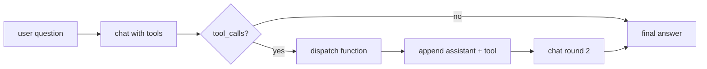

Ask a general-purpose chatbot "what is the weather in Hanoi right now?" or "where is order #1042?" and it cannot answer honestly, because live weather and your shop database live outside the model's training data. **Tool use** (also called **function calling**) lets the model **ask** to call one of your Python functions with structured arguments. Your code decides whether to run that function, executes it locally, and sends the result back so the model can write the final reply.

## 1. The model proposes, your code executes

An LLM only generates text—it never executes Python on its own. When you pass `tools=[weather_tool]` to `client.chat()`, `FakeLLM` can pause with `finish_reason="tool_calls"`, leaving `content=None` and placing its request inside `resp.tool_calls`.

```python
from pyai_llm import FakeLLM

weather_tool = {
    "name": "get_weather",
    "description": "weather city temperature",
    "parameters": {
        "type": "object",
        "properties": {
            "city": {"type": "string"},
            "unit": {"type": "string"},
        },
        "required": ["city"],
    },
}

client = FakeLLM()
resp = client.chat(
    [{"role": "user", "content": "What is the weather in Hanoi?"}],
    tools=[weather_tool],
)
print("finish_reason:", resp.finish_reason)
# finish_reason: tool_calls
print("content:", resp.content)
# content: None
print("tool:", resp.tool_calls[0].name, resp.tool_calls[0].arguments)
# tool: get_weather {'city': 'Hanoi', 'unit': ''}
```

Notice that `content` is `None`: the model has not answered the user yet—it is asking your code to run `get_weather` first. Notice also that `unit` came back as `''` because `FakeLLM` fills missing optional string fields with a blank placeholder, which our dispatch code will clean up shortly.

```text
you                         model                        your code
---                         -----                        ---------
"Weather in Hanoi?" ------> reads prompt + tools
                            picks get_weather("Hanoi")
                            content=None, tool_calls --> checks allowlist & args
                                                         runs get_weather("Hanoi")
                            receives tool message   <--- returns "31C and sunny"
"31C and sunny"     <------ writes final answer
```

## 2. Describing tools with a schema

Just like structured outputs (`p7-02-structured-output`), a **tool schema** is a plain Python `dict` with `"name"`, `"description"`, and `"parameters"` (a JSON Schema object describing each argument). Writing a tiny helper `tool_schema()` keeps tool definitions consistent and avoids repeating boilerplate.

| field | purpose | tip |
|---|---|---|
| `name` | Function identifier the model returns in `tool_calls` | Use clear `snake_case` verbs like `get_weather` or `lookup_order` |
| `description` | Plain-text guide telling the model when to pick this tool | One clear sentence: what it does and when to use it; make tools easy to tell apart |
| `parameters` | JSON Schema `object` with `properties` and `required` | List every argument type (`string`, `number`, `integer`, `boolean`) |

Both real LLMs and `FakeLLM` choose tools based on the `description` field. Because `FakeLLM` picks the tool with the most overlapping words (length ≥ 3, including common words like `"the"` or `"for"`), packing a vague description with filler words steals matches away from the right tool—and in real systems, vague descriptions confuse real models the same way.

```python
from pyai_llm import FakeLLM


def tool_schema(func_name: str, description: str, params: dict[str, str], required: list[str]) -> dict:
    return {
        "name": func_name,
        "description": description,
        "parameters": {
            "type": "object",
            "properties": {p: {"type": t} for p, t in params.items()},
            "required": list(required),
        },
    }


question = "What is the weather for the city of Hue?"

vague_tools = [
    tool_schema("get_weather", "Weather forecast", {"city": "string"}, ["city"]),
    tool_schema("search_logs", "Search the logs for what the user needs", {"query": "string"}, ["query"]),
]
clear_tools = [
    tool_schema("get_weather", "weather city temperature forecast", {"city": "string"}, ["city"]),
    tool_schema("search_logs", "server logs error traceback", {"query": "string"}, ["query"]),
]

print("vague picked:", FakeLLM().chat([{"role": "user", "content": question}], tools=vague_tools).tool_calls[0].name)
# vague picked: search_logs
print("clear picked:", FakeLLM().chat([{"role": "user", "content": question}], tools=clear_tools).tool_calls[0].name)
# clear picked: get_weather
```

With the vague description, `"what"`, `"the"`, and `"for"` gave `search_logs` three word overlaps versus one for `get_weather`, so the wrong tool was proposed. Removing filler words and focusing on each tool's distinct domain fixes the routing here.

> [!NOTE]
> The examples in this lesson use keyword-style descriptions (`"weather city temperature forecast"`) only because `FakeLLM` routes by counting overlapping words. For real LLMs, write **one clear sentence** stating what the tool does and when to use it—for example, `"Get the current weather for a city."` The underlying rule is the same: stay specific, distinguish each tool from the others, and avoid rambling filler.

## 3. The complete tool loop

A single round of tool use follows five steps: (1) call `client.chat(messages, tools=tools)`; (2) if `finish_reason == "tool_calls"`, dispatch the requested function; (3) append the `assistant` message (including `tool_calls`) **and** the `tool` result message; (4) call `client.chat(messages, tools=tools)` a second time; (5) return the final answer. If the model does not need any tool (`finish_reason == "stop"`), return `resp.content` right away.



Here is the complete one-round loop running both a weather question (triggers the tool) and a joke request (skips the tool and answers directly):

```python
from pyai_llm import FakeLLM

WEATHER = {"Hanoi": "31C and sunny", "Hue": "28C and cloudy"}


def get_weather(city: str, unit: str = "C") -> str:
    if city not in WEATHER:
        return f"unknown city: {city}"
    return f"{WEATHER[city]} ({unit})"


weather_tool = {
    "name": "get_weather",
    "description": "weather city temperature",
    "parameters": {
        "type": "object",
        "properties": {"city": {"type": "string"}, "unit": {"type": "string"}},
        "required": ["city"],
    },
}


def ask(question: str) -> str:
    client = FakeLLM()
    messages = [{"role": "user", "content": question}]
    resp = client.chat(messages, tools=[weather_tool])
    if resp.finish_reason != "tool_calls":
        return resp.content or ""
    tc = resp.tool_calls[0]
    args = {k: v for k, v in tc.arguments.items() if v != ""}
    result = get_weather(**args)
    messages.append({
        "role": "assistant",
        "content": None,
        "tool_calls": [{"id": tc.id, "name": tc.name, "arguments": tc.arguments}],
    })
    messages.append({"role": "tool", "tool_call_id": tc.id, "content": result})
    final = client.chat(messages, tools=[weather_tool])
    return final.content or ""


print("with tool:", ask("What is the weather in Hanoi?"))
# with tool: Based on the tool result: 31C and sunny (C)
print("no tool  :", ask("Tell me a joke"))
# no tool  : (fake model) I received: Tell me a joke
```

Watch how `messages` grows step by step during the weather question, with `tool_call_id` linking the `tool` reply back to `call_1`:

| step | role | content / tool call |
|---|---|---|
| 1 | `user` | `"What is the weather in Hanoi?"` |
| 2 | `assistant` | `content=None`, `tool_calls=[{"id": "call_1", "name": "get_weather", "arguments": {"city": "Hanoi", "unit": ""}}]` |
| 3 | `tool` | `tool_call_id="call_1"`, `content="31C and sunny (C)"` |
| 4 | `assistant` | `"Based on the tool result: 31C and sunny (C)"` |

## 4. Registry and safe dispatch

Never map tool names with a messy chain of `if/elif` branches, and never execute arbitrary names from the model. Instead, store allowed functions in a `REGISTRY` dictionary and route calls through a `dispatch()` helper that checks the tool name, validates required arguments, drops fake empty optional values (`""` or `None`), catches exceptions, and converts any `dict` return value into a JSON string with `json.dumps()`.

Press **Visualize** on this block and watch `dispatch()` inspect a valid call and an unknown tool call without crashing.

```python
import json

WEATHER = {"Hanoi": "31C and sunny"}


def get_weather(city: str, unit: str = "C") -> dict:
    return {"city": city, "unit": unit, "forecast": WEATHER.get(city, "unknown")}


REGISTRY = {"get_weather": get_weather}
REQUIRED = {"get_weather": ["city"]}


def dispatch(call: dict, registry: dict, required_map: dict) -> str:
    name = call["name"]
    if name not in registry:
        return f"error: unknown tool {name}"
    req = required_map.get(name, [])
    args = dict(call.get("arguments", {}))
    for key in req:
        if key not in args or args[key] in ("", None):
            return f"error: missing required argument {key}"
    clean = {k: v for k, v in args.items() if k in req or v not in ("", None)}
    try:
        out = registry[name](**clean)
    except Exception as err:
        return f"error: {err}"
    return json.dumps(out) if isinstance(out, dict) else str(out)


calls = [
    {"id": "call_1", "name": "get_weather", "arguments": {"city": "Hanoi", "unit": ""}},
    {"id": "call_2", "name": "delete_db", "arguments": {}},
]
tool_messages = []
for call in calls:
    result = dispatch(call, REGISTRY, REQUIRED)
    tool_messages.append({"role": "tool", "tool_call_id": call["id"], "content": result})
print(tool_messages)
# [{'role': 'tool', 'tool_call_id': 'call_1', 'content': '{"city": "Hanoi", "unit": "C", "forecast": "31C and sunny"}'}, {'role': 'tool', 'tool_call_id': 'call_2', 'content': 'error: unknown tool delete_db'}]
```

Notice that `dispatch()` returns `"error: unknown tool delete_db"` as a **tool result string** rather than raising an unhandled exception. Sending errors back inside the `tool` message lets the model explain the problem politely or try a valid tool instead of crashing your entire application.

## 5. Multiple tools and a round limit

Real assistants expose several tools at once—here weather, currency conversion, and order lookup—and wrap the `chat()` call in a bounded `for _ in range(max_rounds)` loop. Even when we only intend one tool round, a `max_rounds` cap protects your budget and prevents infinite loops if a misbehaving model keeps requesting tools forever (as simulated below with `FakeLLM(script=...)`).

```python
import json
from pyai_llm import FakeLLM

WEATHER = {"Hanoi": "31C and sunny"}
RATES = {"USD": 1.0, "EUR": 0.92, "VND": 25000.0}
ORDERS = {"1042": {"status": "shipped", "eta_days": 2}}


def get_weather(city: str) -> str:
    return WEATHER.get(city, f"unknown city: {city}")


def convert_currency(amount: float, to: str) -> str:
    rate = RATES.get(to.upper())
    if rate is None:
        return f"error: unsupported currency {to}"
    return f"{round(amount * rate, 2)} {to.upper()}"


def lookup_order(order_id: str) -> dict:
    return ORDERS.get(order_id, {"error": f"order {order_id} not found"})


TOOLS = [
    {
        "name": "get_weather",
        "description": "weather city temperature",
        "parameters": {"type": "object", "properties": {"city": {"type": "string"}}, "required": ["city"]},
    },
    {
        "name": "convert_currency",
        "description": "convert currency dollars amount",
        "parameters": {"type": "object", "properties": {"amount": {"type": "number"}, "to": {"type": "string"}}, "required": ["amount", "to"]},
    },
    {
        "name": "lookup_order",
        "description": "order status delivery tracking",
        "parameters": {"type": "object", "properties": {"order_id": {"type": "string"}}, "required": ["order_id"]},
    },
]
REGISTRY = {
    "get_weather": get_weather,
    "convert_currency": convert_currency,
    "lookup_order": lookup_order,
}


def run_bounded(client, question: str, max_rounds: int = 2) -> str:
    messages = [{"role": "user", "content": question}]
    for _ in range(max_rounds):
        resp = client.chat(messages, tools=TOOLS)
        if not resp.tool_calls:
            return resp.content or ""
        tc = resp.tool_calls[0]
        fn = REGISTRY.get(tc.name)
        out = fn(**tc.arguments) if fn else f"error: unknown tool {tc.name}"
        text = json.dumps(out) if isinstance(out, dict) else str(out)
        messages.append({"role": "assistant", "content": None, "tool_calls": [{"id": tc.id, "name": tc.name, "arguments": tc.arguments}]})
        messages.append({"role": "tool", "tool_call_id": tc.id, "content": text})
    return "stopped: too many tool calls"


for q in [
    "What is the weather in Hanoi?",
    "Convert 100 dollars to currency EUR",
    'Check order status for "1042"',
]:
    print(q, "->", run_bounded(FakeLLM(), q))
# What is the weather in Hanoi? -> Based on the tool result: 31C and sunny
# Convert 100 dollars to currency EUR -> Based on the tool result: 92.0 EUR
# Check order status for "1042" -> Based on the tool result: {"status": "shipped", "eta_days": 2}

loopy = FakeLLM(script=[{"tool_calls": [{"name": "get_weather", "arguments": {"city": "Hanoi"}}]}] * 4)
print("loop guard ->", run_bounded(loopy, "Weather?", max_rounds=2))
# loop guard -> stopped: too many tool calls
```

In `p7-07-agents`, you will extend this exact bounded loop so a model can chain multiple tools across several reasoning steps.

## 6. Safety: tools with side effects

Read-only tools like `get_weather` or `lookup_order` only inspect data, so running them automatically is low risk. Tools with a **side effect**—sending an email, issuing a refund, or deleting a record—change real state and need three guards in your Python code: an **allowlist** of permitted tools, explicit human confirmation (`confirmed=True`), and hard numeric caps (`max_amount`).

```python
import json

ORDERS = {"1042": {"total": 45.0, "status": "delivered"}, "1043": {"total": 250.0, "status": "delivered"}}
ALLOWED_TOOLS = {"lookup_order", "issue_refund"}


def issue_refund(order_id: str, amount: float, confirmed: bool = False, max_amount: float = 100.0) -> str:
    if order_id not in ORDERS:
        return f"blocked: unknown order {order_id}"
    if amount <= 0 or amount > max_amount:
        return f"blocked: amount {amount} exceeds limit {max_amount}"
    if not confirmed:
        return f"blocked: confirmation required for {order_id}"
    return json.dumps({"refunded": order_id, "amount": amount})


def run_guarded(tool_name: str, args: dict) -> str:
    if tool_name not in ALLOWED_TOOLS:
        return f"blocked: {tool_name} is not in allowlist"
    if tool_name == "issue_refund":
        return issue_refund(**args)
    return "ok"


print("not allowed:", run_guarded("delete_order", {"order_id": "1042"}))
# not allowed: blocked: delete_order is not in allowlist
print("too high   :", run_guarded("issue_refund", {"order_id": "1043", "amount": 250.0, "confirmed": True}))
# too high   : blocked: amount 250.0 exceeds limit 100.0
print("unconfirmed:", run_guarded("issue_refund", {"order_id": "1042", "amount": 45.0, "confirmed": False}))
# unconfirmed: blocked: confirmation required for 1042
print("approved   :", run_guarded("issue_refund", {"order_id": "1042", "amount": 45.0, "confirmed": True}))
# approved   : {"refunded": "1042", "amount": 45.0}
```

Notice that `confirmed=True` must come from your own application state after a real user clicks "Confirm"—never let the model set `confirmed=True` inside its own prompt arguments!

> [!WARNING]
> Treat every tool name and argument dictionary from the model as **untrusted input**. Just as prompt injection (`p7-05-rag`) can hijack text inside retrieved documents, a malicious email or web page can trick an LLM into proposing dangerous arguments. Never pass model arguments straight into shell commands, string-concatenated SQL queries, or `eval`.

## 7. Common mistakes

**1. Forgetting the assistant `tool_calls` message before the `tool` message**

`FakeLLM` only checks that the last message has `role == "tool"`, so it quietly accepts an orphan `tool` message—but real LLM APIs reject the request with an invalid-history error unless the matching `assistant` message (`content=None`, `tool_calls=[...]`) appears right before it.

```python
from pyai_llm import FakeLLM

client = FakeLLM()
resp = client.chat([
    {"role": "user", "content": "What is the weather in Hanoi?"},
    # Missing: {"role": "assistant", "content": None, "tool_calls": [...]}
    {"role": "tool", "tool_call_id": "call_1", "content": "31C and sunny"},
])
print("fake client replied:", resp.content)
# fake client replied: Based on the tool result: 31C and sunny
```

Fix: always append the `assistant` message with `tool_calls` first, then append each `tool` message referencing its `tool_call_id`.

**2. Calling `func(args)` instead of unpacking `func(**args)`**

Passing the `arguments` dictionary as a single positional argument sends the whole dict into the first parameter and raises `TypeError` for the remaining parameters.

```python
def convert_currency(amount: float, to: str) -> str:
    return f"{amount} {to}"


args = {"amount": 100.0, "to": "EUR"}
try:
    convert_currency(args)
except TypeError as err:
    print("error:", type(err).__name__, "-", err)
# error: TypeError - convert_currency() missing 1 required positional argument: 'to'

print("fixed:", convert_currency(**args))
# fixed: 100.0 EUR
```

Fix: unpack keyword arguments with `**args` inside `dispatch()`.

**3. Sending a `dict` as the `tool` message `content`**

Message `content` in `tool` messages must be a `str`; returning a raw Python `dict` fails validation with `ValueError`.

```python
import json
from pyai_llm import FakeLLM

client = FakeLLM()
history = [
    {"role": "user", "content": 'Check order status for "1042"'},
    {"role": "assistant", "content": None, "tool_calls": [{"id": "call_1", "name": "lookup_order", "arguments": {"order_id": "1042"}}]},
]
raw_result = {"status": "shipped", "eta_days": 2}

try:
    client.chat(history + [{"role": "tool", "tool_call_id": "call_1", "content": raw_result}])
except ValueError as err:
    print("error:", type(err).__name__, "-", err)
# error: ValueError - message at index 2 must have string 'content'

fixed = client.chat(history + [{"role": "tool", "tool_call_id": "call_1", "content": json.dumps(raw_result)}])
print("fixed:", fixed.content)
# fixed: Based on the tool result: {"status": "shipped", "eta_days": 2}
```

Fix: serialize dictionaries with `json.dumps(result)` inside `dispatch()`.

**4. Trusting placeholder `''` values on optional parameters**

When an optional string parameter is not present in the user's sentence, `FakeLLM` fills it with `''`, which overrides your Python function's default value (`unit="C"`).

```python
def get_weather(city: str, unit: str = "C") -> str:
    return f"31{unit} in {city}"


fake_args = {"city": "Hanoi", "unit": ""}
print("buggy:", get_weather(**fake_args))
# buggy: 31 in Hanoi

clean_args = {k: v for k, v in fake_args.items() if v != ""}
print("fixed:", get_weather(**clean_args))
# fixed: 31C in Hanoi
```

Fix: strip empty placeholders (`""` or `None`) from optional arguments before calling `func(**clean_args)`.

## Recap

- **Tool use** lets an LLM propose a function name and structured arguments (`content=None`, `finish_reason="tool_calls"`), while your Python code remains in full control of execution.
- Describe each function with a **tool schema** (`name`, `description`, `parameters`) and keep descriptions short and specific so both real models and `FakeLLM` pick the right tool.
- Complete the loop by appending the `assistant` message (`tool_calls`) followed by the `tool` message (`tool_call_id`, string `content`) before calling `chat()` again.
- Use a `REGISTRY` and `dispatch()` helper that validates required fields, strips empty optional placeholders, unpacks `**clean`, serializes dicts with `json.dumps()`, and returns errors as tool result strings.
- Guard tools with **side effects** using allowlists, amount caps, and human confirmation, and put a `max_rounds` limit on every tool loop.
