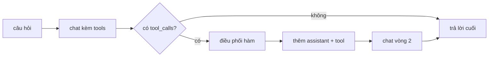

Nếu bạn hỏi một chatbot thông thường "thời tiết Hà Nội lúc này?" hay "đơn hàng #1042 đang ở đâu?", nó không thể trả lời trung thực, vì dữ liệu thời tiết hiện tại và cơ sở dữ liệu cửa hàng nằm hoàn toàn bên ngoài dữ liệu huấn luyện của model. **Tool use** (gọi công cụ, còn gọi là **function calling**) cho phép model **xin** gọi một hàm Python của bạn kèm tham số có cấu trúc. Code của bạn quyết định có chạy hàm đó hay không, thực thi cục bộ, rồi đưa kết quả lại để model viết câu trả lời cuối.

## 1. Model đề nghị, code của bạn thực thi

LLM chỉ sinh văn bản—nó không bao giờ tự chạy Python. Khi bạn truyền `tools=[weather_tool]` vào `client.chat()`, `FakeLLM` có thể dừng với `finish_reason="tool_calls"`, để `content=None` và đặt yêu cầu gọi hàm vào `resp.tool_calls`.

```python
from pyai_llm import FakeLLM

weather_tool = {
    "name": "get_weather",
    "description": "weather city temperature",
    "parameters": {
        "type": "object",
        "properties": {
            "city": {"type": "string"},
            "unit": {"type": "string"},
        },
        "required": ["city"],
    },
}

client = FakeLLM()
resp = client.chat(
    [{"role": "user", "content": "What is the weather in Hanoi?"}],
    tools=[weather_tool],
)
print("finish_reason:", resp.finish_reason)
# finish_reason: tool_calls
print("content:", resp.content)
# content: None
print("tool:", resp.tool_calls[0].name, resp.tool_calls[0].arguments)
# tool: get_weather {'city': 'Hanoi', 'unit': ''}
```

Hãy để ý `content` là `None`: model chưa trả lời người dùng mà đang **hỏi xin** chạy `get_weather` trước. Cũng để ý `unit` mang giá trị `''` vì `FakeLLM` điền vào mọi trường `string` (cả bắt buộc lẫn tùy chọn) bằng cụm từ trích từ prompt hoặc giá trị rỗng giả `''` khi không khớp, phần code điều phối ở mục sau sẽ xử lý điểm này.

```text
you                         model                        your code
---                         -----                        ---------
"Weather in Hanoi?" ------> reads prompt + tools
                            picks get_weather("Hanoi")
                            content=None, tool_calls --> checks allowlist & args
                                                         runs get_weather("Hanoi")
                            receives tool message   <--- returns "31C and sunny"
"31C and sunny"     <------ writes final answer
```

## 2. Mô tả tool bằng schema

Giống như structured output (`p7-02-structured-output`), một **tool schema** (lược đồ mô tả công cụ) là dictionary Python gồm `"name"`, `"description"` và `"parameters"` (đối tượng JSON Schema mô tả từng tham số). Viết một hàm nhỏ `tool_schema()` giúp tạo các tool nhất quán và tránh lặp lại cấu trúc.

| trường | mục đích | mẹo viết |
|---|---|---|
| `name` | Tên hàm mà model trả về trong `tool_calls` | Dùng động từ `snake_case` rõ ràng như `get_weather`, `lookup_order` |
| `description` | Mô tả ngắn cho model biết khi nào nên chọn tool | Một câu rõ ràng: tool làm gì và khi nào dùng; dễ phân biệt với tool khác |
| `parameters` | JSON Schema `object` gồm `properties` và `required` | Ghi rõ kiểu từng tham số (`string`, `number`, `integer`, `boolean`) |

Cả LLM thật lẫn `FakeLLM` đều dựa vào metadata của tool để chọn tool. Vì `FakeLLM` chấm điểm mỗi tool theo số từ trùng khớp (từ ≥ 3 ký tự, kể cả từ phổ biến như `"the"` hay `"for"`) trên cả `name` lẫn `description`, một `description` dài dòng chứa nhiều từ đệm có thể khiến tool bị gọi nhầm—và ngoài thực tế, mô tả mơ hồ cũng làm model thật chọn sai hệt như vậy.

```python
from pyai_llm import FakeLLM


def tool_schema(func_name: str, description: str, params: dict[str, str], required: list[str]) -> dict:
    return {
        "name": func_name,
        "description": description,
        "parameters": {
            "type": "object",
            "properties": {p: {"type": t} for p, t in params.items()},
            "required": list(required),
        },
    }


question = "What is the weather for the city of Hue?"

vague_tools = [
    tool_schema("get_weather", "Weather forecast", {"city": "string"}, ["city"]),
    tool_schema("search_logs", "Search the logs for what the user needs", {"query": "string"}, ["query"]),
]
clear_tools = [
    tool_schema("get_weather", "weather city temperature forecast", {"city": "string"}, ["city"]),
    tool_schema("search_logs", "server logs error traceback", {"query": "string"}, ["query"]),
]

print("vague picked:", FakeLLM().chat([{"role": "user", "content": question}], tools=vague_tools).tool_calls[0].name)
# vague picked: search_logs
print("clear picked:", FakeLLM().chat([{"role": "user", "content": question}], tools=clear_tools).tool_calls[0].name)
# clear picked: get_weather
```

Với mô tả mơ hồ, ba từ `"what"`, `"the"` và `"for"` giúp `search_logs` có 3 từ trùng so với chỉ 1 từ của `get_weather`, nên tool sai bị chọn. Bỏ đi các từ đệm chung chung và tập trung đúng phạm vi riêng của từng tool sẽ sửa được việc định tuyến sai ở đây.

> [!NOTE]
> Các ví dụ trong bài này viết `description` theo kiểu liệt kê từ khóa (`"weather city temperature forecast"`) chỉ vì `FakeLLM` chọn tool bằng cách đếm số từ chung. Với LLM thật, bạn hãy viết **một câu rõ ràng** nói tool làm gì và khi nào nên dùng—ví dụ `"Get the current weather for a city."` Nguyên tắc chung vẫn giống nhau: cụ thể, dễ phân biệt với các tool khác và không lan man.

## 3. Vòng tool hoàn chỉnh

Một vòng gọi tool gồm 5 bước: (1) gọi `client.chat(messages, tools=tools)`; (2) nếu `finish_reason == "tool_calls"`, điều phối chạy hàm tương ứng; (3) nối thêm message `assistant` (có `tool_calls`) **và** message `tool` chứa kết quả; (4) gọi `client.chat(messages, tools=tools)` lần thứ hai; (5) trả về câu trả lời cuối. Nếu model không cần tool (`finish_reason == "stop"`), bạn trả về `resp.content` ngay.



Dưới đây là vòng tool hoàn chỉnh chạy thử cả câu hỏi thời tiết (kích hoạt tool) lẫn yêu cầu kể chuyện cười (trả lời thẳng, không gọi tool):

```python
from pyai_llm import FakeLLM

WEATHER = {"Hanoi": "31C and sunny", "Hue": "28C and cloudy"}


def get_weather(city: str, unit: str = "C") -> str:
    if city not in WEATHER:
        return f"unknown city: {city}"
    return f"{WEATHER[city]} ({unit})"


weather_tool = {
    "name": "get_weather",
    "description": "weather city temperature",
    "parameters": {
        "type": "object",
        "properties": {"city": {"type": "string"}, "unit": {"type": "string"}},
        "required": ["city"],
    },
}


def ask(question: str) -> str:
    client = FakeLLM()
    messages = [{"role": "user", "content": question}]
    resp = client.chat(messages, tools=[weather_tool])
    if resp.finish_reason != "tool_calls":
        return resp.content or ""
    tc = resp.tool_calls[0]
    args = {k: v for k, v in tc.arguments.items() if v != ""}
    result = get_weather(**args)
    messages.append({
        "role": "assistant",
        "content": None,
        "tool_calls": [{"id": tc.id, "name": tc.name, "arguments": tc.arguments}],
    })
    messages.append({"role": "tool", "tool_call_id": tc.id, "content": result})
    final = client.chat(messages, tools=[weather_tool])
    return final.content or ""


print("with tool:", ask("What is the weather in Hanoi?"))
# with tool: Based on the tool result: 31C and sunny (C)
print("no tool  :", ask("Tell me a joke"))
# no tool  : (fake model) I received: Tell me a joke
```

Bảng theo dõi dưới đây cho thấy danh sách `messages` thay đổi qua từng bước với `tool_call_id` gắn kết quả `tool` vào đúng `call_1`:

| bước | role | content / tool call |
|---|---|---|
| 1 | `user` | `"What is the weather in Hanoi?"` |
| 2 | `assistant` | `content=None`, `tool_calls=[{"id": "call_1", "name": "get_weather", "arguments": {"city": "Hanoi", "unit": ""}}]` |
| 3 | `tool` | `tool_call_id="call_1"`, `content="31C and sunny (C)"` |
| 4 | `assistant` | `"Based on the tool result: 31C and sunny (C)"` |

## 4. Registry và dispatch an toàn

Đừng nối chuỗi `if/elif` dài dòng theo tên tool, và tuyệt đối không chạy tên hàm bất kỳ do model đưa ra. Thay vào đó, hãy gom các hàm hợp lệ vào dictionary `REGISTRY` và đi qua hàm **dispatch** (điều phối gọi hàm) để kiểm tra tên tool, kiểm tra tham số bắt buộc, bỏ giá trị rỗng giả của tham số tùy chọn (`""` hoặc `None`), bắt ngoại lệ và chuyển kết quả dạng `dict` thành chuỗi JSON bằng `json.dumps()`.

Bấm **Visualize** ở khối code này để theo dõi `dispatch()` xử lý một **tool call** (yêu cầu gọi công cụ) hợp lệ và một tool lạ mà không làm sập chương trình.

```python
import json

WEATHER = {"Hanoi": "31C and sunny"}


def get_weather(city: str, unit: str = "C") -> dict:
    return {"city": city, "unit": unit, "forecast": WEATHER.get(city, "unknown")}


REGISTRY = {"get_weather": get_weather}
REQUIRED = {"get_weather": ["city"]}


def dispatch(call: dict, registry: dict, required_map: dict) -> str:
    name = call["name"]
    if name not in registry:
        return f"error: unknown tool {name}"
    req = required_map.get(name, [])
    args = dict(call.get("arguments", {}))
    for key in req:
        if key not in args or args[key] in ("", None):
            return f"error: missing required argument {key}"
    clean = {k: v for k, v in args.items() if k in req or v not in ("", None)}
    try:
        out = registry[name](**clean)
    except Exception as err:
        return f"error: {err}"
    return json.dumps(out) if isinstance(out, dict) else str(out)


calls = [
    {"id": "call_1", "name": "get_weather", "arguments": {"city": "Hanoi", "unit": ""}},
    {"id": "call_2", "name": "delete_db", "arguments": {}},
]
tool_messages = []
for call in calls:
    result = dispatch(call, REGISTRY, REQUIRED)
    tool_messages.append({"role": "tool", "tool_call_id": call["id"], "content": result})
print(tool_messages)
# [{'role': 'tool', 'tool_call_id': 'call_1', 'content': '{"city": "Hanoi", "unit": "C", "forecast": "31C and sunny"}'}, {'role': 'tool', 'tool_call_id': 'call_2', 'content': 'error: unknown tool delete_db'}]
```

Điểm quan trọng là `dispatch()` trả `"error: unknown tool delete_db"` **như một kết quả tool** thay vì làm chương trình văng lỗi. Khi nhận chuỗi lỗi trong message `tool`, model biết lý do và có thể trả lời lịch sự hoặc chọn tool khác thay vì làm ứng dụng sập hẳn.

## 5. Nhiều tool và giới hạn vòng

Trợ lý thực tế thường có nhiều tool cùng lúc—như xem thời tiết, đổi tiền và tra đơn hàng—và bọc lời gọi `chat()` trong vòng lặp có giới hạn `for _ in range(max_rounds)`. Dù ở bài này bạn chỉ cần một vòng tool, tham số `max_rounds` vẫn rất cần thiết để chặn chi phí và ngăn lặp vô hạn nếu model cứ gọi tool mãi (được mô phỏng bằng `FakeLLM(script=...)` bên dưới).

```python
import json
from pyai_llm import FakeLLM

WEATHER = {"Hanoi": "31C and sunny"}
RATES = {"USD": 1.0, "EUR": 0.92, "VND": 25000.0}
ORDERS = {"1042": {"status": "shipped", "eta_days": 2}}


def get_weather(city: str) -> str:
    return WEATHER.get(city, f"unknown city: {city}")


def convert_currency(amount: float, to: str) -> str:
    rate = RATES.get(to.upper())
    if rate is None:
        return f"error: unsupported currency {to}"
    return f"{round(amount * rate, 2)} {to.upper()}"


def lookup_order(order_id: str) -> dict:
    return ORDERS.get(order_id, {"error": f"order {order_id} not found"})


TOOLS = [
    {
        "name": "get_weather",
        "description": "weather city temperature",
        "parameters": {"type": "object", "properties": {"city": {"type": "string"}}, "required": ["city"]},
    },
    {
        "name": "convert_currency",
        "description": "convert currency dollars amount",
        "parameters": {"type": "object", "properties": {"amount": {"type": "number"}, "to": {"type": "string"}}, "required": ["amount", "to"]},
    },
    {
        "name": "lookup_order",
        "description": "order status delivery tracking",
        "parameters": {"type": "object", "properties": {"order_id": {"type": "string"}}, "required": ["order_id"]},
    },
]
REGISTRY = {
    "get_weather": get_weather,
    "convert_currency": convert_currency,
    "lookup_order": lookup_order,
}


def run_bounded(client, question: str, max_rounds: int = 2) -> str:
    messages = [{"role": "user", "content": question}]
    for _ in range(max_rounds):
        resp = client.chat(messages, tools=TOOLS)
        if not resp.tool_calls:
            return resp.content or ""
        tc = resp.tool_calls[0]
        fn = REGISTRY.get(tc.name)
        out = fn(**tc.arguments) if fn else f"error: unknown tool {tc.name}"
        text = json.dumps(out) if isinstance(out, dict) else str(out)
        messages.append({"role": "assistant", "content": None, "tool_calls": [{"id": tc.id, "name": tc.name, "arguments": tc.arguments}]})
        messages.append({"role": "tool", "tool_call_id": tc.id, "content": text})
    return "stopped: too many tool calls"


for q in [
    "What is the weather in Hanoi?",
    "Convert 100 dollars to currency EUR",
    'Check order status for "1042"',
]:
    print(q, "->", run_bounded(FakeLLM(), q))
# What is the weather in Hanoi? -> Based on the tool result: 31C and sunny
# Convert 100 dollars to currency EUR -> Based on the tool result: 92.0 EUR
# Check order status for "1042" -> Based on the tool result: {"status": "shipped", "eta_days": 2}

loopy = FakeLLM(script=[{"tool_calls": [{"name": "get_weather", "arguments": {"city": "Hanoi"}}]}] * 4)
print("loop guard ->", run_bounded(loopy, "Weather?", max_rounds=2))
# loop guard -> stopped: too many tool calls
```

Ở bài `p7-07-agents`, bạn sẽ mở rộng chính vòng lặp có giới hạn này để model tự phối hợp nhiều tool qua nhiều bước suy luận.

## 6. An toàn: tool có tác dụng phụ

Các tool chỉ đọc như `get_weather` hay `lookup_order` không làm thay đổi dữ liệu nên có thể chạy tự động. Ngược lại, các tool có **side effect** (tác dụng phụ)—như gửi email, hoàn tiền hay xóa bản ghi—làm thay đổi trạng thái thật và bắt buộc phải có ba lớp bảo vệ trong code Python: **allowlist** (danh sách cho phép) các tool được phép chạy, xác nhận từ con người lưu ở trạng thái ứng dụng (`user_confirmed=True`) và hằng số giới hạn ngưỡng ở phía server (`MAX_AUTO_REFUND`). Quan trọng nhất là không bao giờ bung `**args` thô hay đọc `confirmed`/`max_amount` từ `args` của model: chỉ lấy đúng các khóa cần thiết (`order_id`, `amount`) để mọi khóa giả mạo từ model đều bị bỏ qua.

```python
import json

ORDERS = {"1042": {"total": 45.0, "status": "delivered"}, "1043": {"total": 250.0, "status": "delivered"}}
ALLOWED_TOOLS = {"lookup_order", "issue_refund"}
MAX_AUTO_REFUND = 100.0


def issue_refund(order_id: str, amount: float) -> str:
    if order_id not in ORDERS:
        return f"blocked: unknown order {order_id}"
    if amount <= 0 or amount > MAX_AUTO_REFUND:
        return f"blocked: amount {amount} exceeds limit {MAX_AUTO_REFUND}"
    return json.dumps({"refunded": order_id, "amount": amount})


def run_guarded(tool_name: str, args: dict, user_confirmed: bool) -> str:
    if tool_name not in ALLOWED_TOOLS:
        return f"blocked: {tool_name} is not in allowlist"
    if tool_name == "issue_refund":
        order_id = str(args["order_id"])
        amount = float(args["amount"])
        if amount <= 0 or amount > MAX_AUTO_REFUND:
            return f"blocked: amount {amount} exceeds limit {MAX_AUTO_REFUND}"
        if not user_confirmed:
            return f"blocked: confirmation required for {order_id}"
        return issue_refund(order_id=order_id, amount=amount)
    return "ok"


print("not allowed:", run_guarded("delete_order", {"order_id": "1042"}, user_confirmed=True))
# not allowed: blocked: delete_order is not in allowlist
print("too high   :", run_guarded("issue_refund", {"order_id": "1043", "amount": 250.0}, user_confirmed=True))
# too high   : blocked: amount 250.0 exceeds limit 100.0
print("unconfirmed:", run_guarded("issue_refund", {"order_id": "1042", "amount": 45.0}, user_confirmed=False))
# unconfirmed: blocked: confirmation required for 1042
print("spoofed    :", run_guarded("issue_refund", {"order_id": "1043", "amount": 45.0, "confirmed": True}, user_confirmed=False))
# spoofed    : blocked: confirmation required for 1043
print("spoofed cap:", run_guarded("issue_refund", {"order_id": "1043", "amount": 250.0, "max_amount": 1000.0}, user_confirmed=True))
# spoofed cap: blocked: amount 250.0 exceeds limit 100.0
print("approved   :", run_guarded("issue_refund", {"order_id": "1042", "amount": 45.0}, user_confirmed=True))
# approved   : {"refunded": "1042", "amount": 45.0}
```

Hãy nhớ `user_confirmed` đến từ trạng thái ứng dụng sau khi người dùng thật bấm xác nhận, còn `MAX_AUTO_REFUND` nằm cố định trong code server—kể cả khi model nhét thêm `{"confirmed": True, "max_amount": 1000.0}` vào `args`, `run_guarded()` vẫn bỏ qua hoàn toàn các khóa lạ đó!

> [!WARNING]
> Luôn coi tên tool và dictionary tham số từ model là **input không tin cậy**. Giống như rủi ro **prompt injection** ở bài `p7-05-rag`, nội dung độc hại từ email hoặc trang web có thể đánh lừa model đề nghị tham số nguy hiểm. Tuyệt đối không đưa tham số từ model thẳng vào lệnh shell, câu SQL ghép chuỗi hay `eval`.

## 7. Lỗi thường gặp

**1. Quên nối message `assistant` có `tool_calls` trước message `tool`**

`FakeLLM` chỉ kiểm tra tin nhắn cuối có `role == "tool"` hay không nên vẫn trả lời bình thường khi thiếu message `assistant`—nhưng các API LLM thật sẽ từ chối yêu cầu với lỗi lịch sử hội thoại không hợp lệ nếu thiếu message `assistant` (`content=None`, `tool_calls=[...]`) đứng ngay trước.

```python
from pyai_llm import FakeLLM

client = FakeLLM()
resp = client.chat([
    {"role": "user", "content": "What is the weather in Hanoi?"},
    # Thiếu: {"role": "assistant", "content": None, "tool_calls": [...]}
    {"role": "tool", "tool_call_id": "call_1", "content": "31C and sunny"},
])
print("fake client replied:", resp.content)
# fake client replied: Based on the tool result: 31C and sunny
```

Cách sửa: luôn append message `assistant` chứa `tool_calls` trước, rồi mới append các message `tool` gắn đúng `tool_call_id`.

**2. Gọi `func(args)` thay vì bung tham số `func(**args)`**

Truyền nguyên dictionary `arguments` làm một đối số vị trí sẽ nhét cả dict vào tham số đầu tiên và gây `TypeError` vì thiếu các tham số còn lại.

```python
def convert_currency(amount: float, to: str) -> str:
    return f"{amount} {to}"


args = {"amount": 100.0, "to": "EUR"}
try:
    convert_currency(args)
except TypeError as err:
    print("error:", type(err).__name__, "-", err)
# error: TypeError - convert_currency() missing 1 required positional argument: 'to'

print("fixed:", convert_currency(**args))
# fixed: 100.0 EUR
```

Cách sửa: bung dictionary bằng `**args` bên trong `dispatch()`.

**3. Gửi trực tiếp `dict` làm `content` của message `tool`**

Trường `content` trong message `tool` bắt buộc phải là chuỗi (`str`); đưa thẳng `dict` sẽ văng lỗi `ValueError` khi kiểm tra message.

```python
import json
from pyai_llm import FakeLLM

client = FakeLLM()
history = [
    {"role": "user", "content": 'Check order status for "1042"'},
    {"role": "assistant", "content": None, "tool_calls": [{"id": "call_1", "name": "lookup_order", "arguments": {"order_id": "1042"}}]},
]
raw_result = {"status": "shipped", "eta_days": 2}

try:
    client.chat(history + [{"role": "tool", "tool_call_id": "call_1", "content": raw_result}])
except ValueError as err:
    print("error:", type(err).__name__, "-", err)
# error: ValueError - message at index 2 must have string 'content'

fixed = client.chat(history + [{"role": "tool", "tool_call_id": "call_1", "content": json.dumps(raw_result)}])
print("fixed:", fixed.content)
# fixed: Based on the tool result: {"status": "shipped", "eta_days": 2}
```

Cách sửa: chuyển dictionary sang chuỗi bằng `json.dumps(result)` trong `dispatch()`.

**4. Tin giá trị rỗng giả `''` của tham số tùy chọn**

Khi câu hỏi người dùng không nhắc tới tham số chuỗi tùy chọn, `FakeLLM` điền sẵn `''`, vô tình ghi đè giá trị mặc định của hàm Python (`unit="C"`).

```python
def get_weather(city: str, unit: str = "C") -> str:
    return f"31{unit} in {city}"


fake_args = {"city": "Hanoi", "unit": ""}
print("buggy:", get_weather(**fake_args))
# buggy: 31 in Hanoi

clean_args = {k: v for k, v in fake_args.items() if v != ""}
print("fixed:", get_weather(**clean_args))
# fixed: 31C in Hanoi
```

Cách sửa: lọc bỏ giá trị rỗng giả (`""` hoặc `None`) ở tham số tùy chọn trước khi gọi `func(**clean_args)`.

## Tóm tắt

- **Tool use** cho phép LLM đề nghị tên hàm và tham số có cấu trúc (`content=None`, `finish_reason="tool_calls"`), còn code Python của bạn giữ toàn quyền quyết định thực thi.
- Mô tả từng hàm bằng **tool schema** (`name`, `description`, `parameters`) ngắn gọn, đúng từ khóa để cả model thật lẫn `FakeLLM` chọn đúng công cụ.
- Khép kín vòng tool bằng cách append message `assistant` (`tool_calls`) rồi đến message `tool` (`tool_call_id`, `content` dạng chuỗi) trước khi gọi `chat()` lần hai.
- Dùng `REGISTRY` và hàm `dispatch()` để kiểm tra tham số bắt buộc, lọc giá trị rỗng giả của tham số tùy chọn, bung `**clean`, đổi dict bằng `json.dumps()` và trả lỗi như một kết quả tool.
- Bảo vệ các tool có **side effect** bằng **allowlist**, giới hạn ngưỡng, xác nhận từ người dùng và luôn đặt `max_rounds` cho vòng lặp gọi tool.
