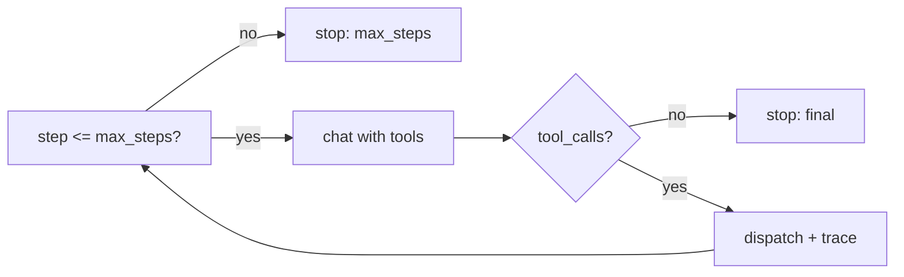

Ask a support bot *"When will order #1042 arrive, and if it is late, refund me?"* and a single prompt cannot answer it. Your code has to look up the order, check the delivery estimate, check the policy, and maybe issue a refund—and the exact number of steps depends on what each step finds. That dynamic decision loop is where an **agent** fits, yet an agent without brakes burns tokens and can trigger risky actions, so this lesson teaches both the loop and the brakes.

## 1. From one tool call to a loop

In `p7-06-tool-use`, you ran a single tool round: send a prompt with `tools`, run one proposed function, and let the model reply. With `FakeLLM()`, a one-step request still picks the right tool from its `description`:

```python
from pyai_llm import FakeLLM

tools = [{
    "name": "lookup_order",
    "description": "order status delivery",
    "parameters": {
        "type": "object",
        "properties": {"order_id": {"type": "string"}},
        "required": ["order_id"],
    },
}]
client = FakeLLM()
resp = client.chat([{"role": "user", "content": 'Check order status "1042"'}], tools=tools)
print(resp.tool_calls[0].name, resp.tool_calls[0].arguments)
# lookup_order {'order_id': '1042'}
```

An **agent** extends that one round into a bounded **observe–think–act** cycle: **model + tools + bounded loop + stop conditions**. Each pass observes the message history, lets the model think and choose either a final answer or a tool call, acts by executing the tool, and feeds the observation back:

```text
   task + messages
          |
          v
    +--> observe (read messages and tool results)
    |       |
    |       v
    |     think (call model with tools)
    |       |
    |       +---> final answer ---> stop
    |       |
    |     tool call
    |       |
    |       v
    +---  act (dispatch tool, append result)
```

Not every task needs an agent. When you already know the steps ahead of time, a fixed **workflow** (pipeline) is cheaper, faster, and much easier to test:

| approach | steps decided by | good for |
|---|---|---|
| fixed workflow | your Python code upfront | predictable pipelines like extract → summarize → format |
| single-step router (`p7-06-tool-use`) | model picks 0 or 1 tool | direct lookups like current weather or one order check |
| agent | model chooses each next step from observations | multi-step tasks where the path depends on mid-way results |

## 2. The minimal agent loop

In code, `run_agent(client, task, tools, registry, max_steps=5)` wraps `client.chat()` in a `for step in range(1, max_steps + 1):` loop. When `resp.tool_calls` is empty, the agent returns the final answer; otherwise it dispatches the first tool call, appends the `assistant` (`tool_calls`) and `tool` messages, and continues:

```python
import json
from pyai_llm import FakeLLM

ORDERS = {"1042": {"status": "shipped", "carrier": "FastPost"}}
CARRIERS = {"FastPost": "2 business days"}


def lookup_order(order_id: str) -> str:
    order = ORDERS.get(order_id)
    if order is None:
        return f"error: unknown {order_id}"
    return f"{order['status']} ({order['carrier']})"


def estimate_delivery(carrier: str) -> str:
    return CARRIERS.get(carrier, f"error: unknown {carrier}")


TOOLS = [
    {
        "name": "lookup_order",
        "description": "order status carrier",
        "parameters": {"type": "object", "properties": {"order_id": {"type": "string"}}, "required": ["order_id"]},
    },
    {
        "name": "estimate_delivery",
        "description": "delivery estimate carrier",
        "parameters": {"type": "object", "properties": {"carrier": {"type": "string"}}, "required": ["carrier"]},
    },
]
REGISTRY = {"lookup_order": lookup_order, "estimate_delivery": estimate_delivery}


def dispatch(name: str, args: dict, registry: dict) -> str:
    fn = registry.get(name)
    if fn is None:
        return f"error: unknown tool {name}"
    clean = {k: v for k, v in args.items() if v not in ("", None)}
    try:
        out = fn(**clean)
    except Exception as err:
        return f"error: {err}"
    return json.dumps(out) if isinstance(out, dict) else str(out)


def run_agent(client, task: str, tools: list[dict], registry: dict, max_steps: int = 5) -> dict:
    messages = [{"role": "user", "content": task}]
    trace = []
    for step in range(1, max_steps + 1):
        resp = client.chat(messages, tools=tools)
        if not resp.tool_calls:
            return {"answer": resp.content or "", "stopped_reason": "final", "steps": step, "trace": trace}
        tc = resp.tool_calls[0]
        args = dict(tc.arguments)
        obs = dispatch(tc.name, args, registry)
        messages.append({
            "role": "assistant",
            "content": None,
            "tool_calls": [{"id": tc.id, "name": tc.name, "arguments": args}],
        })
        messages.append({"role": "tool", "tool_call_id": tc.id, "content": obs})
        trace.append({"step": step, "tool": tc.name, "args": args, "observation": obs})
    return {"answer": "", "stopped_reason": "max_steps", "steps": max_steps, "trace": trace}


script = [
    {"tool_calls": [{"name": "lookup_order", "arguments": {"order_id": "1042"}}]},
    {"tool_calls": [{"name": "estimate_delivery", "arguments": {"carrier": "FastPost"}}]},
    "Order 1042 shipped via FastPost (2 business days).",
]
res = run_agent(FakeLLM(script=script), "When will order 1042 arrive?", TOOLS, REGISTRY)
print("stopped:", res["stopped_reason"], "steps:", res["steps"])
# stopped: final steps: 3
for item in res["trace"]:
    print(f"step {item['step']}: {item['tool']}({item['args']}) -> {item['observation']}")
# step 1: lookup_order({'order_id': '1042'}) -> shipped (FastPost)
# step 2: estimate_delivery({'carrier': 'FastPost'}) -> 2 business days
print("answer:", res["answer"])
# answer: Order 1042 shipped via FastPost (2 business days).
```

> [!NOTE]
> Real tool-calling APIs can return multiple `tool_calls` in a single turn. We take `resp.tool_calls[0]` in this lesson's loop for brevity, while `p7-06` `ex02` shows the pattern for iterating over all of `resp.tool_calls` before the next model turn.

Notice how the loop exits cleanly in two places—either when the model produces a final answer or when `step` reaches `max_steps`:



> [!NOTE]
> By default, `FakeLLM` always stops with `"Based on the tool result: ..."` as soon as a `tool` message appears, so it cannot chain a second tool on its own. Passing `FakeLLM(script=...)` stands in for a real LLM's "thinking" step by pre-scripting step 1 -> step 2 -> final reply; a real LLM chooses each next action dynamically from the tool observations, while the loop, limits, trace, and safety guards in **your code** stay identical.

## 3. Trace: seeing what the agent decided

Each tool execution adds a structured dictionary `{"step": step, "tool": tc.name, "args": args, "observation": obs}` to `trace`. Printing `trace` as compact lines lets you inspect every hop at a glance without digging through raw `messages`:

```python
trace = [
    {"step": 1, "tool": "lookup_order", "args": {"order_id": "1042"}, "observation": "shipped (FastPost)"},
    {"step": 2, "tool": "estimate_delivery", "args": {"carrier": "FastPost"}, "observation": "2 business days"},
]
for entry in trace:
    print(f"step {entry['step']}: {entry['tool']}({entry['args']}) -> {entry['observation']}")
# step 1: lookup_order({'order_id': '1042'}) -> shipped (FastPost)
# step 2: estimate_delivery({'carrier': 'FastPost'}) -> 2 business days
```

Here is the exact trace table produced by the §2 run:

| step | tool | args | observation |
|---|---|---|---|
| 1 | `lookup_order` | `{'order_id': '1042'}` | `shipped (FastPost)` |
| 2 | `estimate_delivery` | `{'carrier': 'FastPost'}` | `2 business days` |

When an agent fails or gives a wrong answer, the **trace** is the first thing you read—and in production systems (which we cover in Phase 8), teams log every trace to a monitoring backend so failures and token costs stay visible.

## 4. Stop conditions: the agent's brakes

A production agent needs four explicit **stop conditions** reported in `stopped_reason`: `final` (no tool calls left), `max_steps` (step cap reached), `repeat` (calling the exact same tool and arguments as the previous step), and `budget` (cumulative `resp.usage.total_tokens` exceeds `token_budget`). Checking `budget` right after `client.chat(...)` enforces the hard spend cap immediately because that call's tokens have already been billed (if your workflow prefers honoring an already-paid final answer before stopping, check `final` first and `budget` second). Checking `budget` -> `final` -> `repeat` on every iteration stops runaway loops before they waste money:

```python
from pyai_llm import FakeLLM

ORDERS = {"1042": "shipped (FastPost)"}
CARRIERS = {"FastPost": "2 business days"}
TOOLS = [
    {"name": "lookup_order", "description": "order status", "parameters": {"type": "object", "properties": {"order_id": {"type": "string"}}, "required": ["order_id"]}},
    {"name": "estimate_delivery", "description": "delivery days", "parameters": {"type": "object", "properties": {"carrier": {"type": "string"}}, "required": ["carrier"]}},
]
REGISTRY = {"lookup_order": lambda order_id: ORDERS.get(order_id, "error: unknown"), "estimate_delivery": lambda carrier: CARRIERS.get(carrier, "error: unknown")}


def run_guarded_agent(client, task: str, max_steps: int = 4, token_budget: int | None = None) -> dict:
    messages = [{"role": "user", "content": task}]
    trace = []
    total_tokens = 0
    for step in range(1, max_steps + 1):
        resp = client.chat(messages, tools=TOOLS)
        total_tokens += resp.usage.total_tokens
        if token_budget is not None and total_tokens > token_budget:
            return {"stopped_reason": "budget", "steps": step, "tokens": total_tokens, "trace": trace}
        if not resp.tool_calls:
            return {"stopped_reason": "final", "steps": step, "tokens": total_tokens, "trace": trace}
        tc = resp.tool_calls[0]
        args = dict(tc.arguments)
        if trace and trace[-1]["tool"] == tc.name and trace[-1]["args"] == args:
            return {"stopped_reason": "repeat", "steps": step, "tokens": total_tokens, "trace": trace}
        obs = str(REGISTRY[tc.name](**args))
        messages.append({"role": "assistant", "content": None, "tool_calls": [{"id": tc.id, "name": tc.name, "arguments": args}]})
        messages.append({"role": "tool", "tool_call_id": tc.id, "content": obs})
        trace.append({"step": step, "tool": tc.name, "args": args, "observation": obs})
    return {"stopped_reason": "max_steps", "steps": max_steps, "tokens": total_tokens, "trace": trace}


scenarios = [
    ("final", [{"tool_calls": [{"name": "lookup_order", "arguments": {"order_id": "1042"}}]}, "Shipped."], 4, None),
    ("max_steps", [
        {"tool_calls": [{"name": "lookup_order", "arguments": {"order_id": "1042"}}]},
        {"tool_calls": [{"name": "estimate_delivery", "arguments": {"carrier": "FastPost"}}]},
        {"tool_calls": [{"name": "lookup_order", "arguments": {"order_id": "1042"}}]},
    ], 2, None),
    ("repeat", [
        {"tool_calls": [{"name": "lookup_order", "arguments": {"order_id": "1042"}}]},
        {"tool_calls": [{"name": "lookup_order", "arguments": {"order_id": "1042"}}]},
    ], 4, None),
    ("budget", [{"tool_calls": [{"name": "lookup_order", "arguments": {"order_id": "1042"}}]}, "Shipped."], 4, 20),
]

for label, sc, cap, bgt in scenarios:
    out = run_guarded_agent(FakeLLM(script=sc), "Check 1042", max_steps=cap, token_budget=bgt)
    print(f"{label:9s} -> reason={out['stopped_reason']}, steps={out['steps']}, tokens={out['tokens']}")
# final     -> reason=final, steps=2, tokens=36
# max_steps -> reason=max_steps, steps=2, tokens=44
# repeat    -> reason=repeat, steps=2, tokens=44
# budget    -> reason=budget, steps=2, tokens=36
```

To see the loop state change without `FakeLLM` cluttering the stack, here is a tiny toy agent driven by a hand-written list of decisions. Press **Visualize** on this block and watch `step`, `trace`, and `stopped_reason` change:

```python
decisions = [
    ("lookup_order", {"order_id": "1042"}),
    ("lookup_order", {"order_id": "1042"}),
    ("final", "Order 1042 is shipped."),
]


def run_toy_agent(plan: list, max_steps: int = 4) -> dict:
    trace = []
    stopped_reason = "max_steps"
    for step in range(1, max_steps + 1):
        kind, payload = plan[step - 1]
        if kind == "final":
            stopped_reason = "final"
            break
        if trace and trace[-1]["tool"] == kind and trace[-1]["args"] == payload:
            stopped_reason = "repeat"
            break
        obs = "shipped" if kind == "lookup_order" else "ok"
        trace.append({"step": step, "tool": kind, "args": payload, "observation": obs})
    return {"step": step, "stopped_reason": stopped_reason, "trace": trace}


res = run_toy_agent(decisions)
print("stopped:", res["stopped_reason"], "at step:", res["step"])
# stopped: repeat at step: 2
print("trace:", res["trace"])
# trace: [{'step': 1, 'tool': 'lookup_order', 'args': {'order_id': '1042'}, 'observation': 'shipped'}]
```

Use this table to pick the right response for each `stopped_reason`:

| stopped_reason | what happened | what to do |
|---|---|---|
| `final` | Model replied without requesting more tools | Return `answer` to the user |
| `max_steps` | Loop reached `max_steps` without finishing | Return partial `trace`, raise `max_steps` only if task genuinely needs more hops |
| `repeat` | Model requested the exact same tool and args twice in a row | Stop immediately and inspect `trace` for missing tool results or confusing errors |
| `budget` | Cumulative `total_tokens` exceeded `token_budget` | Abort before the next call and return a safe budget-limit message |

## 5. Mid-loop errors and self-recovery

Just like `dispatch()` in `p7-06-tool-use`, a failing tool should return `"error: ..."` as a `tool` observation instead of crashing the agent. That lets the model read the error in the next `observe` step and try corrected arguments—while our `repeat` guard and `max_steps` still protect us if the model keeps repeating the same broken call:

```python
from pyai_llm import FakeLLM

ORDERS = {"1042": "shipped (FastPost)"}


def lookup_order(order_id: str) -> str:
    if order_id not in ORDERS:
        return f"error: unknown {order_id}"
    return ORDERS[order_id]


TOOLS = [{"name": "lookup_order", "description": "order status", "parameters": {"type": "object", "properties": {"order_id": {"type": "string"}}, "required": ["order_id"]}}]
REGISTRY = {"lookup_order": lookup_order}

script = [
    {"tool_calls": [{"name": "lookup_order", "arguments": {"order_id": "9999"}}]},
    {"tool_calls": [{"name": "lookup_order", "arguments": {"order_id": "1042"}}]},
    "Found order 1042: shipped (FastPost).",
]

messages = [{"role": "user", "content": "Check my order"}]
trace = []
client = FakeLLM(script=script)
answer = ""
for step in range(1, 5):
    resp = client.chat(messages, tools=TOOLS)
    if not resp.tool_calls:
        answer = resp.content or ""
        break
    tc = resp.tool_calls[0]
    args = dict(tc.arguments)
    obs = REGISTRY[tc.name](**args)
    messages.append({"role": "assistant", "content": None, "tool_calls": [{"id": tc.id, "name": tc.name, "arguments": args}]})
    messages.append({"role": "tool", "tool_call_id": tc.id, "content": obs})
    trace.append({"step": step, "tool": tc.name, "args": args, "observation": obs})

for item in trace:
    print(f"step {item['step']}: {item['tool']}({item['args']}) -> {item['observation']}")
# step 1: lookup_order({'order_id': '9999'}) -> error: unknown 9999
# step 2: lookup_order({'order_id': '1042'}) -> shipped (FastPost)
print("answer:", answer)
# answer: Found order 1042: shipped (FastPost).
```

If step 2 had repeated `lookup_order({'order_id': '9999'})` with the exact same arguments, the `repeat` guard from §4 would halt the loop immediately rather than letting the agent spin until `max_steps`.

## 6. Safety when an agent can act

Multi-step loops magnify the side-effect risk from `p7-06-tool-use`: a single bad observation or prompt injection mid-loop can steer step 3 toward an irreversible action. For tools in `APPROVAL_REQUIRED` (such as `issue_refund`), pause the loop with `stopped_reason == "needs_approval"` and return the proposed action to a human approver instead of running it automatically (**human-in-the-loop**):

```python
from pyai_llm import FakeLLM

ORDERS = {"1042": "delayed ($45.00)"}
APPROVAL_REQUIRED = {"issue_refund"}
TOOLS = [
    {"name": "lookup_order", "description": "order status", "parameters": {"type": "object", "properties": {"order_id": {"type": "string"}}, "required": ["order_id"]}},
    {"name": "issue_refund", "description": "refund order amount", "parameters": {"type": "object", "properties": {"order_id": {"type": "string"}, "amount": {"type": "number"}}, "required": ["order_id", "amount"]}},
]
REGISTRY = {
    "lookup_order": lambda order_id: ORDERS.get(order_id, "error: unknown"),
    "issue_refund": lambda order_id, amount: f"refunded ${amount:.2f} for {order_id}",
}


def run_safe_agent(client, task: str, max_steps: int = 5) -> dict:
    messages = [{"role": "user", "content": task}]
    trace = []
    for step in range(1, max_steps + 1):
        resp = client.chat(messages, tools=TOOLS)
        if not resp.tool_calls:
            return {"stopped_reason": "final", "pending": None, "trace": trace}
        tc = resp.tool_calls[0]
        args = dict(tc.arguments)
        if tc.name in APPROVAL_REQUIRED:
            return {"stopped_reason": "needs_approval", "pending": {"tool": tc.name, "args": args}, "trace": trace}
        obs = str(REGISTRY[tc.name](**args))
        messages.append({"role": "assistant", "content": None, "tool_calls": [{"id": tc.id, "name": tc.name, "arguments": args}]})
        messages.append({"role": "tool", "tool_call_id": tc.id, "content": obs})
        trace.append({"step": step, "tool": tc.name, "args": args, "observation": obs})
    return {"stopped_reason": "max_steps", "pending": None, "trace": trace}


script = [
    {"tool_calls": [{"name": "lookup_order", "arguments": {"order_id": "1042"}}]},
    {"tool_calls": [{"name": "issue_refund", "arguments": {"order_id": "1042", "amount": 45.0}}]},
]
res = run_safe_agent(FakeLLM(script=script), "Refund delayed order 1042")
print("stopped:", res["stopped_reason"], "pending:", res["pending"])
# stopped: needs_approval pending: {'tool': 'issue_refund', 'args': {'order_id': '1042', 'amount': 45.0}}
```

> [!WARNING]
> Always apply **least privilege** (expose only the minimum tools required for the task), enforce both `max_steps` and `token_budget`, and require explicit human approval before running any irreversible side effect.

Remember when **not** to use an agent: if the steps and order are fixed upfront (like clean -> embed -> summarize), write a deterministic workflow instead of an agent loop.

## 7. Common mistakes

**1. Running a loop without `max_steps`**

Without a step limit, a looping model drains your budget in production—or, with `FakeLLM(script=...)`, crashes with `IndexError` as soon as the script runs out of entries.

```python
from pyai_llm import FakeLLM

client = FakeLLM(script=[
    {"tool_calls": [{"name": "lookup_order", "arguments": {"order_id": "1042"}}]},
    {"tool_calls": [{"name": "lookup_order", "arguments": {"order_id": "1042"}}]},
])
messages = [{"role": "user", "content": "Check 1042"}]
try:
    for _ in range(100):  # bounded stand-in for an unguarded loop
        resp = client.chat(messages)
        if not resp.tool_calls:
            break
except IndexError as err:
    print("error:", type(err).__name__, "-", err)
# error: IndexError - script exhausted after 2 replies
```

Fix: always cap the loop with `for step in range(1, max_steps + 1):` (here `max_steps=2` stops cleanly instead of crashing).

**2. Forgetting to append the `tool` result message**

If you call `client.chat(messages)` again without appending the `assistant` (`tool_calls`) and `tool` messages, the model never sees the tool observation and keeps requesting the exact same call.

```python
from pyai_llm import FakeLLM

client = FakeLLM(script=[
    {"tool_calls": [{"name": "lookup_order", "arguments": {"order_id": "1042"}}]},
    {"tool_calls": [{"name": "lookup_order", "arguments": {"order_id": "1042"}}]},
])
messages = [{"role": "user", "content": "Check 1042"}]
last_call = None
for step in range(1, 5):
    resp = client.chat(messages)
    tc = resp.tool_calls[0]
    if last_call == (tc.name, tc.arguments):
        print("stopped by repeat at step", step, tc.name, tc.arguments)
        break
    last_call = (tc.name, tc.arguments)
    # Bug: forgot messages.append(assistant) and messages.append(tool)
# stopped by repeat at step 2 lookup_order {'order_id': '1042'}
```

Fix: append both the `assistant` (`tool_calls`) message and the `tool` (`tool_call_id`, string `content`) message after every tool call, and keep the `repeat` guard active.

**3. Returning after the very first step**

If you forget the loop and return `resp.content` after a single `chat()` call, you get `None` (or an empty string) because the model only proposed a tool call and never got to read the result.

```python
from pyai_llm import FakeLLM

client = FakeLLM(script=[
    {"tool_calls": [{"name": "lookup_order", "arguments": {"order_id": "1042"}}]},
    "Order 1042 is shipped.",
])
first = client.chat([{"role": "user", "content": "Check 1042"}])
print("buggy one-step:", repr(first.content or ""))
# buggy one-step: ''
```

Fix: loop until `not resp.tool_calls` (or a stop condition triggers) before returning `answer`.

**4. Skipping the trace**

Without a trace, an agent that says `"I could not find your order."` gives you zero clues about whether it queried the wrong ID, hit a broken tool, or never called a tool at all.

```python
from pyai_llm import FakeLLM

# Without trace you only see the final reply; with trace you see step 1 failed.
answer = "I could not find your order."
trace = [{"step": 1, "tool": "lookup_order", "args": {"order_id": "9999"}, "observation": "error: unknown 9999"}]
print("no trace  :", answer)
# no trace  : I could not find your order.
print("with trace:", f"step {trace[0]['step']}: {trace[0]['tool']}({trace[0]['args']}) -> {trace[0]['observation']}")
# with trace: step 1: lookup_order({'order_id': '9999'}) -> error: unknown 9999
```

Fix: record `{"step", "tool", "args", "observation"}` on every tool execution so you can debug wrong answers immediately.

## Recap

- An **agent** combines a model, tools, a bounded **observe–think–act** loop, and explicit stop conditions (`final`, `max_steps`, `repeat`, `budget`).
- Prefer a fixed **workflow** over an agent whenever the steps and order are known upfront—workflows are cheaper, faster, and easier to test.
- Always record a **trace** (`step`, `tool`, `args`, `observation`) so you can inspect every decision when an agent misbehaves.
- Return tool errors as `"error: ..."` observations so the model can self-correct, while `repeat` and `max_steps` prevent endless retries.
- Gate side-effect tools with **human-in-the-loop** approval (`stopped_reason == "needs_approval"`), least-privilege tool lists, and strict step/token budgets.
