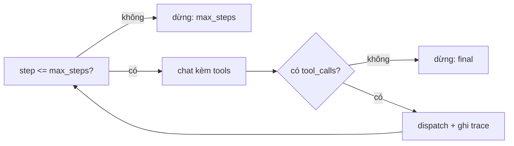

Nếu bạn hỏi bot hỗ trợ *"Đơn #1042 của tôi bao giờ tới, và nếu trễ thì hoàn tiền cho tôi?"*, một prompt đơn lẻ không thể trả lời nổi. Code của bạn phải tra đơn hàng, xem ngày giao dự kiến, kiểm tra chính sách và có thể hoàn tiền—mà số bước cụ thể lại phụ thuộc vào kết quả của từng bước trước. Đó chính là lúc **agent** phát huy tác dụng, nhưng agent không có phanh sẽ đốt tiền và dễ làm việc nguy hiểm, nên bài này dạy bạn cả vòng lặp lẫn phanh an toàn.

## 1. Từ một lần gọi tool tới vòng lặp

Ở bài `p7-06-tool-use`, bạn đã chạy vòng tool một bước: gửi prompt kèm `tools`, chạy một hàm model đề xuất rồi để model trả lời. Với `FakeLLM()`, một câu hỏi đơn vẫn tự chọn đúng tool dựa vào `description`:

```python
from pyai_llm import FakeLLM

tools = [{
    "name": "lookup_order",
    "description": "order status delivery",
    "parameters": {
        "type": "object",
        "properties": {"order_id": {"type": "string"}},
        "required": ["order_id"],
    },
}]
client = FakeLLM()
resp = client.chat([{"role": "user", "content": 'Check order status "1042"'}], tools=tools)
print(resp.tool_calls[0].name, resp.tool_calls[0].arguments)
# lookup_order {'order_id': '1042'}
```

Một **agent** mở rộng vòng một bước đó thành chu trình **observe–think–act** (quan sát – suy nghĩ – hành động) có giới hạn: **model + tools + vòng lặp có giới hạn + điều kiện dừng**. Mỗi lượt lặp đọc lịch sử hội thoại, để model quyết định trả lời cuối hay gọi tool, thực thi tool rồi đưa kết quả quan sát lại cho model:

```text
   task + messages
          |
          v
    +--> observe (read messages and tool results)
    |       |
    |       v
    |     think (call model with tools)
    |       |
    |       +---> final answer ---> stop
    |       |
    |     tool call
    |       |
    |       v
    +---  act (dispatch tool, append result)
```

Nhiều việc không cần tới agent. Khi bạn đã biết trước số bước và thứ tự cố định, một **workflow** (luồng xử lý cố định, hay pipeline) luôn rẻ hơn, nhanh hơn và dễ viết test hơn nhiều:

| hướng tiếp cận | ai quyết định các bước | phù hợp khi nào |
|---|---|---|
| workflow cố định | code Python của bạn định sẵn từ đầu | quy trình dự đoán trước được như trích xuất → tóm tắt → định dạng |
| router một bước (`p7-06-tool-use`) | model chọn 0 hoặc 1 tool | tra cứu trực tiếp như xem thời tiết hoặc tra một đơn hàng |
| agent | model tự quyết định bước kế tiếp từ kết quả giữa chừng | tác vụ nhiều bước mà lộ trình phụ thuộc vào kết quả từng bước |

## 2. Vòng lặp agent tối giản

Trong code, hàm `run_agent(client, task, tools, registry, max_steps=5)` bọc `client.chat()` trong vòng lặp `for step in range(1, max_steps + 1):`. Khi `resp.tool_calls` rỗng, agent trả về câu trả lời cuối; ngược lại nó điều phối tool call đầu tiên, nối cặp message `assistant` (`tool_calls`) và `tool`, ghi lại **trace** (nhật ký từng bước) rồi lặp tiếp:

```python
import json
from pyai_llm import FakeLLM

ORDERS = {"1042": {"status": "shipped", "carrier": "FastPost"}}
CARRIERS = {"FastPost": "2 business days"}


def lookup_order(order_id: str) -> str:
    order = ORDERS.get(order_id)
    if order is None:
        return f"error: unknown {order_id}"
    return f"{order['status']} ({order['carrier']})"


def estimate_delivery(carrier: str) -> str:
    return CARRIERS.get(carrier, f"error: unknown {carrier}")


TOOLS = [
    {
        "name": "lookup_order",
        "description": "order status carrier",
        "parameters": {"type": "object", "properties": {"order_id": {"type": "string"}}, "required": ["order_id"]},
    },
    {
        "name": "estimate_delivery",
        "description": "delivery estimate carrier",
        "parameters": {"type": "object", "properties": {"carrier": {"type": "string"}}, "required": ["carrier"]},
    },
]
REGISTRY = {"lookup_order": lookup_order, "estimate_delivery": estimate_delivery}


def dispatch(name: str, args: dict, registry: dict) -> str:
    fn = registry.get(name)
    if fn is None:
        return f"error: unknown tool {name}"
    clean = {k: v for k, v in args.items() if v not in ("", None)}
    try:
        out = fn(**clean)
    except Exception as err:
        return f"error: {err}"
    return json.dumps(out) if isinstance(out, dict) else str(out)


def run_agent(client, task: str, tools: list[dict], registry: dict, max_steps: int = 5) -> dict:
    messages = [{"role": "user", "content": task}]
    trace = []
    for step in range(1, max_steps + 1):
        resp = client.chat(messages, tools=tools)
        if not resp.tool_calls:
            return {"answer": resp.content or "", "stopped_reason": "final", "steps": step, "trace": trace}
        tc = resp.tool_calls[0]
        args = dict(tc.arguments)
        obs = dispatch(tc.name, args, registry)
        messages.append({
            "role": "assistant",
            "content": None,
            "tool_calls": [{"id": tc.id, "name": tc.name, "arguments": args}],
        })
        messages.append({"role": "tool", "tool_call_id": tc.id, "content": obs})
        trace.append({"step": step, "tool": tc.name, "args": args, "observation": obs})
    return {"answer": "", "stopped_reason": "max_steps", "steps": max_steps, "trace": trace}


script = [
    {"tool_calls": [{"name": "lookup_order", "arguments": {"order_id": "1042"}}]},
    {"tool_calls": [{"name": "estimate_delivery", "arguments": {"carrier": "FastPost"}}]},
    "Order 1042 shipped via FastPost (2 business days).",
]
res = run_agent(FakeLLM(script=script), "When will order 1042 arrive?", TOOLS, REGISTRY)
print("stopped:", res["stopped_reason"], "steps:", res["steps"])
# stopped: final steps: 3
for item in res["trace"]:
    print(f"step {item['step']}: {item['tool']}({item['args']}) -> {item['observation']}")
# step 1: lookup_order({'order_id': '1042'}) -> shipped (FastPost)
# step 2: estimate_delivery({'carrier': 'FastPost'}) -> 2 business days
print("answer:", res["answer"])
# answer: Order 1042 shipped via FastPost (2 business days).
```

> [!NOTE]
> Các API gọi tool ngoài thực tế có thể trả về nhiều `tool_calls` trong cùng một lượt. Bài này chỉ lấy `resp.tool_calls[0]` cho gọn, còn bài tập `ex02` của `p7-06` minh họa cách duyệt hết toàn bộ `resp.tool_calls` trước khi sang lượt gọi model tiếp theo.

Để ý vòng lặp có đúng hai lối thoát rõ ràng—hoặc model đưa ra câu trả lời cuối, hoặc chạm giới hạn `max_steps`:



> [!NOTE]
> Ở chế độ mặc định, `FakeLLM` luôn dừng ngay với `"Based on the tool result: ..."` khi thấy message `tool`, nên nó không tự nối tiếp tool thứ hai. Vì vậy `FakeLLM(script=...)` đóng vai phần "suy nghĩ" thay cho LLM thật qua từng bước đã kịch bản hóa (bước 1 -> bước 2 -> trả lời cuối). Với LLM thật, model tự quyết định bước tiếp theo dựa trên kết quả tool, còn vòng lặp, giới hạn, trace và lớp bảo vệ trong **code của bạn** thì giống hệt.

## 3. Trace: thấy được agent đã nghĩ gì

Mỗi lần gọi tool đều ghi một dictionary `{"step": step, "tool": tc.name, "args": args, "observation": obs}` vào danh sách `trace`. In `trace` thành từng dòng gọn giúp bạn kiểm tra ngay agent đã đi qua những bước nào mà không phải lục lại toàn bộ `messages`:

```python
trace = [
    {"step": 1, "tool": "lookup_order", "args": {"order_id": "1042"}, "observation": "shipped (FastPost)"},
    {"step": 2, "tool": "estimate_delivery", "args": {"carrier": "FastPost"}, "observation": "2 business days"},
]
for entry in trace:
    print(f"step {entry['step']}: {entry['tool']}({entry['args']}) -> {entry['observation']}")
# step 1: lookup_order({'order_id': '1042'}) -> shipped (FastPost)
# step 2: estimate_delivery({'carrier': 'FastPost'}) -> 2 business days
```

Đây là bảng trace tương ứng với ví dụ ở §2:

| step | tool | args | observation |
|---|---|---|---|
| 1 | `lookup_order` | `{'order_id': '1042'}` | `shipped (FastPost)` |
| 2 | `estimate_delivery` | `{'carrier': 'FastPost'}` | `2 business days` |

Khi agent làm sai, trace là thứ đầu tiên bạn đọc—và ngoài đời, người ta log toàn bộ trace vào hệ thống monitoring (phần bạn sẽ gặp ở Phase 8) để theo dõi lỗi và chi phí.

## 4. Điều kiện dừng: phanh của agent

Một agent an toàn cần bốn **stop condition** (điều kiện dừng) ghi vào `stopped_reason`: `final` (đã có câu trả lời), `max_steps` (chạm trần số bước), `repeat` (gọi lại **đúng** tool và tham số như bước ngay trước vì đang bị kẹt), và `budget` (tổng `resp.usage.total_tokens` vượt `token_budget`). Kiểm tra `budget` ngay sau `client.chat(...)` khóa chặt trần chi phí vì lượng token của lượt gọi đó đã phát sinh rồi (nếu hệ thống muốn tận dụng câu trả lời cuối đã trả tiền xong trước khi dừng, có thể kiểm tra `final` trước rồi mới tới `budget`). Kiểm tra theo thứ tự `budget` -> `final` -> `repeat` ở mỗi lượt lặp giúp ngắt ngay trước khi tốn thêm chi phí:

```python
from pyai_llm import FakeLLM

ORDERS = {"1042": "shipped (FastPost)"}
CARRIERS = {"FastPost": "2 business days"}
TOOLS = [
    {"name": "lookup_order", "description": "order status", "parameters": {"type": "object", "properties": {"order_id": {"type": "string"}}, "required": ["order_id"]}},
    {"name": "estimate_delivery", "description": "delivery days", "parameters": {"type": "object", "properties": {"carrier": {"type": "string"}}, "required": ["carrier"]}},
]
REGISTRY = {"lookup_order": lambda order_id: ORDERS.get(order_id, "error: unknown"), "estimate_delivery": lambda carrier: CARRIERS.get(carrier, "error: unknown")}


def run_guarded_agent(client, task: str, max_steps: int = 4, token_budget: int | None = None) -> dict:
    messages = [{"role": "user", "content": task}]
    trace = []
    total_tokens = 0
    for step in range(1, max_steps + 1):
        resp = client.chat(messages, tools=TOOLS)
        total_tokens += resp.usage.total_tokens
        if token_budget is not None and total_tokens > token_budget:
            return {"stopped_reason": "budget", "steps": step, "tokens": total_tokens, "trace": trace}
        if not resp.tool_calls:
            return {"stopped_reason": "final", "steps": step, "tokens": total_tokens, "trace": trace}
        tc = resp.tool_calls[0]
        args = dict(tc.arguments)
        if trace and trace[-1]["tool"] == tc.name and trace[-1]["args"] == args:
            return {"stopped_reason": "repeat", "steps": step, "tokens": total_tokens, "trace": trace}
        obs = str(REGISTRY[tc.name](**args))
        messages.append({"role": "assistant", "content": None, "tool_calls": [{"id": tc.id, "name": tc.name, "arguments": args}]})
        messages.append({"role": "tool", "tool_call_id": tc.id, "content": obs})
        trace.append({"step": step, "tool": tc.name, "args": args, "observation": obs})
    return {"stopped_reason": "max_steps", "steps": max_steps, "tokens": total_tokens, "trace": trace}


scenarios = [
    ("final", [{"tool_calls": [{"name": "lookup_order", "arguments": {"order_id": "1042"}}]}, "Shipped."], 4, None),
    ("max_steps", [
        {"tool_calls": [{"name": "lookup_order", "arguments": {"order_id": "1042"}}]},
        {"tool_calls": [{"name": "estimate_delivery", "arguments": {"carrier": "FastPost"}}]},
        {"tool_calls": [{"name": "lookup_order", "arguments": {"order_id": "1042"}}]},
    ], 2, None),
    ("repeat", [
        {"tool_calls": [{"name": "lookup_order", "arguments": {"order_id": "1042"}}]},
        {"tool_calls": [{"name": "lookup_order", "arguments": {"order_id": "1042"}}]},
    ], 4, None),
    ("budget", [{"tool_calls": [{"name": "lookup_order", "arguments": {"order_id": "1042"}}]}, "Shipped."], 4, 20),
]

for label, sc, cap, bgt in scenarios:
    out = run_guarded_agent(FakeLLM(script=sc), "Check 1042", max_steps=cap, token_budget=bgt)
    print(f"{label:9s} -> reason={out['stopped_reason']}, steps={out['steps']}, tokens={out['tokens']}")
# final     -> reason=final, steps=2, tokens=36
# max_steps -> reason=max_steps, steps=2, tokens=44
# repeat    -> reason=repeat, steps=2, tokens=44
# budget    -> reason=budget, steps=2, tokens=36
```

Để quan sát biến thay đổi gọn gàng mà không gọi `FakeLLM`, ta dùng một agent đồ chơi lấy quyết định từ list viết tay. Bấm **Visualize** ở khối code này để xem `step`, `trace` và `stopped_reason` thay đổi qua từng bước:

```python
decisions = [
    ("lookup_order", {"order_id": "1042"}),
    ("lookup_order", {"order_id": "1042"}),
    ("final", "Order 1042 is shipped."),
]


def run_toy_agent(plan: list, max_steps: int = 4) -> dict:
    trace = []
    stopped_reason = "max_steps"
    for step in range(1, max_steps + 1):
        kind, payload = plan[step - 1]
        if kind == "final":
            stopped_reason = "final"
            break
        if trace and trace[-1]["tool"] == kind and trace[-1]["args"] == payload:
            stopped_reason = "repeat"
            break
        obs = "shipped" if kind == "lookup_order" else "ok"
        trace.append({"step": step, "tool": kind, "args": payload, "observation": obs})
    return {"step": step, "stopped_reason": stopped_reason, "trace": trace}


res = run_toy_agent(decisions)
print("stopped:", res["stopped_reason"], "at step:", res["step"])
# stopped: repeat at step: 2
print("trace:", res["trace"])
# trace: [{'step': 1, 'tool': 'lookup_order', 'args': {'order_id': '1042'}, 'observation': 'shipped'}]
```

Bảng dưới đây tóm tắt cách xử lý ứng với từng `stopped_reason`:

| stopped_reason | điều gì đã xảy ra | bạn nên làm gì |
|---|---|---|
| `final` | Model trả lời cuối mà không gọi thêm tool | Trả `answer` về cho người dùng |
| `max_steps` | Vòng lặp chạm trần `max_steps` mà chưa xong | Trả về `trace` hiện có; chỉ tăng `max_steps` nếu tác vụ thật sự cần nhiều bước hơn |
| `repeat` | Model gọi lại đúng tool và tham số như bước trước | Dừng ngay và đọc `trace` xem có quên nối kết quả tool hay lỗi lặp lại không |
| `budget` | Tổng `total_tokens` vượt quá `token_budget` | Ngắt trước khi gọi tiếp và trả thông báo vượt ngân sách |

## 5. Lỗi giữa chừng và tự sửa

Giống `dispatch()` trong `p7-06-tool-use`, khi tool gặp lỗi hãy trả chuỗi `"error: ..."` vào message `tool` thay vì làm chương trình sập. Model đọc thông báo lỗi đó ở bước `observe` tiếp theo và có thể thử tham số khác để tự sửa:

```python
from pyai_llm import FakeLLM

ORDERS = {"1042": "shipped (FastPost)"}


def lookup_order(order_id: str) -> str:
    if order_id not in ORDERS:
        return f"error: unknown {order_id}"
    return ORDERS[order_id]


TOOLS = [{"name": "lookup_order", "description": "order status", "parameters": {"type": "object", "properties": {"order_id": {"type": "string"}}, "required": ["order_id"]}}]
REGISTRY = {"lookup_order": lookup_order}

script = [
    {"tool_calls": [{"name": "lookup_order", "arguments": {"order_id": "9999"}}]},
    {"tool_calls": [{"name": "lookup_order", "arguments": {"order_id": "1042"}}]},
    "Found order 1042: shipped (FastPost).",
]

messages = [{"role": "user", "content": "Check my order"}]
trace = []
client = FakeLLM(script=script)
answer = ""
for step in range(1, 5):
    resp = client.chat(messages, tools=TOOLS)
    if not resp.tool_calls:
        answer = resp.content or ""
        break
    tc = resp.tool_calls[0]
    args = dict(tc.arguments)
    obs = REGISTRY[tc.name](**args)
    messages.append({"role": "assistant", "content": None, "tool_calls": [{"id": tc.id, "name": tc.name, "arguments": args}]})
    messages.append({"role": "tool", "tool_call_id": tc.id, "content": obs})
    trace.append({"step": step, "tool": tc.name, "args": args, "observation": obs})

for item in trace:
    print(f"step {item['step']}: {item['tool']}({item['args']}) -> {item['observation']}")
# step 1: lookup_order({'order_id': '9999'}) -> error: unknown 9999
# step 2: lookup_order({'order_id': '1042'}) -> shipped (FastPost)
print("answer:", answer)
# answer: Found order 1042: shipped (FastPost).
```

Giới hạn là rất rõ: nếu model cứ lặp lại đúng lời gọi lỗi đó ở bước sau, phanh `repeat` (hoặc `max_steps`) sẽ dừng vòng lặp lại ngay.

## 6. An toàn khi agent có quyền hành động

Vòng lặp nhiều bước làm rủi ro tác dụng phụ từ `p7-06-tool-use` tăng lên gấp bội: một bước đọc nhầm hay dính prompt injection ở bước 1 có thể kéo agent tới hành động nguy hiểm ở bước 3. Với các tool nhạy cảm như `issue_refund` (nằm trong `APPROVAL_REQUIRED`), agent chỉ **đề xuất** hành động rồi dừng với `stopped_reason == "needs_approval"` để chờ người duyệt (**human-in-the-loop**), tuyệt đối không tự chạy:

```python
from pyai_llm import FakeLLM

ORDERS = {"1042": "delayed ($45.00)"}
APPROVAL_REQUIRED = {"issue_refund"}
TOOLS = [
    {"name": "lookup_order", "description": "order status", "parameters": {"type": "object", "properties": {"order_id": {"type": "string"}}, "required": ["order_id"]}},
    {"name": "issue_refund", "description": "refund order amount", "parameters": {"type": "object", "properties": {"order_id": {"type": "string"}, "amount": {"type": "number"}}, "required": ["order_id", "amount"]}},
]
REGISTRY = {
    "lookup_order": lambda order_id: ORDERS.get(order_id, "error: unknown"),
    "issue_refund": lambda order_id, amount: f"refunded ${amount:.2f} for {order_id}",
}


def run_safe_agent(client, task: str, max_steps: int = 5) -> dict:
    messages = [{"role": "user", "content": task}]
    trace = []
    for step in range(1, max_steps + 1):
        resp = client.chat(messages, tools=TOOLS)
        if not resp.tool_calls:
            return {"stopped_reason": "final", "pending": None, "trace": trace}
        tc = resp.tool_calls[0]
        args = dict(tc.arguments)
        if tc.name in APPROVAL_REQUIRED:
            return {"stopped_reason": "needs_approval", "pending": {"tool": tc.name, "args": args}, "trace": trace}
        obs = str(REGISTRY[tc.name](**args))
        messages.append({"role": "assistant", "content": None, "tool_calls": [{"id": tc.id, "name": tc.name, "arguments": args}]})
        messages.append({"role": "tool", "tool_call_id": tc.id, "content": obs})
        trace.append({"step": step, "tool": tc.name, "args": args, "observation": obs})
    return {"stopped_reason": "max_steps", "pending": None, "trace": trace}


script = [
    {"tool_calls": [{"name": "lookup_order", "arguments": {"order_id": "1042"}}]},
    {"tool_calls": [{"name": "issue_refund", "arguments": {"order_id": "1042", "amount": 45.0}}]},
]
res = run_safe_agent(FakeLLM(script=script), "Refund delayed order 1042")
print("stopped:", res["stopped_reason"], "pending:", res["pending"])
# stopped: needs_approval pending: {'tool': 'issue_refund', 'args': {'order_id': '1042', 'amount': 45.0}}
```

> [!WARNING]
> Luôn giữ nguyên tắc **quyền tối thiểu** (chỉ đưa đúng những tool thật sự cần thiết), đặt giới hạn số bước lẫn ngân sách token, và bắt buộc có con người duyệt mọi hành động không thể đảo ngược.

Và đừng dùng agent khi bài toán đã có số bước cùng thứ tự cố định—lúc đó một workflow tất định luôn rẻ, nhanh và an toàn hơn.

## 7. Lỗi thường gặp

**1. Quên đặt `max_steps` cho vòng lặp**

Không có giới hạn bước, vòng lặp chạy mãi làm tốn tiền API vô hạn ngoài đời, còn khi thử với `FakeLLM(script=...)` sẽ văng lỗi `IndexError` ngay lúc hết phần tử kịch bản.

```python
from pyai_llm import FakeLLM

client = FakeLLM(script=[
    {"tool_calls": [{"name": "lookup_order", "arguments": {"order_id": "1042"}}]},
    {"tool_calls": [{"name": "lookup_order", "arguments": {"order_id": "1042"}}]},
])
messages = [{"role": "user", "content": "Check 1042"}]
try:
    for _ in range(100):  # vòng lặp có trần lớn để minh họa lỗi thiếu max_steps
        resp = client.chat(messages)
        if not resp.tool_calls:
            break
except IndexError as err:
    print("error:", type(err).__name__, "-", err)
# error: IndexError - script exhausted after 2 replies
```

Cách sửa: luôn giới hạn bằng `for step in range(1, max_steps + 1):` (với `max_steps=2` vòng lặp dừng êm thay vì văng lỗi).

**2. Quên nối kết quả `tool` vào `messages`**

Nếu gọi lại `client.chat(messages)` mà quên nối message `assistant` và message `tool`, model không thấy kết quả quan sát trước đó nên lặp lại y hệt tool call cũ.

```python
from pyai_llm import FakeLLM

client = FakeLLM(script=[
    {"tool_calls": [{"name": "lookup_order", "arguments": {"order_id": "1042"}}]},
    {"tool_calls": [{"name": "lookup_order", "arguments": {"order_id": "1042"}}]},
])
messages = [{"role": "user", "content": "Check 1042"}]
last_call = None
for step in range(1, 5):
    resp = client.chat(messages)
    tc = resp.tool_calls[0]
    if last_call == (tc.name, tc.arguments):
        print("stopped by repeat at step", step, tc.name, tc.arguments)
        break
    last_call = (tc.name, tc.arguments)
    # Lỗi: quên messages.append(assistant) và messages.append(tool)
# stopped by repeat at step 2 lookup_order {'order_id': '1042'}
```

Cách sửa: nối đủ cả message `assistant` (`tool_calls`) lẫn message `tool` sau mỗi lần chạy tool, đồng thời bật kiểm tra `repeat`.

**3. Trả về ngay sau bước đầu tiên (quên lặp)**

Nếu bạn trả `resp.content` ngay sau lần gọi `chat()` đầu tiên, kết quả thu được chỉ là `None` (hoặc chuỗi rỗng) vì model mới chỉ đề nghị gọi tool chứ chưa hề nhận kết quả để trả lời.

```python
from pyai_llm import FakeLLM

client = FakeLLM(script=[
    {"tool_calls": [{"name": "lookup_order", "arguments": {"order_id": "1042"}}]},
    "Order 1042 is shipped.",
])
first = client.chat([{"role": "user", "content": "Check 1042"}])
print("buggy one-step:", repr(first.content or ""))
# buggy one-step: ''
```

Cách sửa: tiếp tục lặp cho đến khi `not resp.tool_calls` (hoặc chạm điều kiện dừng) rồi mới trả `answer`.

**4. Không ghi `trace`**

Không có `trace`, khi agent trả lời `"I could not find your order."`, bạn không thể biết nó vừa tra nhầm mã đơn, tool bị lỗi hay nó chưa từng gọi tool nào.

```python
from pyai_llm import FakeLLM

# Không có trace chỉ thấy câu trả lời cuối; có trace thấy ngay bước 1 bị lỗi.
answer = "I could not find your order."
trace = [{"step": 1, "tool": "lookup_order", "args": {"order_id": "9999"}, "observation": "error: unknown 9999"}]
print("no trace  :", answer)
# no trace  : I could not find your order.
print("with trace:", f"step {trace[0]['step']}: {trace[0]['tool']}({trace[0]['args']}) -> {trace[0]['observation']}")
# with trace: step 1: lookup_order({'order_id': '9999'}) -> error: unknown 9999
```

Cách sửa: luôn ghi `{"step", "tool", "args", "observation"}` ở mỗi bước gọi tool để lần ra nguyên nhân sai ngay lập tức.

## Tóm tắt

- Một **agent** gồm model, bộ tool, vòng lặp **observe–think–act** có giới hạn và các điều kiện dừng rõ ràng (`final`, `max_steps`, `repeat`, `budget`).
- Hãy ưu tiên **workflow** cố định bất cứ khi nào số bước và thứ tự đã biết trước—rẻ hơn, nhanh hơn và dễ kiểm thử hơn agent.
- Luôn ghi **trace** (`step`, `tool`, `args`, `observation`) để thấy mọi quyết định khi agent trả lời sai.
- Trả lỗi tool thành chuỗi `"error: ..."` để model tự sửa ở bước sau, trong khi `repeat` và `max_steps` chặn vòng lặp kẹt.
- Bảo vệ tool có tác dụng phụ bằng **human-in-the-loop** (`stopped_reason == "needs_approval"`), quyền tối thiểu và giới hạn bước/ngân sách token.
