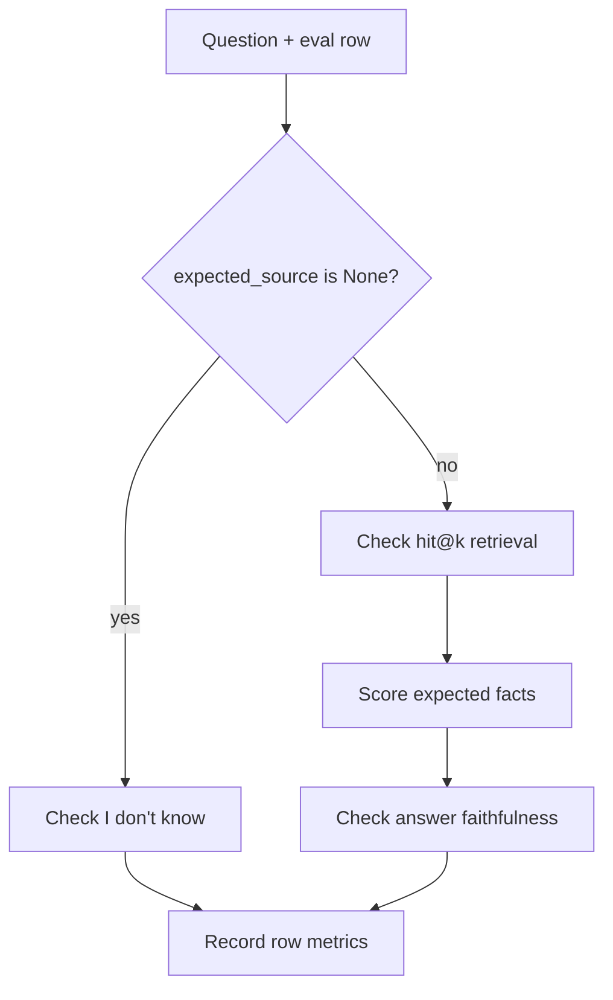

You tweak the chunk size in your RAG bot, ask it three questions by hand, and the replies seem better. Yet "seem better" cannot tell you how many questions improved, which ones silently broke, or whether tomorrow's prompt edit will undo the gain. **Evals** answer with numbers—the same idea as the test set in `p5-04-evaluation`, adapted for LLM systems.

## 1. What evals are and why you need them

An **eval** (**evaluation**) pairs a fixed collection of test questions with expected outcomes and deterministic scoring functions, so you can re-run the exact same check after every change to your prompt, chunk size, `k`, or model.

In `p5-04-evaluation`, you learned never to tune a model on its test set. The same trap hits RAG apps: if you tweak `k` and prompts until your tiny eval set scores 100%, that eval set stops measuring real quality and becomes a tuning set—so keep a separate held-out split or add fresh user questions periodically.

```python
def check_eval_case(answer: str, expected_fact: str) -> bool:
    return expected_fact.lower() in answer.lower()


print("q1 pass:", check_eval_case("Refunds take 30 days.", "30 days"))
# q1 pass: True
print("q2 pass:", check_eval_case("Shipping is free.", "5 business days"))
# q2 pass: False
```

Notice how each check returns a repeatable boolean rather than relying on a quick glance. Different checks answer different questions in an engineering workflow:

| check | question it answers | example |
|---|---|---|
| Unit test (`p3-01-pytest`) | Does this Python helper obey its contract? | `chunk_words("a b c", 2, 0) == ["a b", "c"]` |
| Eval | Does the full LLM system retrieve and answer well? | `hit_rate >= 0.8` across 30 shop questions |
| Eyeballing replies | What do a few outputs look and feel like? | Reading 3 chat replies after changing a prompt |

## 2. Building a small eval set

An **eval set** is a list of test cases storing each question alongside its **expected source** (which document should be retrieved) and **golden answer** facts (short pieces of truth that a correct reply must contain). Three rules keep a small eval set honest: write questions the way real users ask rather than copying sentences from your docs, pick short verifiable facts, and include both tricky paraphrases and at least one unanswerable question (`expected_source=None`, `expected_facts=[]`).

```text
question --> [ retrieve ] --> top-k sources --> [ generate ] --> answer
                  |                                  |
             hit@k (retrieval)              facts / faithful (answer)
```

Scoring retrieval (`hit@k`) and generation (`facts` / `faithful`) separately tells you which layer broke when a question fails. Let's define our 7-chunk shop knowledge base and 6-question eval set:

```python
docs = [
    {"source": "refunds.md", "text": "Refunds are issued within 30 days of purchase. Keep your original receipt and unused item."},
    {"source": "shipping.md", "text": "Standard shipping arrives within 5 business days. Express delivery arrives the next day."},
    {"source": "warranty.md", "text": "Hardware warranty covers factory defects for 12 months. Water damage is not covered."},
    {"source": "hours.md", "text": "Customer support hours are Monday to Friday, 9 AM to 6 PM. Weekend emails get Monday replies."},
    {"source": "pickup.md", "text": "Store pickup is ready 2 hours after order confirmation. Bring photo ID to the front counter."},
    {"source": "payment.md", "text": "We accept Visa, Mastercard, and cash on delivery for orders. Gift cards never convert to cash."},
    {"source": "loyalty.md", "text": "Loyalty points earn 5 points per dollar on every order. Unused points expire after 12 months."},
]

eval_set = [
    {"id": "q1", "question": "How many days after purchase are refunds issued?", "expected_source": "refunds.md", "expected_facts": ["30 days"]},
    {"id": "q2", "question": "How long does standard shipping take?", "expected_source": "shipping.md", "expected_facts": ["5 business days"]},
    {"id": "q3", "question": "How long is hardware warranty for factory defects?", "expected_source": "warranty.md", "expected_facts": ["12 months"]},
    {"id": "q4", "question": "What are customer support hours on weekdays?", "expected_source": "hours.md", "expected_facts": ["Monday to Friday", "9 AM to 6 PM"]},
    {"id": "q5", "question": "Can I get fast money back on my laptop order?", "expected_source": "refunds.md", "expected_facts": ["30 days"]},
    {"id": "q6", "question": "Can I pay with crypto for online orders?", "expected_source": None, "expected_facts": []},
]

print("docs:", len(docs), "questions:", len(eval_set))
# docs: 7 questions: 6
```

Notice `q5` asks for `"money back"` instead of `"refund"`—a natural user paraphrase—while `q6` asks about crypto payments, which do not exist anywhere in `docs`.

## 3. Scoring retrieval: hit rate

**Hit rate** (`hit@k`) measures whether the expected source appears inside the top `k` retrieved chunks: `hits / answerable_count`. Questions with `expected_source is None` have no target document to retrieve, so we skip them from the denominator instead of counting them as retrieval failures.

Press **Visualize** on this block and watch `hits` and `total` grow while `expected is None` is skipped.

```python
def hit_rate(results: list[dict], k: int) -> float:
    hits = 0
    total = 0
    for row in results:
        expected = row["expected_source"]
        if expected is None:
            continue
        total += 1
        if expected in row["retrieved"][:k]:
            hits += 1
    return hits / total if total else 0.0


sample = [
    {"expected_source": "refunds.md", "retrieved": ["refunds.md", "shipping.md"]},
    {"expected_source": "shipping.md", "retrieved": ["loyalty.md", "shipping.md"]},
    {"expected_source": "refunds.md", "retrieved": ["hours.md", "payment.md"]},
    {"expected_source": None, "retrieved": ["pickup.md", "payment.md"]},
]
print("hit@2:", round(hit_rate(sample, k=2), 3))
# hit@2: 0.667
```

Notice that `4` rows entered `sample`, yet `total` only reached `3` (`2 / 3 = 0.667`) because the `None` row was skipped. Now let's run the embedding retriever from `p7-05-rag` with `FakeLLM(embed_dim=256)` and `k=2` across our full shop eval set:

```python
import numpy as np
from pyai_llm import FakeLLM

docs = [
    {"source": "refunds.md", "text": "Refunds are issued within 30 days of purchase. Keep your original receipt and unused item."},
    {"source": "shipping.md", "text": "Standard shipping arrives within 5 business days. Express delivery arrives the next day."},
    {"source": "warranty.md", "text": "Hardware warranty covers factory defects for 12 months. Water damage is not covered."},
    {"source": "hours.md", "text": "Customer support hours are Monday to Friday, 9 AM to 6 PM. Weekend emails get Monday replies."},
    {"source": "pickup.md", "text": "Store pickup is ready 2 hours after order confirmation. Bring photo ID to the front counter."},
    {"source": "payment.md", "text": "We accept Visa, Mastercard, and cash on delivery for orders. Gift cards never convert to cash."},
    {"source": "loyalty.md", "text": "Loyalty points earn 5 points per dollar on every order. Unused points expire after 12 months."},
]

eval_set = [
    {"id": "q1", "question": "How many days after purchase are refunds issued?", "expected_source": "refunds.md", "expected_facts": ["30 days"]},
    {"id": "q2", "question": "How long does standard shipping take?", "expected_source": "shipping.md", "expected_facts": ["5 business days"]},
    {"id": "q3", "question": "How long is hardware warranty for factory defects?", "expected_source": "warranty.md", "expected_facts": ["12 months"]},
    {"id": "q4", "question": "What are customer support hours on weekdays?", "expected_source": "hours.md", "expected_facts": ["Monday to Friday", "9 AM to 6 PM"]},
    {"id": "q5", "question": "Can I get fast money back on my laptop order?", "expected_source": "refunds.md", "expected_facts": ["30 days"]},
    {"id": "q6", "question": "Can I pay with crypto for online orders?", "expected_source": None, "expected_facts": []},
]


def hit_rate(results: list[dict], k: int) -> float:
    hits = 0
    total = 0
    for row in results:
        expected = row["expected_source"]
        if expected is None:
            continue
        total += 1
        if expected in row["retrieved"][:k]:
            hits += 1
    return hits / total if total else 0.0


client = FakeLLM(embed_dim=256)
doc_matrix = np.array(client.embed([d["text"] for d in docs]), dtype=float)

ret_results = []
for row in eval_set:
    q_vec = np.array(client.embed([row["question"]])[0], dtype=float)
    scores = doc_matrix @ q_vec
    order = np.argsort(-scores, kind="stable")[:2]
    top_sources = [docs[int(i)]["source"] for i in order]
    ret_results.append({"expected_source": row["expected_source"], "retrieved": top_sources})
    exp = row["expected_source"]
    hit = "skip" if exp is None else str(exp in top_sources)
    print(f"{row['id']} | {top_sources} | {exp} | {hit}")
# q1 | ['refunds.md', 'shipping.md'] | refunds.md | True
# q2 | ['loyalty.md', 'shipping.md'] | shipping.md | True
# q3 | ['warranty.md', 'refunds.md'] | warranty.md | True
# q4 | ['hours.md', 'refunds.md'] | hours.md | True
# q5 | ['hours.md', 'payment.md'] | refunds.md | False
# q6 | ['pickup.md', 'payment.md'] | None | skip

print("hit@2:", round(hit_rate(ret_results, k=2), 3))
# hit@2: 0.8
```

Tracing all six rows makes the retrieval strengths and gaps immediately obvious:

| id | top-2 sources | expected | hit |
|---|---|---|---|
| `q1` | `['refunds.md', 'shipping.md']` | `refunds.md` | `True` |
| `q2` | `['loyalty.md', 'shipping.md']` | `shipping.md` | `True` |
| `q3` | `['warranty.md', 'refunds.md']` | `warranty.md` | `True` |
| `q4` | `['hours.md', 'refunds.md']` | `hours.md` | `True` |
| `q5` | `['hours.md', 'payment.md']` | `refunds.md` | `False` |
| `q6` | `['pickup.md', 'payment.md']` | `None` | `skip` |

Retrieval got `4/5 = 0.8`: even `q2` succeeded because `shipping.md` landed at rank 2, while `q5` pushed `refunds.md` down to rank 3 behind `hours.md` and `payment.md`.

## 4. Scoring answers: facts and faithfulness

Once retrieval brings chunks into the prompt, we score two properties of the reply:
1. **`facts` (`fact_score`)**: the fraction of `expected_facts` found via lowercase substring check (`fact.lower() in answer.lower()`). When `expected_facts` is empty (an unanswerable question), `facts` is `1.0` if `"i don't know"` appears in `answer.lower()`, else `0.0`. Substring matching is fast and deterministic, though coarse: it misses paraphrased answers like `"thirty days"` and can false-pass if `"30 days"` appears in an unrelated sentence.
2. **`faithful` (**faithfulness** / **groundedness**)**: whether the reply stays grounded in the retrieved context rather than inventing claims. Our deterministic heuristic strips `[n]` citations, lowercases the text, extracts `[a-z0-9]+` words of length `>= 4`, and checks that every such word in `answer` appears in `context` (while treating `"i don't know"` replies as `faithful=True`).



Let's run `score_answer` on both a real RAG-mode reply from `FakeLLM` and a plausible-sounding hallucination simulated with `FakeLLM(script=[...])`:

```python
import re
from pyai_llm import FakeLLM


def content_words(text: str) -> list[str]:
    cleaned = re.sub(r"\[\d+\]", "", text.lower())
    return [w for w in re.findall(r"[a-z0-9]+", cleaned) if len(w) >= 4]


def score_answer(answer: str, expected_facts: list[str], context: str) -> dict:
    ans_low = answer.lower()
    if not expected_facts:
        facts = 1.0 if "i don't know" in ans_low else 0.0
    else:
        matched = sum(1 for f in expected_facts if f.lower() in ans_low)
        facts = matched / len(expected_facts)
    if "i don't know" in ans_low:
        return {"facts": facts, "faithful": True, "unsupported": []}
    ctx_words = set(content_words(context))
    unsupported: list[str] = []
    for word in content_words(answer):
        if word not in ctx_words and word not in unsupported:
            unsupported.append(word)
    return {"facts": facts, "faithful": len(unsupported) == 0, "unsupported": unsupported}


ctx = (
    "[1] Refunds are issued within 30 days of purchase. Keep your original receipt and unused item.\n"
    "[2] Standard shipping arrives within 5 business days. Express delivery arrives the next day."
)
question = "How many days after purchase are refunds issued?"

rag_client = FakeLLM(embed_dim=256)
real_ans = rag_client.chat([
    {"role": "system", "content": "Answer using only context.\n\nContext:\n" + ctx},
    {"role": "user", "content": question},
]).content or ""

# Script simulates a model that answers the fact yet invents extra claims.
scripted = FakeLLM(script=["Refunds are issued within 30 days with free courier pickup. [1]"])
fake_ans = scripted.chat([
    {"role": "system", "content": "Context:\n" + ctx},
    {"role": "user", "content": question},
]).content or ""

print("real:", score_answer(real_ans, ["30 days"], ctx))
# real: {'facts': 1.0, 'faithful': True, 'unsupported': []}
print("hallucinated:", score_answer(fake_ans, ["30 days"], ctx))
# hallucinated: {'facts': 1.0, 'faithful': False, 'unsupported': ['with', 'free', 'courier', 'pickup']}
```

Notice how the fabricated reply scored `facts: 1.0` because it contained `"30 days"`, yet `faithful` caught it (`False`) and flagged `['with', 'free', 'courier', 'pickup']` as unsupported by `ctx`.

> [!NOTE]
> Word-overlap faithfulness is only a simple deterministic approximation, and `FakeLLM(script=[...])` here plays the role of a model making up ungrounded claims. In real systems, teams often add **LLM-as-judge** (a separate LLM grading answers against a rubric) or human review—remembering that the judge itself must be evaluated because LLM judges can be biased toward longer or more confident-sounding replies.

## 5. Comparing two RAG configurations

The main payoff of evals is comparing two configurations side by side on the **exact same eval set**. Let's compare `k=1` (send only the top chunk) against `k=3` (send the top 3 chunks), reporting both **raw counts** and percentages, then inspect which individual questions changed:

```python
import re
import numpy as np
from pyai_llm import FakeLLM

docs = [
    {"source": "refunds.md", "text": "Refunds are issued within 30 days of purchase. Keep your original receipt and unused item."},
    {"source": "shipping.md", "text": "Standard shipping arrives within 5 business days. Express delivery arrives the next day."},
    {"source": "warranty.md", "text": "Hardware warranty covers factory defects for 12 months. Water damage is not covered."},
    {"source": "hours.md", "text": "Customer support hours are Monday to Friday, 9 AM to 6 PM. Weekend emails get Monday replies."},
    {"source": "pickup.md", "text": "Store pickup is ready 2 hours after order confirmation. Bring photo ID to the front counter."},
    {"source": "payment.md", "text": "We accept Visa, Mastercard, and cash on delivery for orders. Gift cards never convert to cash."},
    {"source": "loyalty.md", "text": "Loyalty points earn 5 points per dollar on every order. Unused points expire after 12 months."},
]

eval_set = [
    {"id": "q1", "question": "How many days after purchase are refunds issued?", "expected_source": "refunds.md", "expected_facts": ["30 days"]},
    {"id": "q2", "question": "How long does standard shipping take?", "expected_source": "shipping.md", "expected_facts": ["5 business days"]},
    {"id": "q3", "question": "How long is hardware warranty for factory defects?", "expected_source": "warranty.md", "expected_facts": ["12 months"]},
    {"id": "q4", "question": "What are customer support hours on weekdays?", "expected_source": "hours.md", "expected_facts": ["Monday to Friday", "9 AM to 6 PM"]},
    {"id": "q5", "question": "Can I get fast money back on my laptop order?", "expected_source": "refunds.md", "expected_facts": ["30 days"]},
    {"id": "q6", "question": "Can I pay with crypto for online orders?", "expected_source": None, "expected_facts": []},
]


def content_words(text: str) -> list[str]:
    cleaned = re.sub(r"\[\d+\]", "", text.lower())
    return [w for w in re.findall(r"[a-z0-9]+", cleaned) if len(w) >= 4]


def score_answer(answer: str, expected_facts: list[str], context: str) -> dict:
    ans_low = answer.lower()
    if not expected_facts:
        facts = 1.0 if "i don't know" in ans_low else 0.0
    else:
        matched = sum(1 for f in expected_facts if f.lower() in ans_low)
        facts = matched / len(expected_facts)
    if "i don't know" in ans_low:
        return {"facts": facts, "faithful": True, "unsupported": []}
    ctx_words = set(content_words(context))
    unsupported: list[str] = []
    for word in content_words(answer):
        if word not in ctx_words and word not in unsupported:
            unsupported.append(word)
    return {"facts": facts, "faithful": len(unsupported) == 0, "unsupported": unsupported}


client = FakeLLM(embed_dim=256)
doc_matrix = np.array(client.embed([d["text"] for d in docs]), dtype=float)


def run_eval(k: int) -> tuple[dict, list[dict]]:
    per_q = []
    for row in eval_set:
        q_vec = np.array(client.embed([row["question"]])[0], dtype=float)
        scores = doc_matrix @ q_vec
        order = np.argsort(-scores, kind="stable")[:k]
        hits = [docs[int(i)] for i in order]
        ctx = "\n".join(f"[{n}] {h['text']}" for n, h in enumerate(hits, 1))
        ans = client.chat([
            {"role": "system", "content": "Answer using only context.\n\nContext:\n" + ctx},
            {"role": "user", "content": row["question"]},
        ]).content or ""
        sc = score_answer(ans, row["expected_facts"], ctx)
        exp = row["expected_source"]
        hit = None if exp is None else (exp in [h["source"] for h in hits])
        per_q.append({"id": row["id"], "hit": hit, **sc})
    ans_rows = [r for r in per_q if r["hit"] is not None]
    idk_rows = [r for r in per_q if r["hit"] is None]
    summary = {
        "k": k,
        "hits": sum(1 for r in ans_rows if r["hit"]),
        "n_ans": len(ans_rows),
        "facts_ok": sum(1 for r in ans_rows if r["facts"] == 1.0),
        "faithful": sum(1 for r in per_q if r["faithful"]),
        "n_all": len(per_q),
        "idk_ok": sum(1 for r in idk_rows if r["facts"] == 1.0),
        "n_idk": len(idk_rows),
    }
    return summary, per_q


print(f"{'config':<8} {'hit@k':<11} {'facts':<11} {'faithful':<11} {'idk':<9}")
for k in (1, 3):
    s, _ = run_eval(k)
    h_str = f"{s['hits']}/{s['n_ans']} ({round(s['hits']/s['n_ans']*100)}%)"
    f_str = f"{s['facts_ok']}/{s['n_ans']} ({round(s['facts_ok']/s['n_ans']*100)}%)"
    g_str = f"{s['faithful']}/{s['n_all']} ({round(s['faithful']/s['n_all']*100)}%)"
    i_str = f"{s['idk_ok']}/{s['n_idk']} ({round(s['idk_ok']/s['n_idk']*100)}%)"
    print(f"k={k:<6} {h_str:<11} {f_str:<11} {g_str:<11} {i_str:<9}")
# config   hit@k       facts       faithful    idk
# k=1      3/5 (60%)   3/5 (60%)   6/6 (100%)  1/1 (100%)
# k=3      5/5 (100%)  4/5 (80%)   6/6 (100%)  0/1 (0%)

_, r1 = run_eval(1)
_, r3 = run_eval(3)
for a, b in zip(r1, r3, strict=True):
    if (a["hit"], a["facts"]) != (b["hit"], b["facts"]):
        print(f"diff {a['id']}: k=1(hit={a['hit']}, facts={a['facts']}) -> k=3(hit={b['hit']}, facts={b['facts']})")
# diff q2: k=1(hit=False, facts=0.0) -> k=3(hit=True, facts=1.0)
# diff q5: k=1(hit=False, facts=0.0) -> k=3(hit=True, facts=0.0)
# diff q6: k=1(hit=None, facts=1.0) -> k=3(hit=None, facts=0.0)
```

Look closely at the per-question diff—this is why you never read summary percentages alone:
- **`q2` improved**: at `k=1`, `loyalty.md` outranked `shipping.md`, so the bot said `"I don't know"`; at `k=3`, `shipping.md` entered the prompt and the bot answered `"Standard shipping arrives within 5 business days. [2]"`.
- **`q5` improved in retrieval only**: at `k=3`, `refunds.md` reached rank 3 (`hit=True`), yet `facts` stayed `0.0` because `FakeLLM`'s embedding step maps `"money back"` to `"refund"`, whereas `chat()` only counts exact raw words of length `>= 3` and fell back to `"I don't know"`.
- **`q6` got worse**: at `k=1`, only `pickup.md` entered the prompt and had zero word overlap (`idk=1/1`); at `k=3`, `payment.md` slipped into rank 2 and happened to share `"for"` and `"orders"` with `"Can I pay with crypto for online orders?"`, tricking the model into answering about Visa and Mastercard (`idk=0/1`).

> [!WARNING]
> On a 5–6 question eval set, a single question equals 17–20% of the score, so a one-question swing is very noisy. Real production eval sets need tens to hundreds of representative questions before you can trust small percentage gains.

## 6. Evals as regression tests

Just as `pytest` from `p3-01-pytest` guards Python functions against accidental breakage, eval thresholds turn your eval set into an automated **regression** check before every prompt or retriever change (`assert hit_rate >= 0.8`).

```python
def check_eval(summary: dict, min_hit: float = 0.8, min_facts: float = 0.8) -> list[str]:
    failures: list[str] = []
    hit_val = summary["hits"] / summary["n_ans"]
    fact_val = summary["facts_ok"] / summary["n_ans"]
    if hit_val < min_hit:
        failures.append(f"hit_rate {round(hit_val, 3)} < {min_hit}")
    if fact_val < min_facts:
        failures.append(f"fact_pass {round(fact_val, 3)} < {min_facts}")
    return failures


s_k1 = {"hits": 3, "n_ans": 5, "facts_ok": 3}
s_k3 = {"hits": 5, "n_ans": 5, "facts_ok": 4}
print("k=1 failures:", check_eval(s_k1))
# k=1 failures: ['hit_rate 0.6 < 0.8', 'fact_pass 0.6 < 0.8']
print("k=3 failures:", check_eval(s_k3))
# k=3 failures: []
```

Save each run's summary and per-question scores (timestamp, config, hit rate, fact score, faithfulness) so you can track quality over time alongside latency and cost monitoring in phase 8.

## 7. Common mistakes

**1. Scoring only the final answer without scoring retrieval**

If you only check `facts`, you cannot tell whether retrieval missed the document or the generator ignored it. On `q5` at `k=3`, retrieval actually succeeded (`hit=True`) while the answer still failed:

```python
import numpy as np
from pyai_llm import FakeLLM

docs = [
    {"source": "refunds.md", "text": "Refunds are issued within 30 days of purchase. Keep your original receipt and unused item."},
    {"source": "hours.md", "text": "Customer support hours are Monday to Friday, 9 AM to 6 PM. Weekend emails get Monday replies."},
    {"source": "payment.md", "text": "We accept Visa, Mastercard, and cash on delivery for orders. Gift cards never convert to cash."},
]
q5 = "Can I get fast money back on my laptop order?"

client = FakeLLM(embed_dim=256)
doc_matrix = np.array(client.embed([d["text"] for d in docs]), dtype=float)
q_vec = np.array(client.embed([q5])[0], dtype=float)
order = np.argsort(-(doc_matrix @ q_vec), kind="stable")[:3]
hits = [docs[int(i)] for i in order]
ctx = "\n".join(f"[{n}] {h['text']}" for n, h in enumerate(hits, 1))
ans = client.chat([{"role": "system", "content": "Context:\n" + ctx}, {"role": "user", "content": q5}]).content

print("hit:", "refunds.md" in [h["source"] for h in hits], "| ans:", ans)
# hit: True | ans: I don't know based on the provided context.
```

Fix: always log `hit@k` alongside answer scores so you know whether to tune retrieval (`k`, chunking, embeddings) or the prompt/generator.

**2. Counting unanswerable questions in the `hit_rate` denominator**

Including `expected_source=None` rows as misses artificially drags down retrieval `hit_rate`:

```python
rows = [
    {"expected_source": "refunds.md", "retrieved": ["refunds.md", "shipping.md"]},
    {"expected_source": "shipping.md", "retrieved": ["loyalty.md", "shipping.md"]},
    {"expected_source": "warranty.md", "retrieved": ["warranty.md", "refunds.md"]},
    {"expected_source": "hours.md", "retrieved": ["hours.md", "refunds.md"]},
    {"expected_source": "refunds.md", "retrieved": ["hours.md", "payment.md"]},
    {"expected_source": None, "retrieved": ["pickup.md", "payment.md"]},
]

wrong = sum(1 for r in rows if r["expected_source"] in r["retrieved"]) / len(rows)
right_rows = [r for r in rows if r["expected_source"] is not None]
right = sum(1 for r in right_rows if r["expected_source"] in r["retrieved"]) / len(right_rows)
print("wrong:", round(wrong, 3), "| right:", round(right, 3))
# wrong: 0.667 | right: 0.8
```

Fix: skip `expected_source is None` in `hit_rate` and evaluate unanswerable questions separately via `idk` refusal checks.

**3. Case-sensitive or full-sentence fact matching**

Checking exact casing or demanding an entire verbatim sentence rejects completely accurate answers:

```python
answer = "Refunds are issued within 30 days of purchase. [1]"
print("case-sensitive:", "30 Days" in answer)
# case-sensitive: False
print("lowercase fact:", "30 days".lower() in answer.lower())
# lowercase fact: True
```

Fix: store short atomic facts and lowercase both `fact` and `answer` before checking containment.

**4. Tuning knobs until a tiny eval set hits 100%**

Just as tuning hyperparameters directly on the test set in `p5-04-evaluation` produces **overfitting**, endlessly tweaking prompts and `k` on 6 questions memorizes those 6 quirks while failing on unseen user phrasing. Keep a held-out eval split or refresh your eval set regularly with real logs.

## Recap

- An **eval** turns "looks better" into repeatable numbers using a fixed **eval set**, **golden answer** facts, and deterministic scorers.
- Score **retrieval** (`hit@k`, skipping `expected_source=None`) separately from **answers** (`fact_score` and `faithful`) so you fix the layer that actually broke.
- Our heuristic **faithfulness** check verifies every content word (`len >= 4`, ignoring `[n]` citations) appears in the retrieved context; production pipelines pair this with **LLM-as-judge** or human audits.
- Always compare configurations on the **same** eval set using raw counts alongside percentages, and inspect per-question diffs—small sets of 5–6 questions are noisy.
- Wrap eval thresholds in a **regression** check like `check_eval()` and log results over time before shipping changes.
